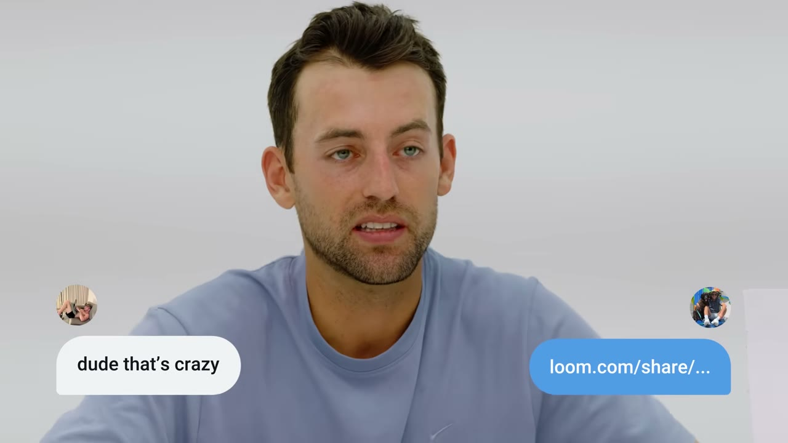
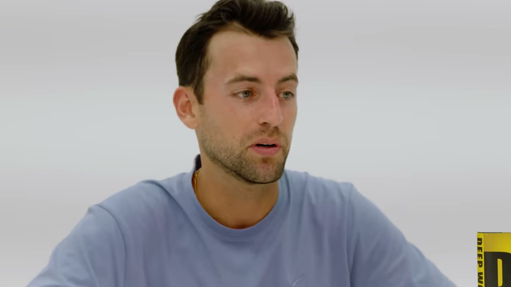
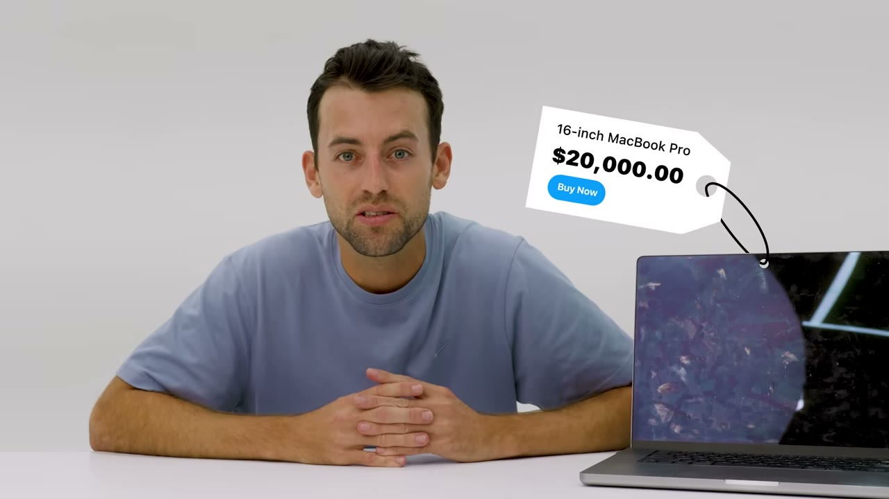
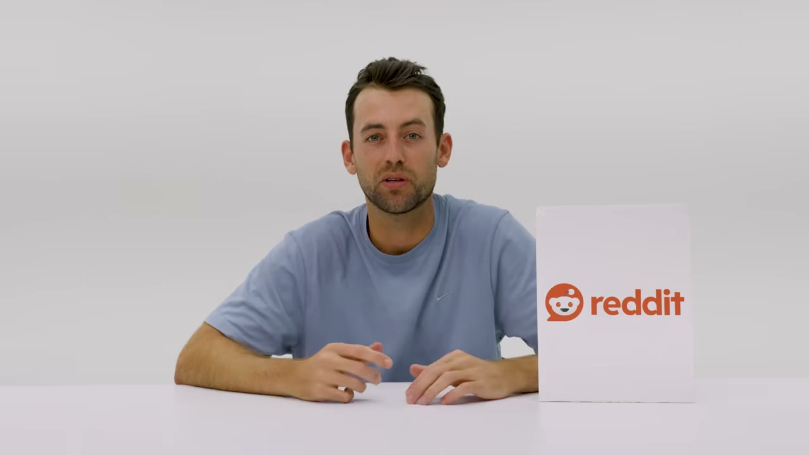
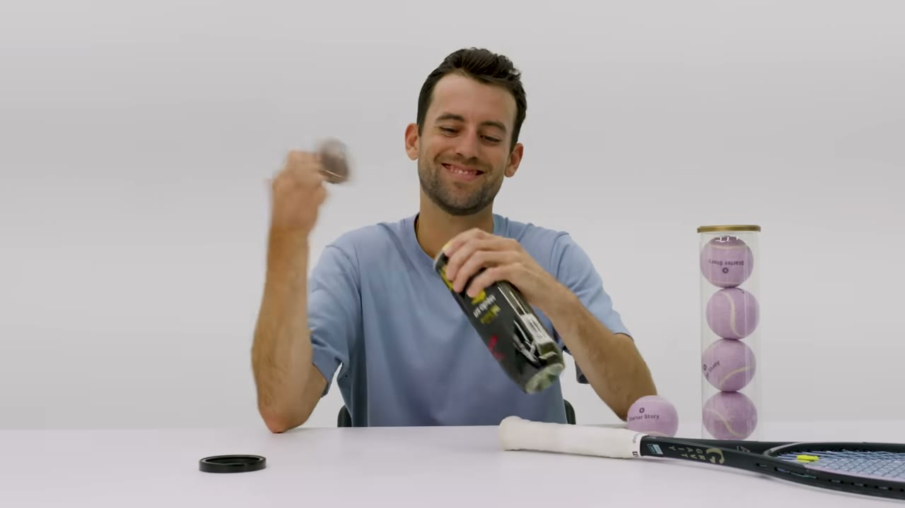
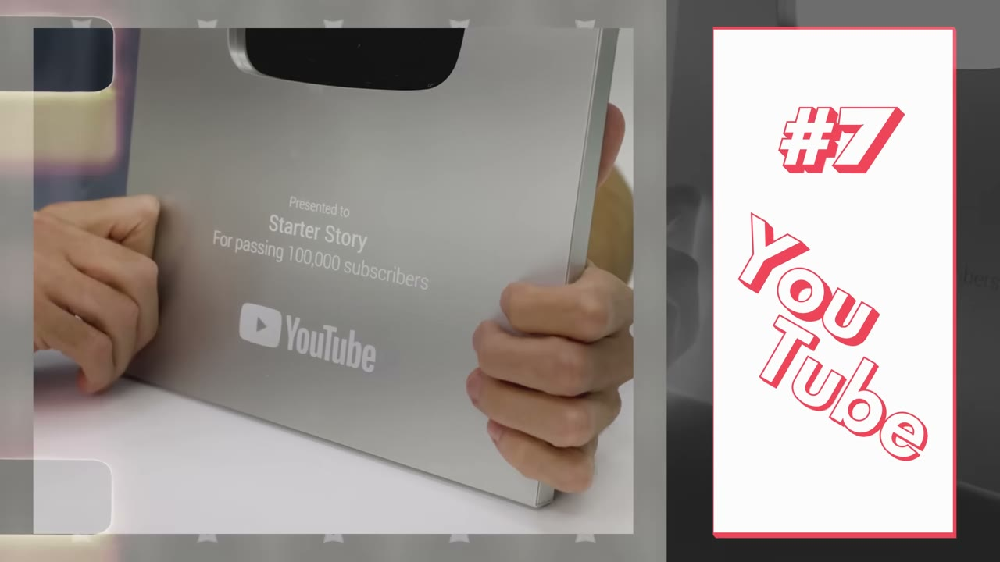
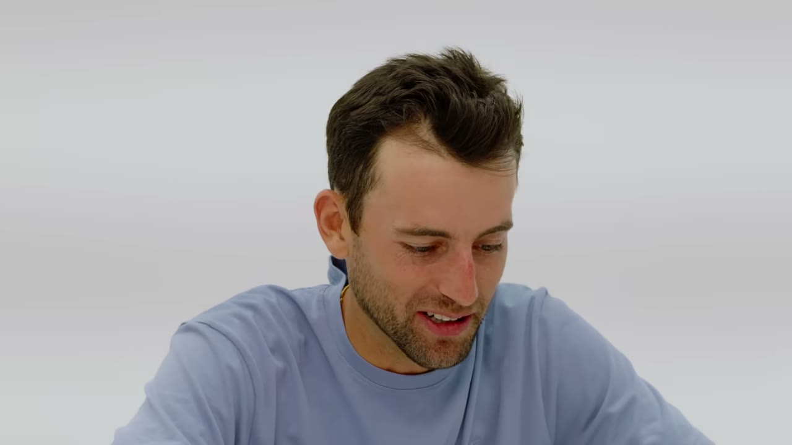
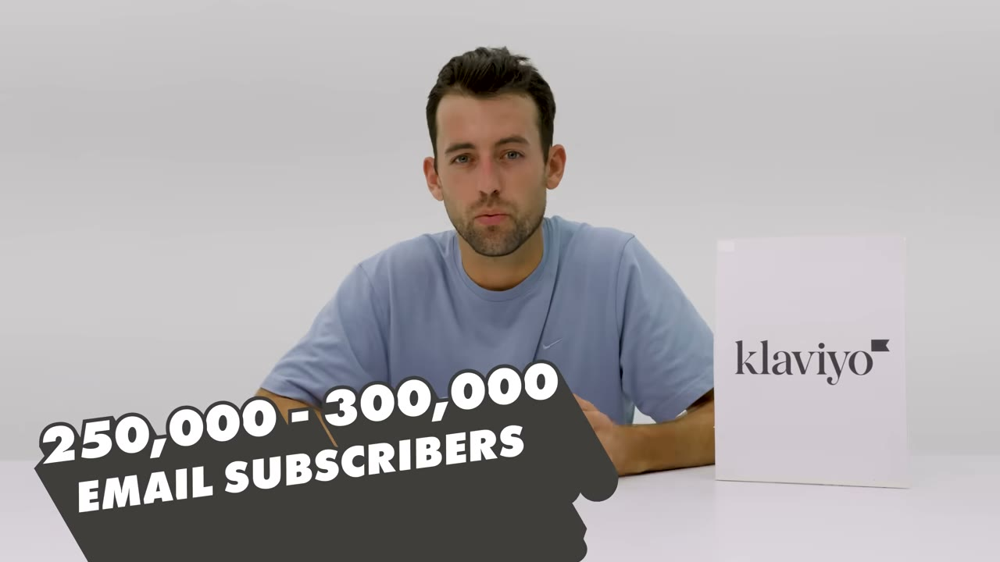

# 9 Things That Make Me $1.8M/Year

✅ **Đã phân tích sâu** → [`case.md`](case.md)

| | |
|---|---|
| **Video** | <https://www.youtube.com/watch?v=GFnBp8lMIf4> |
| **Đăng** | 21/10/2024 |
| **Thời lượng** | 12:57 |
| **Lượt xem** | 43,654 |
| **Lượt thích** | 1,385 |
| **Video ID** | `GFnBp8lMIf4` |

## Trong thư mục này

| File | Nội dung |
|---|---|
| [`case.md`](case.md) | **Phân tích đầy đủ** — ý tưởng, validate, GTM, áp dụng ở VN |
| [`meta.json`](meta.json) | Metadata gốc (chapters, heatmap, mô tả) |
| [`screenshots/`](screenshots/) | 8 ảnh 720p |

## Mô tả gốc

These are the 10 essential tools I used (and still use) to make over $1M/year with Starter Story.

## Số liệu bắt được từ transcript

> Các đoạn founder nhắc tới con số, kèm timestamp để tua thẳng tới đó trong video.

_(không bắt được con số nào)_

## Chương

- `00:00` Intro
- `00:30` Loom
- `01:26` Tea
- `02:59` Book
- `06:13` Reddit
- `07:29` Tennis
- `08:51` YouTube
- `09:57` My Addiction
- `11:06` Best Kept Secret

## Ảnh

1. `01_01m07s_usd-220-000.jpg` — 
2. `02_03m11s_ch-book.jpg` — 
3. `03_05m40s_usd-20-000.jpg` — 
4. `04_06m25s_ch-reddit.jpg` — 
5. `05_07m41s_ch-tennis.jpg` — 
6. `06_09m03s_ch-youtube.jpg` — 
7. `07_10m09s_ch-my-addiction.jpg` — 
8. `08_11m27s_usd-4-000.jpg` — 

---

← [Quay lại index](../../index.md) · [Toàn bộ video](../README.md)
