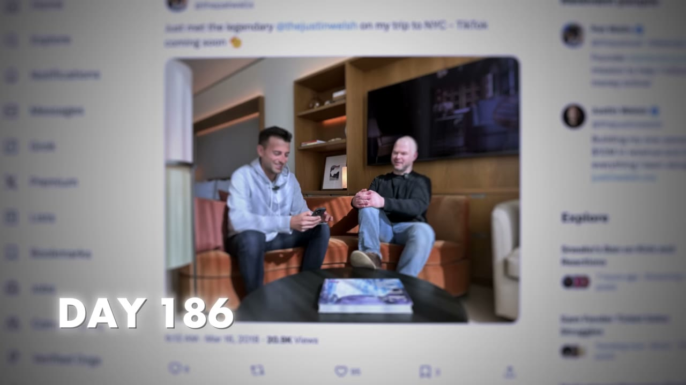
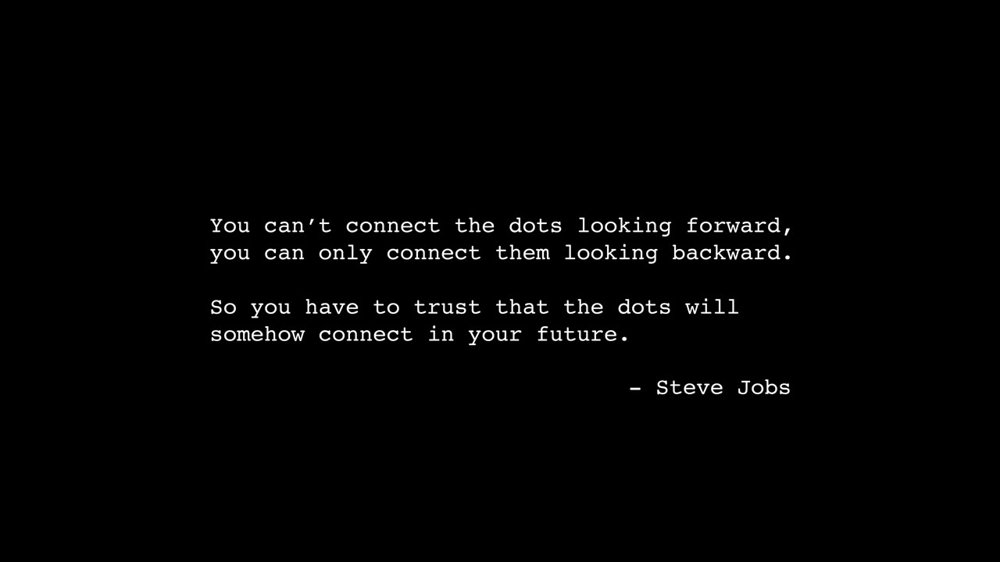
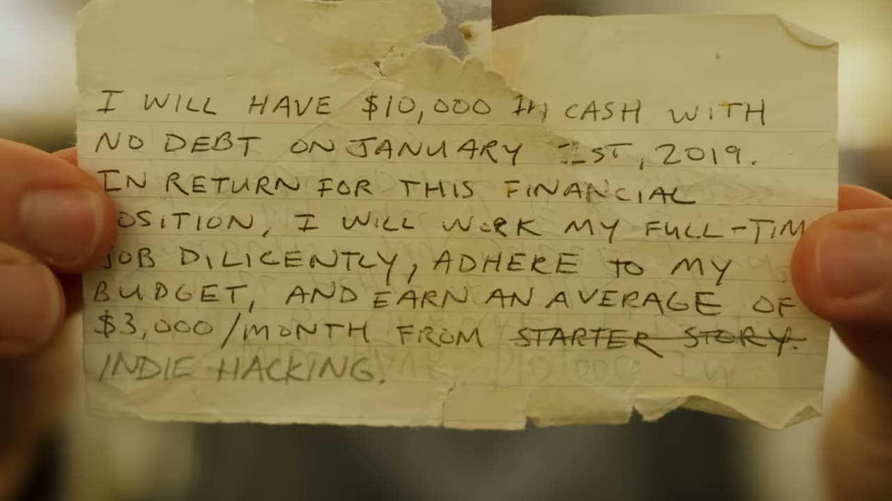

# Pat Walls — câu chuyện gốc của Starter Story, và vì sao case này quan trọng khác mọi case còn lại

> **Tóm tắt 30 giây.** Đây **không phải** một case study về founder khách mời. Đây là câu chuyện của **chính người dẫn chương trình** — người đã phỏng vấn 179 founder khác trong kho này. Gần 30 tuổi, sau một cuối tuần say xỉn, ngồi ở sân bay, anh tự hỏi *"nếu mình cứ liều thì sao?"* và cho mình **365 ngày**. Tháng thứ 2 viral trên Reddit. Tháng thứ 4 có đô la đầu tiên. Tháng thứ 8 ký một hợp đồng tài trợ **112.000 USD**. Hết 365 ngày: **3.500 USD/tháng** — và anh nghỉ việc. Video này đồng thời là **công cụ bán hàng tinh vi nhất trên kênh**, và chính vì thế nó là case bạn cần đọc để hiểu 179 case kia.

## ⚠️ Đây là loại tài liệu gì

Ba điều cần rõ trước khi đọc tiếp:

1. **Đây là video bán hàng.** Nó dẫn tới một "workshop miễn phí" ở giữa video, với câu *"số chỗ có hạn"*. Toàn bộ cấu trúc kể chuyện — nỗi đau, bước ngoặt, cái giá, chiến thắng — phục vụ cho lời mời đó.
2. **Nó vẫn chứa dữ liệu thật và có giá trị.** Các mốc thời gian anh đưa ra rất cụ thể và rất đáng học, đặc biệt vì chúng **khiêm tốn hơn nhiều** so với các con số trong tiêu đề của những video khác trên kênh.
3. **Nó là chìa khoá để đọc cả kho.** Starter Story kiếm tiền bằng cách **bán khoá học và cộng đồng cho người muốn khởi nghiệp**. Điều đó giải thích vì sao 179 case còn lại đều kết thúc bằng một lời chào bán, và vì sao chúng có xu hướng làm nổi bật tốc độ mà làm mờ thời gian chuẩn bị.

Nói cách khác: **đây là mô hình bán cuốc xẻng cho người đi đào vàng** — và tôi cho rằng biết điều đó khiến kho case này **hữu ích hơn**, không phải kém đi.

## 1. Dòng thời gian thật — 12 mốc trong 365 ngày

| Mốc | Sự kiện |
|---|---|
| Ngày 0 | Ở sân bay, viết một tấm thẻ ghi chú làm bản tuyên ngôn |
| Tuần đầu | Ý tưởng kinh doanh **đầu tiên sống được 3 tuần rồi chết** |
| ~Tháng 1 | Đổi môi trường: dậy 6h sáng, ra Starbucks đầu phố mỗi ngày |
| **Tháng 2** | **Viral trên Reddit** → có khán giả và mô hình kinh doanh được xác nhận |
| **Tháng 4** | **Đô la đầu tiên** + nhà tài trợ đầu tiên cho newsletter |
| Tháng 5 | Kết bạn với các founder trên internet, xây follower trên Twitter |
| **Tháng 8** | **Hợp đồng tài trợ 112.000 USD** |
| **Tháng 12** | **3.500 USD/tháng** → nộp đơn nghỉ việc |

## 2. Mâu thuẫn quan trọng nhất trong video ⭐⭐⭐⭐⭐

Đặt hai con số cạnh nhau:

- **Tháng 8: một hợp đồng tài trợ 112.000 USD**
- **Tháng 12: 3.500 USD/tháng**

Nếu 112.000 USD là doanh thu định kỳ, thì tháng 12 phải là con số hoàn toàn khác. **Nó không phải.** 112.000 USD là **một khoản một lần** — một hợp đồng tài trợ lớn, không phải dòng tiền lặp lại.

**Vì sao điều này đáng ghi:**

1. **Đây là bằng chứng rõ nhất trong kho về sự khác biệt giữa "một cú lớn" và "doanh thu bền vững".** Anh đã có 112K trong tay và bốn tháng sau vẫn chỉ ở mức 3.500 USD/tháng.
2. **Anh nghỉ việc ở mức 3.500 USD/tháng** — thấp hơn rất nhiều so với ấn tượng mà kênh này thường tạo ra. Đây là con số trung thực và đáng trân trọng.
3. **Doanh thu tài trợ vốn dĩ gồ ghề.** Nó phụ thuộc vào việc có nhà tài trợ hay không trong tháng đó — cùng loại rủi ro với [Uneed dao động 8–10K tuỳ tháng](../2025-08-23_how-i-finally-built-a-10k-month-saas-30-failures/case.md).

Video **không hề đối chiếu hai con số này**. Nó trình bày 112K như đỉnh cao cảm xúc rồi chuyển sang 3.500 như kết thúc có hậu. Người xem lướt qua sẽ nhớ con số lớn.

## 3. Reddit ở tháng thứ 2 — mốc thật sự quyết định ⭐⭐⭐⭐⭐

Anh nói rất rõ chuyện gì xảy ra ở tháng thứ hai: anh **tìm ra kênh phân phối của mình**, anh **viral trên Reddit**, và **đột nhiên anh có một khán giả và một mô hình kinh doanh đã được xác nhận**.

Đây mới là bước ngoặt thật của toàn bộ câu chuyện — không phải tấm thẻ ghi chú, không phải Starbucks.

**Và nó nhất quán một cách đáng chú ý với cả kho case.** Reddit xuất hiện như kênh đột phá trong rất nhiều case:

| Case | Vai trò của Reddit |
|---|---|
| [Savewise](../2025-08-09_how-i-used-reddit-to-build-a-25k-month-business/case.md) | nằm vùng 3,5 tháng, xin phép moderator, rồi bài đăng đưa anh từ vài nghìn lên hàng chục nghìn user |
| [AppAlchemy](../2025-07-09_how-i-used-reddit-to-hit-17k-mrr-with-zero-audience/case.md) | 17K MRR với chỉ 70 follower trên X |
| [NotionForms](../2024-11-07_how-i-built-it-37k-month-notion-app/case.md) | đăng khắp các cộng đồng Notion khi sản phẩm còn miễn phí |
| **Starter Story** | **viral ở tháng thứ 2, tạo ra toàn bộ khán giả ban đầu** |

**Kết luận rút ra cho người Việt:** nếu bạn phải chọn đúng một kênh để học cho thật kỹ, dữ liệu trong kho này chỉ về Reddit — với điều kiện bạn hiểu luật chơi của từng cộng đồng (xem ba chiến thuật khác nhau trong ba case trên).

## 4. Ý tưởng đầu tiên chết sau 3 tuần — và bài học từ đó ⭐⭐⭐⭐

Ý tưởng kinh doanh đầu tiên của anh **sống được khoảng 3 tuần**. Lý do anh tự chẩn đoán:

- Anh xây nó **vì có người bảo rằng nó kiếm được tiền trên mạng**
- Anh **không có đam mê** với ý tưởng đó
- Anh **không có kỹ năng nào** giúp anh xây được nó

Sau đó anh quay lại vạch xuất phát và tìm **một ý tưởng mà chỉ anh mới xây được** — thứ khớp với **kỹ năng**, **đam mê**, và **có thể kiếm ra tiền**.

Trong vài ngày, anh nghĩ ra Starter Story: một nền tảng cho bạn thấy **người bình thường đã xây doanh nghiệp thay đổi cuộc đời họ như thế nào** — họ tìm ý tưởng ra sao, ra mắt ra sao, kiếm khách hàng ra sao.

**Điểm anh nhấn mạnh, và tôi cho là đúng:** ý tưởng đó **đã nằm sẵn trong đầu anh từ lâu**. Thứ ngăn anh không phải là thiếu ý tưởng — mà là **nỗi ám ảnh phải kiểm soát mọi thứ và nỗi sợ thất bại**.

Cùng bộ ba tiêu chí với [Dmytro thu hẹp không gian ý tưởng theo siêu năng lực](../2024-11-22_how-i-built-it-12k-month-micro-saas/case.md) — nhưng Pat thêm vế "đam mê", thứ mà Dmytro cũng dùng khi bỏ ý tưởng API xác thực email vì thấy quá chán.

## 5. Đổi môi trường thay vì đổi ý chí ⭐⭐⭐⭐

Đây là phần tâm lý học duy nhất trong video mà tôi thấy có giá trị vận hành thật.

Luận điểm của anh: **người ta không thay đổi, trừ khi họ đổi môi trường.** Đó là lý do người ta thay đổi khi rời quê lên thành phố lớn.

Vấn đề của anh: anh đang cố trở thành một người mới **nhưng vẫn ngồi trong căn hộ cũ, với thói quen cũ** — không thực thi, không tập trung, không đều đặn.

Giải pháp của anh **đơn giản đến mức gần như tầm thường**: quán **Starbucks cuối phố**. Anh dậy **6h sáng mỗi ngày** và đi tới đó. Bước vào đó, anh trở thành một người khác.

**Vì sao điều này đáng ghi lại thay vì bỏ qua như một lời sáo rỗng:** nó là một can thiệp **rẻ và cụ thể**. Anh không đổi tính cách; anh đổi **một địa điểm và một khung giờ**. Đó là thứ ai cũng làm được ngay ngày mai.

Và nó kéo theo các thay đổi khác: anh **gần như bỏ rượu**, ngừng tiêu tiền vào cuối tuần, ngừng dành 12 tiếng Chủ nhật xem bóng bầu dục.

## 6. Cái giá — phần trung thực nhất video ⭐⭐⭐⭐

Đây là đoạn tôi đánh giá cao nhất, vì nó **không phục vụ cho việc bán hàng**:

- Anh **ngày càng xa cách bạn bè cũ và cả gia đình**
- Anh **phải rời khỏi thành phố mình yêu**
- Anh **lỡ đám cưới của một người bạn thân**
- Trong những lúc tối tăm nhất, anh nằm thức và tự hỏi **liệu tất cả có đáng không**, và **liệu mình có đang ích kỷ khi hy sinh mọi thứ để theo đuổi giấc mơ**

Anh cũng nói rõ ở cuối rằng **cuộc sống không dễ hơn** sau khi thành công — chỉ là **một bộ vấn đề hoàn toàn mới xuất hiện khi bạn nắm quyền kiểm soát**.

Trong một kho gồm 180 video mà đa số kết thúc bằng con số và ánh sáng, đoạn này là một trong số ít lần cái giá được nói ra bằng những thứ cụ thể — không phải "khó lắm" chung chung, mà **một đám cưới cụ thể đã bị bỏ lỡ**.

## 7. Cách đọc case này khi dùng cả kho ⭐⭐⭐⭐⭐

Đây là phần tôi thêm vào, không phải nội dung video — nhưng nó là lý do chính khiến case này đáng lưu.

**Mô hình kinh doanh của Starter Story là bán sự chuẩn bị cho người muốn khởi nghiệp.** Điều đó tạo ra ba xu hướng có hệ thống mà tôi đã gặp lặp đi lặp lại khi đọc 179 case còn lại:

| Xu hướng | Biểu hiện | Cách đối phó |
|---|---|---|
| **Nén thời gian** | Tiêu đề nhấn "6 ngày", "14 ngày", "90 ngày" | Luôn tìm dòng thời gian đầy đủ trong phần giữa video |
| **Xoá bối cảnh chuẩn bị** | Không nhắc 10 năm làm kỹ sư, audience có sẵn, tiền tiết kiệm | Hỏi: người này bước vào với tài sản gì? |
| **Doanh thu thay cho lợi nhuận** | Con số lớn ở tiêu đề, chi phí ở phút 12 nếu có | Luôn tìm biên lợi nhuận; nếu không có, coi như chưa biết gì |

**Ba thứ khiến kho này vẫn rất đáng giá bất chấp các xu hướng trên:**

1. **Founder thường tự nói ra sự thật bất tiện** khi được hỏi trực tiếp về chi phí, churn, hay thời gian — kể cả khi phần biên tập làm mờ nó đi
2. **Số lượng đủ lớn để so sánh chéo.** Một founder nói gì cũng được; nhưng khi mười founder độc lập cùng nói tăng giá không làm mất khách, đó là dữ liệu
3. **Mâu thuẫn giữa các founder là thứ quý nhất** — chúng buộc ta phải tìm ra **điều kiện** khiến mỗi lời khuyên đúng, thay vì học thuộc lời khuyên

Đây chính là cách toàn bộ kho case này được viết: mỗi file đều có mục cảnh báo nguồn, và các case được liên kết chéo ở đúng chỗ chúng mâu thuẫn nhau.

## 8. Cảnh báo thiên kiến nguồn

- **Toàn bộ video là một công cụ bán hàng** cho một "workshop miễn phí" về cách tìm ý tưởng kinh doanh triệu đô. Lời mời được cài vào **đúng đỉnh cảm xúc của câu chuyện** (khoảng phút 5:25–6:00), ngay sau khoảnh khắc anh tìm ra ý tưởng đời mình.
- **Kỹ thuật khan hiếm:** *"số chỗ có hạn"* cho một workshop trực tuyến miễn phí.
- **Không có bất kỳ bằng chứng nào** cho con số 112.000 USD hay 3.500 USD/tháng.
- **Đây là câu chuyện được kể lại nhiều năm sau**, bởi một người kể chuyện chuyên nghiệp, cho mục đích thương mại. Chi tiết cuốn sách trong vali, tấm thẻ ghi chú đóng đinh trên đầu giường, quán Starbucks — tất cả có thể đều thật, nhưng chúng được sắp xếp theo cấu trúc kịch bản, không theo trí nhớ.
- **Bối cảnh không được nêu:** anh đã có bằng đại học, một công việc tốt ở thành phố lớn, và đủ ổn định tài chính để dành 365 ngày làm buổi tối và cuối tuần. Chính anh nhắc tới nợ sinh viên và nợ thẻ tín dụng — nhưng cũng nhắc tới việc uống rượu tới mức quên trời đất mỗi cuối tuần, tức là có tiền để tiêu.
- **Starter Story sau này đã được bán cho HubSpot** — xem [case về thương vụ đó](../2026-02-23_i-sold-my-company/case.md). Điều đó nghĩa là kênh bạn đang lấy dữ liệu hiện thuộc sở hữu của một công ty phần mềm marketing niêm yết, và điều này ảnh hưởng tới nội dung theo những cách chưa thể đánh giá hết.

## 9. Áp dụng cho tôi (indie hacker VN)

**Lấy được ngay:**

1. **Đổi môi trường thay vì cố đổi ý chí.** Chọn một địa điểm và một khung giờ cố định. Đây là can thiệp rẻ nhất trong toàn bộ kho.
2. **Bộ ba lọc ý tưởng: kỹ năng × đam mê × khả năng kiếm tiền.** Thiếu một vế thì dự án chết trong vài tuần — chính anh mất 3 tuần để học điều đó.
3. **Học Reddit cho thật kỹ.** Đây là kênh xuất hiện nhiều nhất trong kho như bước ngoặt đầu tiên, và nó không đòi hỏi vốn hay audience.
4. **Đặt một mốc thời gian có giới hạn** thay vì cam kết vô thời hạn. 365 ngày là một khung dễ chịu hơn nhiều so với "cho tới khi thành công".
5. **Chấp nhận rằng ngưỡng nghỉ việc có thể thấp hơn bạn tưởng.** Anh nghỉ ở 3.500 USD/tháng.

**Rào cản thật:**

- **Mô hình của Starter Story là truyền thông tiếng Anh cho khán giả phương Tây.** Đây là case có khả năng sao chép thấp nhất trong lô — nội dung media phụ thuộc hoàn toàn vào ngôn ngữ và văn hoá.
- **Doanh thu tài trợ rất gồ ghề** và phụ thuộc vào quy mô khán giả. Một hợp đồng 112K không lặp lại theo lịch.
- **Cái giá anh nêu là thật:** xa cách bạn bè, gia đình, rời thành phố. Đây không phải rào cản kỹ thuật mà là rào cản đời sống, và nó nên được cân nhắc nghiêm túc.

**Khi KHÔNG nên học theo:**

- **Đừng dùng câu chuyện này làm mẫu cho việc "nghỉ việc và all-in".** Anh xây toàn bộ 365 ngày **trong khi vẫn đi làm**, và chỉ nghỉ khi đã có doanh thu. [Dmytro cảnh báo rất đúng rằng lời khuyên nghỉ việc phụ thuộc bối cảnh](../2024-11-22_how-i-built-it-12k-month-micro-saas/case.md).
- **Đừng lấy con số 112.000 USD làm mục tiêu.** Nó là một khoản một lần, và bốn tháng sau doanh thu vẫn ở mức 3.500.
- **Đừng mua khoá học vì một câu chuyện hay.** Đó chính xác là điều video này được thiết kế để khiến bạn làm — và mỉa mai thay, bài học thật của nó lại là hãy tự quyết định, giống hệt điều [Dmytro nói: đừng nghe ai cả, kể cả tôi](../2024-11-22_how-i-built-it-12k-month-micro-saas/case.md).

## Nguồn

- Video: [The day I hit reset on my life](https://www.youtube.com/watch?v=xZDofUHbZHA) — Starter Story, 30/10/2024, 287.705 view
- [Transcript đầy đủ](transcript.md) · [Ảnh chụp màn hình](screenshots/)
