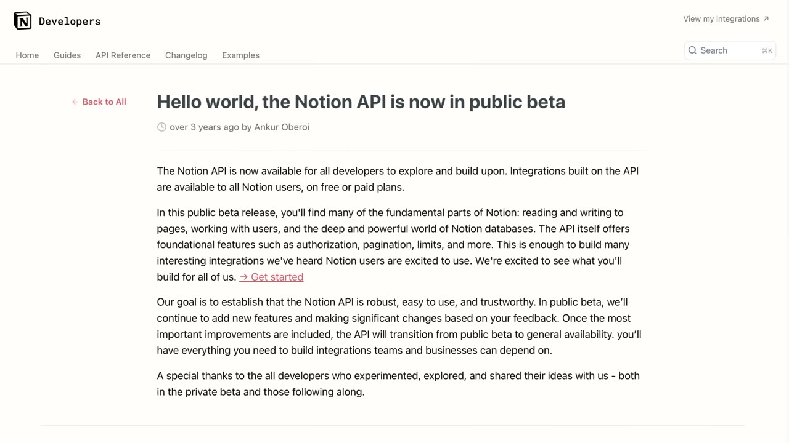
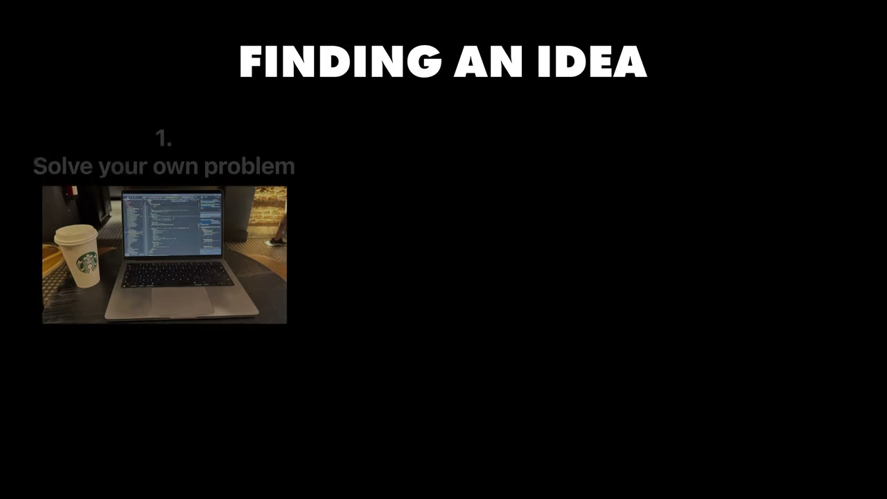

# How I Built It: $37K/Month Notion App

✅ **Đã phân tích sâu** → [`case.md`](case.md)

| | |
|---|---|
| **Video** | <https://www.youtube.com/watch?v=WuzxmeUP6ro> |
| **Đăng** | 07/11/2024 |
| **Thời lượng** | 18:00 |
| **Lượt xem** | 153,023 |
| **Lượt thích** | 3,963 |
| **Video ID** | `WuzxmeUP6ro` |

## Trong thư mục này

| File | Nội dung |
|---|---|
| [`case.md`](case.md) | **Phân tích đầy đủ** — ý tưởng, validate, GTM, áp dụng ở VN |
| [`meta.json`](meta.json) | Metadata gốc (chapters, heatmap, mô tả) |
| [`screenshots/`](screenshots/) | 10 ảnh 720p |

## Mô tả gốc

This is how Julien Nahum left his 9-5 and built a Notion micro-saas to over $37,000/month.

## Số liệu bắt được từ transcript

> Các đoạn founder nhắc tới con số, kèm timestamp để tua thẳng tới đó trong video.

_(không bắt được con số nào)_

## Chương

- `00:00` Intro
- `01:10` Meet Julian
- `01:30` Finding the Idea
- `02:13` Why Notion
- `02:50` Finding Ideas
- `03:59` Validate Ideas
- `05:58` Frameworks
- `06:39` Marketing
- `08:30` Growth Strategy
- `09:38` Customer Support
- `10:38` Monetization
- `11:45` Pricing
- `12:22` Business Model
- `12:52` AI
- `13:30` Software Tools
- `15:00` Advice
- `16:32` Outro

## Ảnh

1. `01_00m53s_usd-400-000.jpg` — 
2. `02_01m42s_ch-finding-the-idea.jpg` — 
3. `03_02m25s_ch-why-notion.jpg` — 
4. `04_03m02s_ch-finding-ideas.jpg` — 
5. `05_04m11s_ch-validate-ideas.jpg` — 
6. `06_06m10s_ch-frameworks.jpg` — 
7. `07_06m51s_ch-marketing.jpg` — 
8. `08_11m30s_usd-90.jpg` — 
9. `09_12m34s_usd-50.jpg` — 
10. `10_14m28s_replay.jpg` — 

---

← [Quay lại index](../../index.md) · [Toàn bộ video](../README.md)
