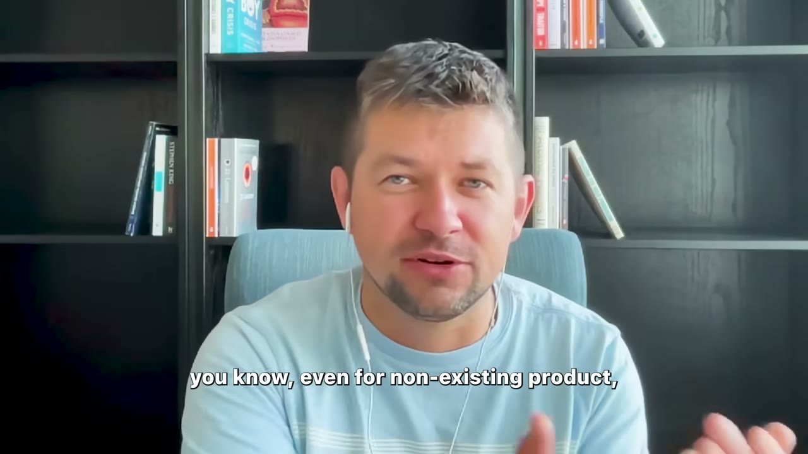
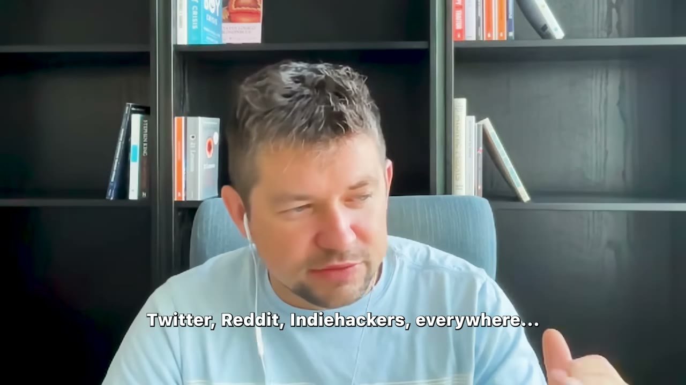
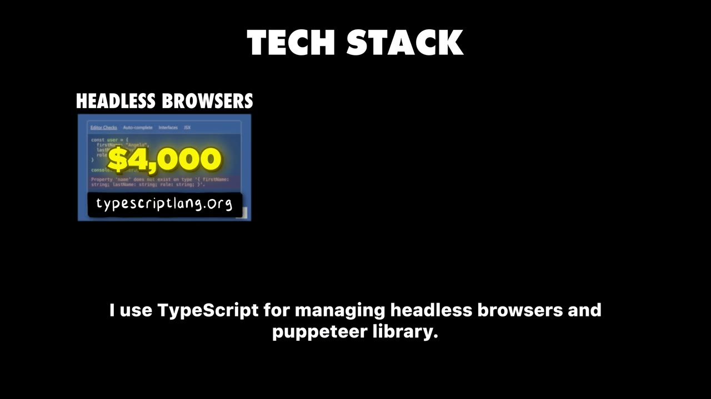
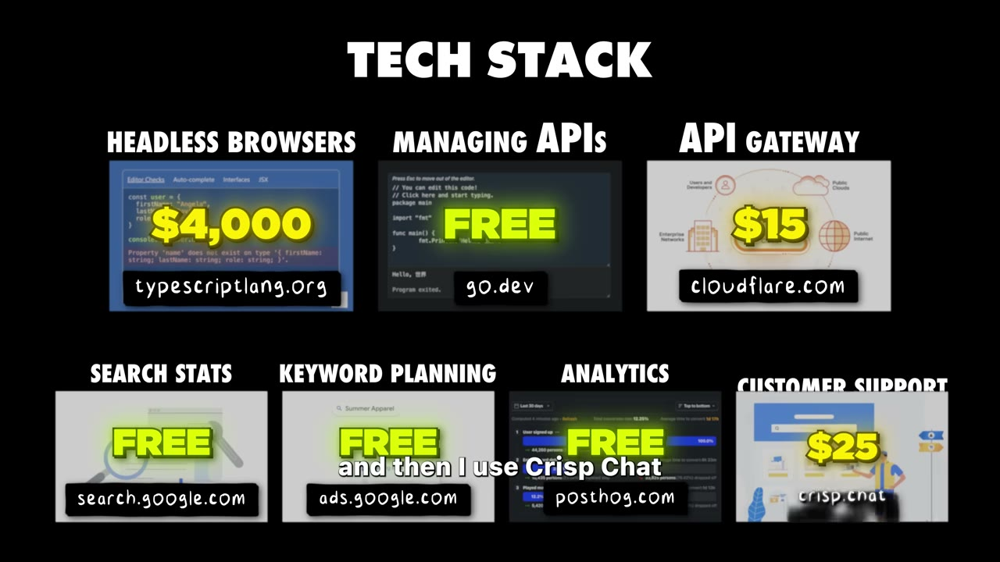

# How I Built It: $12K/Month Micro SaaS

✅ **Đã phân tích sâu** → [`case.md`](case.md)

| | |
|---|---|
| **Video** | <https://www.youtube.com/watch?v=TCGXT7ySco8> |
| **Đăng** | 22/11/2024 |
| **Thời lượng** | 15:27 |
| **Lượt xem** | 388,922 |
| **Lượt thích** | 10,378 |
| **Video ID** | `TCGXT7ySco8` |

## Trong thư mục này

| File | Nội dung |
|---|---|
| [`case.md`](case.md) | **Phân tích đầy đủ** — ý tưởng, validate, GTM, áp dụng ở VN |
| [`meta.json`](meta.json) | Metadata gốc (chapters, heatmap, mô tả) |
| [`screenshots/`](screenshots/) | 10 ảnh 720p |

## Mô tả gốc

This is how Dmytro Krasun quit his 9-5 job and built a screenshot micro saas to over $12,000/month.

## Số liệu bắt được từ transcript

> Các đoạn founder nhắc tới con số, kèm timestamp để tua thẳng tới đó trong video.

_(không bắt được con số nào)_

## Chương

- `00:00` Intro
- `01:36` Who am I
- `02:13` How I got started
- `03:03` Competitors
- `03:42` Validation
- `04:16` Launching
- `05:56` Marketing
- `07:04` Churn
- `08:27` Monetization
- `08:59` Pricing
- `09:36` Tools
- `10:41` Profit Margin
- `11:08` Dealing with Competitors
- `11:59` Personal Life
- `13:06` Advice for Entrepreneurs

## Ảnh

1. `01_01m56s_usd-12-000-m.jpg` — 
2. `02_03m15s_ch-competitors.jpg` — 
3. `03_03m54s_ch-validation.jpg` — 
4. `04_06m08s_ch-marketing.jpg` — 
5. `05_07m16s_ch-churn.jpg` — 
6. `06_08m46s_usd-7.jpg` — 
7. `07_09m48s_replay.jpg` — 
8. `08_10m25s_replay.jpg` — 
9. `09_11m10s_usd-4-500.jpg` — 
10. `10_12m11s_ch-personal-life.jpg` — 

---

← [Quay lại index](../../index.md) · [Toàn bộ video](../README.md)
