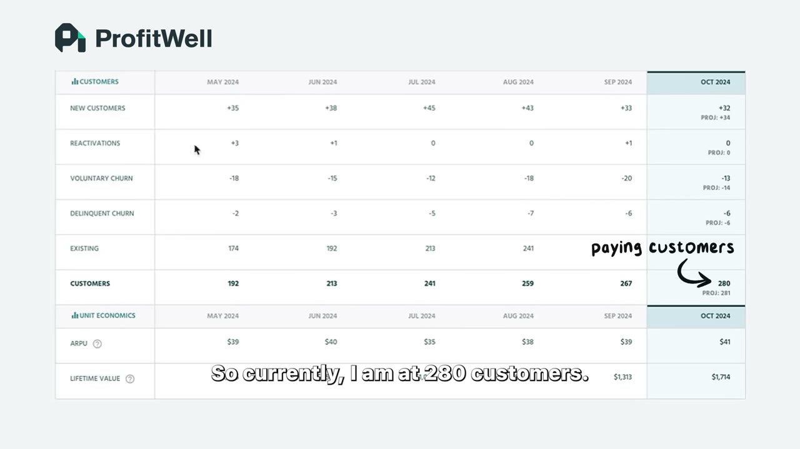
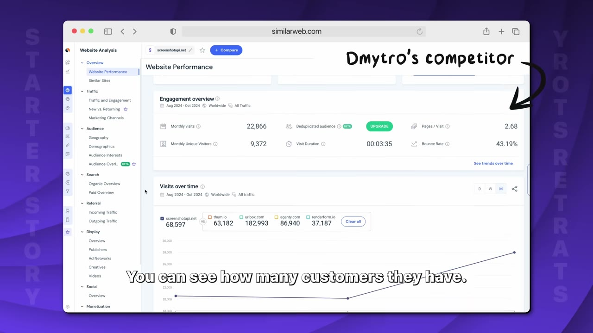
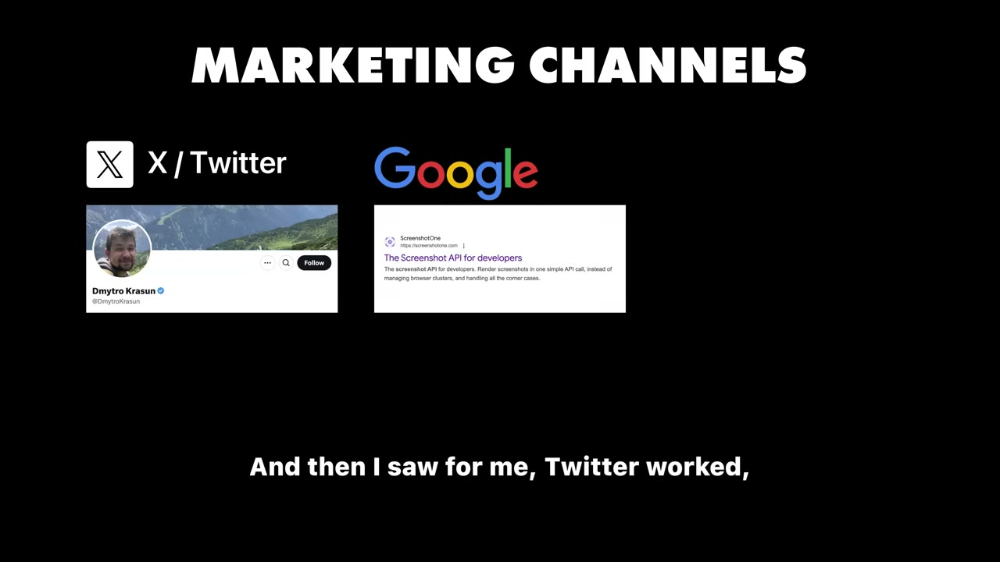
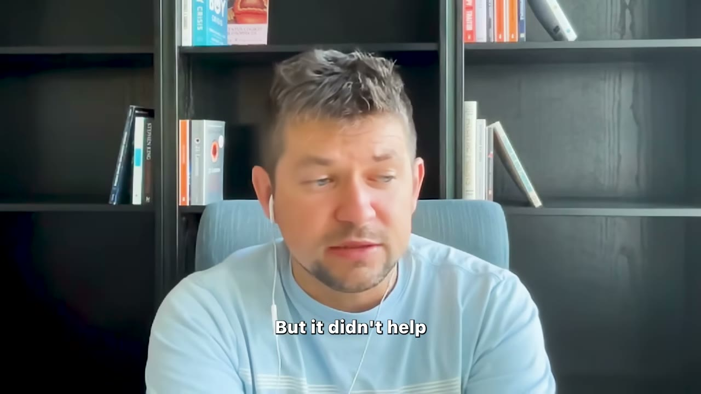

# ScreenshotOne — API nhàm chán, biên lợi nhuận thật, và cách hỏi khách vì sao họ bỏ đi

> **Tóm tắt 30 giây.** Dmytro Krasun là lập trình viên backend. Khi nghỉ việc, anh có hàng triệu ý tưởng — nên anh làm điều ngược đời: **thu hẹp danh sách xuống chỉ còn sản phẩm dạng API**, vì viết API là siêu năng lực của anh. Anh chọn ScreenshotOne sau khi lên Google thấy **rất nhiều đối thủ** — với anh đó là tín hiệu tốt, nghĩa là có người đang trả tiền. Hai năm sau: **12.000 USD/tháng, 280 khách**. Điểm khiến case này khác mọi case khác trong kho: anh công bố **biên lợi nhuận chỉ 40–60%**, không phải 90%. Và anh có một cách hỏi khách hàng vì sao huỷ mà đạt **tỷ lệ trả lời gần 100%**.

## 1. Con số

| Chỉ số | Giá trị |
|---|---|
| MRR | 12.000 USD |
| Khách trả tiền | 280 |
| Doanh thu/khách | ~43 USD/tháng |
| **Biên lợi nhuận** | **chỉ 40–60%** |
| Chi phí server | **3.000–4.000 USD/tháng** |
| Tổng chi phí | ~4.500 USD/tháng |
| Sản lượng | ~2 triệu ảnh/tháng |
| Churn | từ 11%/tháng xuống ~7% |
| Nhân sự | 1 |

**Vì sao con số 40–60% quan trọng:** gần như mọi case trong kho này khoe biên 85–99%. Dmytro là người hiếm hoi có sản phẩm với **chi phí biên thật và lớn** — mỗi ảnh chụp màn hình là một trình duyệt được khởi chạy trên server thật.

| Case | Biên | Bản chất chi phí |
|---|---|---|
| [Cursor Directory](../2025-11-16_my-website-makes-35k-month-built-in-3-hours/case.md) | 99,8% | gần như không có |
| [BulkMockup](../2026-02-11_how-i-built-a-12k-month-micro-saas/case.md) | ~99% | gần như không có |
| [Data Fetcher](../2025-08-13_how-i-built-it-23k-month-micro-saas/case.md) | 85% | worker chạy job |
| **ScreenshotOne** | **40–60%** | **render trình duyệt** |

Bài học: **hãy biết chi phí biên của bạn tăng theo cái gì TRƯỚC khi chọn mô hình giá.** Cùng cảnh báo với [Neural Frames — 45% doanh thu đi thẳng vào GPU](../2025-07-30_my-ai-app-makes-100k-month/case.md).

## 2. Thu hẹp không gian ý tưởng theo siêu năng lực ⭐⭐⭐⭐⭐

Đây là bộ lọc thực dụng nhất trong kho, và nó giải quyết đúng vấn đề mà người mới hay mắc: **quá nhiều ý tưởng**.

Nguyên văn logic của anh: tôi có hàng triệu ý tưởng, nhưng tôi cần **thu hẹp không gian ý tưởng xuống thứ tôi thật sự xây được — và xây ra sản phẩm chất lượng**. Vì anh là lập trình viên backend và **viết API là siêu năng lực của anh**, anh **rút danh sách xuống chỉ còn các sản phẩm dạng API**.

Anh đã thử một cái trước đó: **API xác thực email**. Anh bỏ vì thấy nó *"siêu nhàm chán"* với chính mình.

**Hai bộ lọc chồng lên nhau, và cả hai đều cần:**
1. Tôi có xây được ở mức chất lượng cao không? (siêu năng lực)
2. Tôi có chịu nổi việc làm nó nhiều năm không? (không quá chán)

Đối chiếu với [bốn tiêu chí của Nico](../2025-03-31_i-locked-myself-in-a-room-made-17-apps-sold-2-for-26/case.md) — cũng có "kỹ năng của tôi" là một trong bốn. Điểm khác biệt của Dmytro: anh dùng kỹ năng làm **bộ lọc đầu tiên**, không phải bộ lọc cuối. Điều đó cắt bỏ 95% không gian tìm kiếm ngay từ đầu, và đó là lý do anh không mắc kẹt.

## 3. Hai loại validate — và anh phân biệt rất rạch ròi ⭐⭐⭐⭐⭐

**Validate NGÁCH (rẻ, làm trước):** anh lên Google, thấy rất nhiều đối thủ. Với anh **đó là tín hiệu tốt** — *"it means there are people paying"*. Anh còn nói thêm: bạn thường tìm được **con số của họ**, xem họ có bao nhiêu khách hàng.

Lập luận đầy đủ của anh: gần như mọi lĩnh vực bạn muốn xây đều **không độc nhất**. Rất khó phát minh ra thứ gì mới, và **kể cả khi bạn phát minh được, ai bảo là người ta cần nó?** Việc duy nhất cần kiểm tra: **có đủ người dùng loại này để đạt mục tiêu của bạn không.** Ví dụ cụ thể anh đưa: muốn 10K MRR thì hãy kiểm xem có đủ số công ty cần phần mềm chụp màn hình và chịu trả mức tiền đó không.

Đây là cùng kết luận với [Thomas Sanlis: không có đối thủ nghĩa là không có thị trường](../2025-08-23_how-i-finally-built-a-10k-month-saas-30-failures/case.md), nhưng Dmytro thêm bước **tính ngược quy mô cần thiết** — thứ mà rất ít founder làm.

**Validate SẢN PHẨM (đắt, không tránh được):** đây là chỗ anh nói điều mà tôi cho là quan trọng nhất video, và nó **phản bác một phần các case validate-trước-khi-code** trong kho:

> Vấn đề là **người ta rất tử tế**. Một số người **sẵn sàng trả tiền cho cả sản phẩm chưa tồn tại**. Nhưng bạn vẫn không biết họ **có dùng nó hay không**, nó **có giúp được họ hay không**, cho tới khi bạn xây xong và thấy những công ty **không hề quen bạn** đang dùng nó.

**Ngưỡng validate tối thượng của anh: 10 khách hàng trả tiền TỪ NGOÀI mạng lưới quen biết** — những người tự tìm đến, tự mua, và tự dùng.

Đây là một sự tinh chỉnh quan trọng cho toàn bộ kho case. [Setter AI thu 500 USD đặt cọc trước khi có sản phẩm](../2025-09-27_how-we-built-a-10k-mo-saas/case.md) và [Nico thu tiền qua form Tally rồi làm tay](../2025-03-31_i-locked-myself-in-a-room-made-17-apps-sold-2-for-26/case.md) — cả hai đều đúng, nhưng Dmytro nêu đúng giới hạn của chúng: **tiền trả trước chứng minh có nhu cầu, nó không chứng minh sản phẩm của bạn giải quyết được nhu cầu đó.**

## 4. Sai lầm 5 tháng, và quy trình anh dùng bây giờ ⭐⭐⭐⭐

Bản đầu tiên anh mất **5 tháng**. Anh gọi thẳng đó là **sai lầm**: đó là lần ra mắt đầu tiên nên anh muốn mọi thứ thật hoàn hảo — nhưng **phiên bản đầu của bạn dù sao cũng sẽ không tốt.**

Quy trình hiện tại của anh: ra mắt trong **một tháng hoặc ít hơn**.

1. Xây **một thứ thật nhỏ, đúng một tính năng**
2. **Không xây xác thực. Không xây thanh toán.** Không gì cả
3. Đưa cho **bạn thân bấm thử** xem có vỡ không
4. Đăng lên Twitter
5. Nếu tiếp cận được khách hàng tiềm năng trực tiếp thì **nhắn thẳng cho họ**
6. **Rồi mới** làm thanh toán, rồi mới làm thông báo, rồi bắt đầu lặp theo phản hồi

Thứ tự này đáng chú ý: **thanh toán đến SAU khi có người dùng thật.** Ngược với [Erikas và Nico](../2025-04-19_my-apps-make-4-5m-year-with-0-marketing/case.md) — và cả hai cách đều đúng, tuỳ vào việc bạn đang cần chứng minh điều gì. Thu tiền trước chứng minh **có nhu cầu**; đưa sản phẩm chạy được trước chứng minh **sản phẩm dùng được**.

## 5. Ba kênh không hiển nhiên ⭐⭐⭐⭐⭐

Kênh chính của anh là Twitter và Google. Nhưng phần đáng học là ba kênh anh gọi là **"không hiển nhiên"**:

**1. Zapier và Make.** Rất nhiều doanh nghiệp dùng các nền tảng tự động hoá này. **Nếu bạn đưa được sản phẩm của mình lên đó, người ta sẽ tự tìm thấy bạn.** Đây là phân phối kiểu marketplace mà không cần phụ thuộc hoàn toàn vào một nền tảng — cùng họ với [Data Fetcher trên marketplace Airtable](../2025-08-13_how-i-built-it-23k-month-micro-saas/case.md) nhưng rủi ro thấp hơn nhiều vì đây chỉ là một kênh trong nhiều kênh.

**2. YouTube như một kênh SEO — và cơ chế anh chỉ ra rất tinh tế.** Có người tự đăng video hướng dẫn cách gửi cold email bằng sản phẩm của anh, và anh **thấy khách trả tiền đến từ YouTube**. Từ đó anh nhận ra: leo lên vị trí đầu Google rất khó, **nhưng với một số từ khoá, Google hiển thị luôn video YouTube** — nên bạn có thể đăng video và **xếp hạng cao hơn nhiều so với việc cố đưa một trang web lên đầu**. Anh gọi đó là một cách lách.

Đây là chiến thuật dùng được ngay và gần như không ai trong kho nhắc tới.

**3. Product Hunt** — anh nói nó giúp về **nhận diện** và **backlink cho SEO**. Lưu ý: [Julien của NotionForms nói Product Hunt bị đánh giá quá cao và anh không nhận được một đơn hàng nào từ đó](../2024-11-07_how-i-built-it-37k-month-notion-app/case.md). Hai người **thực ra đồng ý với nhau**: giá trị của Product Hunt là backlink và nhận diện, **không phải doanh số**.

## 6. Cách hỏi vì sao khách bỏ đi — tỷ lệ trả lời gần 100% ⭐⭐⭐⭐⭐

Đây là chiến thuật vận hành đáng copy nhất video.

**Cách thông thường không hiệu quả:** anh có popup khi khách huỷ, cho chọn lý do và viết thêm. Nhưng người ta chỉ trả lời những câu vô nghĩa kiểu *"chúng tôi không cần sản phẩm này nữa"*.

**Cách của anh:**

1. Khi có người huỷ, anh **gửi email cá nhân**
2. Trước đó anh **xem profile của họ, xem công ty họ, xem họ dùng sản phẩm để làm gì**, và đọc lý do họ đã chọn
3. Anh **tự đoán** vì sao họ rời đi
4. Anh hỏi **đúng một câu có/không**: *"Bạn huỷ có phải vì giá không?"*
5. **Người ta bắt đầu trả lời** — *"đúng, đúng là vì lý do đó"*

**Tỷ lệ trả lời gần 100%.**

**Vì sao nó hiệu quả:** một câu hỏi mở buộc người ta phải suy nghĩ và viết — chi phí cao, nên họ viết cho xong. Một câu hỏi có/không đã được đoán sẵn chỉ tốn một giây, và **nếu bạn đoán sai, người ta thường sẽ sửa lại cho bạn** — đó là bản năng con người.

**Kết quả cụ thể:** anh phát hiện một số khách đến vì **tưởng sản phẩm là no-code**. Anh **sửa lại thông điệp marketing để nhấn mạnh rằng sản phẩm dành cho lập trình viên và bạn phải viết code để tích hợp.** Tức là anh dùng dữ liệu churn để **lọc sai người ngay từ đầu phễu** — chứ không phải để cố giữ chân họ.

**Churn: 11%/tháng → gần 7%.** Mục tiêu của anh là dưới 5%.

Anh nói thẳng đây là **rất nhiều việc thủ công**, nhưng nó xây trong đầu anh một **mô hình tư duy** về cách người ta dùng sản phẩm và vì sao họ rời đi. Đây là loại tri thức không có dashboard nào cho bạn.

## 7. Giá: từ 5 USD tới nay ⭐⭐⭐⭐

Đô la đầu tiên: anh **quảng bá suốt một tháng ở mọi nền tảng có thể** — Twitter, Reddit, Indie Hackers, khắp nơi. Đúng **một người** thấy giá trị và trả **7 USD/tháng**. Anh mô tả cảm giác đó *"như một triệu đô"*.

Hành trình giá:
- Bắt đầu 5 USD → thấy quá rẻ
- Lên 7 USD → **biên gần bằng 0**
- **Bỏ bớt gói miễn phí** và **tăng giá các gói tiếp theo**

Và anh rút ra một nhận xét đáng ghi: **khi bạn tăng giá, nó thực sự có ích — vì đó là tín hiệu mạnh hơn nhiều để lọc ra những người thật sự muốn dùng sản phẩm.**

Giá hiện tại được anh mô tả là **trực giác**: bao nhiêu thì khách vẫn trả được và vẫn thấy đáng, đồng thời cho anh biên tốt và còn chỗ để lớn.

## 8. Quan điểm về đối thủ và về lời khuyên ⭐⭐⭐⭐

**Về đối thủ:** khi bạn đã có **10 khách hàng thật** — không phải người quen ủng hộ, mà người dùng nó cho công việc của họ và rút ra giá trị thật — thì bạn chỉ cần **tập trung vào họ**: xây tính năng cho họ, tối ưu toàn bộ marketing để tìm thêm những người giống họ.

Và một câu rất khác với giọng điệu thường thấy trong nội dung khởi nghiệp:

> Với phần lớn người làm một mình muốn xây một doanh nghiệp đơn giản, đủ trang trải cuộc sống hiện tại — bạn **không cần phải khắc nghiệt hay xấu tính**. Bạn có thể **tử tế, xây quan hệ với người khác**, và vẫn có đủ khách hàng để trả hoá đơn.

**Về lời khuyên — và đây là câu tôi cho là trung thực nhất trong toàn bộ kho case:**

> *"Đừng nghe ai cả, kể cả tôi."*

Anh nói rõ hơn: hãy tiêu thụ mọi thứ, tìm nội dung chất lượng nhất bạn có thể — nhưng **đừng thuê ngoài quyết định của bạn cho bất kỳ ai**. Đừng hỏi người khác *"tôi có nên nghỉ việc không"*. Bạn quyết định.

Và anh giải thích lý do bằng một lập luận về bối cảnh mà rất hiếm ai nêu:

- **Anh có runway tốt.** Người khác nghỉ việc có thể không có
- **Anh từng nghèo**, nên với anh mất hết tiền không phải chuyện lớn — *"tôi cảm thấy mình có thể bị phá huỷ rồi bắt đầu lại"*
- Nhưng với người **lớn lên trong một gia đình khá giả**, điều đó có thể rất đáng sợ

Kết luận của anh: lời khuyên kiểu *"cứ nghỉ việc đi, đốt hết cầu"* là **thứ phụ thuộc bối cảnh** và không thể tổng quát hoá.

**Đây là chìa khoá để đọc toàn bộ kho case này.** Mỗi founder trong kho đang nói từ một hoàn cảnh riêng — và phần lớn video không nói ra hoàn cảnh đó.

## 9. Cuộc sống — và một quan sát về sức khoẻ tinh thần

Một ngày của anh rất bình thường: dậy, giúp vợ đưa con đi học và đi nhà trẻ, về uống cà phê hoặc ra quán, **đọc sách ít nhất một tiếng mỗi sáng**, làm tới chiều khi con về, tối đi đá bóng với bạn.

Và một câu đáng ghi:

> Nếu bạn làm một mình, bạn **phải chăm sóc sức khoẻ tinh thần** — vì đó là **công cụ duy nhất bạn dùng mỗi ngày**. Nếu bạn thấy tệ, **chất lượng quyết định của bạn cũng tệ đi**. Đầu óc sáng suốt và khả năng tư duy là một trong những thứ có đòn bẩy lớn nhất trong kinh doanh.

Đặt cạnh [Thomas Sanlis](../2025-08-23_how-i-finally-built-a-10k-month-saas-30-failures/case.md) và [Ramsri](../2025-06-18_i-make-100k-year-from-2-ai-side-projects/case.md) — ba founder độc lập cùng một kết luận, và không ai trong ba người theo mô hình làm 16 tiếng/ngày.

## 10. Cảnh báo thiên kiến nguồn

- **Video có hai đoạn bán Starter Story Academy**, một chèn giữa (khoảng 5:00–5:50) và một ở cuối. Đây là sản phẩm của chính kênh, không phải nhà tài trợ ngoài.
- **Không có ảnh chụp dashboard doanh thu nào.** 12K MRR, 280 khách, biên 40–60% đều là lời tự khai.
- **Bản ghi âm tự động rất kém ở video này** (nhiều chỗ nuốt chữ, "churn" thành "CH", tên sản phẩm biến dạng). Tôi đã đối chiếu với mô tả video để xác định tên Dmytro Krasun và ScreenshotOne.
- **Anh là lập trình viên chuyên nghiệp nhiều năm** ở các startup và công ty, và tự nói rằng lúc nghỉ việc anh đang có *"công việc tốt nhất thế giới, lương rất cao"*. Đây là bối cảnh mà anh — đáng khen — tự nêu ra, khác với nhiều video khác.
- **Thông điệp bán hàng mâu thuẫn với nội dung:** quảng cáo nói về việc tìm ý tưởng và validate nhanh, trong khi nhân vật nói rõ **bản đầu tiên mất 5 tháng** và **hai năm để tới 12K**.

## 11. Áp dụng cho tôi (indie hacker VN)

Case này có **khả năng áp dụng cao nhất trong lô**: sản phẩm kỹ thuật thuần, khách hàng là lập trình viên (không cần bán hàng bằng quan hệ), founder ở Đông Âu chứ không phải Mỹ, và không cần audience.

**Sao chép được ngay:**

1. **Thu hẹp không gian ý tưởng theo siêu năng lực trước tiên.** Nếu bạn mạnh về backend, chỉ xét sản phẩm API. Nếu mạnh về data, chỉ xét sản phẩm data. Bộ lọc này cắt 95% nhiễu.
2. **Dùng Google để đo ngách:** nhiều đối thủ = có người trả tiền. Rồi **tính ngược**: cần bao nhiêu khách để đạt mục tiêu của tôi, và thị trường có đủ chừng đó không?
3. **Đặt ngưỡng "10 khách trả tiền từ ngoài mạng lưới"** làm mốc validate thật. Trước mốc đó, đừng tin là mình đã validate.
4. **Chiến thuật email hỏi churn: đoán trước lý do, hỏi một câu có/không.** Đây là thứ dùng được ngay hôm nay và tỷ lệ trả lời cực cao.
5. **Dùng dữ liệu churn để sửa copy marketing**, không chỉ để sửa sản phẩm.
6. **Đưa sản phẩm lên Zapier và Make** — kênh phân phối gần như miễn phí.
7. **Đăng video YouTube nhắm từ khoá mà Google hiển thị video.** Cạnh tranh thấp hơn nhiều so với xếp hạng trang web.

**Rào cản thật:**

- **Chi phí server 3.000–4.000 USD/tháng là chi phí thật và trả trước.** Bạn phải chịu được lỗ trong giai đoạn đầu khi lượng dùng đã có mà doanh thu chưa tới. Đây là mô hình cần vốn lưu động, khác hẳn SaaS biên 99%.
- **Biên 40–60% nghĩa là 12K MRR chỉ còn khoảng 6–7K.** Đừng nhìn con số MRR mà tưởng đó là thu nhập.
- **Cần tiếng Anh viết đủ tốt để làm hỗ trợ kỹ thuật** — anh gắn Crisp vào điện thoại và trả lời ngay lập tức.
- **Anh có runway tốt và nhiều năm kinh nghiệm.** Chính anh nêu rõ điều này và cảnh báo đừng tổng quát hoá.

**Khi KHÔNG nên đi con đường này:**

- **Khi bạn không đo được chi phí biên trước.** Nếu bạn không biết mỗi lần gọi API tốn bao nhiêu, bạn không định giá được, và bạn có thể bán lỗ suốt nhiều tháng mà không biết.
- **Khi bạn cần biên cao để tái đầu tư nhanh.** 40–60% không cho bạn nhiều dư địa để chi marketing.
- **Khi bạn không chịu được công việc thủ công.** Toàn bộ lợi thế của anh — email từng khách huỷ, trả lời chat ngay lập tức — đến từ việc làm tay những thứ không mở rộng được.
- **Khi bạn muốn ai đó bảo bạn phải làm gì.** Chính anh nói: đừng thuê ngoài quyết định của bạn.

## Nguồn

- Video: [How I Built It: $12K/Month Micro SaaS](https://www.youtube.com/watch?v=TCGXT7ySco8) — Starter Story, 22/11/2024, 388.922 view
- [Transcript đầy đủ](transcript.md) · [Ảnh chụp màn hình](screenshots/)
