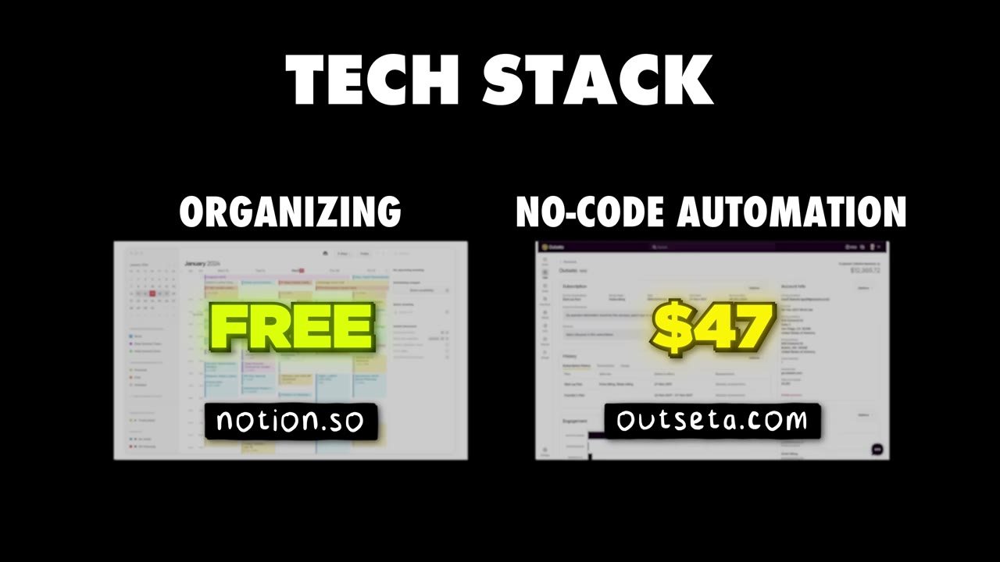

# I Make $15K/Month With 2 AI Apps

✅ **Đã phân tích sâu** → [`case.md`](case.md)

| | |
|---|---|
| **Video** | <https://www.youtube.com/watch?v=G4nsGvL4Fo0> |
| **Đăng** | 02/12/2024 |
| **Thời lượng** | 16:08 |
| **Lượt xem** | 343,903 |
| **Lượt thích** | 7,930 |
| **Video ID** | `G4nsGvL4Fo0` |

## Trong thư mục này

| File | Nội dung |
|---|---|
| [`case.md`](case.md) | **Phân tích đầy đủ** — ý tưởng, validate, GTM, áp dụng ở VN |
| [`meta.json`](meta.json) | Metadata gốc (chapters, heatmap, mô tả) |
| [`screenshots/`](screenshots/) | 2 ảnh 720p |

## Mô tả gốc

This is how Fernando Pessagno built two AI apps to over $15,000/month.

## Số liệu bắt được từ transcript

> Các đoạn founder nhắc tới con số, kèm timestamp để tua thẳng tới đó trong video.

_(không bắt được con số nào)_

## Chương

_(không có chapter)_

## Ảnh

1. `01_08m32s_usd-9-99.jpg` — 
2. `02_11m11s_replay.jpg` — 

---

← [Quay lại index](../../index.md) · [Toàn bộ video](../README.md)
