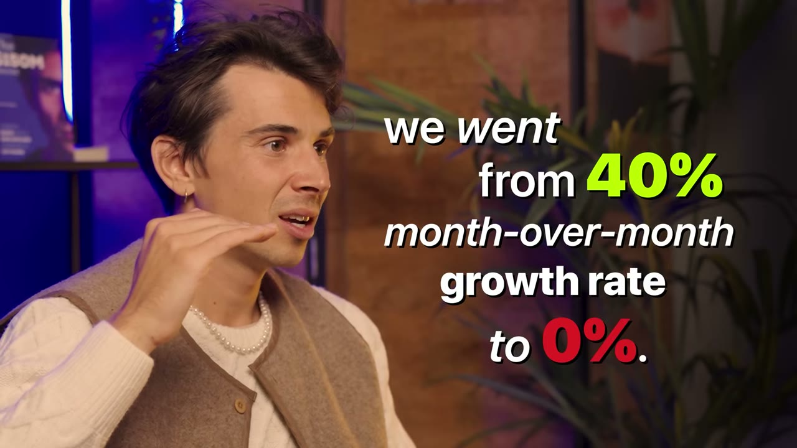
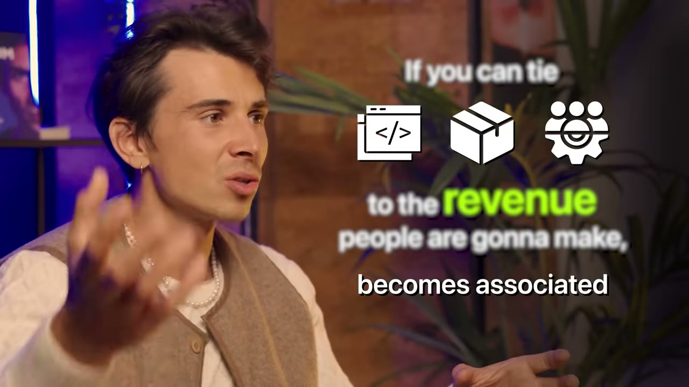
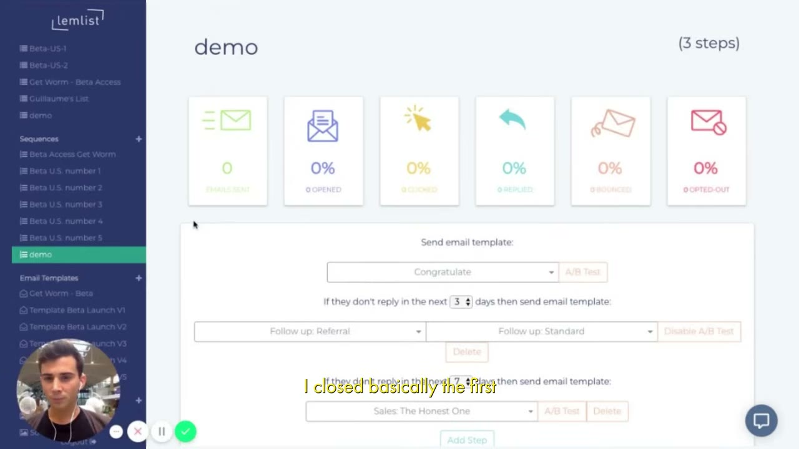

# The Underdog: He Turned His Last $1,000 Into $150M

✅ **Đã phân tích sâu** → [`case.md`](case.md)

| | |
|---|---|
| **Video** | <https://www.youtube.com/watch?v=ZEIPj7QbZeI> |
| **Đăng** | 17/12/2024 |
| **Thời lượng** | 22:07 |
| **Lượt xem** | 324,674 |
| **Lượt thích** | 8,312 |
| **Video ID** | `ZEIPj7QbZeI` |

## Trong thư mục này

| File | Nội dung |
|---|---|
| [`case.md`](case.md) | **Phân tích đầy đủ** — ý tưởng, validate, GTM, áp dụng ở VN |
| [`meta.json`](meta.json) | Metadata gốc (chapters, heatmap, mô tả) |
| [`screenshots/`](screenshots/) | 9 ảnh 720p |

## Mô tả gốc

This is the story of how Guillaume Moubeche went from being an aspiring entrepreneur with $1,000 left in his bank account, to building a company making $30M/year and is now valued at over $150M. 
Starter Story

## Số liệu bắt được từ transcript

> Các đoạn founder nhắc tới con số, kèm timestamp để tua thẳng tới đó trong video.

_(không bắt được con số nào)_

## Chương

_(không có chapter)_

## Ảnh

1. `01_01m26s_usd-11-000.jpg` — 
2. `02_08m03s_usd-1-000.jpg` — 
3. `03_10m01s_replay.jpg` — 
4. `04_10m54s_replay.jpg` — 
5. `05_12m00s_replay.jpg` — 
6. `06_14m03s_usd-250-000.jpg` — 
7. `07_15m39s_usd-10-m.jpg` — 
8. `08_18m30s_usd-30-m.jpg` — 
9. `09_21m38s_usd-10-000.jpg` — 

---

← [Quay lại index](../../index.md) · [Toàn bộ video](../README.md)
