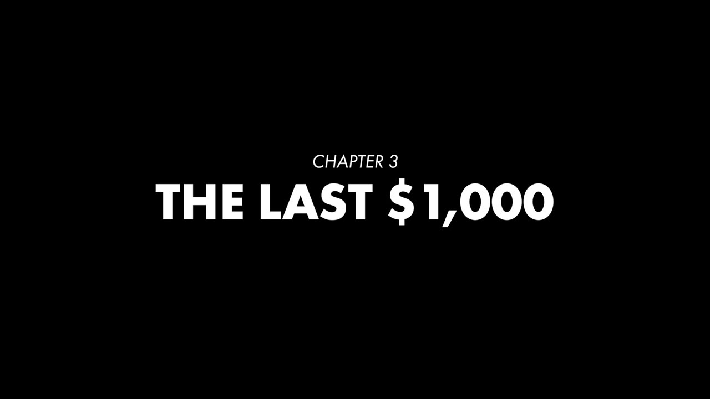
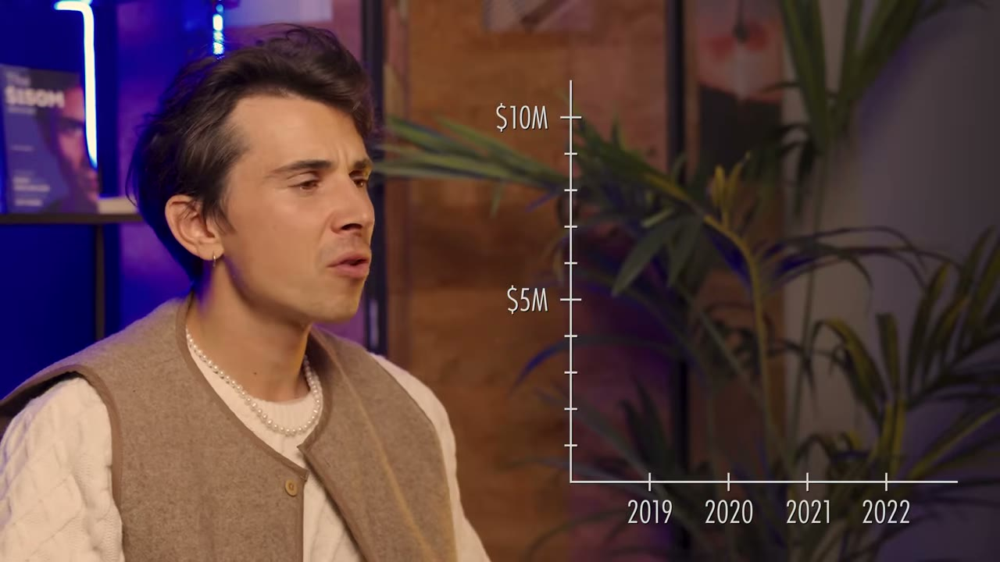
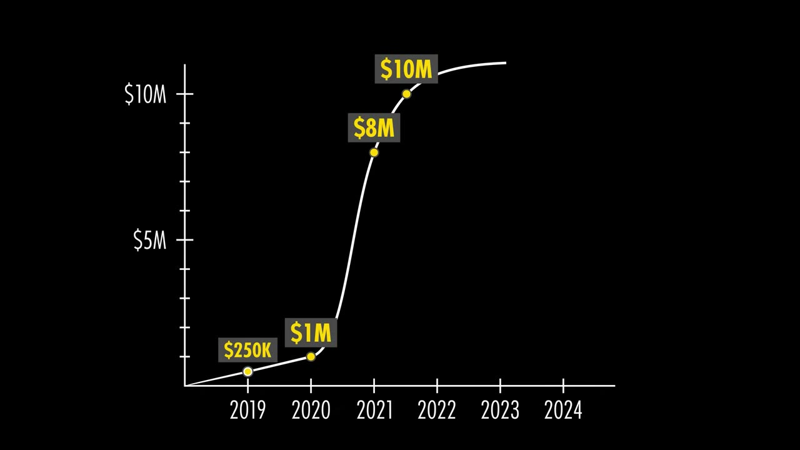

# lemlist — từ $1.000 cuối cùng trong tài khoản tới $30M ARR

> **Tóm tắt 30 giây:** Guillaume Moubeche bị McDonald's từ chối khi xin việc làm thêm. Anh thất bại với business áo phông (bán được **6 cái**), mất 1,5 năm không nói chuyện với bố vì thất bại đó. Sang Nga thuê dev junior hết **toàn bộ $4-5K tiết kiệm**, rồi LinkedIn **đổi một dòng code** và giết chết sản phẩm. Về Pháp còn **$1.000**, bạn gái trả tiền nhà và không còn tin anh nữa. Rồi anh đổi triết lý: **bỏ blue ocean, nhảy vào red ocean** — vì có đối thủ nghĩa là product-market fit đã được người khác chứng minh, việc còn lại chỉ là làm tốt hơn ở đúng **một** điểm. lemlist ra đời với MVP 2 tuần, tháng đầu thu $600, giờ là **$30M ARR với $10M EBITDA**, khoảng 100 nhân sự, định giá hơn $150M.

## ⚠️ Cảnh báo trước khi đọc

- **Đây là video dạng phim tài liệu (series "The Underdog"), không phải breakdown kinh doanh.** Nó nặng về câu chuyện cảm xúc, nhẹ về chiến thuật. Không có chapter, không có demo sản phẩm, không có tech stack, không có bảng chi phí. Tôi giữ case này ngắn hơn các case playbook và chỉ rút ra những **cơ chế** thật sự có thể dùng lại.
- **Thiên kiến nguồn.** Video có một lần chèn quảng cáo lead magnet "52 Micro SaaS Business Ideas" ngay tại điểm cao trào của câu chuyện, và một lần bán Starter Story Academy ở cuối. Kênh này chỉ phỏng vấn người thắng — bạn không thấy hàng nghìn người cũng nhảy vào red ocean cold email và chết.
- **Con số $150M là định giá, không phải tiền.** Video không nói ai đưa ra con số đó, theo phương pháp nào, có giao dịch thật nào không. Với một công ty bootstrapped, "valuation" thường là con số tự công bố hoặc từ một vòng thứ cấp nhỏ. **Con số đáng tin và đáng học duy nhất là $30M ARR / $10M EBITDA** — và ngay cả nó cũng là tự khai.
- **Mâu thuẫn số liệu trong chính video:** ở phút 01:32 lời dẫn nói *"from his last $11,000"* và ảnh chụp màn hình cũng hiện $11,000, nhưng chính founder nói *"I had only like $1,000 left"* (phút 07:58), mô tả video nói $1.000, và tiêu đề nói $1.000. **Tôi lấy $1.000** — vì đó là lời trực tiếp của founder và khớp với ba nguồn khác trong cùng video.

## 1. Con số

| Chỉ số | Giá trị |
|---|---|
| Vốn khởi điểm | **$1.000** (toàn bộ tiết kiệm) |
| Thời gian làm MVP | **2 tuần** |
| Doanh thu tháng đầu | **$600** |
| Tăng trưởng giai đoạn đầu | 40% tháng trên tháng |
| Activation rate | **15% → 35%** sau khi làm lại sản phẩm |
| Cú sốc tăng trưởng | 40% → **0%** trong đúng tháng đổi sản phẩm, tháng sau **+60%** |
| ARR năm 1 | $250.000 |
| ARR năm 2 | $1.000.000 |
| ARR năm 3 | khoảng $8.000.000 |
| ARR năm 3,5 | $10.000.000 → **chững lại** |
| Hiện tại (12/2024) | **$30M ARR, $10M EBITDA**, ~100 người, khách ở hơn 100 nước |
| Tổng hành trình | gần **10 năm** tính cả các thất bại |

Ghi chú: **EBITDA $10M trên ARR $30M = biên 33%** với một công ty SaaS 100 người. Đây là con số lành mạnh bất thường cho SaaS bootstrapped ở quy mô này, và là chi tiết đáng chú ý hơn cả con số định giá.

## 2. Bài học đắt nhất — red ocean thắng blue ocean ⭐⭐⭐

Đây là hạt nhân của cả video, và nó đi ngược lại điều phần lớn người mới được dạy.

**Trước lemlist**, Guillaume theo blue ocean. Anh phát hiện LinkedIn cho phép xem ai đã ghé profile của bạn, và nghĩ: *"That's crazy — it means you can basically do the same on any website. My ambition was to personalize the internet."* Anh sang Nga, thuê vài dev junior, tiêu hết $4-5K tiết kiệm.

> *"But eventually LinkedIn **changed one line of code**, so the entire project went to trash."*

Rồi anh đảo ngược hoàn toàn:

> *"We talk a lot about blue ocean and red ocean. I started with this blue ocean idea because no one was on it. I thought I had an incredible tech that was going to change the world — in the end it was too complex and it didn't work out, we got blocked. So now I was like: okay, **red ocean, we have tons of competitors, but if we have competitors it means that there is always a product-market fit. These guys are making tons of money — so all you have to do is to be better.**"*

### Cơ chế: vì sao red ocean lại an toàn hơn cho người ít vốn

Đây là phần cần hiểu, không chỉ ghi nhớ:

1. **Blue ocean bắt bạn trả tiền hai lần** — vừa xây sản phẩm, vừa xây nhận thức thị trường. Người có $1.000 không đủ sức trả lần thứ hai.
2. **Red ocean nghĩa là ngân sách marketing đã được đối thủ chi hộ bạn.** Khách hàng đã biết loại sản phẩm này tồn tại, đã biết nó đáng bao nhiêu tiền, đã có sẵn ngân sách. Bạn chỉ cần trả lời một câu: *tại sao là bạn chứ không phải họ.*
3. **Blue ocean thường trống vì một lý do.** Trong trường hợp của Guillaume, lý do đó tên là "LinkedIn không cho phép". Thị trường trống thường là thị trường bị chặn — bởi nền tảng, bởi luật, bởi kinh tế đơn vị không chạy.

Đây là cùng một logic với [YouForm](../2025-08-02_i-copied-a-100m-saas-undercut-their-prices-and-hit-1/case.md) (copy một SaaS $100M rồi hạ giá) và [Shipper](../2026-05-28_i-built-a-micro-version-of-a-1b-saas-now-i-make-50k/case.md) (làm bản micro của một SaaS $1B). Ba founder khác nhau, ba thời điểm khác nhau, cùng một cơ chế.

### Nhưng "làm tốt hơn" nghĩa là gì? Không phải nhiều tính năng hơn ⭐⭐⭐

Đây là chỗ phần lớn người copy bị sai:

> *"Instead of doing the same as all the platforms, I started with lemlist with a **key differentiator**: how to make sales more human, and how to add extra layers on personalization that no other platform could offer. **Even though at first I knew all the features that our competitors had were a 100 times better than ours**, I focused on something that was really tied to a key problem from our ideal customer profile — but also tied to a **real return on investment** for them, which is: how many meetings can they book."*

Hai điều kiện của một differentiator đúng, theo Guillaume:
1. Nó gắn với **một vấn đề cốt lõi của ICP** (không phải một tính năng bạn thấy hay).
2. Nó gắn với **ROI đo được bằng tiền của khách** (ở đây: số cuộc hẹn đặt được).

> *"**If you can tie any of your software or product or service to the revenue people are going to make, your product becomes associated with success.**"*

**Cơ chế:** khi sản phẩm gắn với doanh thu của khách, nó chuyển từ mục "chi phí" sang mục "đầu tư" trong đầu người mua. Ngân sách chi phí bị cắt đầu tiên khi khó khăn; ngân sách đầu tư thì không. Đây cũng là lý do các SaaS gắn với doanh thu có churn thấp hơn hẳn các SaaS gắn với năng suất.

**Anh chấp nhận thua đối thủ ở mọi tính năng khác.** Câu *"features that our competitors had were a 100 times better than ours"* là câu quan trọng nhất trong đoạn này — nó cho phép bạn ship trong 2 tuần thay vì 2 năm.

## 3. Growth loop — cỗ máy 5 bước ⭐⭐⭐

Guillaume mô tả nguyên văn vòng lặp anh dùng để bắt đầu:

> *"I use my own product → I help people with their campaigns → I create the best content ever → I push the content into a community → from there I get insights from people who complain about specific things → I improve the product → I restart using the product but with the improvements, making success stories about it with new templates, etc. And this is a growth loop we've used to really skyrocket the growth."*

### Chi tiết bị bỏ qua: cách anh đóng 100 khách đầu tiên

> *"I closed basically the **first 100 customers doing live demos and outbound**. I did only this. On top of it, the first customers I was onboarding I would tell them: you know what, buy the software subscription and **I will myself write the campaigns for you** — and in exchange I would also ask them **if they want to be part of the content I create as success stories**."*

Đây là một trao đổi ba chiều rất đẹp mà ít người nhận ra:
- Khách nhận: dịch vụ done-for-you miễn phí (giá trị cao hơn nhiều so với tiền subscription họ trả).
- Guillaume nhận: **quyền truy cập vào bài toán thật của khách** — anh biết chính xác cái gì hỏng, cái gì thiếu.
- Và anh nhận thêm: **case study có tên thật** — nguyên liệu cho toàn bộ cỗ máy nội dung.

Chi phí của việc này là thời gian của founder, thứ duy nhất anh có. Đây là cách bù cho việc không có tiền marketing. So sánh với [SuperDemo](../2026-03-11_how-this-250k-month-saas-got-its-first-100-users-ste/case.md) — cùng bài toán "100 khách đầu tiên", cách giải khác.

### Lợi thế không công bằng: là chính khách hàng của mình

> *"An unfair advantage you can have when you launch a company is **if you're among the target audience of what you're building**. Because if you're using your product daily, and you're using it so much that **it drives you crazy to see all these bugs** and the messed up things happening — then I can guarantee that **the pace at which you improve the product is 100 times better**."*

Bối cảnh: trước lemlist, Guillaume làm agency lead gen suốt một năm, đặt lịch hẹn cho hàng chục công ty ở nhiều ngành khác nhau. Anh mô tả mình như *"a math scientist testing tons of different approaches"*. Anh không phải người ngoài nhảy vào ngách cold email — **anh là dân trong nghề, mở agency trước, làm SaaS sau**.

**Đây là chi tiết dễ bị bỏ qua nhất và quan trọng nhất về khả năng sao chép:** con đường của anh không phải "tìm ý tưởng rồi build". Nó là **agency trước → hiểu vấn đề bằng tiền và mồ hôi → rồi mới sản phẩm hoá**. Cùng con đường mà [Lancer](../2026-03-08_i-built-a-10k-month-saas-using-other-peoples-custome/case.md) và nhiều case B2B khác trong kho đi.

## 4. Quyết định suýt giết công ty — đổi toàn bộ sản phẩm ⭐⭐⭐

Đây là đoạn có giá trị vận hành cao nhất, vì nó cho thấy một chỉ số duy nhất đáng theo dõi giai đoạn đầu.

Lúc đó lemlist đang tăng **40% tháng trên tháng**. Mọi thứ có vẻ tuyệt. Nhưng:

> *"I was like: we can't have such a low activation rate. The activation rate for me was — when someone signed up, whether or not do they launch a campaign. And that conversion rate, I think it was like at **15%**. So I decided to **change entirely the product**. We redid all the wireframes, we restarted from scratch."*

Kết quả tức thì là thảm hoạ:

> *"When we put it live, **half of our customers were just saying 'what the f***'**. They were like public messages on the community: **'yesterday I love lemlist, today I f***ing hate it.'** And at the time I was like: holy s***, what do you do? Do you revert, or do you wait and see whether or not it's going to give you a higher activation rate?"*

Cách anh xử lý:

> *"I took all the users who were unhappy, I asked them to come directly on Zoom calls. **I started working until like 4:00 a.m.** so I had chat with everyone to understand what they were liking. I saw that we had removed stuff that we shouldn't have removed, so we fixed a lot of the product during that time."*

Kết quả cuối:

| Chỉ số | Trước | Trong tháng đổi | Tháng sau |
|---|---|---|---|
| Tăng trưởng MoM | 40% | **0%** | **60%** |
| Activation rate | 15% | — | **35%** |

> *"The next month we grew by like 60%, because all the unhappy people wanted to churn — but eventually the new ones converted at a much higher pace."*

### Ba bài học cơ chế từ đoạn này

1. **Activation rate là chỉ số chẩn đoán, tăng trưởng là chỉ số triệu chứng.** Tăng trưởng 40%/tháng che giấu việc 85% người đăng ký không bao giờ dùng. Ở quy mô nhỏ, kênh mới còn bù được; ở quy mô lớn, nó thành trần cứng. Guillaume đã bắt được bệnh **trước khi** nó biểu hiện.
2. **Định nghĩa activation phải là một hành động cụ thể, không phải "đăng nhập".** Của anh: *đã launch một campaign chưa?* Không phải "đã tạo tài khoản", không phải "đã xem dashboard". Hãy chọn hành động nhỏ nhất mà **sau đó khách chắc chắn thấy giá trị**.
3. **Khách hàng giận dữ nhất là nguồn dữ liệu tốt nhất — nhưng phải nói chuyện trực tiếp.** Anh không đọc comment và đoán. Anh kéo họ lên Zoom, thức tới 4h sáng. Kết quả cụ thể: phát hiện ra **anh đã xoá nhầm những thứ không nên xoá** — thông tin này không thể lấy được từ số liệu.

**Mâu thuẫn cần lưu ý:** nhiều founder trong kho khuyên "đừng nghe khách hàng, họ chỉ xin ngựa nhanh hơn". Guillaume thì nghe khách hàng đến 4h sáng. **Phân định:** đừng nghe khách khi họ **đề xuất giải pháp**; hãy nghe kỹ khi họ **mô tả cái gì vừa mất đi**. Guillaume đã tự quyết hướng đi (giải pháp), rồi dùng khách để tìm thiệt hại (dữ liệu).

## 5. Đường cong S — bài học lớn nhất về tăng trưởng ⭐⭐⭐

Sau khi đạt PMF thật, anh mô tả cảm giác đó bằng đoạn hay nhất video:

> *"There is no way to describe how it feels when you have a true product-market fit. **It's like poetry, it's like magic.** Everything you do works, you're in a state of flow where everything is so easy that you feel like you've understood everything about life, that it was a game all along. You're in a state of bliss, you feel like a superhero and you feel like nothing can destroy you — **until you reach a plateau**. And this is where I realized that I hadn't been a great entrepreneur."*

Bài học anh rút ra:

> *"**Growing a company is never an exponential curve. It's always an S-curve that can look like an exponential curve, but there is always a plateau. And the only companies that have a proper exponential curve are the ones planning for the next S-curve.**"*

**Cơ chế:** mỗi đường cong S tương ứng với việc **khai thác cạn một kênh hoặc một phân khúc**. Khi kênh bão hoà, tăng trưởng chững — không phải vì bạn làm tệ đi, mà vì bạn đã lấy hết những người dễ lấy. Công ty tăng trưởng liên tục là công ty **bắt đầu xây đường cong tiếp theo khi đường cong hiện tại còn đang dốc lên**, tức là lúc bạn ít có động lực làm nhất.

**Áp dụng cho indie hacker:** khi sản phẩm đang chạy tốt và bạn thấy sung sướng nhất — đó chính là lúc phải dành 20% thời gian cho kênh hoặc sản phẩm tiếp theo. Đây cũng là logic đằng sau các case danh mục nhiều sản phẩm trong kho.

Điều xảy ra ở plateau của lemlist còn tệ hơn: **hai co-founder rời công ty**, và Guillaume phải ôm hết kỹ thuật, hỗ trợ, sản phẩm, sales, marketing.

> *"We had coded the product really quickly to ship a lot of features, and then you realize that the way it's been developed **doesn't match the amount of users you have and the scale**. So we had to rebuild entirely our architecture, and I think **it took me like a year and a half** to deal with all the technical s*** and then be sure that **I would become irrelevant to the growth of the business**."*

Chú ý mục tiêu anh đặt ra: *"trở nên không còn liên quan tới tăng trưởng của doanh nghiệp"*. Đó là định nghĩa đúng của việc thoát khỏi bẫy tự làm mọi thứ — và nó tốn **1,5 năm**.

## 6. Magnet Persona — chiến lược phá vỡ plateau ⭐⭐⭐

Đây là khái niệm gốc, ít gặp trong các case khác, và đáng đọc kỹ.

> *"When you're doing a SaaS business, the name of the game is your **retention**. So we spent a lot of time looking at: **who are the people who, when they join lemlist, they never churn?** I called it the **magnet persona** — the persona that's going to attract a lot more customers."*

Ví dụ anh dùng:

> *"If you take for example Apple — their only focus for years was **designers**. And why? Designers are a great persona because **designers are cool**. So if you have a product that makes people feel like they are amongst this magnet persona, then it's awesome."*

Với lemlist:

> *"In our space the magnet persona is really **the sales rep** — because we're a tool that drives more revenue, and who drives revenue in a company? Sales. So for us to have this magnet persona was a game changer, because **in people's mind we became the sales tool for sales teams**. So anyone who has a company who wants to drive more sales knows that they should use lemlist."*

### Cách tìm magnet persona của bạn — quy trình 3 bước

1. **Nhìn vào dữ liệu retention, không nhìn vào dữ liệu acquisition.** Lọc ra nhóm khách **không bao giờ churn**. Không phải nhóm đông nhất, không phải nhóm trả nhiều nhất — nhóm **ở lại lâu nhất**.
2. **Hỏi: nhóm này có "cool" không?** Tức là: người khác có muốn được xem là thuộc nhóm này không? Designer với Apple, sales rep với lemlist. Đây là điều kiện khiến persona có tính **nam châm** chứ không chỉ là phân khúc tốt.
3. **Định vị lại toàn bộ sản phẩm quanh nhóm đó**, kể cả khi nó thu hẹp thông điệp. Thu hẹp thông điệp làm **mở rộng** lượng khách, vì nó tạo ra sự rõ ràng.

**Vì sao cơ chế này hiệu quả:** phần lớn quyết định mua B2B có một thành phần bản sắc — *"đây là công cụ mà những người giỏi trong nghề tôi đang dùng"*. Magnet persona biến sản phẩm thành **tín hiệu thuộc về nhóm**, và tín hiệu thì lan truyền miễn phí. Đây là cùng cơ chế mà [Marc Lou](../2026-04-26_how-i-work-77k-month-solopreneur/case.md) khai thác khi bán cho chính cộng đồng indie hacker.

**Khi nào nó KHÔNG hiệu quả:** khi ngách của bạn không có bản sắc nghề nghiệp mà người ta tự hào (kế toán nội bộ, hành chính, nhân sự vận hành). Lúc đó hãy quay về ROI thuần.

## 7. Phần con người — điều video này làm tốt hơn các case khác ⭐⭐

Chuỗi thất bại trước lemlist, theo đúng thứ tự:

| Giai đoạn | Kết quả |
|---|---|
| Xin việc McDonald's khi đi học | **Bị từ chối** trong khi bạn bè được nhận |
| Business áo phông làm cùng bố (có bằng thạc sĩ marketing) | Bán được **6 cái áo**; 1,5 năm sau đó không nói chuyện với bố |
| Agency lead gen (làm cùng bạn) | Thành công về kỹ năng, nhưng anh muốn thứ scale được |
| Sản phẩm tracking người truy cập web (sang Nga thuê dev) | Tiêu hết $4-5K tiết kiệm; **LinkedIn đổi một dòng code → xoá sổ** |
| Về Pháp | Còn **$1.000**; bạn gái trả tiền nhà và bảo anh đi kiếm việc; **nói dối bạn bè là bận để khỏi phải đi ăn ngoài, thực ra ở nhà nấu mì** |

> *"Everyone is thinking: why are you doing this, you have degrees, just take a job and you'll see later if you can become an entrepreneur. But I don't know why — **deep inside I had a voice that wanted to prove everyone wrong.**"*

Về mối quan hệ với bố sau thất bại áo phông, anh nói câu tự nhận thức nhất video:

> *"I was also mad at first at my dad because we couldn't invest more money. **But in reality it was my own fault. I was mad at him, but the version of me that was mad at him was a version that was also mad at myself** — and I didn't really realize it."*

Và khi đã đến $30M ARR:

> *"When I reached that state it was weird, because I don't like fancy watches, I'm a terrible driver, my holiday is going in the mountain and putting my tent in nature. I just felt like money would open so many new doors... and then you realize that **you should focus more on the substance — who you become, who you help, your values.**"*

Lời khuyên cuối:

> *"It's an **overnight success story that took 10 years**. You got to be **patient with the results but impatient with your actions**. Always invest in yourself... always optimize for the learning you're going to get, **because the outcome you will never control, and the only thing you can control is how you work on yourself.**"*

**Ghi chú tỉnh táo:** "10 năm" là con số cần nhớ mỗi khi bạn xem một video Starter Story và thấy nản vì mình chưa thành công sau 6 tháng. Nhưng cũng cần nhớ mặt kia: **kênh này không phỏng vấn những người cũng kiên trì 10 năm và vẫn không thành công.** Sự kiên trì là điều kiện cần, không phải điều kiện đủ.

## 8. Áp dụng cho tôi (indie hacker VN)

### Sao chép được gì

- **Đổi bộ lọc ý tưởng từ "chưa ai làm" sang "nhiều người đang làm và kiếm được tiền".** Đây là thay đổi tư duy rẻ nhất và có tác động lớn nhất trong cả case. Lần tới khi bạn hào hứng vì "chưa ai làm cái này", hãy hỏi: **nó trống vì chưa ai nghĩ ra, hay trống vì có ai đó đã thử và bị chặn?**
- **Quy tắc một differentiator + ROI đo được.** Chọn đúng một điểm để thắng, chấp nhận thua ở mọi điểm còn lại, và điểm đó phải quy đổi được ra tiền của khách. Cách này cho phép bạn ship MVP trong 2 tuần thay vì 6 tháng.
- **Đo activation rate ngay từ khách thứ 10.** Định nghĩa nó bằng **một hành động cụ thể chứng minh khách đã thấy giá trị**, không phải "đăng ký" hay "đăng nhập". Đây là chỉ số rẻ nhất để theo dõi và có sức chẩn đoán cao nhất giai đoạn đầu.
- **Đổi dịch vụ done-for-you lấy case study.** Với 100 khách đầu, hãy tự làm hộ họ và xin được kể chuyện. Người Việt có lợi thế chi phí thời gian ở đây so với founder phương Tây.
- **Đi từ agency/dịch vụ sang sản phẩm.** Đây là con đường thực tế của Guillaume, và nó phù hợp với indie hacker VN hơn nhiều so với con đường "bỏ việc rồi build app". Bạn kiếm tiền trong lúc học vấn đề.
- **Bắt đầu đường cong S tiếp theo khi đường hiện tại còn đang dốc.**

### Rào cản thật

- **Đây là B2B outbound — ngách bị siết nặng nhất hiện nay.** Cold email chịu áp lực từ GDPR, CAN-SPAM, và đặc biệt là các quy định xác thực người gửi mà Google/Microsoft siết từ 2024. Ngách này khó hơn năm 2018 rất nhiều. Nếu bạn định copy đúng ngách này, đừng.
- **Vốn không phải rào cản, nhưng THỜI GIAN thì có.** $1.000 là ít, nhưng Guillaume có **6 năm không thu nhập** để thử sai, có bạn gái trả tiền nhà, có gia đình ở cùng thành phố. Đây là mạng lưới an toàn không nhìn thấy được. Với indie hacker VN có trách nhiệm tài chính gia đình, mô hình "đốt 6 năm để tìm ý tưởng" là không khả thi — hãy dùng con đường agency-trước để tự trả lương cho mình trong lúc học.
- **Bán B2B cho thị trường quốc tế cần tiếng Anh ở mức bán hàng, không phải mức đọc hiểu.** Anh đóng 100 khách đầu bằng **live demo** — tức là nói tiếng Anh trực tiếp, xử lý phản đối, đàm phán. Đây là rào cản thật và lớn hơn rào cản code rất nhiều. Nếu bạn không làm được điều này, hãy chọn mô hình self-serve/SEO (như [FollowBuddy](../2026-03-19_i-make-17k-month-with-one-strategy/case.md) hoặc [Bank Statement Converter](../2025-07-20_i-make-40k-month-with-this-one-website/case.md)) thay vì mô hình sales-led của Guillaume.
- **Rủi ro nền tảng có thật và đã xảy ra một lần với chính anh.** LinkedIn đổi một dòng code, xoá sổ toàn bộ tiết kiệm của anh. Bất kỳ sản phẩm nào ngồi trên API của người khác đều mang rủi ro này. Hãy coi nó là **rủi ro tồn tại**, không phải rủi ro vận hành.
- **Compliance khi lên quy mô B2B.** Ở mức $30M ARR với khách doanh nghiệp, bạn cần SOC 2 (chi phí duy trì khoảng $500-1.000/tháng cho công cụ + audit hàng năm), DPA, xử lý GDPR. Đây là chi phí không xuất hiện trong video nhưng chắc chắn tồn tại.
- **Rebuild kiến trúc mất 1,5 năm.** Anh nói thẳng: code nhanh để ship nhiều tính năng, rồi kiến trúc không chịu nổi quy mô. Đây là cái giá hoãn lại của mọi MVP làm trong 2 tuần. **Hãy tính nó vào kế hoạch, đừng ngạc nhiên khi nó tới.**

### Khi nào KHÔNG dùng mô hình này

- **Khi bạn cần kết quả trong 6-12 tháng.** Đây là mô hình 10 năm. Năm 1 chỉ $250K ARR sau khi đã có kỹ năng agency sẵn. Nếu bạn cần thay thế lương trong 12 tháng, mô hình mobile app hay micro-SaaS SEO nhanh hơn nhiều.
- **Khi bạn không phải người trong ngành.** Toàn bộ tốc độ lặp của lemlist đến từ việc Guillaume **là** người dùng và đã làm agency trong ngành đó một năm. Nhảy vào một ngách B2B lạ mà không có nền tảng đó, bạn sẽ mất 2 năm chỉ để hiểu vấn đề.
- **Khi bạn muốn giữ mô hình solo.** lemlist ở $30M ARR có **100 nhân sự**. Đây không phải mô hình micro-SaaS. Nếu mục tiêu của bạn là một mình làm $10-30K/tháng, hãy đọc các case micro-SaaS trong kho thay vì case này — cấu trúc chi phí và kỹ năng cần thiết hoàn toàn khác.
- **Khi ngách của bạn không có magnet persona.** Nếu khách của bạn là nhóm nghề không có bản sắc để tự hào, chiến lược ở mục 6 không áp dụng được.

## Nguồn

- Video: <https://www.youtube.com/watch?v=ZEIPj7QbZeI> (22:07, đăng 17/12/2024, 324.674 view)
- [Transcript đầy đủ](transcript.md) · [Ảnh chụp](screenshots/)
- **Ghi chú tên riêng:** phụ đề tự động đọc sai rất nhiều. `lless` / `LM list` / `lamb list` / `list` = **lemlist**; `gam mubes` / `Guam` / `Gom` = **Guillaume Moubeche** (xác nhận qua mô tả video). Công ty mẹ là **lempire** — video không nhắc tên này, tôi bổ sung để tra cứu. Số `$11,000` ở phút 01:32 là lỗi, con số đúng là **$1.000** (xem cảnh báo đầu bài).
