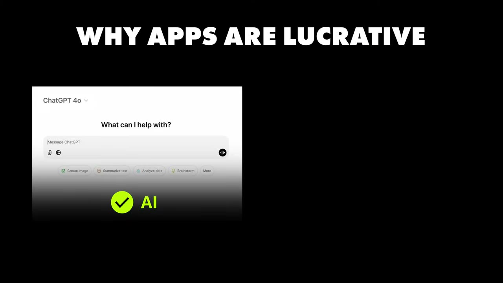
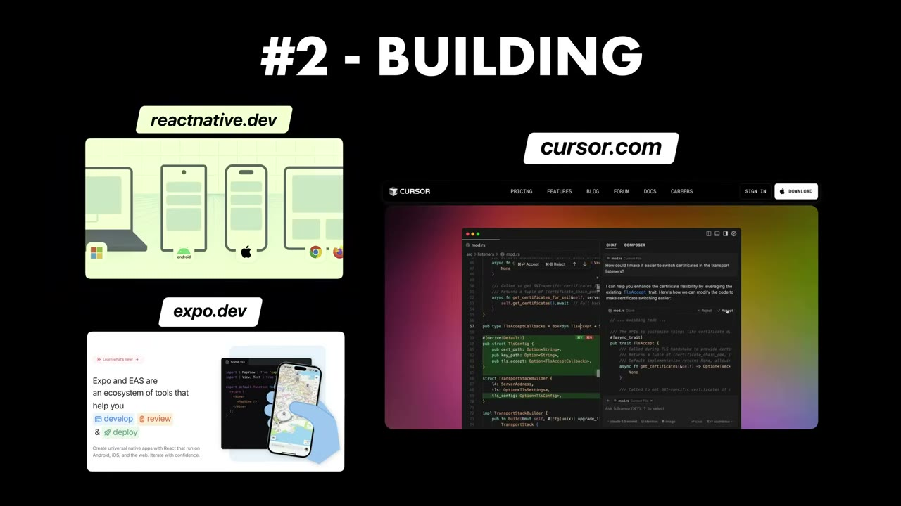

# He Made $10M with 3 iPhone Apps

✅ **Đã phân tích sâu** → [`case.md`](case.md)

| | |
|---|---|
| **Video** | <https://www.youtube.com/watch?v=5u9u8yzPEpA> |
| **Đăng** | 29/12/2024 |
| **Thời lượng** | 20:24 |
| **Lượt xem** | 260,856 |
| **Lượt thích** | 9,710 |
| **Video ID** | `5u9u8yzPEpA` |

## Trong thư mục này

| File | Nội dung |
|---|---|
| [`case.md`](case.md) | **Phân tích đầy đủ** — ý tưởng, validate, GTM, áp dụng ở VN |
| [`meta.json`](meta.json) | Metadata gốc (chapters, heatmap, mô tả) |
| [`screenshots/`](screenshots/) | 10 ảnh 720p |

## Mô tả gốc

This is how Blake Anderson built 3 AI iPhone apps that have earned him over $10M.

## Số liệu bắt được từ transcript

> Các đoạn founder nhắc tới con số, kèm timestamp để tua thẳng tới đó trong video.

_(không bắt được con số nào)_

## Chương

- `00:00` Intro
- `01:08` Who is Blake
- `02:06` Opportunities in apps right now
- `03:21` How he got started
- `04:36` His first app
- `06:38` Mobile app ideas
- `07:38` Methods for finding winning ideas
- `08:53` Validation process
- `09:37` Tools
- `11:37` Marketing
- `12:29` Monetization
- `13:35` Expenses
- `14:38` Profit margins
- `15:05` Leaving Riz GPT
- `15:32` Tech Stack
- `16:09` Personal Stuff
- `16:59` Biggest Lesson
- `18:21` Advice to Entrepreneurs

## Ảnh

1. `01_01m40s_usd-5-m.jpg` — 
2. `02_02m18s_ch-opportunities-in-apps-right-now.jpg` — 
3. `03_03m33s_ch-how-he-got-started.jpg` — 
4. `04_04m18s_usd-50-000.jpg` — 
5. `05_05m23s_usd-50.jpg` — 
6. `06_06m50s_ch-mobile-app-ideas.jpg` — 
7. `07_07m25s_usd-400-m.jpg` — 
8. `08_09m05s_ch-validation-process.jpg` — 
9. `09_10m28s_replay.jpg` — 
10. `10_18m50s_replay.jpg` — 

---

← [Quay lại index](../../index.md) · [Toàn bộ video](../README.md)
