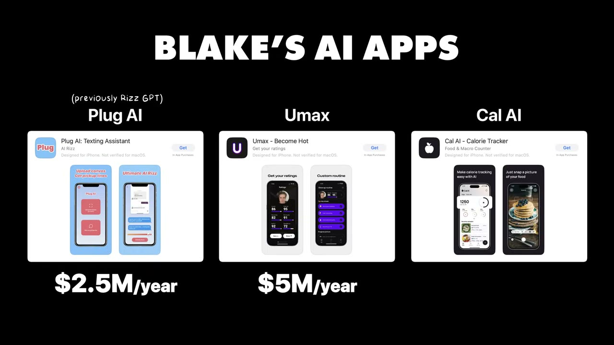
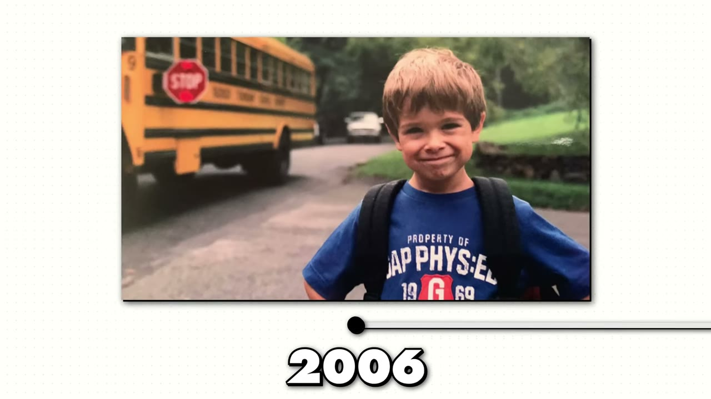
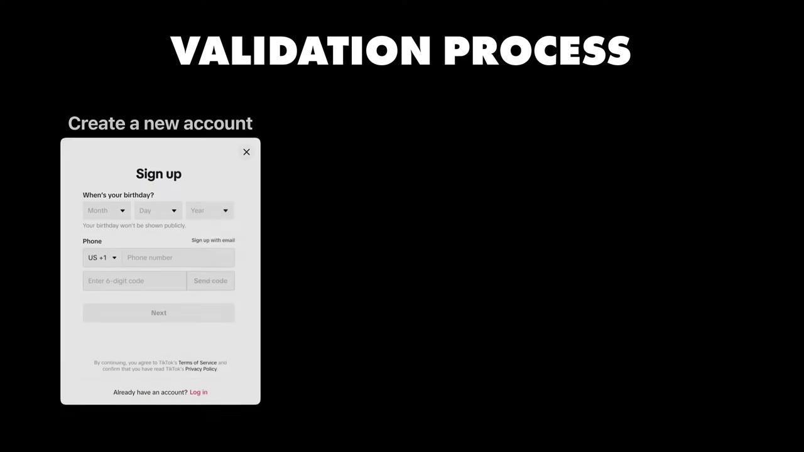
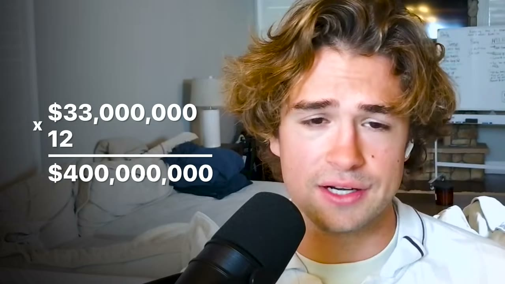

# RizzGPT + Umax + Cal AI — $10M kiếm được từ 3 app iPhone, sau chưa đầy 2 năm học code

> **Tóm tắt 30 giây:** Blake Anderson tốt nghiệp đại học với 0 đồng, ở nhà bố mẹ, vay tiền anh trai đi chợ. Anh tự học code bằng ChatGPT **trong đúng một tháng**, launch RizzGPT tháng 7/2023. Bản đầu tệ tới mức không có notification, không có review, paywall hỏng. Rồi anh chi **$100** thuê hai creator vô danh — qua một đêm được 5-10 triệu view, **45.000 lượt tải trong ngày, 500.000 trong tháng, $80K MRR gần như toàn bộ là lợi nhuận**. Ba app sau đó (RizzGPT, Umax, Cal AI) tổng gần $20M/năm. Bài học trung tâm không phải AI, mà là: **phân phối trên TikTok/Instagram đang rẻ bất thường vì các thuật toán đang đánh nhau và phải bơm view cho tài khoản mới.**

## ⚠️ Cảnh báo trước khi đọc

1. **Video này quay tháng 12/2024** — cũ nhất trong kho tính tới giờ. Nhiều con số đã lỗi thời. Cal AI về sau **đã được bán** (xem [24 giờ với các triệu phú iOS](../2026-08-16_i-spent-24-hours-with-ios-millionaires/case.md)), và mảng "AI calorie tracker" đã bị clone hàng loạt — ví dụ [CalBuddy](../2026-08-09_i-copied-a-huge-app-now-i-make-80k-month/case.md) làm bản tiếng Do Thái ra $80K/tháng. Mảng "glowup" mà Umax mở ra cũng đã đông đúc: [GlowUp](../2025-12-17_my-mobile-app-made-800k-in-365-days/case.md), [Glowly](../2026-08-12_the-lazy-method-how-i-build-10k-month-apps/case.md).
2. **Thiên kiến nguồn nặng.** Video 20 phút có **hai lần chèn quảng cáo** Starter Story Academy, cộng thêm đoạn kết Pat Walls tự chốt "vì thế tôi tạo ra Academy". Đây là video bán khoá học có kèm nội dung, không phải điều tra độc lập.
3. **Số liệu bất đối xứng.** Blake nói rõ lợi nhuận Umax (hơn $100K/tháng) và Cal AI (vài trăm nghìn/tháng), nhưng **từ chối nói lợi nhuận RizzGPT** vì "co-founder khác đang điều hành". Nghĩa là con số $10M ở tiêu đề có phần không kiểm chứng được.

## 1. Con số

| Chỉ số | Giá trị |
|---|---|
| RizzGPT | $2.5M ARR (Blake đã rời đội, giữ equity) |
| Umax | gần $5M doanh thu 12 tháng, hơn $100K lợi nhuận/tháng |
| Cal AI | hơn $1M doanh thu/tháng sau 6 tháng, vài trăm nghìn lợi nhuận/tháng |
| Tổng danh mục | gần $20M/năm (Pat Walls tóm tắt) |
| Chi phí cú hích đầu tiên | **$100** ($50 x 2 creator) |
| Kết quả cú hích đó | 5-10 triệu view qua đêm → 45K tải ngày đầu → 200K tuần đầu → 500K tháng đầu → **$80K MRR** |
| Đỉnh RizzGPT | hơn $250K MRR, rồi tụt về mặt bằng $150-200K |
| Thời gian học code | 1 tháng (5-6/2023), launch 7/2023 |

**Mâu thuẫn nội tại cần ghi rõ:** RizzGPT được nói là "$2.5M ARR" nhưng cũng được nói là chạy ổn định ở "$150-200K MRR" — tức $1.8M-$2.4M/năm. Hai con số này khớp nhau ở mức chấp nhận được (làm tròn lên). Nhưng "$10M đã kiếm được" thì không thể tách bạch giữa doanh thu gộp, doanh thu phần anh sở hữu, và lợi nhuận sau thuế Apple. **Hãy đọc con số này như doanh thu gộp cộng dồn của các app anh dính líu, không phải tiền vào túi anh.**

## 2. Cú hích $100 — chi tiết đắt nhất của cả video ⭐⭐⭐

Đây là đoạn cần đọc kỹ nhất, vì nó phá vỡ trực giác của phần lớn người mới.

Bản RizzGPT đầu tiên, theo lời chính founder:

> *"The first version of the app was so bad I built this myself — we didn't have notifications, we didn't have reviews, the design was a mess, **the paywall was terrible**."*

Anh chạy vài promo đầu tiên, không ăn thua gì. Vài lượt tải, vài đô.

Rồi:

> *"Then I find these two underground kind of undiscovered creators. I pay them each $50 for promo, so **$100 total**, and overnight — 5, 10 million views total, **45,000 downloads in that first big day**, 200,000 downloads on that week, 500,000 downloads on the month. **We're at 80K MRR from the jump, that's pretty much all profit.**"*

### Cơ chế: vì sao $100 lại ra được kết quả đó?

Blake giải thích thẳng, và đây là phần có giá trị thật:

> *"I don't think that the algorithms were as optimized for new accounts to be able to generate millions of views a few years ago, but now that they're **all in bloodbath competition with one another**, they have to incentivize new creators, and so they'll push more views to new accounts than they did previously."*

Diễn giải cho bạn:
- **Nguồn cung view rẻ đến từ chiến tranh nền tảng**, không từ tài năng của Blake. TikTok/Reels/Shorts đang giành creator của nhau nên cùng bơm reach cho tài khoản mới.
- **"Undiscovered creators" là từ khoá.** Anh không thuê KOL. Anh thuê những đứa 18-19 tuổi làm nội dung vì vui, chưa biết định giá bản thân. $50 là mức giá của sự chưa-được-khám-phá, không phải mức giá thị trường.
- **Cửa sổ này sẽ đóng** khi các creator đó biết giá trị của mình, hoặc khi nền tảng ngừng trợ cấp reach. Đến 2026, giá influencer trong ngách app đã lên nhiều.

### Cách anh tiếp cận creator — đoạn ít ai kể ⭐⭐

Câu hỏi thường gặp là "tôi DM 10 người, không ai trả lời". Blake trả lời không khoan nhượng:

> *"They'll DM 10 influencers and they get no responses, they go 'oh this is so hard', and I'm like: no, **you're just not getting creative**. With RizzGPT the creators making the most profitable content, most of them were like 18, 19 years old — they're just doing it for fun, and so getting in contact with them was really difficult. I would find that one of them had a Discord link hidden in their Instagram bio, and I would join that Discord and **send a message every 10 minutes until the person responded**. There were guys that I was DMing their mom saying: hey, get me a contact with your son, I want to pay him money."*

Đây là lợi thế mà một team có vốn không có: **sự lì lợm ở quy mô nhỏ**. Không agency nào chịu nhắn tin cho mẹ của một đứa 18 tuổi để mua promo $50.

## 3. Hai lý do khiến app đang là mảnh đất tốt ⭐⭐

Blake nêu đúng hai lý do, và cả hai đều là lý do **về cấu trúc**, không phải về sản phẩm:

1. **AI hạ chi phí giải bài toán.** *"With RizzGPT it would have been virtually impossible to build an AI dating assistant without the use of LLMs."* Một lớp vấn đề trước đây không giải được bằng phần mềm, giờ giải được.
2. **Kỹ thuật phân phối mới đang "solvable".** *"TikTok and Instagram are very solvable right now."*

Điểm mấu chốt: **cả hai đều là cửa sổ thời gian, không phải năng lực bền vững.** Nếu bạn định copy mô hình này năm 2026, hãy tự hỏi cửa sổ nào còn mở.

## 4. Cách tìm ý tưởng — ba phương pháp khác nhau cho ba app ⭐⭐⭐

Blake nói thẳng là anh **không có một công thức duy nhất**. Mỗi app một kiểu:

| App | Cách tìm ra |
|---|---|
| **RizzGPT** | Vấn đề quan sát trực tiếp — bạn bè trong group chat hội sinh viên liên tục hỏi "tao nên nhắn gì cho con này". |
| **Umax** | Cơ hội thị trường — thấy người ta **đã chi tiền cho sản phẩm vật lý** (skincare, haircare, Gua Sha) nhưng chưa có phần mềm nào giải vấn đề đó. |
| **Cal AI** | Nhập vai thị trường — tạo tài khoản mới, chỉ xem nội dung về dinh dưỡng, đếm calo, tập tạ, cho tới khi tự nghĩ như người trong ngách. |

### Heuristic đáng in ra dán tường ⭐⭐⭐

> *"When you find a niche that's **heavily monetized with physical products**, that's a good indicator that the niche converts. It's also a good indicator that you can probably build a software application to solve a problem within it."*

**Vì sao cơ chế này đúng:** sản phẩm vật lý có chi phí biên cao (hàng, ship, kho). Nếu một ngách vẫn nuôi sống được cả một ngành hàng vật lý, nghĩa là **willingness-to-pay đã được chứng minh bằng tiền thật ở mức giá cao**. Phần mềm cùng ngách có chi phí biên gần 0 → cùng một khách, biên lợi nhuận gấp nhiều lần. Đây là cách đọc thị trường tốt hơn "tìm pain point" chung chung, vì nó đo bằng tiền chứ không đo bằng lời than.

**Áp dụng cho VN:** nhìn các ngách người Việt đang chi tiền vật lý mạnh — thực phẩm chức năng, mỹ phẩm, đồ tập gym, khoá học offline, đồ chơi trẻ em giáo dục. Ở mỗi ngách đó, hỏi: phần mềm nào chưa tồn tại?

### Cách validate — nhập vai, không phải khảo sát ⭐⭐

> *"My validation process primarily looks like a deep dive into the niche on social media. I'll create an account — say Cal — and then purely consume nutrition and dieting and calorie counting weightlifting content, essentially **becoming the target market**, and then thinking about what it is that **I** want, and then just build that."*

Đây là một trường phái validate **đối lập hẳn** với nhiều case khác trong kho:

| Trường phái | Ai | Đúng khi nào |
|---|---|---|
| Nhập vai thị trường qua feed mạng xã hội rồi tự làm cho chính mình | Blake (case này) | B2C mass-market, chi phí build thấp, bạn có thể **thực sự** trở thành người dùng |
| Nói chuyện với khách thật / validate trước khi viết code | [Once](../2026-05-10_i-built-a-20k-month-app-in-83-days/case.md), [Gojiberry AI](../2026-01-25_how-i-used-reddit-to-build-a-34k-month-saas/case.md) | B2B, chi phí build cao, bạn KHÔNG phải người dùng |
| Bám ý định tìm kiếm, không cần validate cảm tính | [FollowBuddy](../2026-03-19_i-make-17k-month-with-one-strategy/case.md) | Vấn đề người ta chủ động đi tìm, có từ khoá rõ |

**Phân định:** cách của Blake chỉ hoạt động khi **bạn có thể giả làm người dùng một cách chân thật**. Một người đàn ông 35 tuổi ở Hà Nội không thể "trở thành" nữ sinh Mỹ 19 tuổi bằng cách xem TikTok 2 tuần. Nếu bạn không thể nhập vai thật, hãy đi đường validate bằng phỏng vấn.

## 5. Bộ công cụ nếu làm lại từ đầu hôm nay ⭐⭐

Blake được hỏi thẳng: nếu reset về 0, chỉ còn ý tưởng, anh làm gì?

| Việc | Công cụ | Ghi chú của founder |
|---|---|---|
| Thiết kế | **Figma** | *"Learning how to use Figma will be one of the greatest unlocks."* Kể cả bạn không định làm designer, bạn **phải** dùng được Figma để làm việc với designer. Cách làm: lấy các app có chức năng tương tự làm reference. |
| Code | **React Native + Expo, IDE là Cursor** | Không bàn cãi thêm |
| Nội dung | **CapCut** | Slideshow + video faceless + video nói thẳng vào camera |
| Paywall | **Superwall** | Xem mục 6 |
| Ngân hàng | **Mercury** | *"Best platform for startup banking in the US"* — người VN gần như chắc chắn không mở được, xem phần rào cản |
| Thuê ngoài | **Upwork** | Mẹo cụ thể bên dưới |
| Ngôn ngữ | React Native + Node.js | *"Pretty straightforward, nothing special"* |

### Mẹo thuê Upwork đáng giá ⭐⭐

> *"Hire like **5 to 10 guys to do an hour or two of work**, and then stick with the best guy. That tends to work very well."*

Cơ chế: bạn đang mua **thông tin** chứ không mua **sản phẩm**. Chi phí 5-10 giờ freelancer rẻ hơn nhiều so với chi phí chọn nhầm một người rồi làm với họ 3 tháng. Đây là cách áp dụng A/B test vào tuyển dụng.

## 6. Kinh tế đơn vị — phần trung thực nhất của video ⭐⭐⭐

Đây là mục quan trọng nhất với người Việt, vì nó cho biết **tiền thật sự đi đâu**.

### Apple cắt bao nhiêu (con số thực tế, không phải con số trên giấy)

> *"Apple charges 15%, but for whatever reason it's really **closer to 20%** of revenue, up to your first million dollars in earnings. Beyond that Apple charges 30, but really **close to like 33%**."*

Chênh lệch giữa 15% và 20% đến từ thuế/phí xử lý theo từng thị trường và chênh lệch tỉ giá. **Khi tính mô hình tài chính, hãy dùng 20% và 33%, không phải 15% và 30%.**

### Chi phí AI thấp hơn mọi người tưởng rất nhiều

> *"One thing that people significantly overestimate is the cost of AI in the backend. **Unless you're doing image generation or using advanced voice mode, AI costs are sub 3%.**"*

Đây là con số nên nhớ. Nỗi sợ "chi phí OpenAI ăn hết lợi nhuận" phần lớn là ảo tưởng — trừ hai trường hợp: **sinh ảnh** và **voice mode**. Nếu app của bạn chỉ gọi text LLM, chi phí AI không phải bài toán.

### Biên lợi nhuận theo kênh phân phối ⭐⭐⭐

Đây là bảng đắt nhất trong video:

| Kênh | Biên lợi nhuận |
|---|---|
| **Internal UGC** (tự làm nội dung, đăng lên tài khoản mang thương hiệu app) | **50-80%** |
| **Influencer marketing** (trả tiền người có sẵn audience) | **25-70%** |
| **Paid ads** | **0-30%** |

> *"In-house organic content might be the way to go if you don't want to spend all your profits on marketing."*

**Cơ chế:** paid ads là thị trường đấu giá — biên lợi nhuận của bạn bị san phẳng bởi đối thủ trả giá cao nhất. Nội dung tự làm không có đấu giá, chỉ có chi phí thời gian, nên biên giữ được. Đổi lại nó không mua được bằng tiền và không scale tuyến tính.

**Đây là chỗ mâu thuẫn với nhiều case khác trong kho** (ví dụ các case chạy Google Ads hay Apple Search Ads). Phân định: paid ads đúng khi bạn có **LTV cao và đo được** — B2B, hoặc app có giá cao. Nội dung tự làm đúng khi **ARPU thấp và thị trường là mass-market B2C** — đúng trường hợp của Blake.

### Superwall — đòn bẩy 1.5-2x ⭐⭐

> *"You should use Superwall. Superwall enables you to split test different offerings — different price points, whether it's weekly, yearly, monthly, at different points in the app. **Being able to test these different offerings and different placements within the app can take you from making X per user that downloads to 1.5 or 2X.**"*

Đọc kỹ: đây **không phải** tối ưu conversion rate đơn thuần. Đây là test **cả ba biến cùng lúc**: mức giá, chu kỳ (tuần/tháng/năm), và **vị trí paywall xuất hiện trong luồng app**. Biến thứ ba thường bị bỏ qua và thường là biến mạnh nhất.

### Triết lý giá — cố tình để giá thấp

> *"Generally I try to go with lower price points for a couple of reasons. One, I want as many people as possible to be able to use my applications — people are more likely to tell their friends about it, get generally more positive user sentiment on social media. But then it also is more sustainable for long-term growth."*

**Mâu thuẫn với các founder khác:** [Fernando Pessagno](../2024-12-02_i-make-15k-month-with-2-ai-apps/case.md) đi hướng ngược — nâng giá sau khi thêm tính năng, và định vị *"affordable, not cheap"*. Phân định bằng **mô hình phân phối**: Blake sống nhờ nội dung lan truyền, nên **sentiment mạng xã hội là đầu vào của cỗ máy tăng trưởng** — giá cao làm hỏng đầu vào đó. Fernando sống nhờ SEO, nơi sentiment không ảnh hưởng tới thứ hạng → anh được tự do nâng giá.

## 7. Vì sao anh rời RizzGPT

Câu trả lời ngắn và thẳng:

> *"Left because one of my co-founders and I were constantly going head-to-head about who's at the helm of the company. What I said to him was: okay, we can't work together anymore — either you run the company and I keep my equity, or I run the company and you keep your equity. And he wanted to continue running it, which I was like: great, I'm going to go work on new projects."*

Bài học kín đáo ở đây: anh **giữ equity** thay vì bán rẻ để thoát. Một phần lớn trong con số "$10M" của tiêu đề nhiều khả năng là equity chứ không phải tiền mặt.

## 8. Động cơ tâm lý — "sense of urgency" ⭐⭐

Blake nói đây là bài học lớn nhất cả hành trình:

> *"My most productive and successful periods have come when there's **a lot of risk and a lot of urgency**. When I was building RizzGPT it was like: I'm at home making 0 while my parents' house is on the market, meanwhile all of my friends are making these great six-figure salaries. When I was building Umax I had just split from my previous team and I felt like I had something to prove — **I was on my brother's couch, I spent Thanksgiving alone, I had some sliced turkey while I was coding.**"*

**Đọc con số này cẩn thận.** Đây là dạng câu chuyện dễ bị lãng mạn hoá. Điều đáng rút ra không phải "hãy tự làm khổ mình", mà là: **các ràng buộc thật (hết tiền, hết đường lùi) tạo ra tốc độ quyết định cao hơn**. Nếu bạn không ở hoàn cảnh đó, hãy tự tạo ràng buộc nhân tạo — deadline công khai, đặt cọc, tuyên bố trước cộng đồng. Cách này chính là cách [Fernando](../2024-12-02_i-make-15k-month-with-2-ai-apps/case.md) dùng khi tự đặt thử thách 10 ngày.

Lời khuyên cuối cùng của anh:

> *"Abstract yourself away from what you hear on social media and what others are telling you to do. You have to be able to think on your own and think from first principles. There's a Naval quote: **if you want to make the wrong decision, ask everybody.**"*

Trớ trêu: câu này nằm trong một video bán khoá học dạy bạn làm theo người khác.

## 9. Hai ý tưởng anh cho không (tính tới cuối 2024)

1. **Career AI platform** — hiện có rất nhiều công cụ rời rạc (AI LinkedIn image generator, AI resume analysis). Cơ hội là gộp tất cả lại thành một nền tảng, định vị: *nếu bạn là sinh viên muốn xin việc, đây là nền tảng của bạn.* Web + mobile.
2. **Language learning** — voice mode nâng cao của ChatGPT gần như là gia sư riêng. *"Duolingo is making $33 million a month, multiply that by 12 and we get $400 million per year. **You capture 1% of that market and you have a $4 million annual application on your hands.**"*
3. Anh cũng nói mảng **all-in-one AI glowup** vẫn còn chỗ: *"Umax was kind of like the first iteration, but there's still millions and millions on the table."*

**Cảnh báo về phép tính "1% của thị trường":** đây là kiểu lập luận nổi tiếng là sai trong đầu tư. Không có cơ chế nào bảo đảm bạn lấy được 1%; thị trường không chia đều. Hãy đọc nó như một cách ước lượng **trần thị trường**, không phải dự báo doanh thu. Đáng chú ý là tới 2026, ngách này đã có case thật trong kho — nhưng thắng bằng **ngôn ngữ ngách** ([CalBuddy](../2026-08-09_i-copied-a-huge-app-now-i-make-80k-month/case.md) làm bản tiếng Do Thái), không phải bằng cách chiếm 1% của Duolingo.

## 10. Kết luận của Pat Walls — phân phối thắng sản phẩm

Đoạn recap cuối video đáng chép lại:

> *"Nearly every really really successful bootstrapped B2C app like this **purely got traction from content**. The most successful B2C founders truly understand that **product is just not as important as distribution** — distribution and attention wins the game. If your app is not niche, it's like a calorie tracking app, then you must be ready and excited for the content game."*

Điều kiện hoá cho đúng: câu này chỉ đúng với **B2C mass-market không có ngách bảo vệ**. Với B2B ngách hẹp ([Packager](../2026-03-15_i-make-60k-month-from-the-most-boring-saas-on-the-in/case.md)) hoặc sản phẩm có ý định tìm kiếm rõ ([Bank Statement Converter](../2025-07-20_i-make-40k-month-with-this-one-website/case.md)), sản phẩm và SEO quan trọng hơn nội dung viral nhiều.

## 11. Áp dụng cho tôi (indie hacker VN)

### Sao chép được gì

- **Phép thử $100.** Đây là thứ đáng copy nhất. Tìm 2-5 creator **chưa được khám phá** trong ngách của bạn (dưới 50K follower, đang làm nội dung vì vui), trả mỗi người $30-50, đo. Chi phí thử nghiệm gần như bằng 0 so với mọi kênh khác. Với thị trường VN, con số này còn rẻ hơn nữa.
- **Heuristic "ngách nào đang bán được hàng vật lý".** Áp dụng trực tiếp cho thị trường VN. Đây là bộ lọc ý tưởng tốt hơn nhiều so với brainstorm.
- **Dùng 20% và 33% khi tính mô hình Apple**, không phải 15% và 30%.
- **Biết chi phí AI dưới 3%** để không sợ hãi vô cớ, và biết rõ hai ngoại lệ (sinh ảnh, voice).
- **Mẹo Upwork 5-10 người thử 1-2 giờ** — áp dụng được ngay cho việc thuê freelancer VN.
- **Internal UGC trước, influencer sau, paid ads sau cùng.** Thứ tự này khớp với thứ tự biên lợi nhuận.

### Rào cản thật

- **Ngân hàng và pháp lý.** Mercury (và phần lớn ngân hàng startup Mỹ) **không mở tài khoản cho người VN không có công ty Mỹ**. Để nhận tiền từ App Store bạn cần một pháp nhân — Mỹ (LLC + EIN, chi phí lập và duy trì khoảng $500-1.500/năm), hoặc Singapore, hoặc dùng dịch vụ trung gian. **Đây là rào cản đầu tiên và tốn tiền nhất, phải giải trước khi viết dòng code nào.**
- **Dòng tiền âm 30-45 ngày.** Apple trả tiền theo chu kỳ tháng, sau khi kết sổ. Nếu bạn chi tiền influencer hôm nay, tiền về sớm nhất là hơn một tháng sau. Với ngân sách nhỏ, đây là chỗ chết vốn lưu động.
- **Cửa sổ influencer đã hẹp hơn 2024 rất nhiều.** Blake mua $50/creator vào 2023. Đến 2026, thị trường này đã được khám phá — chính video này (260K view) góp phần khép cửa sổ đó lại.
- **Rào cản văn hoá lớn hơn rào cản ngôn ngữ.** Cách validate của Blake là "trở thành thị trường mục tiêu". Nếu bạn nhắm Gen Z Mỹ, bạn không chỉ cần tiếng Anh — bạn cần cảm được cái hài hước, cái xấu hổ, cái khao khát của họ. Đây là lý do thật khiến case này khó copy, chứ không phải code.
- **Rủi ro nền tảng kép.** Bạn phụ thuộc **cả App Store lẫn thuật toán TikTok**. Hai nút thắt, không nút nào bạn kiểm soát. RizzGPT tụt từ $250K xuống $150K MRR chính là biểu hiện của việc đó.
- **Ngách "AI dating assistant" và "AI glowup" có rủi ro chính sách.** App Store có thể siết loại nội dung này; TikTok có thể chặn quảng bá. Umax từng vướng tranh cãi về việc chấm điểm ngoại hình.

### Khi nào KHÔNG dùng mô hình này

- **Khi bạn không sẵn sàng làm nội dung mỗi ngày.** Pat nói thẳng: nếu app của bạn không phải ngách hẹp, bạn **bắt buộc** phải chơi trò nội dung. Nếu bạn ghét lên hình và ghét làm video, hãy đi đường SEO của [FollowBuddy](../2026-03-19_i-make-17k-month-with-one-strategy/case.md) hay [Bank Statement Converter](../2025-07-20_i-make-40k-month-with-this-one-website/case.md) thay vì mô hình này.
- **Khi bạn cần doanh thu ổn định để sống.** Mô hình này có phân phối **giật cục** — một promo trúng ra $80K MRR, mười promo trượt ra $0. Nó không phải dòng tiền đều. Nếu bạn cần $2.000/tháng ổn định để nghỉ việc, B2B ngách hẹp an toàn hơn nhiều.
- **Khi ngách của bạn là B2B hoặc có ý định tìm kiếm rõ ràng.** Trò chơi nội dung viral tốn công vô ích khi khách của bạn đang gõ tìm giải pháp trên Google.
- **Khi bạn không thể trở thành người dùng của chính mình.** Toàn bộ quy trình validate của Blake sụp đổ nếu bạn không nhập vai được.

## Nguồn

- Video: <https://www.youtube.com/watch?v=5u9u8yzPEpA> (20:24, đăng 29/12/2024, 260.856 view)
- [Transcript đầy đủ](transcript.md) · [Ảnh chụp](screenshots/)
- **Ghi chú tên riêng:** phụ đề tự động đọc sai nhiều tên. `Riz GPT` = **RizzGPT**; `umax` = **Umax**; `CI`/`K I`/`C I` = **Cal AI** (xác nhận qua đoạn founder mô tả tạo tài khoản tên Cal để xem nội dung đếm calo); `super wall` = **Superwall**; `EXP Expo` = **Expo**; `no JS` = **Node.js**.
