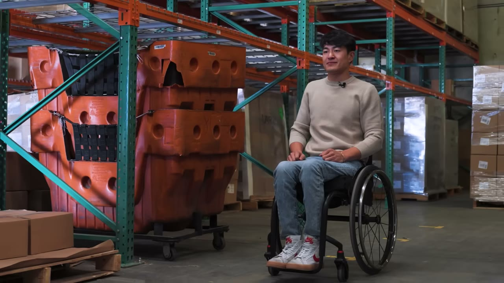
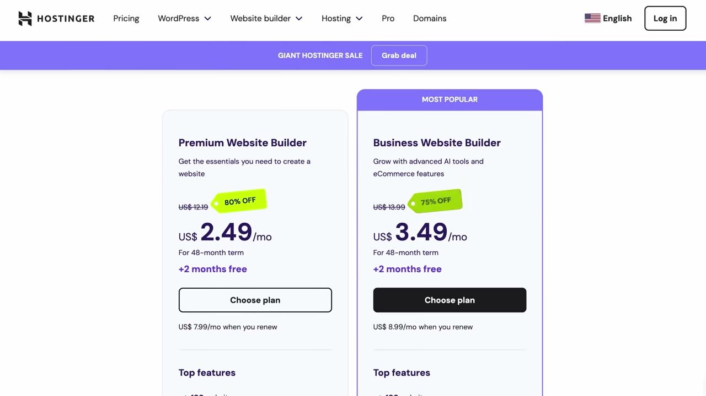
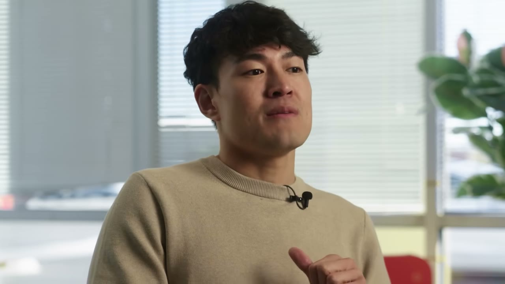
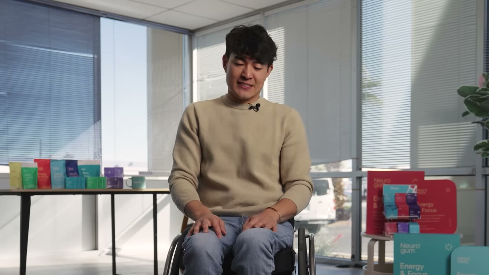

# The Underdog: From Life Changing Accident to $100M/Year

✅ **Đã phân tích sâu** → [`case.md`](case.md)

| | |
|---|---|
| **Video** | <https://www.youtube.com/watch?v=BeRKQkU5Ceo> |
| **Đăng** | 07/02/2025 |
| **Thời lượng** | 16:17 |
| **Lượt xem** | 125,579 |
| **Lượt thích** | 3,214 |
| **Video ID** | `BeRKQkU5Ceo` |

## Trong thư mục này

| File | Nội dung |
|---|---|
| [`case.md`](case.md) | **Phân tích đầy đủ** — ý tưởng, validate, GTM, áp dụng ở VN |
| [`meta.json`](meta.json) | Metadata gốc (chapters, heatmap, mô tả) |
| [`screenshots/`](screenshots/) | 4 ảnh 720p |

## Mô tả gốc

This is the true story of how Ryan Chen and Kent Yoshimura overcame the odds and built a $100M company called NeuroGum.
Starter Story Second Channel :)

## Số liệu bắt được từ transcript

> Các đoạn founder nhắc tới con số, kèm timestamp để tua thẳng tới đó trong video.

_(không bắt được con số nào)_

## Chương

_(không có chapter)_

## Ảnh

1. `01_01m08s_usd-100-m.jpg` — 
2. `02_08m33s_usd-30-000.jpg` — 
3. `03_12m56s_replay.jpg` — 
4. `04_14m16s_usd-10-m.jpg` — 

---

← [Quay lại index](../../index.md) · [Toàn bộ video](../README.md)
