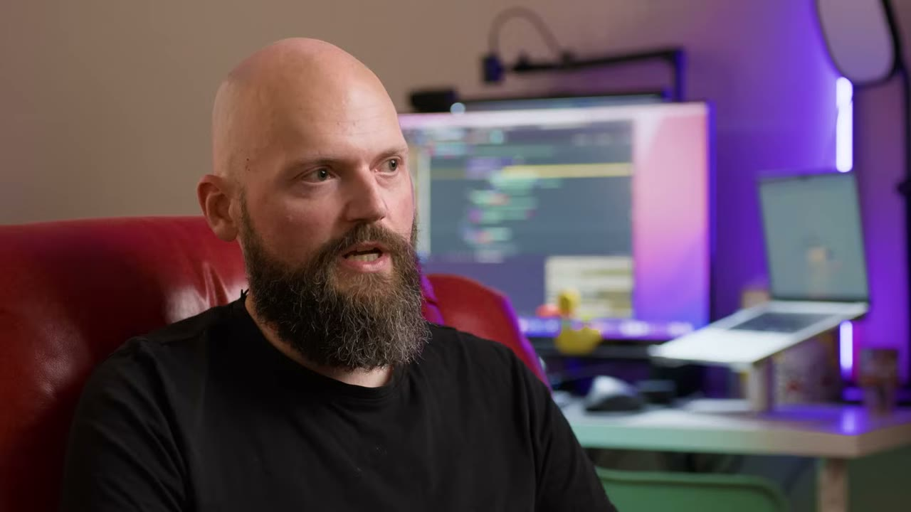
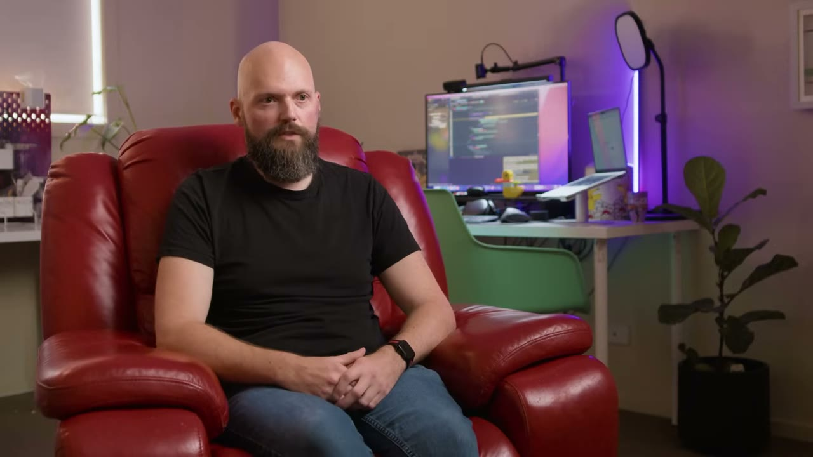
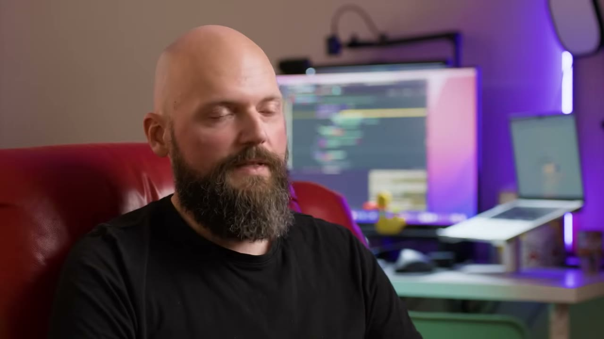
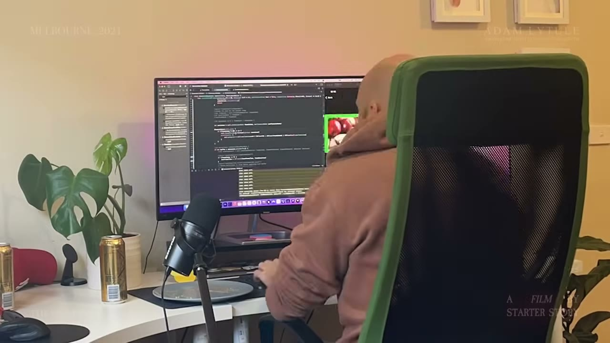

# The Underdog: From $200K in Debt to $1M App Maker

✅ **Đã phân tích sâu** → [`case.md`](case.md)

| | |
|---|---|
| **Video** | <https://www.youtube.com/watch?v=h9R6ZeNruuI> |
| **Đăng** | 26/02/2025 |
| **Thời lượng** | 18:16 |
| **Lượt xem** | 81,478 |
| **Lượt thích** | 2,714 |
| **Video ID** | `h9R6ZeNruuI` |

## Trong thư mục này

| File | Nội dung |
|---|---|
| [`case.md`](case.md) | **Phân tích đầy đủ** — ý tưởng, validate, GTM, áp dụng ở VN |
| [`meta.json`](meta.json) | Metadata gốc (chapters, heatmap, mô tả) |
| [`screenshots/`](screenshots/) | 9 ảnh 720p |

## Mô tả gốc

This is the true story of how Adam Lyttle went from having over $200,000 dollars in debt, to becoming a $1M app developer.
Starter Story Second Channel :)

## Số liệu bắt được từ transcript

> Các đoạn founder nhắc tới con số, kèm timestamp để tua thẳng tới đó trong video.

_(không bắt được con số nào)_

## Chương

_(không có chapter)_

## Ảnh

1. `01_01m25s_usd-200-000.jpg` — 
2. `02_03m17s_usd-300-000.jpg` — 
3. `03_04m39s_usd-10-000.jpg` — 
4. `04_05m41s_usd-200-000.jpg` — 
5. `05_08m06s_usd-200-000.jpg` — 
6. `06_11m18s_usd-224-000.jpg` — 
7. `07_13m25s_usd-2.jpg` — 
8. `08_14m07s_replay.jpg` — 
9. `09_14m44s_usd-10-000.jpg` — 

---

← [Quay lại index](../../index.md) · [Toàn bộ video](../README.md)
