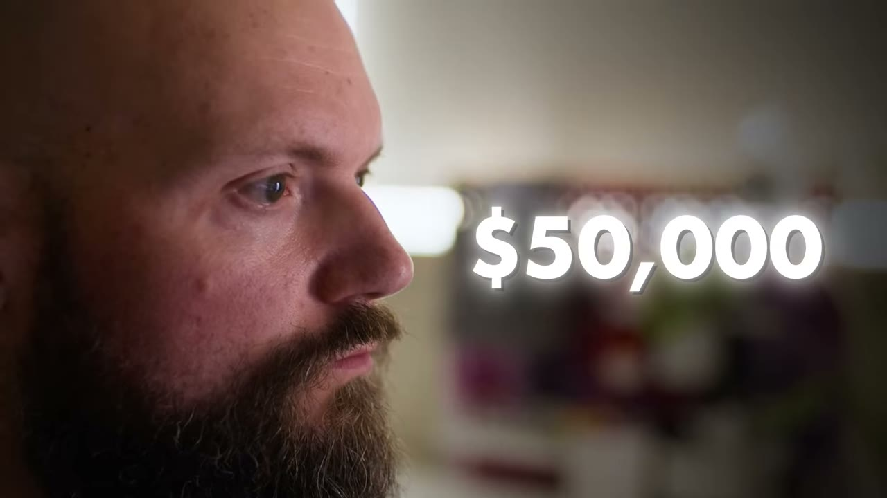
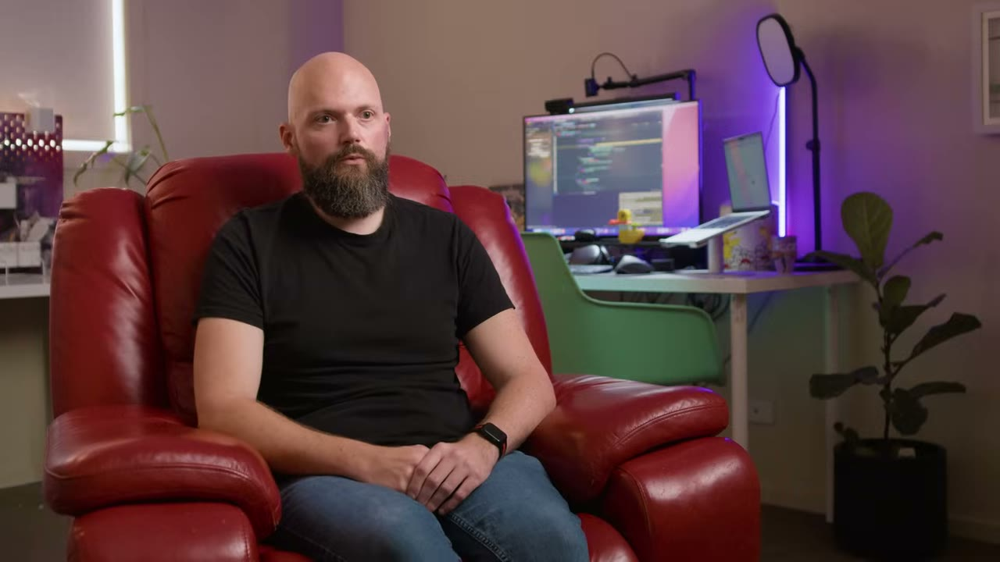
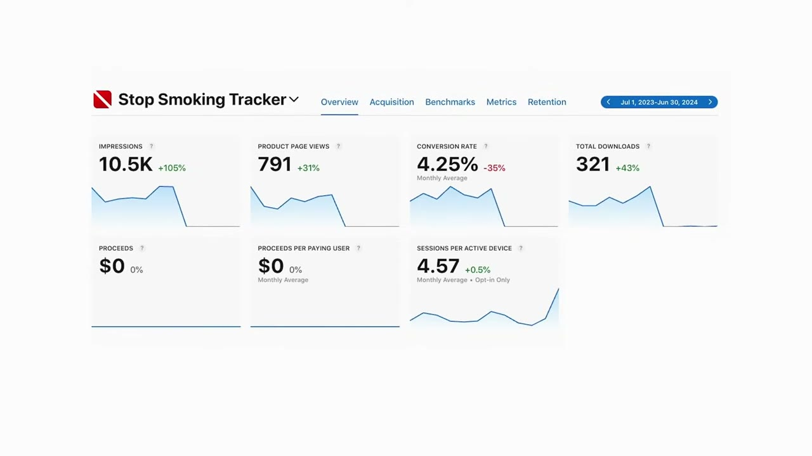
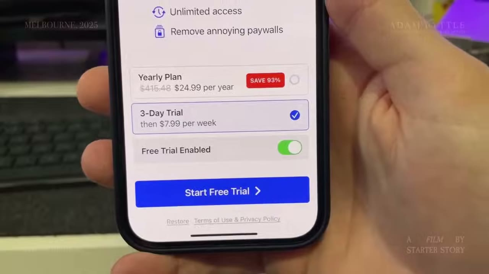

# Adam Lyttle — từ nợ $200K tới $50-60K/tháng bằng danh mục app

> **Tóm tắt 30 giây:** Adam Lyttle mất tất cả khi agency web của anh sập vì Wix/Squarespace — từ $300K lợi nhuận/năm xuống $200K nợ không bảo đảm, xe bị thu, tài khoản bị đóng băng. Anh đi cắt cỏ thuê để sống, rồi tự đặt thử thách **làm 1 app mỗi tháng**. Sau hơn 50 app, một app bán được **$224.000** cứu anh khỏi phá sản. Nhưng cú nhảy thật sự đến sau cùng: **anh không làm app mới — anh thay paywall và onboarding của app đang có, và doanh thu bật từ $10K lên $50K/tháng gần như qua đêm.**

## 1. Con số

| Chỉ số | Giá trị |
|---|---|
| Doanh thu hiện tại | $50.000–$60.000/tháng |
| Doanh thu trước khi đổi paywall | ~$10.000/tháng |
| Nợ đã trả hết | $200.000 (credit card + car loan, không bảo đảm) |
| Đỉnh của agency cũ | ~$300.000 lợi nhuận/năm |
| Giá bán một website hồi đó | $10.000 (Wix/Squarespace giết bằng $10/tháng) |
| Exit lớn nhất | $224.000 = 2x doanh thu năm của một app ~$11K/tháng |
| Số app đã build | hơn 50 (đã mất đếm) |
| Kỷ lục 1 tháng | 9 app (mục tiêu 10) |
| Team | 1 người |

### ⚠️ Mâu thuẫn số liệu — phải đọc trước khi trích

Video này có **ba chỗ số liệu không khớp**, tôi nêu thẳng:

1. **Tiêu đề nói "$1M App Maker" nhưng transcript không hề có con số $1 triệu.** Con số cao nhất được nói ra là $50–60K/tháng, tức $600–720K/năm. "$1M" nhiều khả năng là **tổng tích luỹ nhiều năm** (doanh thu app + tiền bán app) hoặc là cách giật tít của kênh. **Đừng trích "$1M/năm".**
2. **"App làm ~$11.000/tháng, bán 2 lần doanh thu năm = $224.000".** Toán không khớp: $11K × 12 × 2 = $264K. Ngược lại $224K ÷ 2 = $112K/năm = **$9.333/tháng**. Nghĩa là "around about $11,000" là con số làm tròn lên, hoặc bội số không đúng 2.0. Con số **$224.000 có ảnh xác nhận** nên tôi tin nó; con số $11K thì coi là "khoảng $9–11K".
3. **"Hơn 50 app"** — chính founder nói đã mất đếm. Đây là ước lượng, không phải thống kê.

Không có ảnh dashboard nào chứng minh $50K/tháng trong video. Toàn bộ con số này là **lời kể**, không được kiểm chứng.

## 2. Vòng sập: bài học về việc bán thứ mà công nghệ sắp làm miễn phí ⭐⭐

Adam bỏ đại học, mở agency làm website ngay trước khi Wix/Squarespace ra đời. Đỉnh cao: **$300.000 lợi nhuận/năm**, bán mỗi website **$10.000**.

> *"Tôi tưởng tôi đang bay. Tôi tưởng tôi bất khả chiến bại và tôi tưởng cuộc đời sẽ mãi như thế."*

Rồi:

> *"Tôi không thể tiếp tục tính $10.000 để làm một website khi người ta chỉ cần vào Wix hoặc Squarespace và tạo website với $10 một tháng. Thế là công việc kinh doanh của tôi sập gần như chỉ sau một đêm."*

**Cơ chế cần hiểu:** anh không bị đối thủ giỏi hơn đánh bại. Anh bị **thay đổi cấu trúc chi phí của cả ngành** đánh bại. Giá trị anh bán (lắp ráp HTML) bị hạ giá 99% bởi một sản phẩm tự phục vụ.

Phản ứng của anh làm mọi thứ tệ hơn: *"Logic của tôi là tôi phải làm việc chăm hơn, phải kiên trì hơn, phải tiếp tục đào cái hố tôi đang đứng trong đó"* — tức là **giảm giá và làm nhiều giờ hơn**, dẫn tới burnout hoàn toàn.

**Áp dụng thẳng vào 2026:** đây chính xác là điều AI đang làm với dịch vụ freelance/agency (viết content, làm landing page, dựng video, code app đơn giản). Nếu doanh thu chính của bạn đến từ **bán giờ công cho một việc mà AI sắp làm được với giá gần bằng 0**, câu chuyện của Adam là bản xem trước. Bài học không phải "làm chăm hơn" mà là **chuyển từ bán giờ sang bán sản phẩm có biên lợi nhuận không phụ thuộc thời gian của bạn**.

## 3. Nguồn gốc ý tưởng: nghe khách hàng của chính mình phàn nàn ⭐⭐

Adam đi cắt cỏ thuê qua **Airtasker**, $20–30 mỗi bãi cỏ, làm từ 6h sáng tới 6h tối. Vấn đề thật anh gặp: phải tự lên Google Maps để xếp lộ trình đi qua các nhà khách hàng cho hiệu quả.

Anh hỏi những người cắt cỏ khác. Câu trả lời:

> *"Dễ mà, cậu lấy một tờ giấy, viết hết công việc lên một mặt — đó là tuần 1; lật mặt kia viết tiếp — đó là tuần 2."*
>
> — *"Sao các anh không dùng app cho việc đó?"*
>
> — *"Không có app nào cả. Ai đó nên làm một cái."*
>
> *"Và tôi nghĩ trong đầu: tôi có thể là cái người đó."*

**Cơ chế:** ý tưởng đến từ **việc anh đang làm bằng tay và thấy đau**, cộng với việc hỏi những người cùng nghề. Đây là cách rẻ nhất để tìm nhu cầu có thật — bạn vừa là người dùng vừa có mạng lưới người dùng khác.

**NHƯNG — và đây là phần quan trọng nhất mà kênh không nhấn mạnh:** anh bỏ **6 tháng** build app cắt cỏ đó và **nó thất bại hoàn toàn**.

> *"Tôi cố tìm hiểu vì sao cái app này — mà tôi có ý định rất rõ ràng, có use case, và có nhu cầu thật — lại thất bại."*

**Bài học ngược:** "có nhu cầu thật" và "có người nói nên làm" **không đủ**. Một câu nói của người cắt cỏ khác không phải validation. Đây là chỗ case này va thẳng vào [Once](../2026-05-10_i-built-a-20k-month-app-in-83-days/case.md) — validate trước khi viết dòng code nào — và Adam là ví dụ về cái giá của việc bỏ qua bước đó: **6 tháng đời trong lúc đang nợ $200K**.

## 4. Mô hình "runway": bán app để mua thời gian ⭐⭐

Sau thất bại, Adam chuyển sang **1 app mỗi tháng** để học nhanh. Rồi một app sớm đạt ~$9–11K/tháng và có người hỏi mua.

> *"Anh ta nói tôi sẽ mua với giá 2 lần doanh thu năm — $224.000. Với tôi đó là rất nhiều tiền. Tôi trả được khoản nợ trước khi phải ra toà và giữ được lũ đòi nợ ở xa — vừa đủ để giữ giấc mơ sống sót."*

Bối cảnh: một khách hàng cũ của agency kiện đòi hoàn tiền. Nếu thua kiện, anh phá sản và sự nghiệp dev độc lập chấm dứt. Vụ bán app đến **đúng lúc** cứu anh.

Từ đó mô hình chuyển thành:

> *"Tôi nghĩ về nó như một đường băng (runway). Tôi bán một app, đường băng dài ra, rồi tôi cố tung một app khác thành công trước khi đường băng hết. Và tôi làm như thế trong 2 năm."*

**Vì sao mô hình này nguy hiểm:** nó là **treadmill**. Mỗi lần bán, bạn xoá luôn nguồn thu định kỳ của mình để lấy tiền mặt. Adam mô tả điểm gãy rất cụ thể:

> *"Có một lần chúng tôi đi nhà hàng. Tôi muốn uống một lon Pepsi Max mà tôi không đủ tiền mua. Tôi nhận ra trong khoảnh khắc đó: tôi đang làm gì với cuộc đời mình? Tôi đang theo một giấc mơ sẽ không bao giờ thành hiện thực à?"*

Sau nhiều năm và hàng chục app, anh vẫn **không đủ tiền mua một lon nước ngọt**. Đó là bằng chứng rằng "build to sell" không tạo ra tài sản — nó chỉ hoãn nợ.

**So sánh với các case khác trong kho:** [flipping app](../2025-10-21_i-made-1m-flipping-apps/case.md) và [bán 4 app được $500K](../2025-11-09_i-flipped-4-apps-and-made-500-000/case.md) đều là mô hình bán. Adam là người **thoát khỏi nó** và nói thẳng vì sao. Điều kiện phân định:

| Khi nào bán app | Khi nào giữ |
|---|---|
| Bạn cần tiền mặt gấp (nợ, chi phí sống) | Bạn có runway ít nhất 6-12 tháng |
| App đã chạm trần tăng trưởng với bạn | App chưa được tối ưu paywall/retention |
| Bạn muốn học vòng lặp build nhanh | Bạn muốn xây tài sản tích luỹ |

## 5. Chiến lược mới — nhiều app nhỏ, mỗi app $2–$500/tháng ⭐⭐

Chiến lược thay thế: build thật nhiều app, chấp nhận mỗi app chỉ ra **$2 đến $500/tháng**, nhưng tổng lại đủ sống.

Và đây là đoạn đắt nhất về AI trong toàn bộ video:

> *"Đó là lúc ChatGPT ra đời và có câu đùa rằng ChatGPT biến bạn thành 10x developer. Trước đó tôi làm 1 app mỗi tháng — vậy để là 10x developer tôi phải làm 10 app trong tháng này. Tôi làm hết sức nhưng tôi thất bại. **Hoá ra ChatGPT chỉ biến tôi thành 9x developer, vì tôi chỉ ra được 9 app.**"*

Kết quả: *"Nó kéo tôi ra khỏi cái vòng build-bán-build-bán. Danh mục của tôi đủ lớn để tạo doanh thu mà tôi không còn phải bán app để giữ dòng tiền."*

**Cơ chế phía sau — vì sao "nhiều app nhỏ" hoạt động:** trong App Store, mỗi app là một **vé xổ số có chi phí gần bằng 0 sau khi bạn có template**. Bạn không dự đoán được app nào trúng; bạn chỉ tăng số vé. Với AI, chi phí mỗi vé giảm 10 lần → chiến lược danh mục trở nên khả thi cho một người.

**Khi nào chiến lược này HẾT hiệu quả:** khi ai cũng làm được. Xem [case người build 100 app và kiếm $0](../2026-08-22_he-built-100-apps-and-made-0-can-he-fix-it-in-30-day/case.md) — số lượng không tự sinh ra tiền. Điều khác biệt giữa Adam và người đó chính là mục 6 dưới đây.

## 6. ⭐⭐⭐ Cú nhảy 5x: đổi paywall + onboarding, KHÔNG đổi app

Đây là phần đáng giá nhất của cả video và nó chỉ dài 15 giây trong transcript:

> *"Tháng 7 tôi lập kênh YouTube và nghĩ mình sẽ làm vài thử nghiệm với các app của mình, xem cái gì chạy cái gì không. **Tôi tạo một paywall mới và tạo một onboarding flow mới, và điều đó biến doanh thu từ $10.000 một tháng thành $50.000 một tháng — gần như qua đêm.**"*

Video chiếu một dashboard App Store Connect của app tên **Stop Smoking Tracker**, kỳ 01/07/2023 – 30/06/2024:

| Chỉ số | Giá trị |
|---|---|
| Impressions | 10.5K (+105%) |
| Product page views | 791 (+31%) |
| Conversion rate | 4,25% (−35%) |
| Total downloads | 321 (+43%) |
| **Proceeds** | **$0** |
| Proceeds per paying user | $0 |
| Sessions per active device | 4,57 |

*(Lưu ý: founder không đọc rõ các con số này trong lời thoại — đây là ảnh minh hoạ được kênh chiếu ngay đoạn nói về paywall. Tôi đọc từ ảnh, không suy diễn thêm.)*

**Một app có 321 lượt tải trong cả năm và thu về đúng $0.** Đó là trạng thái "trước". Và đây là paywall được chiếu ở đoạn "sau":

Đọc kỹ cấu trúc paywall này — nó là toàn bộ bài học:

| Thành phần | Nội dung | Cơ chế tâm lý |
|---|---|---|
| Yearly Plan | ~~$415,48~~ → **$24,99/năm**, nhãn **SAVE 93%** | $415,48 chính là 7,99 × 52 tuần. Giá tuần trở thành **mỏ neo (anchor)** làm gói năm trông rẻ 93% |
| 3-Day Trial | rồi **$7,99/tuần** — **được chọn sẵn** | Rào cản tâm lý thấp nhất, ARPU cao nhất cho người mua bốc đồng |
| Free Trial Enabled | toggle bật sẵn | Biến câu hỏi từ "có mua không" thành "có thử miễn phí không" |
| Nút CTA | **Start Free Trial** (không phải Subscribe) | Bỏ hẳn từ nhạy cảm |
| Bullet | Unlimited access / Remove annoying paywalls | Bán việc **thoát khỏi phiền toái**, không bán tính năng |

**Vì sao cơ chế này tạo ra 5x — giải thích thẳng:**

Trong app subscription B2C, **paywall LÀ toàn bộ phễu chuyển đổi**. Adam đã có traffic (impressions tăng 105%), đã có download, đã có 4,57 phiên/thiết bị (người dùng quay lại!). Cái anh không có là **một thời điểm và một cách hỏi tiền**. Doanh thu = Downloads × Tỉ lệ tới paywall × Tỉ lệ start trial × Tỉ lệ convert trial × ARPU. Anh không tăng mẫu số đầu tiên; anh tăng **bốn nhân tử còn lại cùng lúc**, và bốn nhân tử nhân với nhau nên 5x là hoàn toàn hợp lý về mặt số học.

**Đây là bài học chuyển giao được nhất của case:**

> Nếu app của bạn có lượt tải nhưng doanh thu gần $0, nút thắt gần như chắc chắn **không phải marketing**. Đừng đổ tiền quảng cáo lên một cái phễu rò. Sửa paywall và onboarding trước.

Cách kiểm tra nhanh xem bạn đang ở tình huống nào:

- **Downloads > 0 và Proceeds ≈ 0** → nút thắt là monetization. Sửa paywall.
- **Impressions cao, Downloads thấp** → nút thắt là App Store listing (icon, screenshot, tiêu đề).
- **Impressions thấp** → nút thắt là ASO/kênh. Lúc đó mới nói chuyện marketing.

## 7. Lời khuyên cuối của founder — và chỗ tôi không đồng ý

Adam nói rất mạnh về động cơ:

> *"Tôi được hỏi suốt: nên làm app gì? Và 9 trên 10 lần động cơ là 'tôi muốn xây thứ gì đó để kiếm tiền'. Nhưng theo kinh nghiệm của tôi, nếu bạn không có đam mê, không có sự sáng tạo, không có động lực phía sau, thì nó cũng tệ y như đang mắc nợ vậy — bạn sẽ mắc kẹt trong thứ bạn không muốn xây."*

Cách tìm ý tưởng của anh: *"Cứ sống cuộc sống của bạn, rồi tìm chỗ nào có nhu cầu cần một app, hoặc chỗ nào có app đang làm chưa đủ tốt."*

Và câu kết thật lòng nhất:

> *"Tôi không dậy nổi khỏi giường. Tôi thấy bị đè nặng bởi thế giới đến mức dù làm gì tôi vẫn còn nợ, vẫn có người truy đuổi, vẫn có khách hàng giận dữ. Tất cả những gì tôi làm được là trùm chăn kín đầu và không ra khỏi giường... Nhưng ai cũng có khả năng hoặc động lực tạo ra thứ gì đó, và theo trải nghiệm của tôi nó là **thuốc giải cho trầm cảm**."*

**Chỗ tôi không đồng ý — và bạn nên cẩn thận:** thông điệp "làm vì đam mê, tiền sẽ theo sau như một sản phẩm phụ" **mâu thuẫn với chính dữ liệu trong video của anh**. Cú nhảy 5x không đến từ đam mê. Nó đến từ một việc rất khô khan, rất kỹ thuật, rất "làm vì tiền": **A/B test paywall**. App cắt cỏ mới là app anh làm vì đam mê và nó thất bại.

Cách hoà giải hợp lý: **đam mê giữ bạn ở lại đủ lâu để có nhiều vé xổ số; tối ưu chuyển đổi mới là thứ đổi vé thành tiền.** Thiếu vế đầu bạn bỏ cuộc; thiếu vế sau bạn giống [người build 100 app kiếm $0](../2026-08-22_he-built-100-apps-and-made-0-can-he-fix-it-in-30-day/case.md).

## 8. Cảnh báo thiên kiến nguồn ⚠️

Đây là video **định dạng phim tài liệu** ("A film by Starter Story"), không phải breakdown kinh doanh. Cụ thể:

- **Không có một dashboard doanh thu nào** chứng minh $50–60K/tháng. Ảnh dashboard duy nhất trong video lại là ảnh một app kiếm **$0**.
- **Tiêu đề "$1M App Maker" không được transcript hậu thuẫn** (xem mục 1). Đây là dấu hiệu giật tít.
- Video có **tài trợ Hostinger** chèn giữa đoạn cao trào cảm xúc, và bán lead magnet "50+ Solo Developer Business Ideas" của Starter Story.
- **Survivorship bias cực nặng:** hơn 50 app, video chỉ kể về vài app thành công. Tỉ lệ thất bại thật là >90% và điều đó **không được nói ra**.
- Cấu trúc kể chuyện (rock bottom → phép màu → cứu rỗi) được thiết kế để tạo cảm xúc, không phải để bạn ra quyết định kinh doanh.

**Cách dùng case này đúng:** lấy **mục 6 (paywall)** làm bài học kỹ thuật. Bỏ qua phần cảm hứng.

## 9. Áp dụng cho tôi (indie hacker VN)

### Sao chép được gì

1. **Audit paywall trước khi làm app mới.** Nếu bạn đã có app nào đó trên store với >100 download và <$50/tháng, việc có ROI cao nhất tuần này là dựng lại paywall theo cấu trúc ở mục 6: gói tuần có trial 3 ngày chọn sẵn + gói năm với mỏ neo giá tuần annualized + CTA "Start Free Trial".
2. **Dùng RevenueCat hoặc Superwall để A/B test paywall** mà không cần submit bản mới lên App Store — đây là điểm khiến việc này rẻ và nhanh.
3. **Mô hình danh mục vé xổ số** giờ khả thi hơn Adam nhiều: anh làm 9 app/tháng với ChatGPT 3.5 năm 2023. Với công cụ 2026, template + AI coding, một người VN có thể ra 2-4 app/tháng ở chất lượng cao hơn.
4. **Bắt đầu từ vấn đề bạn tự gặp khi làm một công việc chân tay/dịch vụ nào đó** — nhưng phải validate (xem rào cản dưới).

### Rào cản thật — không tô hồng

- **Dòng tiền âm 30-45 ngày với Apple.** Apple trả tiền theo chu kỳ tháng sau. Nếu bạn chạy quảng cáo, bạn tài trợ CAC bằng tiền túi trong 1-1,5 tháng. Adam không chạy ads nên không gặp — bạn có thể gặp.
- **Tài khoản Apple Developer $99/năm** và thủ tục thanh toán quốc tế. Nhiều dev VN dùng công ty nước ngoài hoặc dịch vụ trung gian → thêm chi phí và rủi ro khoá tài khoản.
- **Gói tuần $7,99 gần như bất khả thi ở thị trường VN.** ARPU VN thấp hơn US 5-10 lần. Mô hình này **chỉ chạy khi bạn nhắm US/EU/AU** → bạn cần copy tiếng Anh, screenshot tiếng Anh, và ASO tiếng Anh đạt chuẩn bản xứ. Đây là rào cản thật, không phải chi tiết nhỏ.
- **Rủi ro nền tảng đơn điểm.** 100% doanh thu qua Apple. Apple đổi chính sách trial, siết quảng cáo trong app, hoặc reject vì "spam app" (Apple đã mạnh tay với dev nộp hàng loạt app tương tự) → mất sạch. Adam nộp 9 app/tháng — chiến thuật đó **rủi ro bị flag** cao hơn nhiều so với năm 2023.
- **Paywall aggressive có rủi ro pháp lý và review.** Cấu trúc "gạch giá $415,48" phải phản ánh giá thật đang bán, nếu không là quảng cáo sai lệch. Apple có guideline riêng về hiển thị trial. Đừng copy mù.
- **Vốn cần có gần bằng 0** — đây là điểm mạnh nhất của mô hình. Adam khởi động bằng tiền cắt cỏ.

### Khi nào KHÔNG dùng mô hình này

- **Khi bạn cần thu nhập ổn định trong 6 tháng tới.** Đây là mô hình xổ số. Adam mất 4-5 năm và trải qua giai đoạn không mua nổi một lon nước ngọt. Nếu bạn có gia đình phụ thuộc và không có runway, [mô hình B2B có doanh thu dự báo được](../2026-03-15_i-make-60k-month-from-the-most-boring-saas-on-the-in/case.md) an toàn hơn nhiều.
- **Khi sản phẩm bạn muốn làm cần >1 tháng để build.** Toàn bộ lợi thế của chiến lược danh mục nằm ở chi phí mỗi vé thấp. App phức tạp phá vỡ phép tính.
- **Khi bạn ghét việc tối ưu số.** Case này chứng minh 80% giá trị nằm ở việc tinh chỉnh paywall — công việc lặp lại, đo đạc, không sáng tạo. Nếu bạn chỉ thích build, bạn sẽ dừng ở giai đoạn "$10K/tháng" của Adam mà không bao giờ tới $50K.

## Nguồn

- Video: <https://www.youtube.com/watch?v=h9R6ZeNruuI> (18:16, đăng 26/02/2025, 81.478 view, 2.714 like)
- Kênh của founder: youtube.com/@adamlyttleapps · x.com/adamlyttleapps (theo mô tả video)
- [Transcript đầy đủ](transcript.md) · [Ảnh chụp](screenshots/)
