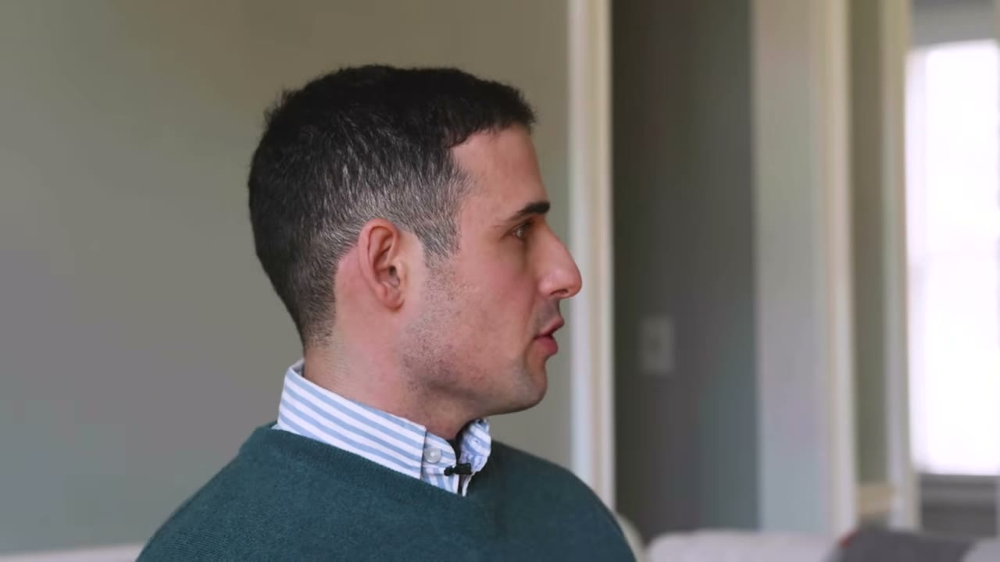
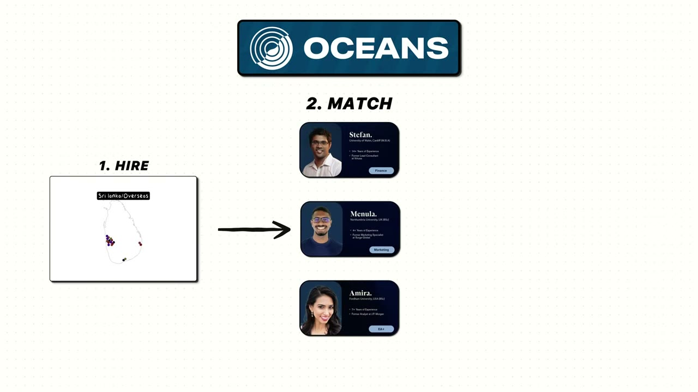
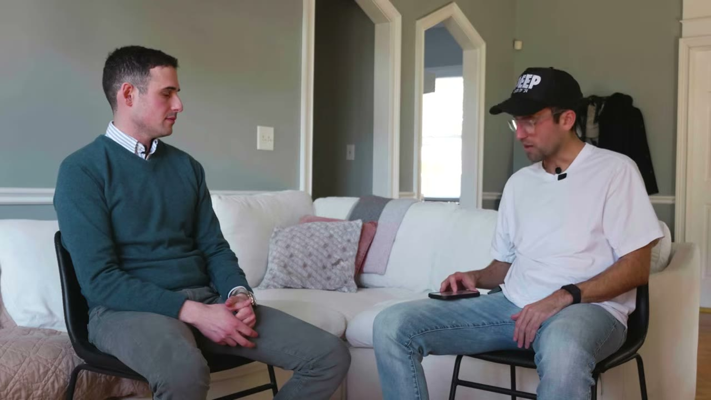
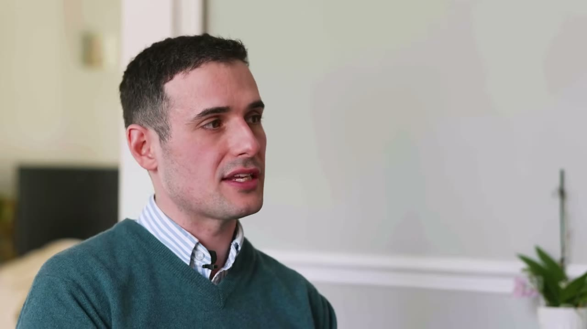
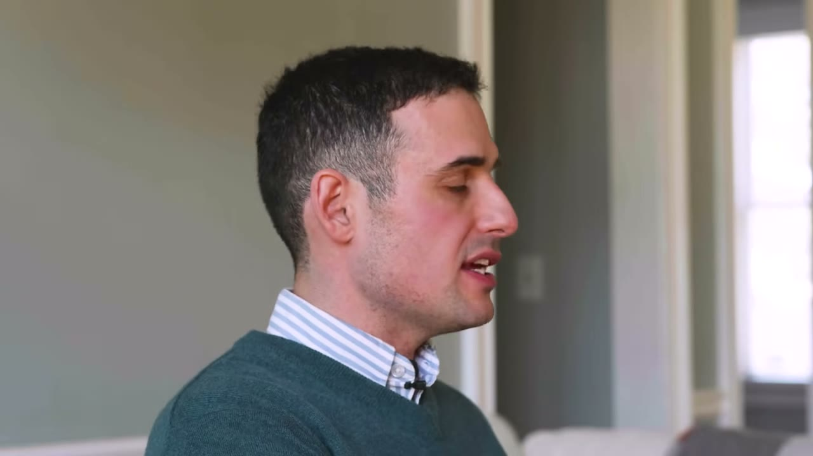
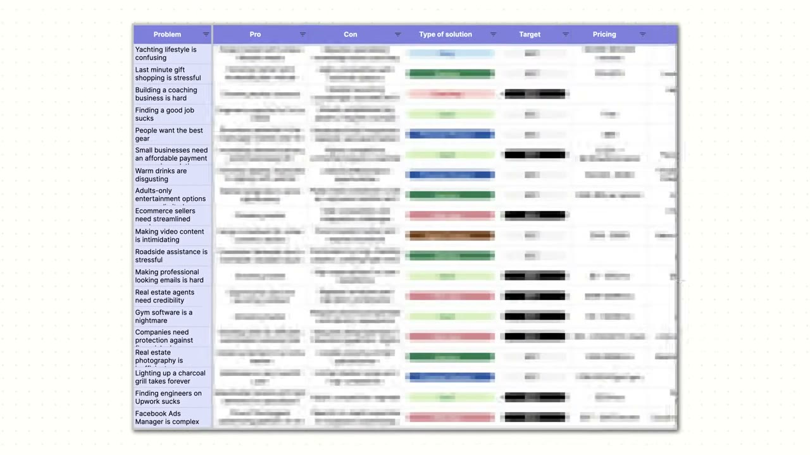

# Oceans — $15M/năm từ arbitrage nhân lực, $0 marketing

> **Tóm tắt 30 giây:** Ian Myers bỏ nghề tài chính và VC, bán app đã gọi vốn, rồi mở một công ty **outsourcing nhân sự vận hành trình độ cao**. Anh tuyển người chủ yếu ở **Sri Lanka**, ghép họ với khách hàng toàn thời gian 40 giờ/tuần, thu **$3.000-$4.000/tháng mỗi đầu người**, trả lương và phúc lợi cho người lao động rồi **bỏ túi phần chênh**. Năm đầu (2022) $650.000, năm gần nhất **khoảng $15 triệu**, lãi hàng triệu đô. **Chi phí marketing bằng 0** — toàn bộ tăng trưởng từ referral. Ba khách đầu tiên là **bạn bè, bán dưới giá, gần như không lãi** — anh chỉ muốn xem có ai thật sự trả tiền không.

## ⚠️ Đọc trước: đây KHÔNG phải case SaaS

Nếu bạn vào kho này để tìm micro-SaaS, hãy đọc case này với tâm thế khác. Oceans là **công ty dịch vụ**: có con người, có lương, có quản lý, có đào tạo. Biên lợi nhuận thấp hơn SaaS nhiều lần, không có tính "ngủ vẫn ra tiền".

**Nhưng đây có thể là case liên quan trực tiếp nhất tới người Việt trong toàn bộ kho.** Lý do: Việt Nam nằm **đúng ở phía cung** của mô hình này. Ian tuyển ở Sri Lanka và Nam Phi. Bạn ở VN có thể chọn một trong hai vai — hoặc trở thành nguồn cung, hoặc **dựng chính mô hình này với nguồn cung Việt Nam**. Xem mục 10.

## 1. Con số

| Chỉ số | Giá trị |
|---|---|
| Ý tưởng | cuối 2021 |
| Hợp đồng đầu tiên | **tháng 02/2022** |
| Doanh thu năm 1 (2022) | **$650.000** |
| Doanh thu năm gần nhất | **khoảng $15 triệu** |
| Lợi nhuận | *"hàng triệu đô kể từ khi bắt đầu"* |
| Giá bán | **$3.000-$4.000/tháng mỗi đầu người** |
| Nơi tuyển | chủ yếu **Sri Lanka**, một số **Nam Phi** và nơi khác |
| Tốc độ tuyển | **30-40 người/tháng** |
| Chi phí marketing | **$0** |
| Sở hữu | founder giữ **100%**, không gọi vốn |

**Mâu thuẫn về con số — và tôi chọn thế nào:** tiêu đề video là *"$10M Business"* và phần dẫn nói *"hơn 10 triệu một năm trong 3 năm"*. Nhưng chính Ian nói: *"năm ngoái chúng tôi chốt ở khoảng **15 triệu doanh thu**"*. Hai con số không thật sự mâu thuẫn ($15M đúng là "hơn $10M"), nhưng tiêu đề dùng mốc thấp hơn. **Tôi lấy $15M** vì đó là con số founder tự nói cho năm gần nhất, và ghi rõ để bạn biết vì sao tiêu đề khác.

**Điều video KHÔNG nói — và đó là lỗ hổng lớn nhất:** anh trả cho người lao động bao nhiêu. Anh chỉ nói *"chúng tôi trả toàn bộ lương và phúc lợi, rồi bỏ túi phần chênh giữa"*. **Toàn bộ tính khả thi kinh tế của mô hình nằm ở con số đó, và nó bị giấu.** Đừng tự bịa ra tỉ lệ — hãy tự tra mức lương thị trường ở nước bạn định tuyển trước khi tính toán.

## 2. Mô hình hoạt động — arbitrage được diễn giải ⭐⭐⭐

> *"Chúng tôi tuyển người khắp thế giới, chủ yếu ở **Sri Lanka**, vài người ở **Nam Phi** và nơi khác. Chúng tôi ghép họ với khách hàng **toàn thời gian, 40 giờ/tuần, dài hạn**. **Họ là một phần của team khách hàng** — họ dự All Hands, họ có trên lịch, họ có trên Slack, họ làm việc thật. Chúng tôi thu khoảng **$3.000 đến $4.000 một tháng cho mỗi đầu người**. Nếu bạn cần một EA thì rẻ hơn chút, nếu bạn cần một financial controller thì đắt hơn chút. Rồi chúng tôi trả toàn bộ lương, mọi phúc lợi của người của mình, và **bỏ túi phần chênh ở giữa**."*

Đọc kỹ câu *"họ là một phần của team khách hàng"* — đây là điểm khác biệt cốt lõi so với freelancer marketplace.

**Cơ chế vì sao mô hình này có giá:**

| Yếu tố | Freelancer marketplace (Upwork...) | Oceans |
|---|---|---|
| Người mua chịu rủi ro tuyển sai | ✅ toàn bộ | ❌ |
| Người mua chịu rủi ro nghỉ việc | ✅ | ❌ (Oceans thay người) |
| Người mua phải sàng lọc, phỏng vấn | ✅ | ❌ |
| Người mua phải đào tạo | ✅ | ❌ (Oceans có khoá đào tạo riêng) |
| Người mua xử lý thanh toán quốc tế, thuế, hợp đồng | ✅ | ❌ |

**Khách hàng không trả tiền cho lao động — họ trả tiền để KHÔNG phải chịu rủi ro và ma sát.** Đó chính là khoảng chênh giữa mức lương và $3.000-4.000. Nếu bạn định sao chép mô hình này, mọi đồng lợi nhuận của bạn nằm ở việc bạn hấp thụ được bao nhiêu trong năm loại ma sát trên.

**Chi tiết đào tạo quan trọng:** ngay từ đầu Ian đã thuê **một người từng làm EA 10 năm để xây khoá đào tạo**, rồi cho **cohort đầu tiên chỉ 3 người** đi qua khoá đó. *"Tôi nghĩ, nếu mình làm VA thì mình phải đào tạo họ thành VA giỏi. Nên mô hình của chúng tôi có rất nhiều phần đào tạo bên trong."* Đây là thứ biến một môi giới thành một sản phẩm.

## 3. Vì sao cửa sổ này mở ra — và bài học chọn thời điểm ⭐⭐

Ian giải thích thị trường này đã tồn tại từ lâu nhưng chỉ dành cho công ty lớn:

> *"Google có khoảng **180.000 nhân viên** toàn thế giới, trong đó **120.000 người ở nước ngoài**. Microsoft cũng tỉ lệ tương tự. Đây đã là **bí quyết của những công ty lớn nhất thế giới suốt hàng chục năm**."*

Rồi COVID đến:

> *"Cơ hội kinh doanh với tôi là vì **COVID đã thay đổi mọi thứ**. Đột nhiên ai cũng phải lên online. Nếu bạn làm việc được với một người vừa dọn về Montana ở với bố mẹ, thì bạn **cũng làm việc được với một người ở Sri Lanka**."*

> *"Điều này mở cửa cho những công ty **chưa từng nghĩ tới offshoring** — phòng khám bác sĩ, văn phòng kế toán, công ty luật, agency sáng tạo — những người kiểu 'ơ, cả team tôi remote hết rồi, sao tôi không ném luôn nhân tài toàn cầu vào cho rồi, khi mà giá tốt hơn, **chất lượng nhiều khi cao hơn**, và người ta **khao khát làm việc hơn**'."*

**Đây là bài học chọn thời điểm quan trọng nhất của case:** Ian **không tạo ra nhu cầu**. Anh nhìn thấy một hành vi (làm việc từ xa) vừa được bình thường hoá bởi một cú sốc bên ngoài, và bán vào cái hành vi đó.

Và anh nói ra công thức bằng đúng một câu:

> *"Tôi thấy ngành offshoring đang cất cánh và tôi tự nghĩ — **thế nếu tôi chỉ đơn giản có sản phẩm tốt hơn thì sao**? Ngành này đã tồn tại, tôi biết người ta muốn thứ này. Đó là khoảnh khắc bừng sáng. **Đi tìm thứ người ta đã muốn rồi, và làm nó khác đi hoặc tốt hơn — đó là phương trình cho một business thành công.**"*

**Đây là phản đề trực tiếp của "tìm ý tưởng mới lạ".** Nó khớp với [Packager](../2026-03-15_i-make-60k-month-from-the-most-boring-saas-on-the-in/case.md) và [YouForm](../2025-08-02_i-copied-a-100m-saas-undercut-their-prices-and-hit-1/case.md) — vào thị trường đã có nhu cầu được chứng minh, thắng bằng chất lượng thực thi chứ không bằng ý tưởng.

## 4. Ba khách hàng đầu tiên — bài test validate tàn nhẫn nhất kho này ⭐⭐⭐

Đây là đoạn giá trị nhất của video.

> *"Lúc đó chúng tôi chưa gọi đồng vốn nào, chỉ có mình tôi, tôi **sở hữu 100%** công ty. Và tôi **không biết gì về ngành này cả, không biết gì hết.**"*

Anh làm gì:
1. Thuê một EA 10 năm kinh nghiệm xây khoá đào tạo.
2. Tuyển **đúng 3 người** anh quen qua thời gian ở Sri Lanka, làm cohort đầu tiên.
3. **Pitch cho bạn bè** với **giá giảm mạnh**.
4. *"Nên chúng tôi **không kiếm được đồng nào từ ba khách hàng đầu tiên**. Tôi chỉ muốn đưa cái này vào tay ai đó và xem chuyện gì xảy ra."*

Và đây là câu định nghĩa lại validate:

> *"Với tôi, tất cả nằm ở chỗ — **nếu tôi làm ra cái business này, ngày mai tôi gọi cho một người và họ có mua nó từ tôi không?** Tôi nghĩ điều đó rất quan trọng. Đừng bước vào kinh doanh với kiểu 'à tôi sẽ mua quảng cáo Facebook và bán cho một người lạ nào đó ở Arkansas'. Nó phải là thứ mà bạn **không chỉ đưa cho người ta dùng thử**, mà **có ai đó chịu đưa tiền cho bạn** trong vòng bấy nhiêu ngày kể từ lúc ra mắt. Và **phải là người bạn quen**."*

**Cơ chế — vì sao "bán cho người quen trước" lại đúng chứ không phải gian lận:**

Người ta thường bác bỏ doanh số từ bạn bè là "không tính". Ian lật ngược lại: bạn bè là **bộ lọc ngược**. Nếu bạn **không thể** thuyết phục nổi một người đã tin bạn, quý bạn và muốn bạn thành công bỏ tiền ra, thì xác suất bạn thuyết phục được người lạ hoài nghi qua một quảng cáo Facebook là bao nhiêu? Gần bằng 0. **Bán cho người quen là ngưỡng sàn, không phải ngưỡng thành công.**

Và anh trung thực về nỗi lo tiếp theo — nỗi lo mà rất ít founder dám nói:

> *"Nhưng có rất nhiều lo lắng khi tôi **dùng hết mạng lưới của mình**. Tôi nghĩ — nếu đây chỉ là loại business mà những người tôi gọi, những người thích tôi hoặc biết tôi, sẽ mua, **rồi sau đó thì hết** thì sao? May mắn là chúng tôi bắt đầu có **giới thiệu từ khách hàng hiện tại**. Tôi không quen những người này. Và business lớn lên từ đó. Nhưng có một khoảnh khắc lo lắng thật sự về chuyện **tôi có một business thật hay tôi chỉ đang bán cho bạn tôi thứ mà họ có thể dùng vừa đủ để trả tiền cho tôi**."*

**Đây là cột mốc quan trọng nhất mà bạn cần đặt ra cho chính mình:** khách hàng đầu tiên bạn **không quen** đến từ đâu. Trước cột mốc đó, bạn chưa có business.

## 5. Marketing $0 — cỗ máy referral được mổ xẻ ⭐⭐⭐

> *"Ngay từ đầu tôi đã biết **referral sẽ là bí quyết tăng trưởng của chúng tôi**."*

### Điều kiện tiên quyết mà không ai muốn nghe

> *"Nếu bạn có một service business tuyệt vời thì nó thường lớn lên bằng word of mouth. **Ai cũng cần dịch vụ cắt cỏ, ai cũng cần người dọn nhà** — những loại business đó, nếu bạn chọn đúng, sẽ lớn lên bằng truyền miệng vì người ta có dịch vụ xuất sắc. Nên **bước đầu tiên là đảm bảo bạn có dịch vụ tuyệt vời. Không ai đi giới thiệu một dịch vụ hoặc sản phẩm tệ.**"*

Nghe hiển nhiên. Nhưng đây chính là lý do referral **không phải kênh miễn phí** — nó là kênh mà bạn **trả trước bằng chất lượng vận hành** thay vì trả sau bằng tiền quảng cáo.

### Cơ chế thật: biến khách hàng thành người hùng ⭐⭐⭐

Đây là câu đắt nhất của cả video:

> *"Nếu bạn đang xây một business dựa trên referral, **trước khi** bạn đi tới chỗ 'đây là funnel của chúng tôi, đây là engine, đây là cách nó hoạt động, bấm vào đây để tham gia' — hãy **đặt khách hàng của bạn vào vị trí trở thành người hùng với bạn bè họ** khi họ giới thiệu dịch vụ của bạn. Và bạn sẽ thành công."*

Và anh minh hoạ bằng hình ảnh cực kỳ cụ thể:

> *"Nếu tôi trông mệt mỏi phờ phạc, tôi muốn một khách hàng của chúng tôi nhìn thấy điều đó và nghĩ **'trời ơi, trông ông cần được kết nối với Oceans, họ sẽ thay đổi cuộc đời ông'**."*

**Hãy tách bạch hai thứ ở đây, vì nhầm lẫn chỗ này giết chết hầu hết chương trình referral:**

| Referral program | Referral engine |
|---|---|
| Bạn trả tiền cho khách để họ giới thiệu | Khách giới thiệu vì **việc giới thiệu làm họ trông giỏi trước mặt bạn bè** |
| Động lực bên ngoài, dễ tắt | Động lực địa vị xã hội, tự duy trì |
| Cần funnel, link, coupon | Chỉ cần dịch vụ tốt tới mức đáng khoe |

Ian nói thẳng: đừng vội xây funnel. Hãy làm cho việc giới thiệu bạn trở thành **hành động khiến người giới thiệu được ngưỡng mộ**.

### Điều kiện ngành — quan trọng, đừng bỏ qua

> *"Phần lớn khách hàng của chúng tôi là chủ doanh nghiệp, và họ **lúc nào cũng đang nghĩ tới chuyện tuyển người**. Tôi nghĩ điều đó cũng đúng với các business làm lead generation — 'làm sao để tôi có thêm khách' là **chủ đề nói chuyện thường trực**. Nếu bạn ở trong những nhóm ngành đó thì bạn có **word of mouth cài sẵn**."*

**Đây là bộ lọc để bạn quyết định referral có phải kênh của mình không:** khách hàng của bạn có **thường xuyên nói chuyện với nhau về đúng vấn đề bạn giải** không? Chủ doanh nghiệp nói về tuyển dụng và tìm khách hàng — có. Người dùng app đếm calo nói về app đếm calo — hiếm hơn nhiều. **Nếu vấn đề của bạn không phải chủ đề trò chuyện thường trực của tệp khách, đừng đặt cược vào referral.**

### Cách anh làm dịch vụ đủ tốt để được giới thiệu

> *"Hãy nghĩ về đời sống hàng ngày của chính bạn. Nếu bạn gửi email cho ai đó và **họ trả lời trong 5 phút**, cảm giác đó tuyệt vời. Nếu bạn gặp vấn đề và gọi điện cho ai đó và họ nói **'tôi hoàn toàn hiểu, đó là lỗi của chúng tôi, để tôi tặng anh một tháng dịch vụ vì đây không phải trải nghiệm tôi muốn anh có'**..."*

> *"Có **rất nhiều quả thấp dễ hái** trong việc mang lại trải nghiệm khách hàng xuất sắc, nếu bạn chịu **bật chế độ luôn sẵn sàng trong một quãng khá dài** ở giai đoạn đầu."*

Và anh nói rõ đây là sự đánh đổi có thời hạn:

> *"Dù tôi muốn một lối sống dễ chịu, tôi biết **20 khách đầu tiên, 50 khách đầu tiên thì bạn phải lăn xả**. Bạn phải có mặt, phải nhấc máy, phải gọi cho người ta, và phải **đi xa hơn giới hạn của những gì bạn sẽ làm khi công ty đã lớn**."*

## 6. Nút thắt khi scale — kiến thức mắc kẹt trong đầu người ⭐⭐

Ian nói đây là thứ khó nhất anh học được:

> *"Có một **khoảng trống thật sự** khi bạn đi từ 5-8 người đầu tiên làm mọi việc — nơi **một người nắm toàn bộ kiến thức và không cần chia sẻ nó**, vì người tạo ra quy trình chính là người thực hiện quy trình, và mọi thứ chạy tốt — sang việc **giờ chúng tôi là một tổ chức**, giờ chúng tôi có một team, giờ người mới vào cần học được cách làm việc này. **Mọi thứ vỡ.**"*

> *"**Lôi kiến thức ra khỏi đầu người và biến nó thành quy trình** là một trong những thử thách lớn nhất của chúng tôi khi lớn lên. Và nó đau đớn. Với tôi đó là thứ khó nhất."*

**Vì sao đây là insight có giá trị với cả người làm SaaS:** ngưỡng 5-8 người là điểm chuyển pha. Trước đó, tài liệu hoá là lãng phí thời gian. Sau đó, thiếu tài liệu hoá là thứ chặn đứng tăng trưởng. Nếu bạn đang tuyển **30-40 người/tháng** như Oceans, mọi quy trình chưa được viết ra là một quả bom hẹn giờ.

## 7. Tuyển người từ nơi không ai tìm ⭐⭐

> *"Điều lớn nhất của tôi là tôi thích tuyển từ **những nơi phi truyền thống**. Tôi nghĩ có một kho nhân tài phi thường tồn tại **bên ngoài New York City và Silicon Valley** — đó rõ ràng là nền tảng của business tôi."*

Ví dụ cụ thể mà anh kể — đáng nhớ:

> *"Người tuyển ngoài đầu tiên của chúng tôi ở Mỹ, cô ấy từng là **trưởng bộ phận trại hè cho trẻ em**. Tôi muốn cô ấy nhận các cuộc gọi bán hàng. Tôi nghĩ — trời ạ, nếu cô xoay xở được với một đám trẻ con hò hét ở trại hè, **rồi mỗi tuần 20-30 phụ huynh giận dữ tới la hét vào mặt cô**, thì cô làm được việc này và nó sẽ như đi nghỉ mát. **Giờ cô ấy là chief of staff của tôi.**"*

Nguyên tắc anh rút ra:

> *"Nhìn không hẳn vào 'bạn đã từng làm việc này chưa' mà là **'thứ bạn từng làm có chuẩn bị cho bạn thành công ở công việc này không'** — điều đó cực kỳ quan trọng."*

Áp dụng cho chính sản phẩm cốt lõi:

> *"Chúng tôi **không tuyển người đã từng làm EA**. Chúng tôi tuyển người có **nền tảng vận hành rất độc đáo**, rất thông minh, rất sắc sảo. Họ có theo kịp được một chủ doanh nghiệp, một founder không? Nếu có thì **chúng tôi sẽ đào tạo bạn thành một EA giỏi** và bạn sẽ thành công."*

**Cơ chế kinh tế đằng sau:** người đã có nhãn "EA 5 năm kinh nghiệm" được thị trường định giá theo nhãn đó. Người quản lý trại hè thì không — thị trường chưa biết định giá cô ấy cho công việc này. **Ian mua năng lực chưa được thị trường định giá đúng, rồi tự cấp nhãn bằng khoá đào tạo nội bộ.** Đây là arbitrage thứ hai của mô hình, bên cạnh arbitrage địa lý. Với người Việt tuyển người Việt, đây là chiến thuật dùng được ngay.

## 8. Tech stack — rẻ đến mức gây sốc

> *"Tôi là fan cứng của việc **không tiêu tiền cho công cụ**, nên chúng tôi không có nhiều. Chúng tôi dùng chủ yếu **Google Workspace** cho mọi thứ. Tôi nghĩ **những gì bạn làm được trong Google Sheets là phi thường** — người ta nên lên YouTube và nhận ra rằng bạn có thể **chạy toàn bộ dashboard của một công ty bằng Google Sheets**."*

| Hạng mục | Công cụ |
|---|---|
| Dashboard, vận hành, dữ liệu | **Google Sheets** |
| Đào tạo | **Google Classroom** |
| Email, tài liệu | Google Workspace |
| Thanh toán | **Stripe** |
| Tài liệu, cẩm nang tham chiếu | Notion |
| Ghi âm cuộc họp | **tl-dv** (phụ đề đọc là "TLD DV") |
| CRM | **HubSpot** |

**Một công ty $15M/năm chạy trên Google Sheets.** Đây là liều thuốc giải cho căn bệnh phổ biến nhất của indie hacker: tốn tuần đầu tiên đi chọn stack thay vì đi tìm khách hàng đầu tiên.

> **Lưu ý về xung đột lợi ích:** HubSpot là **nhà tài trợ của chính video này** (link `clickhubspot.com/ojwn` trong description) — và HubSpot cũng là công ty **đã mua lại Starter Story**. Việc HubSpot xuất hiện trong danh sách tech stack cần được đọc với ý thức đó.

## 9. Ngách nào đáng làm — gợi ý trực tiếp của Ian ⭐⭐

Pat hỏi thẳng: ý tưởng nào anh thấy được mà không có thời gian làm?

> *"**Tạo ra một ngách dọc nhỏ mà bạn có thể thắng** là điều then chốt. Tôi là founder và CEO của một công ty offshoring — **mỗi ngày tôi nhận 10 email từ những công ty offshoring khác cố bán nhân sự cho tôi**. Đây là **không gian đã bị hàng hoá hoá**. Nên bạn phải nổi bật, và một trong những cách tốt nhất để nổi bật là **giỏi nhất trong hạng mục của mình**."*

Các ví dụ anh nêu — công ty chuyên **một việc duy nhất**:
- Giỏi nhất về **dựng video**
- Giỏi nhất về một loại thiết kế rất cụ thể, ví dụ **minh hoạ**
- Giỏi nhất về **thiết kế CAD cho công ty kiến trúc**

> *"Chuyên vào một ngách dọc nơi bạn sẽ **được người ta nhắc tới** — **rất dễ đạt $1 tới $2 triệu doanh thu** bằng cách đó."*

**Chú ý cụm "được người ta nhắc tới" (talked about).** Nó nối thẳng về mục 5: ngách hẹp không chỉ giúp bạn thắng về chất lượng — nó là điều kiện để **referral hoạt động**. Không ai giới thiệu "một công ty outsourcing chung chung". Người ta giới thiệu "công ty chuyên làm CAD cho kiến trúc sư".

**Và hãy đọc kỹ chữ "dễ".** Ian nói $1-2M doanh thu là dễ với mô hình này. Đó là **doanh thu**, không phải lợi nhuận. Với dịch vụ, khoảng cách giữa hai con số đó rất lớn — khác hẳn SaaS.

## 10. Áp dụng cho tôi (indie hacker VN)

### Sao chép được gì — case này có HAI con đường, khác hẳn các case khác

**Con đường A — dựng chính mô hình này với nguồn cung Việt Nam**

Đây là con đường ít người nghĩ tới nhưng khả thi nhất. Ian tuyển ở Sri Lanka và Nam Phi. **Việt Nam có cùng cấu trúc lợi thế**: chi phí lao động thấp so với Mỹ/EU, lực lượng lao động trẻ, thành thạo công cụ số, múi giờ phủ được cả châu Á và một phần châu Âu.

Cách bắt đầu, theo đúng trình tự Ian đã làm:
1. **Chọn MỘT ngách dọc hẹp** bạn hiểu — không làm "VA chung chung". Ví dụ: dựng video short-form cho creator (nối được với [playbook của David Park](../2025-03-18_the-10m-ai-saas-playbook/case.md), nơi UGC creator có giá $2.000-3.000/tháng ở Mỹ), vận hành cửa hàng Shopify, hỗ trợ kế toán/bookkeeping.
2. **Xây khoá đào tạo trước khi có khách.** Ian thuê chuyên gia 10 năm kinh nghiệm làm việc này. Đây là thứ tách bạn khỏi môi giới nhân lực.
3. **Cohort đầu tiên 3 người.**
4. **Ba khách đầu là người bạn quen, giá giảm mạnh, không lãi.** Chỉ để chứng minh có người trả tiền.
5. Chăm sóc đến mức phi lý cho 20 khách đầu — trả lời trong 5 phút, tặng tháng miễn phí khi có sự cố.
6. **Chờ khách hàng đầu tiên bạn không quen.** Đó mới là lúc bạn có business.

**Con đường B — trở thành nguồn cung có thương hiệu**

Nếu bạn hoặc nhóm bạn giỏi một kỹ năng vận hành cụ thể, mức $3.000-4.000/tháng/đầu người là **mức giá mà thị trường Mỹ đang trả**. Bạn có thể tiếp cận trực tiếp thay vì qua trung gian. Điều bạn cần bù đắp chính là năm loại ma sát ở mục 2 — hợp đồng, thanh toán, thay người, bảo đảm chất lượng.

**Áp dụng chung, không phụ thuộc con đường:**
- **Bài test validate của Ian.** *"Ngày mai tôi gọi cho một người và họ có mua không?"* — dùng được cho mọi loại business.
- **Tuyển từ nơi phi truyền thống.** Ở VN, nhãn "5 năm kinh nghiệm" bị định giá quá cao trong khi năng lực thật thì không. Đây là arbitrage bạn dùng được ngay.
- **Google Sheets là đủ.** Đừng tốn tuần đầu tiên chọn stack.

### Rào cản thật

- **Đây là business quản lý con người, không phải phần mềm.** Bạn sẽ xử lý người nghỉ việc, người ốm, khách phàn nàn, xung đột văn hoá. Không có "ngủ dậy thấy tiền vào". Nếu bạn chọn indie hacking **để tránh phải quản lý người**, mô hình này đi ngược lại toàn bộ lý do bạn bắt đầu.
- **Biên lợi nhuận thấp hơn SaaS rất nhiều và video giấu con số đó.** Ian nói *"lãi hàng triệu đô"* trên $15M doanh thu qua 3 năm — nhưng không nêu tỉ lệ. So sánh: [Jack Friks lãi trên 95%](../2025-03-25_i-built-a-10k-month-app-from-my-moms-basement/case.md) trên $10K/tháng. Doanh thu dịch vụ và doanh thu SaaS **không so sánh trực tiếp được**.
- **Rủi ro dòng tiền là rủi ro sống còn.** Bạn phải **trả lương nhân viên trước** khi khách thanh toán. Một khách lớn chậm trả 45 ngày có thể làm bạn vỡ nợ dù đang có lãi trên sổ sách. Đây là rủi ro mà mô hình SaaS không có.
- **Pháp lý và thuế phức tạp.** Hợp đồng lao động ở VN, bảo hiểm xã hội, thuế TNCN, hợp đồng dịch vụ với khách nước ngoài, hoá đơn VAT, thuế nhà thầu. Bạn cần kế toán thật ngay từ đầu — đây không phải business chạy trên tài khoản cá nhân.
- **Rào cản tiếng Anh ở mức cao nhất trong kho này.** Không chỉ bạn cần tiếng Anh — **toàn bộ nhân sự bạn cho thuê phải giao tiếp trực tiếp với khách hàng Mỹ hàng ngày**, dự họp All Hands, viết Slack. Đây là rào cản nghiêm trọng và thật với nguồn cung Việt Nam, và là lý do Sri Lanka + Nam Phi (nước nói tiếng Anh) được chọn. **Hãy trung thực đánh giá điều này trước khi bắt đầu.**
- **Không gian đã bị hàng hoá hoá.** Chính Ian nhận 10 email chào bán mỗi ngày. Vào cửa chung chung = chết. Bắt buộc phải chọn ngách dọc.
- **AI đang ăn vào chính phân khúc này.** Video là 03/2025. Rất nhiều công việc EA/vận hành cấp thấp đang bị AI thay thế nhanh. **Điều này vừa là rủi ro vừa là cơ hội**: rủi ro nếu bạn bán giờ công đơn thuần; cơ hội nếu bạn bán "người vận hành có AI hỗ trợ" với năng suất cao hơn ở cùng mức giá.

### Khi nào KHÔNG dùng mô hình này

- **Khi bạn muốn thu nhập thụ động.** Đây là business tuyến tính: thêm doanh thu = thêm người = thêm quản lý. Nó không có tính nhân bản của phần mềm.
- **Khi bạn không có mạng lưới để bán ba đơn hàng đầu.** Toàn bộ khởi động của Ian dựa vào việc anh gọi được cho bạn bè là chủ doanh nghiệp. Nếu vòng quan hệ của bạn không có ai cần thuê người, bạn không có bước một — và referral engine không bao giờ khởi động được.
- **Khi bạn không chịu được 6-12 tháng "luôn sẵn sàng".** Ian nói rõ 20-50 khách đầu phải lăn xả. Đây là ngược lại hoàn toàn với hình ảnh solopreneur tự do.
- **Khi vốn lưu động của bạn dưới 3 tháng lương của đội ngũ.** Xem rủi ro dòng tiền ở trên.

## 11. Cảnh báo về nguồn

- **Nhà tài trợ video là HubSpot** — và HubSpot cũng chính là công ty **đã mua lại Starter Story**. Đoạn quảng cáo dài khoảng 1,5 phút (07:11-08:25) chào một "free solopreneur guide". Đồng thời HubSpot được nêu trong tech stack của Oceans. Ba lớp lợi ích chồng lên nhau trong một video 20 phút.
- **Không có bằng chứng số liệu.** Không ảnh dashboard, không báo cáo tài chính. $650K, $15M, "lãi hàng triệu đô" đều là lời khai.
- **Con số then chốt nhất bị giấu**: mức trả cho người lao động. Không có nó thì không ai đánh giá được mô hình này thật sự lãi bao nhiêu.
- **Kênh chỉ phỏng vấn người thắng.** Ngành offshoring đã bị hàng hoá hoá (chính Ian xác nhận: 10 email chào bán mỗi ngày). Nghĩa là có **rất nhiều** công ty làm đúng mô hình này và không đạt được $15M. Bạn không được nghe câu chuyện của họ.
- **Yếu tố may mắn về thời điểm rất lớn và ít được nhấn mạnh.** Ian vào thị trường cuối 2021 — đúng đỉnh của cú sốc chuẩn hoá remote work do COVID. Cửa sổ đó không còn mở như thế nữa.

## 12. Triết lý sống của Ian — phần đáng suy nghĩ

Đây không phải chiến thuật, nhưng nó là khung ra quyết định đứng sau mọi lựa chọn kinh doanh của anh.

Vì sao anh bỏ con đường venture-backed sau khi đã bán một app:

> *"Cái đầu tiên chúng tôi nhận đầu tư, nó là venture-backed... nhưng tôi nhận ra nếu đi đường đó thì **bạn không thật sự làm cho chính mình**. Bạn muốn xây một thứ, muốn sở hữu một thứ — nhưng **giây phút bạn gọi vốn thì hội đồng quản trị bảo bạn phải đạt chỉ số nào**, và bạn ở trên cái máy chạy bộ của việc gọi vòng tiếp theo."*

Câu hỏi anh dùng để chọn mô hình kinh doanh:

> *"Tôi tiếp cận business này từ câu hỏi **tôi muốn cuộc đời tôi như thế nào** — chứ không phải làm sao kiếm nhiều tiền nhất hay làm sao gọi được nhiều vốn nhất. Tôi nhận ra, và tôi nghĩ nhiều người khác cũng đang nhận ra, rằng **tôi chỉ muốn một chỗ tốt trong đời để tôi có thể sống và làm những điều tôi muốn với những người tôi muốn. Bạn không cần phải là tỉ phú để làm được điều đó.** Nên bạn sống ở đâu, bạn muốn sống thế nào — đó đều là những quyết định nên đi vào việc **tôi muốn tạo ra loại business nào**."*

Về việc chơi game 5 tiếng sáng thứ Bảy:

> *"Có một sự kỳ thị quanh chuyện doanh nhân làm những việc không liên quan tới công ty của họ. Và tôi thì nghĩ — **nếu điều đó đúng thì bạn đang có một business tệ**. Nếu bạn không thể làm những điều mình muốn, không thể bước ra và nói 'tôi đọc được những cuốn sách tôi muốn đọc, tôi thăm được bạn bè, tôi đi du lịch được' — thì **bạn làm việc đó để làm gì?**"*

Lời khuyên cuối cho phiên bản trẻ hơn của chính mình:

> *"Rất nhiều người thế hệ chúng ta hoảng sợ vì 'tôi sẽ ra quyết định sai'... Có kiểu **stalking LinkedIn** — thấy mấy đứa hai mấy tuổi học chung đại học giờ đang ở công ty này, có chức danh kia, đi xa hơn mình, và mình phát hoảng. Tôi thì đã đi qua **rất nhiều trải nghiệm khốn khổ** trong đời và kết cục là ở đây. **Nếu tôi không phạm hết những sai lầm đó thì cánh cửa này đã không mở ra.** Nên đừng ra quyết định từ **nỗi sợ chọn sai**. Cứ nhận lấy cơ hội mới, vì bạn **luôn có thể xoay xở về đúng thứ mình muốn làm**."*

## Nguồn

- Video: <https://www.youtube.com/watch?v=gU9FtZIfb_M> (21:00, đăng 08/03/2025, 81.922 view)
- Founder: x.com/oceanstalent · Sản phẩm: oceanstalent.com
- [Transcript đầy đủ](transcript.md) · [Ảnh chụp](screenshots/)
