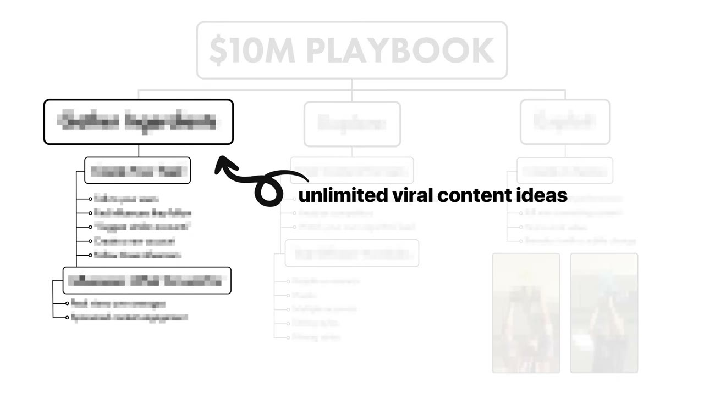
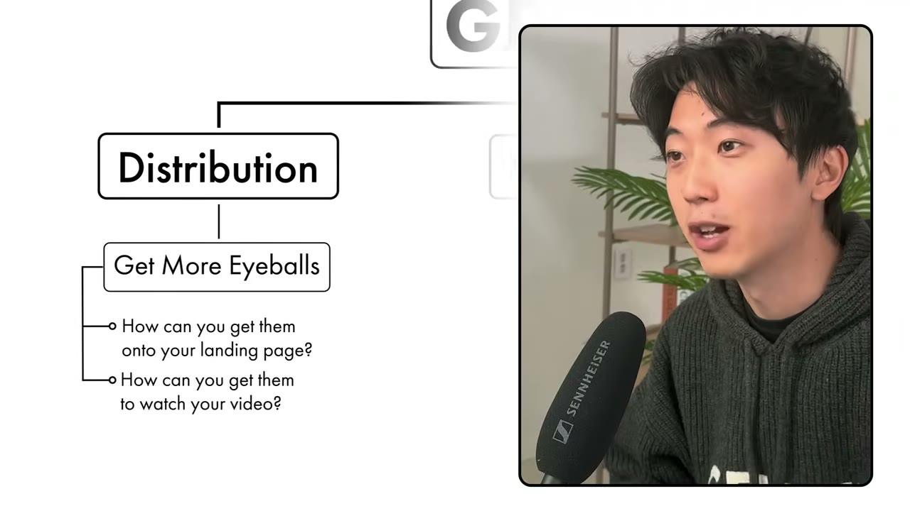
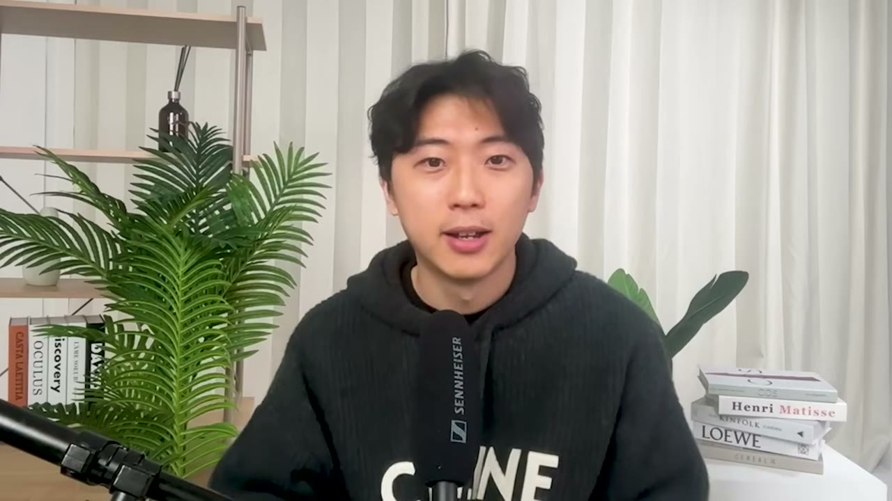
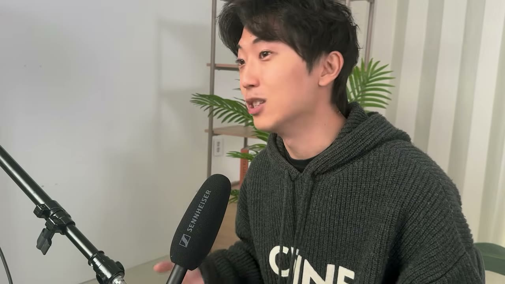
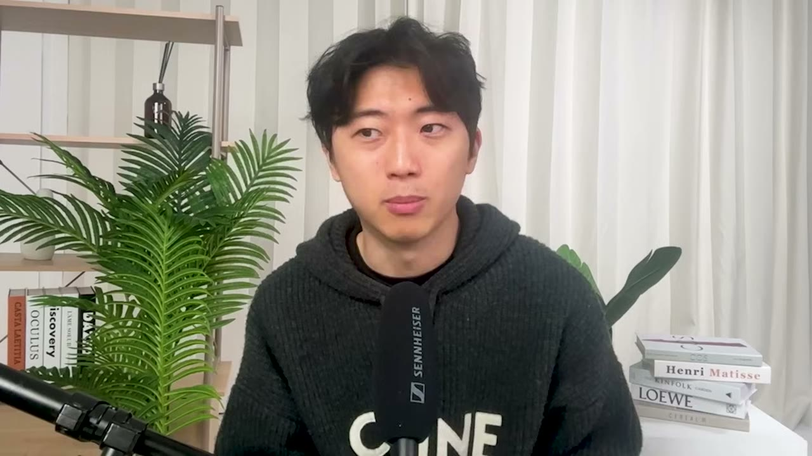
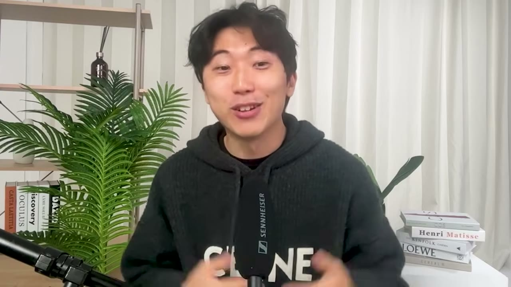

# Jenni AI — playbook short-form đưa một AI SaaS lên $10M/năm

> **Tóm tắt 30 giây:** David Park đưa Jenni AI (công cụ viết học thuật bằng AI) lên **hơn $10M/năm với hơn 5 triệu người dùng trong 2 năm**, gần như hoàn toàn bằng video short-form rẻ tiền trên TikTok và Instagram. Điểm cốt lõi không phải là "làm video viral" mà là **tìm được MỘT series rồi vắt nó tới cạn**: một series duy nhất — cảnh ai đó nhớ ra mình có bài luận phải nộp rồi chạy tới máy tính — được đăng lại **2 lần mỗi tuần suốt nửa năm** trên 15 tài khoản, đem về hàng trăm triệu view và **hơn $500.000**. Video cũng cho bảng giá thật của thị trường influencer/UGC — thứ gần như không ai công khai.

## ⚠️ Đọc trước: đây là case về PHÂN PHỐI, không phải case kinh doanh đầy đủ

David nói thẳng ngay từ phút 2:38: *"Hôm nay tôi **chỉ nói về distribution**, và còn thu hẹp lại nữa — chỉ nói về kênh phân phối thành công nhất của chúng tôi."*

Nghĩa là video **không có**: sản phẩm được build thế nào, tech stack, giá bán, churn, CAC, LTV, cơ cấu team, cách tìm ra ý tưởng, cách validate. Nếu bạn tìm một breakdown kinh doanh trọn vẹn, đây không phải nó. Nếu bạn tìm **bảng giá và quy trình thật của influencer marketing cho SaaS**, đây là một trong những tài liệu chi tiết nhất kho này có.

**Về tên sản phẩm:** phụ đề tự động viết "Jenny AI", "jny AI", "gen accounts". Tên đúng là **Jenni AI** (jenni.ai) — trợ lý viết học thuật, khớp với mô tả của David *"bộ công cụ edtech giúp researcher nghiên cứu, viết và mọi thứ ở giữa"*. Description video xác nhận founder là **David Park** (x.com/Davidjpark96).

## 1. Con số

| Chỉ số | Giá trị |
|---|---|
| Doanh thu | **hơn $10 triệu/năm**, đang có lãi |
| Người dùng | **hơn 5 triệu** |
| Thời gian | phần lớn tăng trưởng trong **2 năm** |
| Doanh thu quy cho một series video | **hơn $500.000** — tức khoảng **5%** tổng doanh thu |
| Số tài khoản chạy song song | 5 tài khoản × 3 nền tảng = **15 video/ngày** |
| Tỉ lệ influencer không phản hồi | **trên 50%** |
| Chi phí UGC creator | ~**$2.000/tháng** lương cứng, thực nhận ~$3.000 sau thưởng |
| Chi phí influencer chuyển thành UGC creator | **$3.000-$5.000/tháng** |
| Chi phí đăng lại trên meme page | **$50-$100/bài** |

**Cảnh báo về logic của video — điều cần nhìn thẳng:** tiêu đề là "$10M AI SaaS Playbook", nhưng con số duy nhất mà David thật sự quy cho playbook này là **hơn $500.000 từ một series**. Anh nói đó là *"một trong nhiều series"*, nhưng không nêu tổng. **Khoảng cách giữa $500K và $10M chưa được lấp bằng số liệu trong video.** Điều đó không có nghĩa playbook sai — nghĩa là bạn nên coi nó là **một kênh đã được chứng minh ở quy mô vài trăm nghìn đô**, chứ không phải cỗ máy tự động tạo ra $10M.

## 2. Khung ba trụ cột — và vì sao nó đáng nhớ ⭐⭐

Cách David nghĩ về tăng trưởng, ở mức cao nhất, chỉ là: *"có nhiều người dùng hơn hôm qua, và ngày mai có nhiều hơn hôm nay."* Đo tiến độ qua **ba trụ cột**:

| Trụ cột | Câu hỏi |
|---|---|
| **Distribution** | Làm sao để người ta **biết** sản phẩm tồn tại? Vào được landing page? Xem được video về nó? |
| **Conversion** | Sau khi xem video và vào landing page, làm sao để họ **trả tiền**? Họ có bắt đầu trial không? Có convert sau trial không? |
| **Retention** | Sau khi mua, họ dùng **bao lâu**? Bạn có giao đúng giá trị đã hứa không? |

> *"**Chỉ cần bạn chinh phục được MỘT trong ba trụ cột này**, bạn đã có thể tạo ra một business rất có lãi, rất giá trị và hữu ích."*

**Vì sao câu này quan trọng hơn nó nghe:** phần lớn founder cố làm tốt cả ba cùng lúc và giỏi trung bình ở cả ba — kết quả là không có lợi thế nào. David chọn dồn toàn bộ vào distribution và chấp nhận bình thường ở hai cái còn lại. Đó là một lựa chọn chiến lược có ý thức, không phải may mắn.

**Áp dụng cho bạn:** nhìn vào ba trụ cột và tự hỏi bạn có lợi thế bất công ở cái nào. Nếu bạn giỏi làm nội dung → distribution. Nếu bạn giỏi thiết kế/tâm lý → conversion. Nếu bạn giỏi vận hành và chăm khách → retention (đây là con đường của [Oceans](../2025-03-08_i-quit-my-job-accidentally-built-a-10m-business/case.md), case cùng thời điểm trong kho này).

## 3. Bước 1 — Nguyên liệu: tìm influencer mà khách của bạn ĐÃ theo dõi ⭐⭐⭐

Đây là bước David gọi là *"phần chán nhất của quy trình"* nhưng khẳng định nó **tiết kiệm cho bạn hàng tháng trời**.

Câu hỏi gốc: *"Để tạo một video thật sự viral, bạn phải hiểu người xem muốn thấy gì. Họ là ai? Sở thích của họ? **Hiện tại họ đang xem cái gì? Vì sao họ xem cái đó?** Và làm sao bạn tạo ra nội dung còn hấp dẫn hơn thứ họ đang xem?"*

### Quy trình 4 bước

1. **Hỏi thẳng khách hàng handle Instagram của họ.** Rồi vào xem họ **đang follow ai**, họ xem gì lúc rảnh.
2. **Dùng chính thuật toán làm công cụ nghiên cứu.** Vào profile những influencer đó, bấm **"suggest similar accounts"**, xem họ đăng chủ yếu ở **hashtag nào**. Bạn sẽ có ngay một danh sách hot lead.
3. **Lập một tài khoản Instagram/TikTok MỚI chỉ để làm việc này.** Tài khoản này không dùng để đăng gì — nhiệm vụ duy nhất của nó là **được thuật toán nuôi bằng những người bạn có thể tài trợ hoặc thuê**.
4. Follow các influencer đã tìm được để thuật toán đưa thêm người tương tự.

**Cơ chế — đây là chỗ thông minh nhất của cả video:**

> *"Một trong những rủi ro lớn nhất của influencer marketing là bạn trả tiền cho một bài đăng và nó **chết ngắc**. Hoặc có thể trước đây họ khá thành công nhưng gần đây thì không. Khi bạn để Instagram hoặc TikTok **tự đưa influencer tới cho bạn bằng thuật toán của chính nó**, bạn có thể chắc chắn rằng những influencer đó **vẫn đang được phân phối tự nhiên tới người xem**."*

Nói cách khác: bảng số liệu follower là **dữ liệu quá khứ**, còn việc thuật toán vẫn đang đẩy họ lên feed là **dữ liệu hiện tại**. Bạn dùng thuật toán như một bộ lọc sống thay vì tin vào media kit.

### Chọn influencer theo TRẦN, không theo SÀN

> *"Điều quan trọng với tôi không phải là **sàn** — họ có đều đặn được 5.000, 10.000, 100.000 view không. Cái quan trọng hơn nhiều là **trần** — họ có **ít nhất một hai video đạt 1 triệu, 2 triệu, 10 triệu view** không."*

Và một bộ lọc phụ cực kỳ thực dụng: **xem riêng các video có tài trợ của họ**. *"Đôi khi bạn sẽ thấy video sponsored của họ tệ hơn hẳn video thường. Nếu nội dung tài trợ của họ lúc nào cũng flop thì tôi sẽ cân nhắc lại."*

**Vì sao chọn theo trần:** short-form là trò chơi phân phối theo đuôi dài. Một video triệu view ăn đứt hai mươi video 50.000 view. Bạn không mua "reach trung bình" — bạn **mua một tấm vé số có xác suất trúng cao hơn**.

## 4. Bước 2 — Nguồn ý tưởng nội dung (miễn phí, 4 hướng)

1. **Từ danh sách influencer ở bước 1**: họ đang đăng loại nội dung gì? Họ đã từng làm sponsored content nào? Video nào bật lên? **Vì sao bạn nghĩ nó bật?** Đó chính là giả thuyết để đem đi thử.
2. **Hỏi khách hàng họ còn dùng công cụ nào khác** giống hoặc liên quan tới bạn. Những công cụ đó có tài khoản mạng xã hội không? Họ đang làm nội dung kiểu gì?
3. **Học từ đối thủ trực tiếp** — nếu góc tiếp cận của bạn giống họ.
4. **Tự lướt trên chính tài khoản nghiên cứu đã lập**, cho tới khi có thứ **tự nhiên níu bạn lại**. Rồi hỏi: *"Vì sao tôi dừng lại? Users của tôi có thích không nếu tôi chỉnh cái hook này một chút?"*

### Các biến số cần test

David liệt kê những thứ nên thử — mỗi thứ là một trục thử nghiệm độc lập:

- **Người xuất hiện trên camera** — influencer khác nhau, thậm chí **bạn bè của bạn nếu ít ngân sách**.
- **Hook** — dòng chữ hiện ra ở giây đầu tiên, hoặc câu nói đầu tiên. Kiểu *"top 10 lý do..."*, *"cách tốt nhất để..."*, *"thứ tệ nhất là..."*, *"tôi ghét khi..."*.
- **Tài khoản** — *"có những trường hợp tài khoản của bạn dù làm gì cũng **kẹt ở địa ngục 100-300 view**. Lúc đó bạn có thể phải lập tài khoản mới **với SIM mới**."*
- **Nhịp dựng** — nhanh hay chậm.
- **Ánh sáng** — kiểu tự quay tại nhà thoải mái, hay có đầu tư quay dựng hơn.

## 5. Bước 3 — Outreach influencer ⭐⭐

David khẳng định: *"Nếu bạn làm những điều này thì tôi sẽ thật sự ngạc nhiên nếu bạn không nhận được phản hồi."*

**Quy tắc 1 — Đừng chỉ gửi email.**

> *"Bạn phải nhớ rằng nhiều người làm nội dung **không phải dân kinh doanh**, họ là người bình thường. **Họ không check email mỗi ngày như founder.** Nên thay vì chỉ gửi email, chúng tôi gửi cả DM. **DM có tỉ lệ phản hồi cao hơn hẳn.** Nhưng thật ra bạn nên gửi cả hai."*

**Quy tắc 2 — Follow up sau vài ngày.** *"Nếu một influencer phải trả lời mọi tin nhắn thì họ chẳng còn thời gian sáng tạo."*

**Quy tắc 3 — Chi tiết và cá nhân hoá, nhưng vẫn ngắn.** Đây là thế cân bằng khó nhất.

**Quy tắc 4 — Chứng minh bạn thật sự là fan.**

> *"Bạn không cần phải diễn, vì nếu bạn đang build sản phẩm trong không gian này thì bạn **nên là** fan của họ — họ ở cùng không gian và đang nói với đúng những người bạn muốn giúp. Phần khó không phải là giả vờ nhiệt tình, mà là **thể hiện được nó ra**. Một số founder nghe rất lạnh, kiểu 'Chào, tôi muốn hợp tác'. **Con người thường không nói chuyện như thế.**"*

**Quy tắc 5 — Đừng khoe những thứ họ không quan tâm.**

> *"Đừng nói về những chuyện ngoài lề như công ty bạn có bao nhiêu nhân viên, bạn đang ở vòng gọi vốn nào, hay bạn được lên TechCrunch. **Influencer thật sự không quan tâm gì tới mấy thứ đó.** Họ chỉ quan tâm tới việc tạo ra nội dung tốt."*

Câu này đáng đóng khung: **những thứ bạn tự hào nhất về startup của mình chính là những thứ vô dụng nhất trong email outreach.** Thay vào đó hãy nói: **vì sao khán giả CỦA HỌ sẽ thích sản phẩm của bạn.**

**Quy tắc 6 — Chấp nhận trên 50% không trả lời.** Nhưng có phần thưởng phụ:

> *"Tin tốt là **phần khó nhất của influencer marketing luôn là ngày hôm qua.** Bạn luôn đang học cách viết email tốt hơn... Và những influencer này, khi đã collab, thường sẽ follow tài khoản của bạn — đó là **social proof** cho lần sau. Influencer khác sẽ thấy 'à, tôi từng thấy video của người kia trên For You Page, họ đã làm với tài khoản này, vậy làm với tài khoản này cũng không rủi ro lắm'."*

## 6. Bước 4 — Cấu trúc deal và đàm phán ⭐⭐⭐

Đây là phần hiếm nhất của video — bảng giá và chiến thuật thật, không phải lý thuyết.

### Nguyên tắc gốc: đồng nhất động lực

> *"Bạn muốn động lực của bạn và của influencer **cùng hướng**. Cả hai cùng muốn một video tốt và chuyển đổi cao."*

- **Tránh trả hết tiền trước.** *"Hầu hết influencer là người tuyệt vời, nhưng một số sẽ thả xuống một video làm cho có ngay khi tiền vào tài khoản — và nói chung bạn **mất hết đòn bẩy** khi đã thanh toán xong."* Nhiều nơi trả **một nửa trước**.
- **Gắn một phần thanh toán vào kết quả**: theo số conversion (track bằng coupon code hoặc UTM link).
- Nếu họ không chịu → ít nhất gắn **thưởng theo view** hoặc **thưởng theo số click vào link in bio**.

### Chiến thuật giá — bảng số thật

| Chiến thuật | Con số cụ thể |
|---|---|
| **Mua theo gói** | Thay vì $500/video → **3 video giá $1.200** (tức $400/video) |
| **Đăng chéo nền tảng** | Creator thường có cả Reels, TikTok, YouTube Shorts. Đề nghị **trả thêm 30%** để đăng thêm nền tảng thứ hai → giá mỗi video giảm mạnh, mà với họ **gần như không thêm việc** |
| **Hợp đồng định kỳ** | *"3-4 video mỗi tháng, tháng nào cũng vậy"* → họ có **thu nhập ổn định**, bạn có giá tốt và quan hệ thật |
| **Không trả theo follower** | *"Câu hỏi duy nhất bạn nên hỏi là: **khán giả của họ có convert và thích sản phẩm của bạn không**. Bối cảnh mạng xã hội đã thay đổi rất nhanh — người có **50 follower có thể ra nhiều view hơn người có 10 triệu follower**."* |

### Kỹ thuật đàm phán "bóc từng lớp" ⭐⭐⭐

Đây là chiến thuật cụ thể nhất trong video, và nó dùng được ở mọi ngành:

1. **Nhồi mọi thứ vào yêu cầu ban đầu**: độc quyền, một story Instagram, link in bio suốt một tháng, quyền sử dụng lại video, quyền độc quyền cho video này...
2. Để họ báo **giá của trọn gói đó**.
3. Rồi **gỡ từng món ra**: *"Thế bỏ cái này thì còn bao nhiêu? Bỏ tiếp cái kia thì sao?"*
4. Bạn kết thúc với **giá chính xác của đúng những thứ bạn cần**.
5. Rồi mới hỏi: *"Làm sao để được giảm 30-40% nếu tôi đặt số lượng lớn?"*

**Cơ chế:** khi bạn hỏi giá trực tiếp, influencer báo một con số tròn phòng thủ. Khi bạn bắt họ định giá từng thành phần rồi bóc dần, bạn buộc họ phải **tự phá vỡ con số tròn đó** và bạn nhìn thấy cấu trúc chi phí thật của họ.

Và lời trấn an cho người ngại mặc cả:

> *"Một số founder hơi sợ, họ không muốn làm mất lòng influencer. Nhưng bạn phải nhớ có **rất nhiều biến số** trong đó — có thể ở mức giá kia họ đang phải làm nhiều việc hơn nhiều. Bạn có thể nói chuyện và kéo giá xuống đáng kể **nếu bạn minh bạch về lý do bạn đưa ra mức giá đó**. Người ta nói chung khá dễ tiếp nhận nếu bạn là người trung thực."*

## 7. UGC in-house — mô hình ổn định hơn sponsorship ⭐⭐⭐

Thay vì thuê influencer đăng trên kênh của họ, bạn **thuê người làm nội dung cho tài khoản của bạn** (hoặc cho tài khoản không có follower nào).

> *"UGC deal là loại **ổn định nhất có thể**, vì bạn đang đăng 20-30 video mỗi tháng, có khi hơn. Nên **10 video flop cũng không sao**, chỉ cần vài video ăn."*

Và về mặt tâm lý người làm:

> *"Có người thích thế. Phải làm một sponsored deal, phải chắc chắn nó viral cho bằng được — điều đó **gây căng thẳng**. Có người thích kiểu 'ok, bạn cho tôi playbook về loại video cần làm, tôi chỉ cần đăng một video mỗi ngày, mỗi video chỉ mất 20-30 phút, và tôi có lương cứng ổn định cộng thưởng'."*

### Bảng giá thị trường (theo David, thời điểm 03/2025)

| Loại | Chi phí |
|---|---|
| UGC creator thông thường | **~$2.000/tháng** lương cứng + thưởng → thực nhận thường **~$3.000/tháng** |
| Influencer có sẵn audience làm UGC | **$3.000-$5.000/tháng** + thưởng |

Các dạng thưởng có thể dùng:
- Coupon code vượt X lượt sử dụng → thưởng.
- **% của LTV** mỗi user họ mang về (David nêu mức **20-30% LTV**).
- Thưởng theo view.

> *"Không có cách cấu trúc cứng nhắc nào cả. Bạn nói chuyện với người bạn định thuê và **xem mắt họ sáng lên ở đâu** — rồi tạo động lực theo đúng cách họ hào hứng."*

**Và cảnh báo quan trọng nhất về UGC:**

> *"Bạn phải chắc chắn **luôn có phần thưởng gắn vào**, vì với người làm UGC thì rất dễ rơi vào chế độ làm cho xong — 'ừ hôm nay phải làm video, thôi làm trong 5 phút rồi đăng'. **Đó không hẳn là lỗi của họ** — tất cả chúng ta đều là nạn nhân của con đường ít trở lực nhất khi nó được bày ra trước mặt."*

## 8. Chiến lược đăng bài và multi-account ⭐⭐⭐

### Đăng lại trên mọi nền tảng — nhưng đăng đúng cách

> *"Gần như **ngẫu nhiên** việc video của bạn sẽ bật lên ở nền tảng nào. Chúng tôi từng có video cùng nội dung mà một nền tảng ra lượng view khổng lồ còn nền tảng kia thì rất tệ."*

Hai chi tiết kỹ thuật:
- **Đừng đăng file có watermark TikTok** (hiển nhiên nhưng nhiều người quên).
- **Viết lại phần chữ trong hook bằng công cụ native của từng nền tảng.** *"Nó giúp cho SEO của video, và giúp nó **trông ít giống việc bạn đang farm clip trên nhiều nền tảng**."*

### Trình tự khởi động tài khoản mới

Nếu bạn vừa thuê một influencer làm UGC cho tài khoản của bạn:
1. **Ban đầu, đăng video giống với thứ influencer đó đăng trên kênh chính của họ.** Lý do: *"Video sẽ được thuật toán đưa ngược lại cho chính follower của kênh chính. Nên gần như bạn đang có sponsored post — nhưng **nó không phải sponsored, nó nằm trên tài khoản bạn sở hữu**."*
2. Khi tài khoản đã chứng minh có người cộng hưởng, **mới bắt đầu thử video xuất hiện sản phẩm nhiều hơn** hoặc các thử nghiệm mạo hiểm hơn.

**Cơ chế:** bạn đang mượn tín hiệu thuật toán của người khác để khởi động tài khoản của mình, rồi dần dần chuyển tài khoản đó thành tài sản riêng. Đây là kỹ thuật đắt giá nhất trong mục này.

### Tần suất và kỷ luật đo lường

- Đăng **ít nhất một video mỗi ngày**.
- Giữ một **spreadsheet** với hàng loạt ý tưởng nội dung, rồi **cắt cành**: *"Cái này tôi đã test kỹ, không ăn — cắt. Cái này có vẻ ổn — vì sao ổn? Cứ kéo mãi sợi chỉ đó cho tới khi ra video banger."*
- **Đừng đổ cho shadowban.** *"Rất dễ rơi vào cớ 'video tôi không lên vì tôi bị shadowban'. Nên tránh cái cớ đó. **Nhưng** nếu bạn đã đăng 10-20 ngày và thấy chất lượng ngang đối thủ mà bạn được 10 view còn họ được 1 triệu view, thì lúc đó mới nên nghĩ tới chuyện trả tiền cho một người bạn lập tài khoản, hoặc nhờ influencer lập tài khoản trên máy của họ rồi gửi mật khẩu cho bạn."*

### Multi-account — và con số dị thường quan trọng nhất video ⭐⭐⭐

Jenni AI từng chạy **5 tài khoản** cùng lúc, mỗi tài khoản trên 3 nền tảng = **15 video ra mỗi ngày**. Nhiều tài khoản chỉ có **vài chục tới vài trăm follower**, chỉ đăng lại hoặc dựng lại nội dung từ tài khoản chính.

> *"Và trong một số trường hợp — nghe thật vô lý — **tài khoản 48 follower lại ra nhiều view hơn tài khoản chính có 55.000 follower**, dù đăng video giống hệt nhau."*

**Vì sao cần nhiều tài khoản — cơ chế thật:**

> *"Có thể video của bạn về cách dùng AI để làm nghiên cứu **chỉ chạm được vào phía sinh viên kỹ thuật của TikTok**. Nhưng chính video đó cũng hữu ích không kém với sinh viên chính trị học hay sinh viên văn học. Bằng cách tạo nhiều tài khoản và dựng lại nội dung, bạn tăng khả năng **vắt được hết mọi ngách nhỏ khác nhau của TikTok**."*

Đây là insight có thể áp dụng ngay: thuật toán TikTok phân loại **tài khoản**, không chỉ phân loại từng video. Một tài khoản bị đóng khung vào một pocket khán giả sẽ mãi ở đó. Muốn chạm pocket khác → cần tài khoản khác. **Follower count gần như không liên quan.**

Và mở rộng ra quốc tế: Jenni AI từng có Jenni AI USA, Jenni AI Germany, Jenni AI Australia, và một tài khoản **hoàn toàn bằng tiếng Quan Thoại**.

> *"Khi bạn có một video mạnh tới mức nó **vượt qua rào cản ngôn ngữ**, nó sẽ viral bất kể văn hoá nào, bất kể ngôn ngữ nào đang được nói."*

**Đây là mở đường trực tiếp cho người Việt.** Xem mục 12.

> **Xác nhận độc lập từ kho:** playbook này không chỉ là chuyện của một người. [RizzGPT, Umax và Cal AI](../2024-12-29_he-made-10m-with-3-iphone-apps/case.md) — nhóm app iOS làm $10M — chạy đúng cùng cơ chế multi-account + UGC. Khi cùng một chiến thuật xuất hiện độc lập ở nhiều case khác nhau trong kho, độ tin cậy của nó cao hơn hẳn một lời khai đơn lẻ. Đây là lý do nên tin **cơ chế** của video này ngay cả khi hoài nghi **con số** của nó.

## 9. Định nghĩa lại "viral" ⭐⭐

Đây là đoạn tư duy sắc nhất của David:

> *"Nhiều người nghĩ virality là view, comment, share — mấy chỉ số bề mặt đó. Tôi nghĩ chúng thường **tương quan** với viral, nhưng virality thật sự là thứ **lây nhiễm đúng vào những người bạn thật sự muốn thấy nội dung của mình**. Một video 10.000 view mà chạm đúng vào túi người xem yêu sản phẩm của bạn và họ lập tức trở thành người truyền giáo — với tôi đó **cực kỳ viral**. Nó đáng giá **gấp vô hạn lần** một video triệu view nhưng chỉ là một cái meme nhàn nhạt, hoặc một video có quảng cáo chèn giữa mà ai cũng sẽ lướt qua."*

**Vì sao điều này quan trọng với người mới:** nó cho phép bạn ngừng đo sai. Nếu bạn nhắm ngách hẹp (ví dụ: kế toán viên, giáo viên tiếng Anh, chủ shop online), **10.000 view đúng người là chiến thắng**, còn 500.000 view sai người là lãng phí ngân sách. Nó cũng giải thích vì sao chọn influencer theo trần lại đúng — trần cao thường đi kèm nội dung có bản sắc, mà bản sắc chính là thứ lọc ra đúng pocket khán giả.

## 10. Bước cuối — vắt cạn video viral thành SERIES ⭐⭐⭐

Đây là trái tim của cả playbook, và cũng là phần dễ bị bỏ qua nhất.

> *"Sẽ rất mệt nếu phải khởi động lại vòng lặp này mỗi lần. Nhưng tin tốt là **một khi bạn có MỘT video viral, bạn có thể vắt phát hiện đó ra 10 lần, thậm chí 100 lần** lượng view ban đầu."*

**Series là gì:** *"về cơ bản là đăng lại cùng một video, lặp đi lặp lại, với những biến thể rất nhỏ."*

> *"Bạn có thể nghĩ điều này phi thực tế — làm sao cùng một video lại viral mãi được? Nhưng **sự thật đáng buồn là hầu hết mọi người, kể cả bạn và tôi, đều là sinh vật của thói quen, và chúng ta thích xem đi xem lại những thứ giống nhau.**"*

Ví dụ minh hoạ anh dùng: một người thử xem cần bao nhiêu **sợi mì spaghetti** để chịu được trọng lượng cơ thể anh ta. Lần sau là **móc treo quần áo**. Khi giàu hơn thì có thể là iPad. *"Nỗ lực tối thiểu, và là **đúng cùng một video mỗi lần**. Anh ta không phải đi qua cả vòng lặp test influencer, test hook, test tài khoản. Anh ta **biết** nó sẽ viral. Anh ta chỉ cần chỉnh một thứ nhỏ."*

### Series thật của Jenni AI — và doanh thu của nó

Series tên **"point of view — bạn có bài luận phải nộp"**:
- Cốt truyện: một tình huống vô lý, nhân vật chợt nhận ra mình có bài luận đến hạn, chạy tới máy tính, rồi Jenni xuất hiện.
- **Biến thể chỉ nằm ở 10 giây đầu**: đang ngủ / đang dắt chó đi dạo / đang ở nhà hàng.
- **Nửa sau hoàn toàn giống nhau**: khoảnh khắc nhận ra → phải mở Jenni AI.
- Tần suất: **2 lần/tuần trong khoảng nửa năm**.

Kết quả: **hàng trăm triệu view, hàng chục nghìn người dùng trả tiền, và theo David là "có lẽ hơn nửa triệu đô"** — và đó chỉ là **một trong nhiều series**.

> *"Đây không phải kiểu 'khi tìm được video viral thì tuần sau đăng lại, tháng sau đăng lại rồi nó chết'. Bạn có thể khoan chính video đó **nhiều lần mỗi tuần**. Tôi thấy có người đăng cùng một video **mỗi ngày**. **Bạn có thể đi từ 0 tới 1 triệu chỉ với một series viral.**"*

### Kéo dài tuổi thọ khi series bắt đầu tàn

Khi video mega-viral bước vào "những năm hoàng hôn" — đối thủ bắt đầu copy, ai cũng đăng nó:

> *"Bạn có thể kéo dài thêm bằng cách liên hệ các **meme page**, các tài khoản tổng hợp. Phí tài trợ của họ **rẻ đến vô lý** — bạn có thể trả **$50, có khi $100**, và được đăng trên tài khoản có hàng trăm nghìn follower. Video này đã viral trên nhiều tài khoản của bạn rồi, nên đăng ở đây cũng có khả năng viral khá cao."*

*"Một lưu ý là mấy meme page này thường có **phần bình luận độc địa nhất bạn từng thấy**. Nhưng không sao — bạn vẫn có view, bạn vẫn đang kéo dài vòng đời nội dung."*

Rồi khi đủ nhiều bản copy khiến series bão hoà → **quay lại bước một**, đi tìm series mới.

## 11. Mâu thuẫn với các founder khác — phân định điều kiện ⭐⭐

| Quan điểm | Ai nói | Đúng khi nào |
|---|---|---|
| **Trả tiền cho influencer/UGC, chạy 15 video/ngày, coi nội dung là dây chuyền công nghiệp** | David Park (case này) và [RizzGPT + Umax + Cal AI](../2024-12-29_he-made-10m-with-3-iphone-apps/case.md) | Bạn có **dòng tiền sẵn** để nuôi $2.000-5.000/tháng/người, ARPU đủ để chịu CAC, và sản phẩm B2C đại chúng |
| **Tự làm 1 giờ/ngày, $0 ngân sách, một template 6 giây lặp 300 lần** | [Jack Friks](../2025-03-25_i-built-a-10k-month-app-from-my-moms-basement/case.md) | Bạn **chưa có tiền**, và chấp nhận đánh đổi tốc độ lấy chi phí |
| **Bỏ hẳn short-form, chỉ chơi YouTube Search vì ý định mua cao** | [Ben của FollowBuddy](../2026-03-19_i-make-17k-month-with-one-strategy/case.md) | Sản phẩm giải vấn đề mà người ta **chủ động đi tìm**, có từ khoá rõ |
| **Không marketing gì cả, chỉ referral** | [Ian Myers của Oceans](../2025-03-08_i-quit-my-job-accidentally-built-a-10m-business/case.md) | Dịch vụ giá cao, khách hàng là chủ doanh nghiệp hay nói chuyện với nhau |

**Cách hoà giải — đường phân định là ARPU và tính chủ động của nhu cầu:**

- **Nhu cầu chủ động** (người ta tự gõ tìm) → SEO/YouTube Search thắng, vì traffic ít nhưng đóng tiền cao.
- **Nhu cầu bị động, ARPU thấp, thị trường đại chúng** (sinh viên viết luận, người muốn bớt lướt điện thoại) → **short-form là kênh duy nhất có kinh tế hợp lý**, vì bạn cần số lượng khổng lồ ở chi phí gần bằng 0.
- **ARPU cao, B2B** → referral và sales trực tiếp.

**Và mâu thuẫn quan trọng nhất giữa David và Jack:** David nói *"đăng lại y hệt nhiều lần mỗi tuần, series là chìa khoá"*. Jack nói *"đừng đăng cùng video với cùng metadata — thuật toán bây giờ nhận ra và tôi không khuyên làm vậy"*. Cả hai đều đúng vì **họ nói về hai thứ khác nhau**: Jack nói về việc đăng **file y hệt lên nhiều tài khoản cùng lúc** (bị phạt spam). David nói về **cùng công thức, cùng nửa sau, nhưng quay lại với hook mới** (không bị phạt, vì với thuật toán đây là video mới). **Ranh giới là: lặp lại CÔNG THỨC thì được, lặp lại FILE thì không.**

## 12. Cảnh báo về nguồn ⭐⭐

Đây là case cần đọc thận trọng nhất trong lô này:

1. **Video là một lead magnet.** Ở phút 06:15 Pat Walls cắt ngang: *"Cuộc nói chuyện của tôi với David thật ra kéo dài gần 3 tiếng, nhưng nếu tôi đăng hết thì YouTube sẽ chôn nó... nên tôi đã tải **toàn bộ playbook** lên nền tảng Starter Story. Miễn phí 100% nhưng **chỉ có trong thời gian rất hạn chế**."* Nói cách khác: **phần được cho là giá trị nhất bị giữ sau một cái email gate**, kèm chiến thuật khan hiếm giả. 28 phút bạn xem là phần mồi.
2. **Không có bằng chứng số liệu nào.** Không ảnh dashboard, không Stripe, không App Store Connect. Toàn bộ $10M ARR và 5 triệu user là **lời khai của founder**. So sánh: case FollowBuddy trong kho có ảnh dashboard rõ ràng.
3. **Khoảng cách $500K → $10M chưa được giải thích.** Xem mục 1.
4. **Kênh chỉ phỏng vấn người thắng.** Không có video nào về công ty đốt $50.000 vào UGC creator và không thu được gì. Với playbook đòi $2.000-5.000/tháng/người, **tỉ lệ thất bại thật là thông tin sống còn mà bạn không được cung cấp**.
5. **Pat Walls tự khen ngay đầu video**: *"David không phải influencer, anh ấy không bán khoá học"*. Đúng — nhưng **Starter Story thì có bán**, và [kênh này sau đó đã được bán lại](../2026-02-23_i-sold-my-company/case.md).

**Điều này KHÔNG có nghĩa nội dung vô giá trị.** Bảng giá UGC, kỹ thuật đàm phán bóc lớp, và insight về multi-account là những thứ cụ thể, kiểm chứng được và khớp với thực tế ngành. Hãy lấy **cơ chế**, và giữ thái độ hoài nghi với **con số kết quả**.

## 13. Lời khuyên cuối của David

> *"Influencer marketing là **biến thể của marketing thưởng cho nỗ lực và sáng tạo phụ trội** — đó là tin tốt cho bất kỳ founder nào chịu bỏ công thêm và đang bị hạn chế về vốn. Nếu bạn không tìm được email của một influencer, sẽ tốn thêm công để tìm cách liên lạc — nhưng cũng có nghĩa họ sẽ **ấn tượng hơn** vì bạn chịu đi thêm một dặm. Và **sẽ có ít người gửi email hơn nếu email khó tìm**. Vượt qua rào cản đó rồi thì **cạnh tranh cho deal đó ít hơn nhiều**."*

> *"Nếu bạn không biết ai là **ngôi sao đang lên** trong ngành của mình, sẽ tốn công để đào ra họ. Nhưng những influencer ngách này **luôn là deal tốt hơn** so với làm việc với creator lớn — những người đã có agent và rất thạo việc **rút càng nhiều tiền của bạn càng tốt**."*

> *"Sự thật buồn là **rất ít công ty và rất ít founder thật sự bỏ công thêm này**, và cái sponsorship rốt cuộc chỉ còn là influencer đọc quảng cáo như thể **bị chĩa súng vào đầu** hoặc vừa uống cạn một lọ melatonin."*

> *"Vài email đầu bạn gửi sẽ **cringe kinh khủng** và có lẽ bị lờ đi. Deal influencer đầu tiên có lẽ sẽ đau đớn, bạn có lẽ sẽ mất tiền. Nhưng kỹ năng sẽ **cộng dồn**. Tin tốt là **bạn chỉ cần MỘT influencer tuyệt vời để bù cho toàn bộ thua lỗ của 10 lần trước**."*

## 14. Áp dụng cho tôi (indie hacker VN)

### Sao chép được gì

1. **Kỹ thuật "để thuật toán tìm influencer cho bạn" là miễn phí và làm được ngay hôm nay.** Lập một tài khoản TikTok/IG mới, follow 10 người trong ngách, để For You Page nuôi bạn 3 ngày. Bạn sẽ có danh sách creator **đang được phân phối thật**, không phải danh sách từ media kit cũ.
2. **Kỹ thuật đàm phán bóc lớp dùng được cho mọi thứ**, không riêng influencer — thuê freelancer, thuê dev, mua dịch vụ. Nhồi đủ yêu cầu → lấy giá trọn gói → bóc từng món.
3. **Multi-account để chạm nhiều pocket khán giả** là insight rẻ nhất và có tác động cao nhất. Không tốn tiền, chỉ tốn SIM và thời gian.
4. **Tư duy series.** Đây là thứ thay đổi cách bạn làm nội dung: đừng đi tìm ý tưởng mới mỗi ngày — hãy tìm **một công thức** rồi chỉ đổi 10 giây đầu.
5. **Giá UGC $2.000-3.000/tháng ở Mỹ là cơ hội arbitrage rõ ràng cho người Việt.** Nếu bạn ở VN, chi phí thuê một người làm 20-30 video/tháng thấp hơn con số đó rất nhiều. **Đây có thể là lợi thế cạnh tranh lớn nhất bạn có trong playbook này** — bạn chạy cùng chiến lược với chi phí bằng một phần nhỏ.
6. **Tài khoản đa ngôn ngữ.** Jenni AI có tài khoản tiếng Quan Thoại riêng. Nếu sản phẩm của bạn nhắm quốc tế, một tài khoản tiếng Việt + một tài khoản tiếng Anh dùng chung một công thức video là chi phí biên gần bằng 0.

### Rào cản thật

- **Đây là playbook CẦN VỐN, khác hẳn case Jack Friks.** Một UGC creator = $2.000-3.000/tháng. Muốn test tử tế cần **3-6 tháng** (David nói *"deal đầu tiên có lẽ sẽ đau đớn, bạn có lẽ sẽ mất tiền"*). Đó là **$6.000-18.000 tiền học phí** trước khi biết có hiệu quả không. Nếu bạn không có số tiền đó, hãy dùng [playbook 1 giờ/ngày của Jack Friks](../2025-03-25_i-built-a-10k-month-app-from-my-moms-basement/case.md) trước.
- **Thanh toán quốc tế cho creator là rào cản hành chính thật.** Trả tiền cho creator ở Mỹ/EU từ VN — Wise, Payoneer, hoặc công ty ở Singapore/Delaware. Cộng thêm hợp đồng, thuế nhà thầu. Với $500/video thì phí và ma sát chiếm tỉ trọng đáng kể.
- **Rào cản tiếng Anh xuất hiện đúng ở chỗ khó nhất.** Email outreach cần *"thể hiện được sự nhiệt tình thật"*, cá nhân hoá, ngắn gọn, đúng tông — đây là loại tiếng Anh khó nhất, khó hơn viết tài liệu kỹ thuật nhiều. Dùng AI để soạn thì lại rơi đúng vào cái bẫy David cảnh báo (*"nghe lạnh, con người không nói như thế"*).
- **Rủi ro nền tảng dạng ban hàng loạt.** Chạy 5-15 tài khoản với SIM mới, đăng nội dung lặp lại — TikTok và Meta phạt cụm tài khoản, không phạt từng cái. Mất cả cụm trong một đêm là kịch bản thật.
- **Bối cảnh 03/2025.** Video này gần 1,5 năm tuổi. Giá UGC đã thay đổi, thuật toán đã siết nội dung AI/lặp lại. Coi bảng giá là **mốc tham chiếu lịch sử**, không phải bảng giá hiện hành.
- **Sản phẩm phải hợp với short-form.** Jenni AI bán cho sinh viên — tệp khổng lồ, ở sẵn trên TikTok, nỗi đau (deadline bài luận) có thể diễn trong 10 giây. Nếu sản phẩm của bạn không diễn được trong 10 giây thì playbook này không dùng được.

### Khi nào KHÔNG dùng mô hình này

- **Khi ARPU của bạn trên $100/tháng và khách là doanh nghiệp.** Bạn không cần 5 triệu user, bạn cần 200 khách. Chi $3.000/tháng cho UGC để tiếp cận sinh viên là đốt tiền. Xem [SuperDemo](../2026-03-11_how-this-250k-month-saas-got-its-first-100-users-ste/case.md) hoặc [Lancer](../2026-03-08_i-built-a-10k-month-saas-using-other-peoples-custome/case.md).
- **Khi bạn chưa có sản phẩm đã giữ được người dùng.** David chỉ nói về distribution và nói rõ conversion + retention là hai trụ cột khác. **Đổ traffic vào một sản phẩm churn cao là cách đốt tiền nhanh nhất tồn tại.** Hãy chinh phục retention trước khi mở van distribution.
- **Khi bạn không chịu được việc đăng 15 video/ngày trong 6 tháng.** Đây là công việc vận hành, không phải sáng tạo. Nếu bạn ghét việc lặp lại, bạn sẽ bỏ ở tháng thứ hai.
- **Khi ngách của bạn quá hẹp.** Playbook này thắng nhờ **quy mô** — hàng trăm triệu view để lọc ra hàng chục nghìn người trả tiền. Với ngách vài nghìn người trên toàn thế giới, short-form là công cụ sai. Hãy đi tìm họ ở nơi họ đã tụ tập.

## Nguồn

- Video: <https://www.youtube.com/watch?v=KcCnqLBhvXY> (28:35, đăng 18/03/2025, 143.666 view)
- Founder: x.com/Davidjpark96 · Sản phẩm: Jenni AI
- [Transcript đầy đủ](transcript.md) · [Ảnh chụp](screenshots/)
