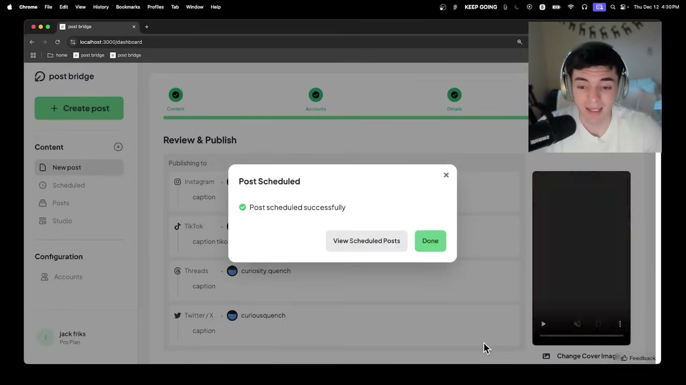
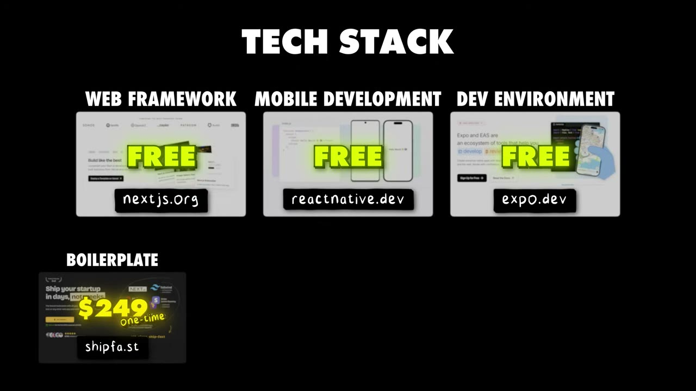
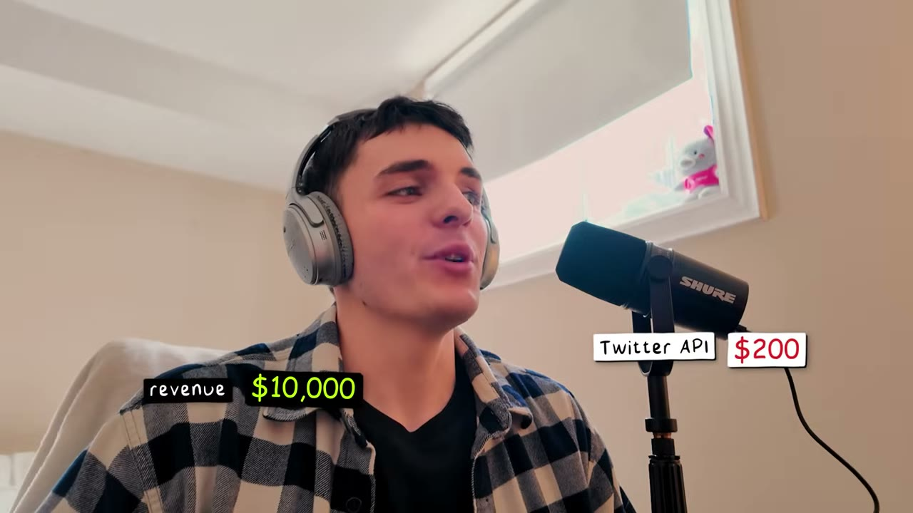

# I Built a $10K/Month App from My Mom’s Basement

✅ **Đã phân tích sâu** → [`case.md`](case.md)

| | |
|---|---|
| **Video** | <https://www.youtube.com/watch?v=qeY283nBhIA> |
| **Đăng** | 25/03/2025 |
| **Thời lượng** | 19:09 |
| **Lượt xem** | 236,833 |
| **Lượt thích** | 8,574 |
| **Video ID** | `qeY283nBhIA` |

## Trong thư mục này

| File | Nội dung |
|---|---|
| [`case.md`](case.md) | **Phân tích đầy đủ** — ý tưởng, validate, GTM, áp dụng ở VN |
| [`meta.json`](meta.json) | Metadata gốc (chapters, heatmap, mô tả) |
| [`screenshots/`](screenshots/) | 6 ảnh 720p |

## Mô tả gốc

This is how Jack Friks taught himself how to code (within 1 year), then built 2 apps to over $10,000/month all from his mom's basement.
This video is an educational case study of one founder’s experience. It is not financial advice and does not guarantee any income or results. Every business is different and your results may vary.

## Số liệu bắt được từ transcript

> Các đoạn founder nhắc tới con số, kèm timestamp để tua thẳng tới đó trong video.

_(không bắt được con số nào)_

## Chương

_(không có chapter)_

## Ảnh

1. `01_01m39s_usd-3-000.jpg` — 
2. `02_02m26s_usd-9.jpg` — 
3. `03_07m55s_replay.jpg` — 
4. `04_15m23s_replay.jpg` — 
5. `05_16m06s_usd-200.jpg` — 
6. `06_17m55s_usd-10-000.jpg` — 

---

← [Quay lại index](../../index.md) · [Toàn bộ video](../README.md)
