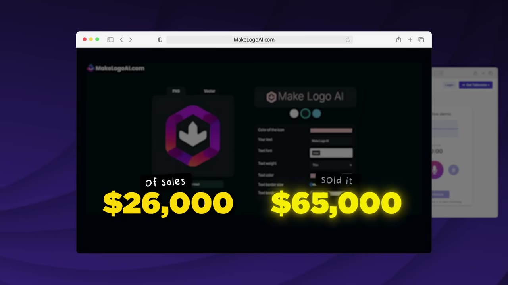
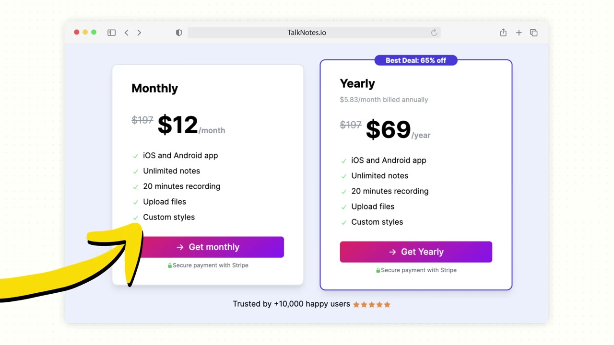
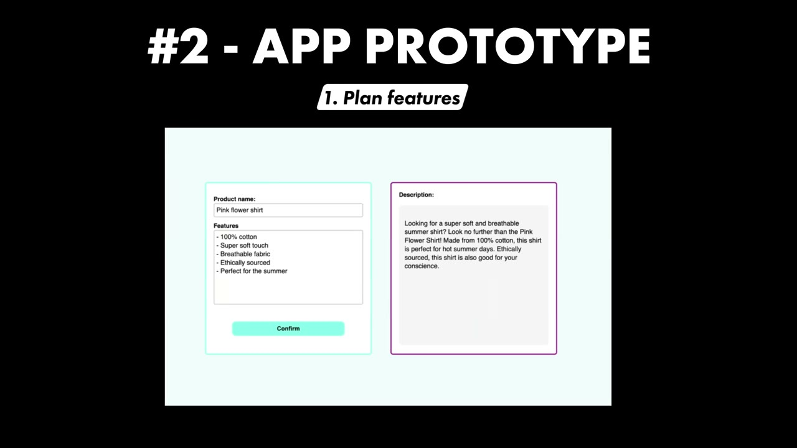
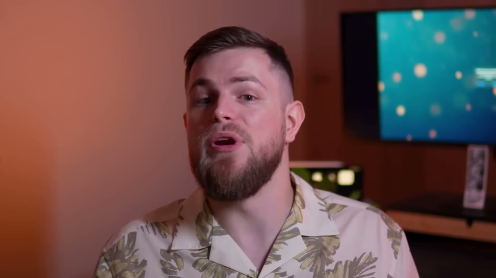
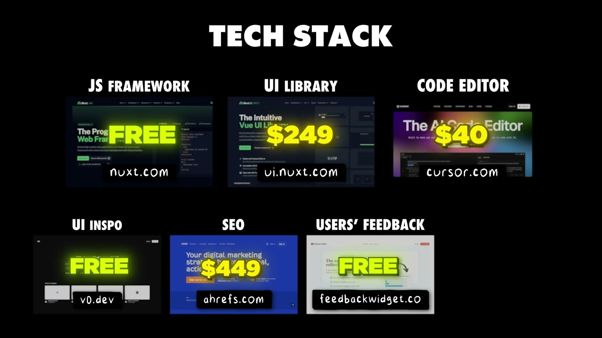
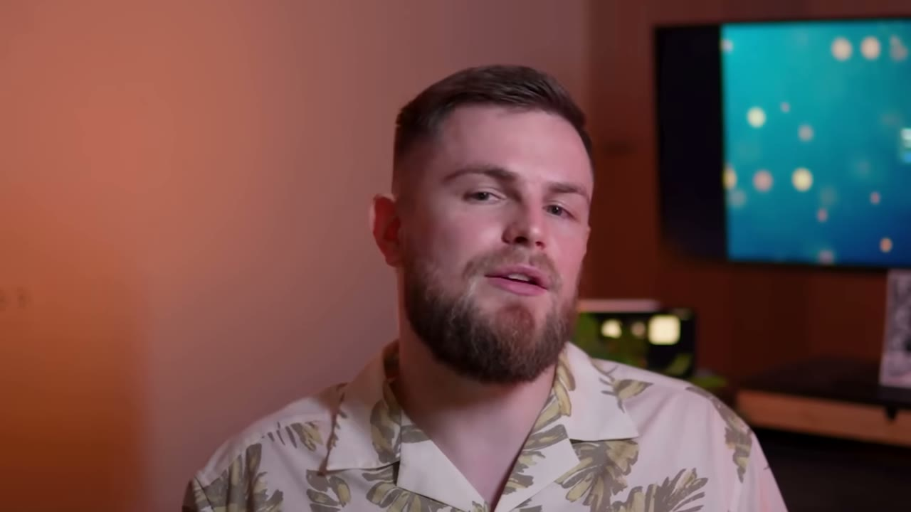

# Nico — 17 app, 2 cái thắng, 265.000 USD: quy luật luỹ thừa nhìn thấy bằng mắt thường

> **Tóm tắt 30 giây.** Nico bỏ việc ở ngân hàng sau **ba ngày** khi 19 tuổi. Thử làm thương hiệu cà vạt (thất bại), dropshipping (học được cách chạy quảng cáo Facebook), rồi đóng cửa hết và **nhốt mình trong phòng khách sạn hai tháng để tự học code**. Trong năm sau đó anh làm **17 app**. **Mười lăm cái thất bại.** Hai cái còn lại — MakeLogo AI và TalkNotes — anh bán được **265.000 USD**. Đây là một trong số ít case trong kho **thắng bằng quảng cáo trả phí** thay vì organic, và cũng là case cho thấy rõ nhất **tỷ lệ thắng thật của việc làm sản phẩm: khoảng 12%**.

## 1. Con số

| App | Doanh số khi vận hành | Giá bán | Tổng |
|---|---|---|---|
| **MakeLogo AI** | 26.000 USD | **65.000 USD** | ~85.000 USD¹ |
| **TalkNotes** | 77.000 USD | **200.000 USD** | 277.000 USD |
| **Tổng tiền bán** | — | **265.000 USD** | — |

¹ *Anh nói "khoảng 85.000 USD tổng doanh thu từ dự án này" nhưng 26 + 65 = 91. Mâu thuẫn nhỏ, tôi ghi lại nguyên trạng.*

| Chỉ số khác | Giá trị |
|---|---|
| App làm trong một năm | **17** |
| App thành công | **2** |
| **Tỷ lệ thắng** | **~12%** |
| TalkNotes: người dùng | ~10.000 |
| TalkNotes: giá | 60 USD/năm hoặc **12 USD/tháng** |
| Chi quảng cáo | **20–100 USD/ngày** |
| MakeLogo: thời gian từ bắt đầu tới khi bán xong | ~6 tháng (tháng 11 → tháng 3) |

**Một mâu thuẫn nhỏ cần ghi:** tiêu đề và lời kể của Nico nói **17 app**, nhưng Pat nói **"20 apps"** ở cuối video. Tôi lấy con số của chính Nico.

## 2. Tỷ lệ 12% — con số quan trọng nhất trong case này ⭐⭐⭐⭐⭐

Hầu hết video trên kênh này kể về **một** sản phẩm thành công. Case này cho bạn **mẫu số**.

**17 app trong một năm. 2 cái đáng tiền. 15 cái không.**

Đây là bằng chứng trực quan cho quy luật luỹ thừa mà [Domenico cũng chạm tới](../2025-10-21_i-made-1m-flipping-apps/case.md) (6 thương vụ đầu chỉ chiếm 6–8% tổng tiền kiếm được) và [Jacob của Faceless.video](../2025-06-14_i-built-a-1m-saas-100-with-no-code-bubble/case.md) (6 ý tưởng thất bại trước cái thứ bảy).

**Hệ quả thực tiễn — và nó khắc nghiệt:**

- Nếu tỷ lệ thắng là 12%, thì **xây một app và hy vọng nó thắng là đánh cược ở tỷ lệ 1/8**
- Chiến lược đúng không phải "chọn ý tưởng tốt hơn" mà là **hạ chi phí mỗi lần thử xuống đủ thấp để chạy đủ nhiều lần**
- Toàn bộ quy trình của Nico (xem mục 4) được thiết kế cho đúng mục tiêu đó

Và đây cũng là lý do lời khuyên cuối của anh có trọng lượng: **đừng gắn cảm xúc vào sản phẩm.** Với tỷ lệ 12%, gắn bó với một sản phẩm nghĩa là bạn sẽ dành cả năm cứu một trong 15 cái sẽ chết.

## 3. Bốn tiêu chí lọc ý tưởng ⭐⭐⭐⭐

Anh nêu bốn tiêu chí, chia làm hai nhóm:

**Về thị trường:**
1. **Giá trị cảm nhận** — đây có thật sự là thứ người ta coi trọng việc giải quyết, hay chỉ là **một bất tiện nhỏ mà họ không mấy quan tâm**?
2. **Quy mô** — có một thị trường thật, hay chỉ ba người trên thế giới cần?

**Về bản thân:**
3. **Kỹ năng của tôi** — tôi tự làm được không?
4. **Phân phối** — có cách nào để tôi tiếp cận người dùng **một cách có lãi** không?

Tiêu chí 1 là tiêu chí sắc nhất và ít người áp dụng nghiêm túc. Ranh giới giữa "vấn đề" và "bất tiện nhỏ" chính là ranh giới giữa sản phẩm bán được và sản phẩm được khen là hay rồi không ai trả tiền.

Tiêu chí 4 lặp lại đúng điều [Thomas Sanlis nói](../2025-08-23_how-i-finally-built-a-10k-month-saas-30-failures/case.md): ý tưởng tốt là ý tưởng **bạn biết cách bán**.

Anh cũng thừa nhận: **phần lớn ý tưởng thành công đến với anh một cách tự nhiên, vì chính anh cần chúng.** Nhưng khác với các founder chỉ dừng ở "tôi tự dùng nó", anh có bốn bộ lọc phía sau.

## 4. Quy trình xây — được thiết kế để chạy nhanh và chạy nhiều lần ⭐⭐⭐⭐⭐

Đây là phần vận hành đáng copy nhất, và mỗi bước đều phục vụ mục tiêu **giảm chi phí mỗi lần thử**:

**Bước 0 — Đặt một deadline cứng trước tiên.** Lý do anh đưa rất chính xác: **nếu không có ràng buộc thời gian thì luôn có thứ để thêm vào, luôn có cách làm cho app "hoàn hảo hơn".** Deadline ép anh chỉ làm những gì cần thiết.

**Bước 1 — Lên kế hoạch: viết ra tính năng, KHÔNG viết những thứ hay ho.** Chỉ những gì thiết yếu.

**Bước 2 — Nguyên mẫu giao diện.** Tìm ý tưởng thiết kế trên Dribbble và Google Images; gần đây dùng **v0 để sinh giao diện**. Nếu giao diện phức tạp thì dựng prototype trên Figma; nếu không thì code thẳng.

**Bước 3 — Thêm các lớp SaaS.** Xác thực, thanh toán, những thứ mọi SaaS đều cần. Anh nói rõ: **đây là mã boilerplate mà anh bê từ dự án này sang dự án khác.**

**Bước 4 — Landing page.** Trang bán hàng, làm sao cho thuyết phục nhất có thể.

**Bước 5 — Tối ưu.** SEO, sửa lỗi nhỏ, tối ưu cho di động.

**Vì sao quy trình này quan trọng hơn nó trông có vẻ:** bước 3 là chỗ hầu hết người mới **đốt hàng tuần cho mỗi dự án**. Khi bạn có sẵn boilerplate, chi phí thử một ý tưởng mới giảm mạnh — và với tỷ lệ thắng 12%, **giảm chi phí mỗi lần thử chính là toàn bộ chiến lược.**

Bộ công cụ hiện tại của anh: **Next.js + NextUI** (thư viện component, để không phải code từng cái nút), **Cursor** với tài liệu Next.js và NextUI được nhúng sẵn, **v0** để sinh giao diện. Anh nói ba thứ này cộng lại làm anh **nhanh gấp khoảng 10 lần** so với trước khi dùng AI.

## 5. MVP không có backend — validation kiểu người phục vụ ⭐⭐⭐⭐⭐

Đây là chi tiết tôi cho là đắt nhất video.

Với **MakeLogo AI**, phiên bản đầu tiên **không có backend nào cả**. Anh dùng **Tally** (công cụ làm form) để:
- Thu thập tên dự án và thông tin khách muốn
- Hỏi họ muốn loại logo gì
- **Thu tiền**

Rồi anh **tự làm thủ công**.

Nguyên văn: *"it's definitely not scalable but I was able to get something going and I got my first sales from that."* Và câu tiếp theo mới là điểm chốt: **có đơn hàng nghĩa là người ta thật sự quan tâm — giờ tôi mới đáng bỏ thời gian làm giao diện tử tế.**

**Vì sao cách này mạnh hơn mọi khảo sát:** tiền là tín hiệu duy nhất không nói dối. Và chi phí dựng nó gần bằng 0 — một form và vài giờ làm tay.

Đây là cùng một họ phương pháp với [Setter AI thu 500 USD đặt cọc trước khi viết code](../2025-09-27_how-we-built-a-10k-mo-saas/case.md) và [lời khuyên của Erikas: nếu thu tiền được thì càng tốt](../2025-04-19_my-apps-make-4-5m-year-with-0-marketing/case.md). Ba founder độc lập, cùng kết luận: **thu tiền trước khi tự động hoá.**

## 6. Quảng cáo trả phí — con đường ít người trong kho này đi ⭐⭐⭐⭐⭐

Phần lớn founder trên kênh này thắng bằng organic. Nico thắng bằng **Facebook ads**, và anh giải thích đủ chi tiết để dùng được.

**Trình tự anh làm — và thứ tự này là điều quan trọng nhất:**

1. **Với MakeLogo:** anh **không có tiền tiết kiệm** nên không chi quảng cáo. Anh là **người đầu tiên làm logo bằng AI** thời điểm đó, nên sự tò mò tự nhiên đủ để kéo khách
2. **Với TalkNotes:** anh **không chạy ads ngay từ đầu**. Anh validate ý tưởng bằng organic trước, đạt **khoảng 1.500 USD MRR**
3. **Chỉ khi biết ý tưởng có tiềm năng, anh mới bắt đầu chạy ads**
4. Ban đầu chỉ là **quảng cáo tĩnh rất cơ bản** — một tấm ảnh với một dòng tiêu đề, vì anh không có nguồn lực làm creative
5. Rồi anh làm **landing page riêng cho từng nhóm khách hàng, và quảng cáo riêng cho từng nhóm** — **"đó là lúc nó thực sự bùng nổ"**

**Ngân sách: 20–100 USD/ngày.** Anh tự nói con số này rất nhỏ so với chuẩn ngành, nhưng anh giải thích lý do rất hợp lý: **nguồn lực làm creative và hỗ trợ khách hàng của anh có hạn, nên chi hàng nghìn đô mỗi ngày sẽ không có ý nghĩa.**

Đây là điểm mà nhiều người bỏ qua: **ngân sách quảng cáo bị chặn bởi năng lực sản xuất creative và năng lực phục vụ khách, không phải bởi tiền.**

**Cấu trúc của quảng cáo thắng nhất — anh mô tả rất cụ thể:**

- **Không giống quảng cáo chuyên nghiệp.** Anh trả tiền cho một người quay chính họ đọc kịch bản **trong văn phòng của họ**
- **Trông như nội dung organic** bạn lướt thấy trên feed → người ta tự nhiên có xu hướng xem hơn
- **Tập trung vào VẤN ĐỀ.** Tên app **không được nhắc tới mãi tới về sau**
- Bạn **liên tục cho họ lý do để xem tiếp**, cho tới đoạn cuối mới có lời kêu gọi hành động: *nếu bạn gặp những vấn đề này và muốn giải pháp, hãy xem sản phẩm này*

Anh cũng phân biệt hai loại nền tảng rất rõ:

| Loại | Ví dụ | Logic |
|---|---|---|
| **Nền tảng tìm kiếm** | Google | đưa cho người ta đúng thứ họ muốn, **đúng thời điểm** |
| **Nền tảng ngắt quãng** | Facebook, Instagram | người ta đang làm việc khác — **phải giành sự chú ý** |

Đối chiếu quan trọng: [Connor dùng organic làm phòng thí nghiệm creative cho paid](../2025-10-26_i-vibe-coded-a-20k-month-mobile-app-in-14-days/case.md) và [Jure nói CPM Facebook là hàm của mức độ giải trí](../2025-04-12_i-make-60k-month-with-4-apps/case.md). Nico đến cùng kết luận từ hướng khác: **quảng cáo trông giống quảng cáo là loại đắt nhất bạn có thể chạy.**

## 7. Cách bán app — phần thực dụng nhất video ⭐⭐⭐⭐⭐

Anh đã qua quy trình này **hai lần** và chia sẻ đủ để dùng lại.

**Nơi niêm yết: Acquire.com.** Lưu ý quan trọng: **họ không xử lý giao dịch** — họ chỉ kết nối bạn với người mua. **Việc chuyển tiền bạn phải tự lo.**

**Nguyên tắc niêm yết: hãy làm listing của bạn như một landing page.** Bạn đang trưng bày startup của mình như một **sản phẩm**, không phải một bảng số liệu.

**Chiến thuật đàm phán — và đây là phần thú vị nhất:** anh nói thẳng là nên **làm cho nhiều người mua cùng quan tâm**, vì **có yếu tố cái tôi trong đó**.

Diễn biến thật của thương vụ MakeLogo:

| Chào giá | Điều kiện |
|---|---|
| ~50.000 USD | — |
| ~55.000 USD | — |
| 65.000 USD | **trả góp trong một năm** |
| **65.000 USD** | **tiền mặt, chốt trong hai tuần** ← thắng |

Người mua cuối nói thẳng: *"tôi không muốn mất thời gian đấu giá với những người mua khác."*

**Điểm cần rút ra và nó tinh tế:** hai lời chào cuối **cùng một con số 65.000**, nhưng **điều khoản khác nhau hoàn toàn**. Một cái trả trong 12 tháng (kèm rủi ro không thu đủ), một cái tiền mặt trong hai tuần. **Trong M&A quy mô nhỏ, điều khoản quan trọng ngang giá.** Và cách tạo ra lời chào tốt hơn đó không phải bằng thương lượng — mà bằng **sự tồn tại của những người mua khác**.

## 8. Bối cảnh: con đường thật của anh ⭐⭐⭐

Trình tự đầy đủ, và nó không hề gọn gàng:

1. **19 tuổi:** làm hè ở ngân hàng, ghét quá nên **nghỉ sau ba ngày**. Không hiểu khởi nghiệp là gì
2. Một năm sau: làm thương hiệu **cà vạt sản xuất tại Pháp** → thất bại (*"không ai đeo cà vạt nữa"*) nhưng nó đưa anh vào thương mại điện tử và marketing
3. Học **dropshipping** qua các nhóm Facebook → không thành công lắm nhưng **học được cách chạy quảng cáo Facebook**
4. Nhờ kỹ năng đó, được thuê làm freelancer cho một **thương hiệu thời trang Bỉ**
5. Chủ thương hiệu báo dừng hợp tác vì **tìm được người rẻ hơn**; cùng lúc thương hiệu thương mại điện tử của anh **có doanh số nhưng lãi rất ít**
6. Anh **dừng tất cả**, nhốt mình trong phòng khách sạn hai tháng, học code
7. Hai tháng sau khi ra mắt app đầu tiên, có doanh thu

**Điều đáng chú ý:** kỹ năng quyết định thành công của anh — **chạy quảng cáo Facebook** — được học trong một dự án **thất bại** (dropshipping). Đây là mô hình lặp lại trong kho: [Jacob dùng kỹ năng marketing âm nhạc](../2025-06-14_i-built-a-1m-saas-100-with-no-code-bubble/case.md), [Alex dùng kỹ năng làm phim](../2025-06-14_i-built-a-1m-saas-100-with-no-code-bubble/case.md). **Dự án thất bại vẫn tạo ra tài sản, miễn là bạn học một kỹ năng chuyển giao được.**

## 9. Lời khuyên cuối — chống lại chính khung của kênh này ⭐⭐⭐⭐

Ba điều anh nói với chính mình khi còn trong phòng khách sạn:

1. **Đừng gắn cảm xúc vào sản phẩm** (xem mục 2 — với tỷ lệ 12% thì đây là điều kiện sống còn)
2. **Làm nguyên mẫu kỹ thuật thật nhanh** để giải quyết vấn đề, rồi **nói chuyện với người dùng sớm nhất có thể**
3. **Đừng cố kiếm 100.000 USD, thậm chí đừng cố kiếm 10.000 USD cho dự án đầu tiên nếu bạn chưa từng thành công.** Hãy **kiếm đô la đầu tiên** đã, và quên khả năng mở rộng đi. *"Compounding small wins"* — bạn cần thắng lợi nhỏ đầu tiên để đẩy quả cầu tuyết lăn.

Điểm 3 mâu thuẫn thẳng với thông điệp của phần lớn nội dung indie hacking, kể cả đoạn quảng cáo ở cuối chính video này.

Pat cũng chốt một câu đáng ghi nhận là trung thực: anh **không nghĩ Nico có công thức thần kỳ nào cả**. Nico chỉ bắt đầu, ship rất nhiều thứ, và trong quá trình đó **tình cờ vấp phải một vài cái chạy được.**

## 10. Cảnh báo thiên kiến nguồn

- **Vanta tài trợ, đoạn dài ~1,5 phút** (7:37–9:16) về tuân thủ SOC 2, ISO 27001, HIPAA và "khách hàng doanh nghiệp mang lại 100.000 USD ARR". **Hoàn toàn không liên quan tới Nico** — anh làm micro-app B2C bán 12 USD/tháng, chưa từng nhắc tới doanh nghiệp lớn hay tuân thủ. Đây là quảng cáo cài ghép trơ trọi nhất trong kho.
- **Không có ảnh chụp dashboard doanh thu hay hợp đồng bán nào.** Toàn bộ con số là lời tự khai.
- **Số app không thống nhất:** Nico nói 17, Pat nói 20.
- **Số tiền MakeLogo không cộng khớp:** 26 + 65 = 91, nhưng anh nói "khoảng 85".
- **Bán khoá "AI Build Accelerator"** ở cuối — *"trong 2 tuần bạn sẽ lên ý tưởng, xây và ship một app thật"*. Đặt cạnh lời khuyên của chính Nico ("đừng cố kiếm 10.000 USD cho dự án đầu"), thông điệp thương mại và thông điệp của nhân vật đi ngược nhau.
- **Bối cảnh bị làm mờ:** "tự học code trong 2 tháng" là thật, nhưng anh bước vào đó với **nhiều năm kinh nghiệm thương mại điện tử và kỹ năng chạy quảng cáo Facebook có trả tiền** — chính hai thứ đó, chứ không phải kỹ năng code, là thứ bán được sản phẩm.
- **Anh sống ở Bali.** Chi phí sinh hoạt thấp là một phần của phương trình cho phép anh thử 17 lần trong một năm; video không nhắc.

## 11. Áp dụng cho tôi (indie hacker VN)

Đây là case **có cấu trúc gần với hoàn cảnh người Việt nhất** trong kho: ít vốn, chi phí sinh hoạt thấp, làm một mình, dùng quảng cáo nhỏ thay vì audience.

**Sao chép được ngay:**

1. **Xây boilerplate SaaS của riêng bạn** (auth + thanh toán + layout) và tái sử dụng. Đây là khoản đầu tư một lần làm giảm chi phí mọi lần thử sau đó — và với tỷ lệ thắng 12%, đó là đòn bẩy lớn nhất bạn có.
2. **Đặt deadline cứng trước khi bắt đầu**, không phải sau.
3. **MVP không backend:** dùng form thu thông tin và **thu tiền**, làm thủ công phần còn lại. Nếu không ai trả tiền, bạn vừa tiết kiệm hàng tháng.
4. **Validate organic trước, chạy ads sau.** Thứ tự này là lý do TalkNotes thành công còn 15 app khác thì không.
5. **Landing page riêng cho từng nhóm khách + quảng cáo riêng cho từng nhóm.** Chính anh nói đây là lúc mọi thứ bùng nổ.
6. **Cấu trúc quảng cáo:** trông như organic, nói về vấn đề, giấu tên sản phẩm tới cuối.
7. **Khi bán: tạo cạnh tranh giữa người mua, và đọc kỹ điều khoản chứ không chỉ con số.**

**Rào cản thật:**

- **Chi phí quảng cáo cần vốn lưu động thật.** 20–100 USD/ngày là 600–3.000 USD/tháng — không nhỏ với người mới ở Việt Nam, và bạn phải chịu được vài tháng chưa hoàn vốn.
- **Cần tài khoản quảng cáo Facebook ổn định và phương thức thanh toán quốc tế.** Đây là rào cản vận hành thật, không phải rào cản kỹ thuật.
- **Acquire.com không xử lý giao dịch** — bạn phải tự lo chuyển tiền quốc tế và các vấn đề pháp lý, thuế đi kèm khi bán một tài sản cho người mua nước ngoài. Đây là phần khó nhất khi áp dụng từ Việt Nam và video không nói gì.
- **Kỹ năng quảng cáo của anh mất nhiều năm mới có.** "Học code 2 tháng" không phải phần khó.

**Khi KHÔNG nên đi con đường này:**

- **Khi bạn không chịu nổi việc 15 trong 17 dự án thất bại.** Đây là mô hình danh mục, và nó đòi hỏi sức chịu đựng tâm lý cụ thể. Nếu bạn cần mỗi dự án thành công, hãy chọn mô hình chậm mà chắc như [Stagetimer](../2025-06-25_this-app-makes-25-000-month/case.md) hay [HabitKit](../2025-06-21_how-i-built-it-15k-month-mobile-app/case.md).
- **Khi LTV sản phẩm của bạn quá thấp so với CAC.** Quảng cáo chỉ scale được khi khách ở lại đủ lâu. TalkNotes bán thuê bao 12 USD/tháng nên có chỗ; công cụ dùng một lần thì không.
- **Khi bạn muốn xây tài sản dài hạn.** Nico bán cả hai sản phẩm thắng. Đây là mô hình **xây để bán**, và [Lotts nói rõ mặt trái của nó](../2025-11-09_i-flipped-4-apps-and-made-500-000/case.md): bạn bán mất dòng tiền tương lai để lấy tiền mặt hôm nay.

## Nguồn

- Video: [I Locked Myself In A Room, Made 17 Apps, & Sold 2 for $265,000](https://www.youtube.com/watch?v=zPijWd9uk-I) — Starter Story, 31/03/2025, 284.047 view
- [Transcript đầy đủ](transcript.md) · [Ảnh chụp màn hình](screenshots/)
