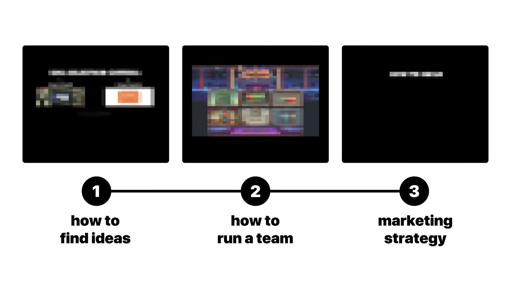
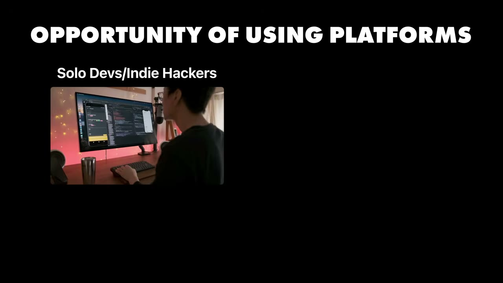
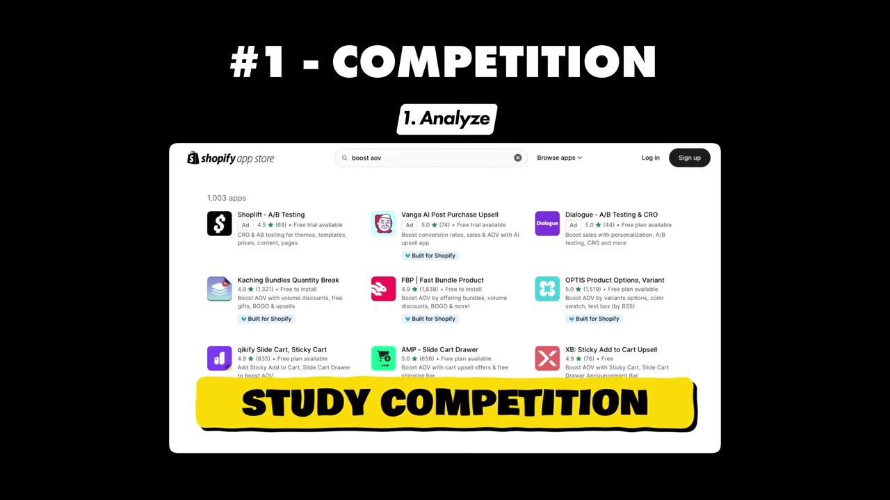
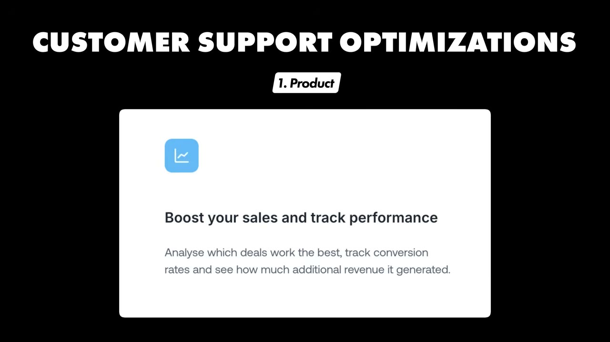

# My Apps Make $4.5M/Year With $0 Marketing

✅ **Đã phân tích sâu** → [`case.md`](case.md)

| | |
|---|---|
| **Video** | <https://www.youtube.com/watch?v=vLLBzUZr6-s> |
| **Đăng** | 19/04/2025 |
| **Thời lượng** | 18:13 |
| **Lượt xem** | 345,620 |
| **Lượt thích** | 8,950 |
| **Video ID** | `vLLBzUZr6-s` |

## Trong thư mục này

| File | Nội dung |
|---|---|
| [`case.md`](case.md) | **Phân tích đầy đủ** — ý tưởng, validate, GTM, áp dụng ở VN |
| [`meta.json`](meta.json) | Metadata gốc (chapters, heatmap, mô tả) |
| [`screenshots/`](screenshots/) | 10 ảnh 720p |

## Mô tả gốc

Erikas runs 5 different Shopify apps, making $4.5M/Year. In this interview, he breaks down the simple playbook behind his explosive growth. And how he went from $2/hour to making millions with 90% margins. 
0:00 - Intro
1:33 - Breakdown of Apps
2:16 - Building apps on platforms
4:40 - How to find winning ideas
6:33 - An under-the-radar marketplace to build on
8:37 - His process for building apps
11:11 - The strategy that changed everything
13:32 - 3 step launch strategy
14:12 - Tech stack
15:17 - Day in the life
16:13 - Advice to new founders
This video is an educational case study of one foun

## Số liệu bắt được từ transcript

> Các đoạn founder nhắc tới con số, kèm timestamp để tua thẳng tới đó trong video.

_(không bắt được con số nào)_

## Chương

- `00:00` Intro
- `01:33` Breakdown of Apps
- `02:16` Building apps on platforms
- `04:40` How to find winning ideas
- `06:33` An under-the-radar marketplace to build on
- `08:37` His process for building apps
- `11:11` The strategy that changed everything
- `13:32` 3 step launch strategy
- `14:12` Tech stack
- `15:17` Day in the life
- `16:13` Advice to new founders

## Ảnh

1. `01_00m51s_usd-4-5-m.jpg` — 
2. `02_01m45s_ch-breakdown-of-apps.jpg` — 
3. `03_02m28s_ch-building-apps-on-platforms.jpg` — 
4. `04_03m29s_usd-2.jpg` — 
5. `05_04m52s_ch-how-to-find-winning-ideas.jpg` — 
6. `06_06m26s_replay.jpg` — 
7. `07_08m49s_ch-his-process-for-building-apps.jpg` — 
8. `08_11m32s_replay.jpg` — 
9. `09_13m44s_ch-3-step-launch-strategy.jpg` — 
10. `10_14m24s_ch-tech-stack.jpg` — 

---

← [Quay lại index](../../index.md) · [Toàn bộ video](../README.md)
