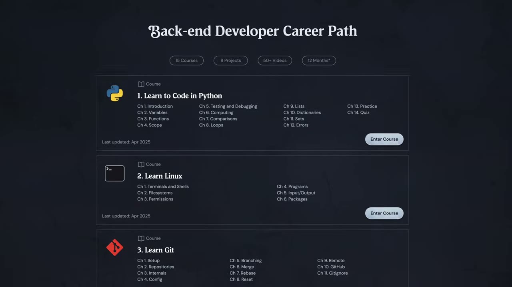
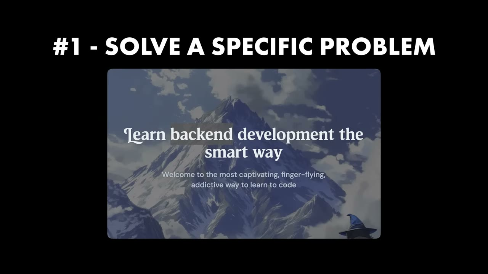
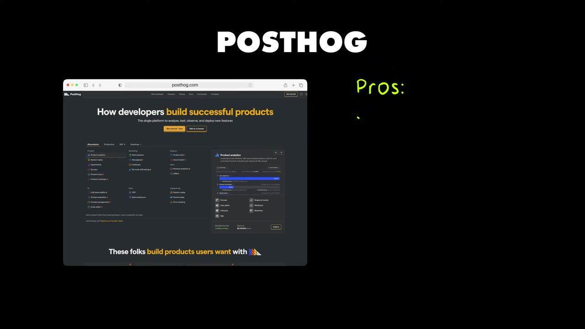
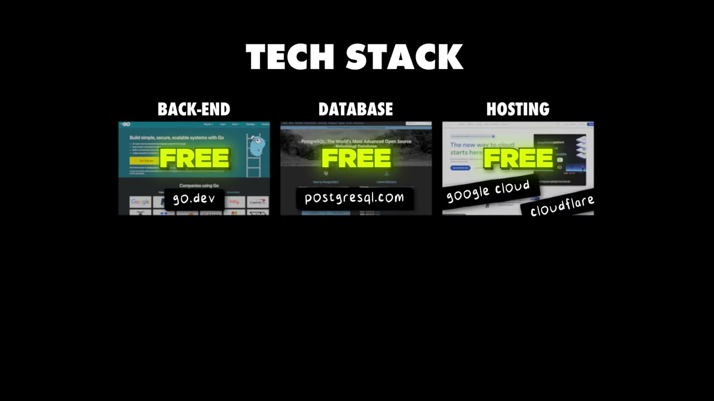

# My Coding Game Makes $1M Per Month

✅ **Đã phân tích sâu** → [`case.md`](case.md)

| | |
|---|---|
| **Video** | <https://www.youtube.com/watch?v=tMkpiFIW8Xg> |
| **Đăng** | 30/04/2025 |
| **Thời lượng** | 17:15 |
| **Lượt xem** | 195,375 |
| **Lượt thích** | 6,471 |
| **Video ID** | `tMkpiFIW8Xg` |

## Trong thư mục này

| File | Nội dung |
|---|---|
| [`case.md`](case.md) | **Phân tích đầy đủ** — ý tưởng, validate, GTM, áp dụng ở VN |
| [`meta.json`](meta.json) | Metadata gốc (chapters, heatmap, mô tả) |
| [`screenshots/`](screenshots/) | 10 ảnh 720p |

## Mô tả gốc

This is how Lane Wagner went from working 9-5 as a developer to building his own $1M/month learning platform.
0:00 - Intro
1:36 - Boot dev business breakdown
2:07 - The secret sauce to his business
3:01 - Background
4:15 - The idea
4:50 - Building the product
6:10 - Using posthog for analytics
8:00 - Growing the business
9:34 - Collaborating with influencers
10:22 - Building products people love
11:06 - Monetizing the business
12:03 - Tools and tech stack 
12:50 - Costs to run the business
13:34 - Day in the life
14:33 - Advice to new founders
15:59 - Micro saas ideas
This video is an educatio

## Số liệu bắt được từ transcript

> Các đoạn founder nhắc tới con số, kèm timestamp để tua thẳng tới đó trong video.

_(không bắt được con số nào)_

## Chương

- `00:00` Intro
- `01:36` Boot dev business breakdown
- `02:07` The secret sauce to his business
- `03:01` Background
- `04:15` The idea
- `04:50` Building the product
- `06:10` Using posthog for analytics
- `08:00` Growing the business
- `09:34` Collaborating with influencers
- `10:22` Building products people love
- `11:06` Monetizing the business
- `12:03` Tools and tech stack
- `12:50` Costs to run the business
- `13:34` Day in the life
- `14:33` Advice to new founders
- `15:59` Micro saas ideas

## Ảnh

1. `01_01m06s_replay.jpg` — 
2. `02_01m48s_ch-boot-dev-business-breakdown.jpg` — 
3. `03_03m28s_usd-2-000.jpg` — 
4. `04_04m27s_ch-the-idea.jpg` — 
5. `05_05m02s_ch-building-the-product.jpg` — 
6. `06_06m22s_ch-using-posthog-for-analytics.jpg` — 
7. `07_07m22s_metric.jpg` — 
8. `08_08m12s_ch-growing-the-business.jpg` — 
9. `09_12m19s_replay.jpg` — 
10. `10_13m02s_usd-5-7-m.jpg` — 

---

← [Quay lại index](../../index.md) · [Toàn bộ video](../README.md)
