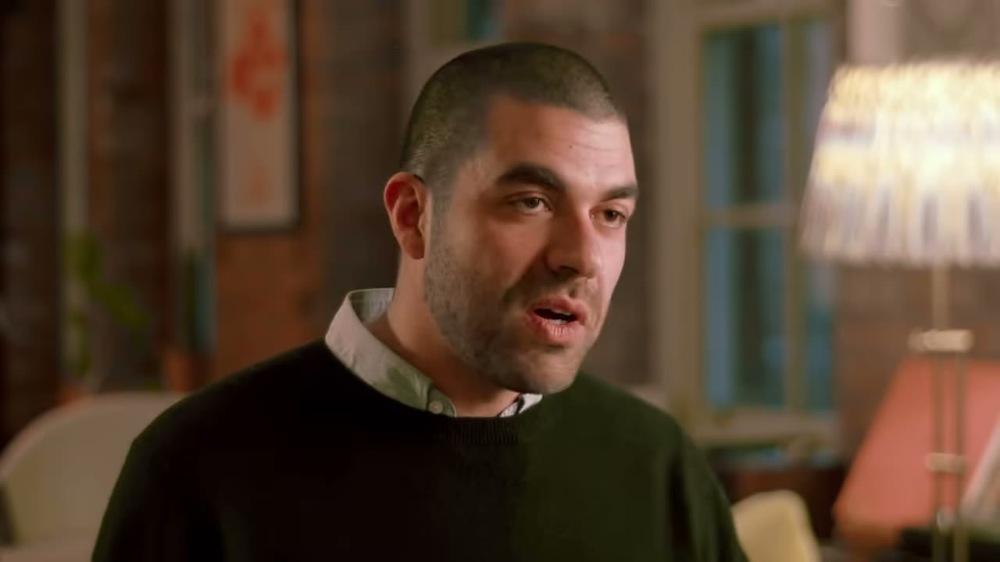
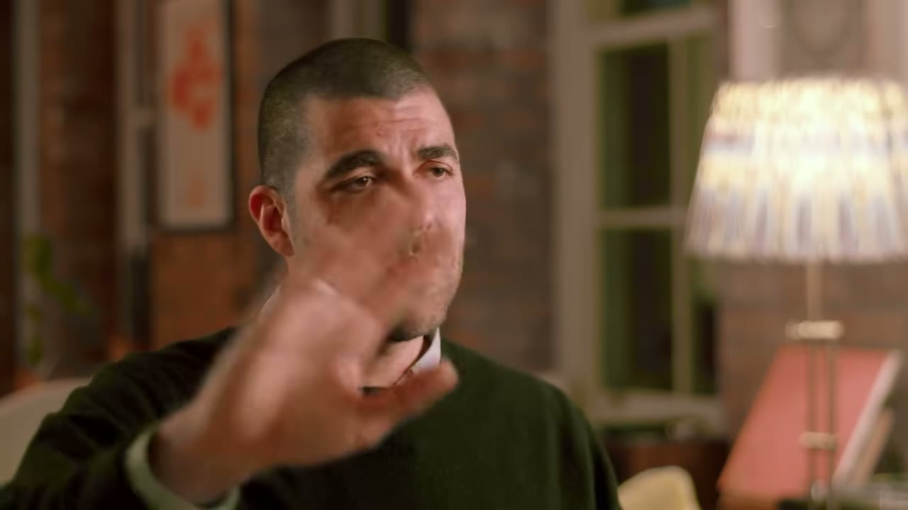
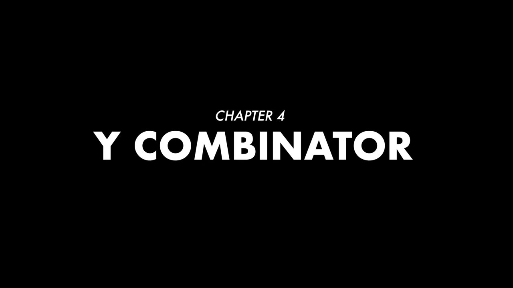
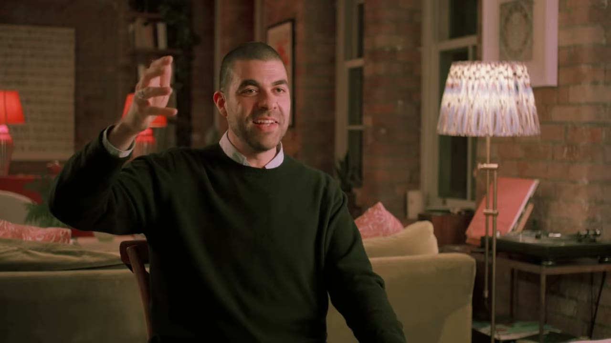
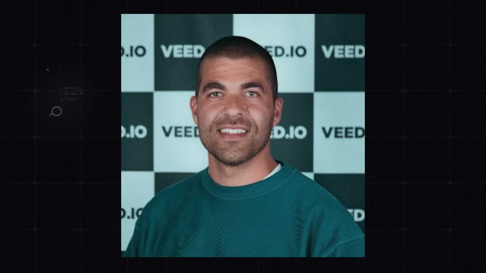

# Veed.io — từ hai lần bị YC từ chối tới 40 triệu USD ARR

> **Tóm tắt 30 giây:** Sabba Keynejad và co-founder Tim đốt 2 năm không doanh thu, không vốn, bị VC đuổi khỏi văn phòng, hai intern nghỉ cùng một ngày, phải bán crypto cá nhân để nuôi công ty. Nộp Y Combinator với 30.000 người dùng/tháng và bị từ chối. Nhưng trong email từ chối có một câu: ***"chúng tôi không hiểu vì sao các bạn chưa thu tiền người dùng"***. Họ cày cả cuối tuần để gắn thanh toán, thứ Hai email lại YC báo đã có **20 khách trả tiền** — và bị từ chối lần hai. Cái họ thật sự nhận được không phải suất vào YC mà là **doanh thu**. Sau đó Sabba, một người mắc chứng khó đọc, tự tay viết **khoảng 500 landing page** cho 500 từ khoá kiểu *trim video*, *crop video*, mỗi trang kèm một video YouTube. Công ty đi 0 → 1 → 6 → 40 triệu USD.

⚠️ **Đây là case kể chuyện (story), KHÔNG phải breakdown kinh doanh.** Không có ảnh dashboard doanh thu, không có CAC, không có churn, không có số khách trả tiền. Toàn bộ con số đến từ lời kể và từ mô tả video. Đọc case này để lấy **cơ chế** và **thứ tự ưu tiên**, đừng lấy nó làm bằng chứng số liệu.

## 1. Con số

| Chỉ số | Giá trị | Nguồn |
|---|---|---|
| Doanh thu | 40 triệu USD ARR | mô tả video (không phải lời founder trong video) |
| Mốc tăng trưởng | 0 → 1M năm đầu, 4 tháng sau 2M, 2 tháng sau 3M, 6 tháng sau 6M | founder đọc trong video |
| Sau đó | 10 → 20 → 30 → 40 triệu | founder đọc trong video |
| Người dùng khi nộp YC | 30.000/tháng, **không ai trả tiền** | founder |
| Thời gian lên 30.000 MAU | 9 tháng | founder |
| Khách trả tiền đầu tiên | 20 người, gom trong 1 cuối tuần | founder |
| Số landing page SEO | khoảng 500 | founder |
| Số lần bị YC từ chối | 2 | founder |
| Con số 200 triệu USD ở tiêu đề | **không được giải thích trong video** | — |

**Ghi chú ASR:** phụ đề tự động đọc tên sản phẩm thành "V" và "v.io", tên founder thành "Saba Kenned". Tên đúng lấy từ mô tả video: **Veed.io** và **Sabba Keynejad**. Phụ đề cũng đọc "Y Combinator" thành "White Combinator" và "prey combinator".

## 2. Hai năm địa ngục — chi tiết đáng nhớ nhất ⭐⭐

Đây là phần video kể kỹ nhất, và nó có giá trị vì nó cho bạn **thước đo thật về cái giá phải trả**:

- Dậy 6h sáng, đạp xe tới "văn phòng" lúc 7h, làm tới 7-8h tối, đi gym, về làm tiếp.
- *"Khi tôi nói văn phòng, ý tôi là co-working space. Và khi tôi nói co-working space, ý tôi là **tôi và Tim dùng chung một thẻ ra vào**."*
- Mua đồ ăn giảm giá cuối ngày ở London trên đường về.
- Email cho Crisp chat: *"Bọn tôi không trả nổi 100 đô/tháng, giảm được không?"* → được 20 đô/tháng. **Nickel and dime từng khoản chi.**
- Bị chính VC cho ngồi nhờ văn phòng **đuổi ra**. Hai intern nghỉ **cùng một ngày**.
- Bị từ chối gọi vốn *"rất rất nhiều lần"*. Phải **bán crypto cá nhân** để nuôi công ty.
- Không đủ tiền mua vé tàu đi dự sinh nhật bạn. Không đi ăn tối thứ Sáu được.

> *"Bạn bè cùng lứa đang cuối 20, đang thăng tiến, đang mua nhà. Còn tôi thì vừa vét sạch tài khoản ngân hàng."*

**Rồi họ làm một việc quan trọng mà ít người kể:** cả hai **đi làm thuê lại**. Không phải bỏ cuộc — mà để có dòng tiền. Mỗi tháng họ trích **một nửa lương** bơm vào tài khoản công ty, và dùng số đó **thuê 2 kỹ sư** build tiếp.

> **Cơ chế cần hiểu:** đây là nước đi đổi **thời gian của mình** lấy **thời gian của người khác**. Hai founder đi làm 8 tiếng để mua được 16 tiếng lập trình mỗi ngày. Với người không code được hoặc code chậm, đây thường là nước đi đúng — và nó ngược hoàn toàn với lời khuyên *"nghỉ việc all-in"* mà kênh này thường tôn vinh.

## 3. Bài học đắt nhất — email từ chối của YC ⭐⭐⭐

Đây là phần đáng giá nhất của cả video.

Bối cảnh: 30.000 người dùng/tháng, **không ai trả tiền**, đã cày 2 năm. Nộp YC, được vào vòng phỏng vấn. Cách YC làm việc: **được nhận thì gọi điện, bị loại thì gửi email**. Tối đó hai người ngồi refresh điện thoại.

Email đến. Bị loại. Nhưng trong đó có một dòng:

> ***"We don't understand why you haven't charged your users."***
> (Chúng tôi không hiểu vì sao các bạn chưa thu tiền người dùng.)

Họ làm gì trong cuối tuần đó: **gắn thanh toán vào sản phẩm**. 9h sáng thứ Hai gửi email: *"Cảm ơn feedback, bọn tôi đã làm rồi, đã có 20 khách trả tiền, các anh xem lại được không?"*

**Kết quả: bị từ chối lần hai.**

Nhưng Sabba nói câu này — đây là câu nên in ra dán tường:

> *"Trước Combinator là một công ty **không có doanh thu**. Sau đó là một công ty **có doanh thu**."*

**Vì sao cơ chế này quan trọng với bạn:**

1. **30.000 người dùng miễn phí trong 9 tháng KHÔNG phải là product-market fit.** Nó là bằng chứng có traffic, không phải bằng chứng có giá trị. Hai founder cày 2 năm mới có người ngoài chỉ ra điều hiển nhiên này.
2. **Gắn thanh toán mất đúng một cuối tuần.** Không phải một quý, không phải một vòng gọi vốn. Việc trì hoãn 2 năm là quyết định tâm lý, không phải kỹ thuật.
3. **Người từ chối bạn thường là người nói thật nhất.** VC/accelerator không có động cơ nịnh bạn. Người dùng free thì có — họ luôn khen sản phẩm miễn phí.

**Mâu thuẫn với các case khác — và cách phân định:**

| Quan điểm | Ai | Đúng khi nào |
|---|---|---|
| Ship kèm nút mua ngay từ ngày đầu | [Marc Lou](../2026-04-26_how-i-work-77k-month-solopreneur/case.md) | Bạn là solo, không có runway, chi phí build dưới 1 tuần |
| Validate trước khi viết dòng code nào | [Once](../2026-05-10_i-built-a-20k-month-app-in-83-days/case.md) | Sản phẩm cần trên 1 tháng để build |
| Xây free tới 30.000 user rồi mới thu tiền | Sabba (case này) | **Gần như luôn sai** — chính founder thừa nhận đó là sai lầm 2 năm |

**Phân định:** Sabba không cố tình chọn chiến lược free-first, anh chỉ **sợ thu tiền**. Case này không phải bằng chứng ủng hộ freemium; nó là bằng chứng chống lại việc trì hoãn thu tiền. Freemium thật sự có lý là khi bạn **cố ý** dùng bản free làm kênh phân phối — xem [Boot.dev](../2025-04-30_my-coding-game-makes-1m-per-month/case.md), nơi Lane Wagner mở free **toàn bộ nội dung** nhưng khoá **tính tương tác**, và đó là quyết định có chủ đích ngay từ đầu.

## 4. Playbook tăng trưởng — 500 landing page và sức mạnh của sự ngu ngốc có kỷ luật ⭐⭐⭐

Sau khi từ California về, Sabba đặt ra đúng **một** mục tiêu:

> *"Việc duy nhất tôi phải làm là làm cho traffic hôm nay cao hơn hôm qua, và doanh thu tuần này cao hơn tuần trước."*

Cách anh chọn kênh — logic loại trừ, không phải logic sáng tạo:

1. Không có tiền → **không quảng cáo được** → chỉ còn SEO.
2. SEO nghĩa là gì → **phải viết landing page**.
3. *"Tôi bị chứng khó đọc nặng, nhưng dù sao tôi vẫn phải tự làm."*
4. → Anh viết **một đống landing page câu chữ tệ hại, sai chính tả** — anh nói thẳng đó là chuyện có thật.

Cấu trúc từ khoá anh khai thác: người ta không tìm *"video editor"*, người ta tìm **từng việc cụ thể**: `trim video`, `crop video`, `resize video`, `add subtitles`...

> *"Có khoảng **500 từ khoá** kiểu như vậy. Nên tôi build một landing page cho từng cái. Rồi tôi quay **một video YouTube cho từng landing page**. Đó chỉ là brute force, brute force thuần tuý."*

**Cơ chế vì sao cách này ăn — và với ai:**

- Veed là **bộ công cụ**, không phải một tính năng. Mỗi động từ (`trim`, `crop`, `merge`...) là một **job to be done** riêng biệt, có lượng tìm kiếm riêng, có ý định sử dụng ngay lập tức. Sản phẩm giải đúng job đó **trong 10 giây trên trình duyệt**, không cần cài đặt, không cần đăng ký.
- Người gõ `trim video online` là người **đã có file trong tay và đang cần cắt ngay bây giờ**. Đây là ý định cao nhất trong mọi loại traffic.
- Programmatic SEO chỉ hoạt động khi bạn có **N job thật sự khác nhau**. Nếu sản phẩm bạn giải **một** vấn đề, làm 500 trang là spam và sẽ bị phạt.

**So sánh với [FollowBuddy](../2026-03-19_i-make-17k-month-with-one-strategy/case.md):** Ben chỉ chọn **10-20 từ khoá** ý định mua rồi làm video cho từng cái. Sabba làm **500**. Cả hai đều đúng — khác nhau ở **bề mặt sản phẩm**. Một sản phẩm = một job → 10-20 từ khoá là đủ, làm nhiều hơn là loãng. Một sản phẩm = bộ công cụ → programmatic là bắt buộc, làm ít là bỏ tiền trên bàn.

**Cảnh báo quan trọng: cửa sổ này đã hẹp lại đáng kể.** Giai đoạn Sabba làm là khoảng 2019-2021. Google từ đó đã tung nhiều đợt cập nhật nhắm thẳng vào **nội dung mỏng hàng loạt**. Landing page sai chính tả, câu chữ tệ mà vẫn lên top là hiện tượng của thời đó. Ngày nay, để làm được điều tương tự bạn cần mỗi trang thật sự **làm được việc** (công cụ chạy ngay trên trang), chứ không chỉ mô tả việc đó.

## 5. Điều video KHÔNG nói — và bạn phải tự trừ hao

Đây là phần tôi cho là bạn cần đọc kỹ nhất:

- **Video không nói gì về vốn sau giai đoạn được kể.** Câu chuyện dừng ở "growth phase" rồi nhảy tới 40 triệu. Đừng suy ra "Veed bootstrapped tới hôm nay" từ video này — video đơn giản là không trả lời.
- **Không có số khách trả tiền, không có ARPU, không có churn, không có CAC.** Một SaaS video editing ở quy mô đó gần như chắc chắn có đội ngũ hàng trăm người và ngân sách marketing lớn. Video không đề cập.
- **Con số 200 triệu USD ở tiêu đề không xuất hiện một lần nào trong lời thoại.** Đây là kỹ thuật đặt tiêu đề của kênh, không phải số liệu founder cung cấp.
- **Đoạn tài trợ PostHog chiếm gần 2 phút** trong video 15 phút, và được cài vào đúng điểm cao trào (ngay trước khúc YC) để giữ người xem. Cách Pat giới thiệu — *"tôi đang inspect code của veed.io và xem họ dùng gì"* — làm nhà tài trợ trông như một phát hiện khách quan. Đó là quảng cáo.
- **Pat tự nói mình bị YC từ chối 3 lần** ở cuối video. Đây là video được chọn làm **vì nó khớp với câu chuyện cá nhân của người dẫn**, không phải vì nó là case điển hình.

## 6. Nghề làm founder ở quy mô lớn — phần trung thực nhất ⭐⭐

Sabba mô tả sự khác nhau giữa hai giai đoạn, và mô tả này chính xác một cách khó chịu:

> *"Lúc đầu nó giống như nhảy qua vòng lửa — nghĩ xem trò tiếp theo là gì, làm sao lách qua khúc cua đó. Khi nó bắt đầu chạy và scale, nó thành **giữ nhịp trống cho cả công ty**."*

> *"Bạn không còn ở trên tàu lượn nữa. Bạn đang **đánh nhau hằng ngày**."*

> *"Càng lớn càng khó, và bạn chỉ càng thấy mình **dễ tổn thương** hơn. Tôi lúc nào cũng hoang tưởng về công ty — chúng ta có đang làm đúng không?"*

Anh liệt kê **những điểm công ty đáng lẽ đã chết**: khi hai intern nghỉ; khi hết tiền; khi bị đuổi khỏi văn phòng; khi trượt YC. *"Mỗi lần như vậy chúng tôi vẫn đi tiếp."*

Và câu hỏi anh đặt ở đầu video, đáng để bạn tự trả lời trước khi bắt đầu:

> *"Nếu bạn biết trước nó khó đến mức nào, bạn có làm không?"*

## 7. Áp dụng cho tôi (indie hacker VN)

**Sao chép được gì:**

1. **Gắn thanh toán vào tuần này.** Bài học đắt nhất trong case này miễn phí với bạn — đừng lặp lại 2 năm của Sabba. Nếu sản phẩm bạn đang có người dùng free, hãy hỏi: mất bao lâu để dựng trang thanh toán? Nếu câu trả lời dưới 1 tuần, không có lý do gì để hoãn.
2. **Đi làm thuê và mua thời gian dev.** Mô hình "làm thuê + trích 50% lương thuê dev" rất hợp với VN, nơi lương dev outsource thấp hơn nhiều so với London. Với 15-25 triệu/tháng bạn thuê được part-time dev thật. Đây là con đường an toàn hơn nhiều so với nghỉ việc all-in.
3. **Programmatic SEO nếu sản phẩm bạn là bộ công cụ.** Liệt kê mọi động từ người dùng có thể gõ. Mỗi động từ một trang, và trang đó phải **thực thi được việc đó ngay** — không chỉ mô tả. Đây là chỗ AI coding giúp bạn nhiều nhất.
4. **Đi tìm người sẽ từ chối bạn.** Nộp accelerator, gửi cold email cho nhà đầu tư, đăng lên nơi người ta chê thẳng. Bạn không cần tiền của họ — bạn cần **dòng feedback tàn nhẫn** mà bạn bè và người dùng free sẽ không bao giờ nói.

**Rào cản thật:**

- **Ngưỡng vốn thời gian rất cao.** Case này là **2 năm không doanh thu** trước khi có đồng đầu tiên, và **4-5 năm** tới quy mô lớn. Đây không phải micro-SaaS 90 ngày. Nếu bạn có gia đình phải nuôi, mô hình này rủi ro hơn nhiều so với những case app di động trong kho.
- **Thị trường video editor hôm nay đã đông nghẹt.** Năm 2018 làm trình sửa video trên trình duyệt là hiếm. Năm 2026 có CapCut miễn phí, Canva, hàng chục công cụ AI. Cửa sổ này đã đóng — đừng copy sản phẩm, hãy copy **cách chọn kênh**.
- **SEO tiếng Anh cạnh tranh khốc liệt và tốn tiền.** Nếu bạn nhắm từ khoá tiếng Anh ngành công cụ, bạn đang đấu với công ty có ngân sách content 6 chữ số. Nếu nhắm từ khoá tiếng Việt, thị trường trống hơn nhưng **ARPU thấp hơn nhiều lần** — 500 trang cho thị trường VN có thể không bao giờ hoàn vốn.
- **Chi phí hạ tầng của sản phẩm video rất nặng.** Xử lý và lưu trữ video tốn băng thông và CPU thật. Đây không phải CRUD app — free tier có thể giết bạn trước khi bạn kịp thu tiền. Sabba may mắn ở chỗ giai đoạn free của anh là 2018-2019, khi kỳ vọng chất lượng thấp hơn nhiều.

**Khi nào KHÔNG dùng mô hình này:**

- Khi bạn cần dòng tiền trong 6-12 tháng. Mô hình này là marathon nhiều năm, không có đường tắt trong câu chuyện.
- Khi sản phẩm bạn giải **một** vấn đề duy nhất — programmatic SEO sẽ thành spam. Dùng cách của [FollowBuddy](../2026-03-19_i-make-17k-month-with-one-strategy/case.md) thay vì.
- Khi bạn không chịu nổi rủi ro Google. Toàn bộ tăng trưởng của Veed trong giai đoạn được kể phụ thuộc vào một thuật toán mà bạn không kiểm soát — cùng loại rủi ro nền tảng đã xoá sổ nhiều business khác trong kho này.

## Nguồn

- Video: <https://www.youtube.com/watch?v=PSx0vcUY-sk> (15:03, đăng 07/05/2025, 61.943 view)
- [Transcript đầy đủ](transcript.md) · [Ảnh chụp](screenshots/)
- **Cảnh báo thiên kiến nguồn:** kênh Starter Story (đã được HubSpot mua lại) chỉ phỏng vấn người thành công, và video này có tài trợ PostHog cùng quảng cáo khoá học Starter Story Build ở cuối. Video được làm vì câu chuyện "bị YC từ chối" khớp với trải nghiệm cá nhân của người dẫn chương trình. Không có case nào về hàng nghìn founder cũng brute force 2 năm rồi phá sản.
