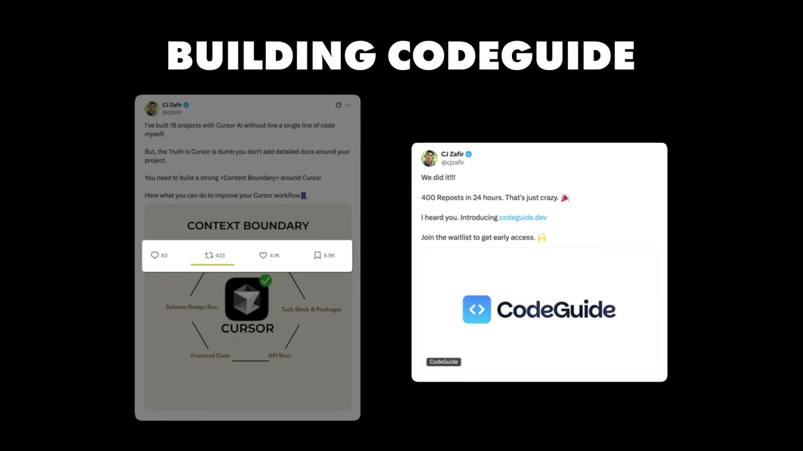
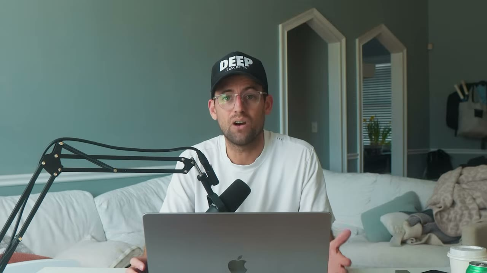
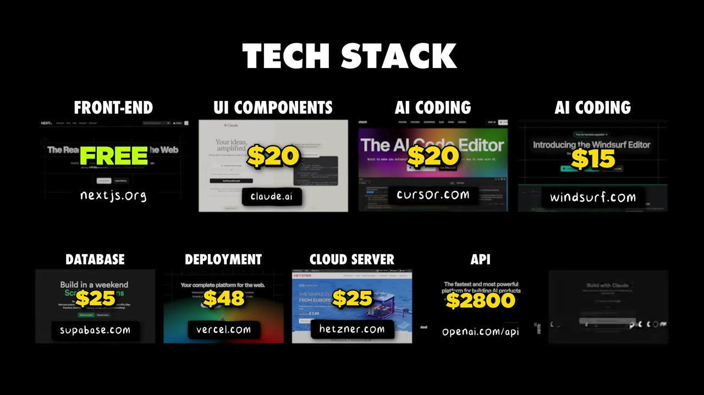
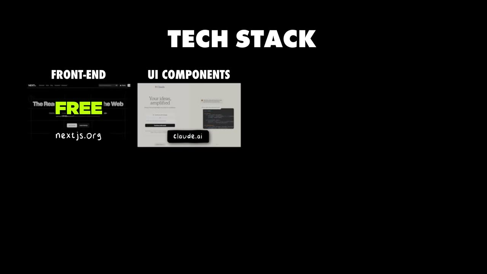
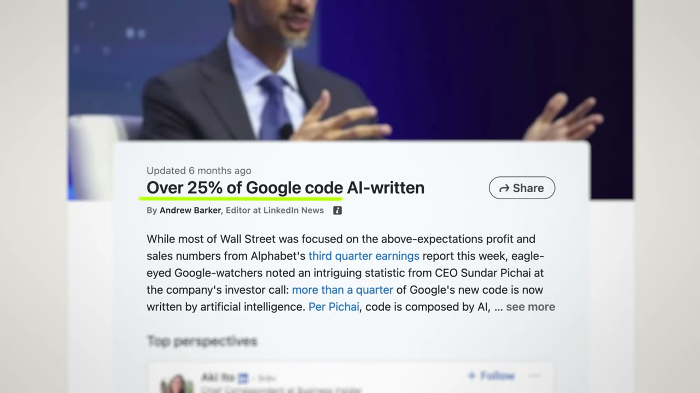

# CodeGuide — 0 lên $42K/tháng trong 90 ngày bằng cách bán cuốc xẻng cho người đào vàng AI

> **Tóm tắt 30 giây:** CJ Zafir tự thách mình làm **12 startup trong 12 tháng**. Anh build 11 cái, **10 cái chết**. Cái sống sót là **CodeGuide** — công cụ sinh tài liệu kỹ thuật để nhét vào Cursor/Windsurf nhằm giảm hallucination. Từ 0 lên **$42K MRR trong 90 ngày**, **0 đồng quảng cáo**, đội 2 người, chi phí vận hành $3.500/tháng. Ba cơ chế đắt nhất: (1) anh **không build gì cả** cho tới khi một tweet demo màn hình đem về **1.800 email waitlist trong 2 tuần**; (2) anh **không xây audience của riêng mình** mà **mượn audience có sẵn của các công cụ AI coding** — *"tôi không phát minh lại audience của mình, tôi chỉ tận dụng audience của các AI coding tool"*; (3) anh **bỏ hẳn free trial** vì hoá đơn OpenAI $2.800/tháng khiến user miễn phí trở thành lỗ thật.

## 1. Con số

| Chỉ số | Giá trị |
|---|---|
| Doanh thu | **$42.000 MRR** sau 90 ngày (≈ $500K ARR) |
| Mốc trung gian | **$17.000/tháng sau 49 ngày** |
| Dự phóng (CHƯA đạt) | ~$90.000 trong tháng quay video |
| Ngày launch | **24/12/2024** — 100 user ngay ngày đầu |
| Waitlist trước khi có sản phẩm | **1.800 email trong 2 tuần** |
| Tweet gốc | **400 retweet, 300 signup** |
| Cộng đồng | hơn **4.800 AI developer** |
| Thời gian build | **14 ngày** từ UI thô tới web app hoàn chỉnh |
| Giá | **$29/tháng**, gói năm giảm **40%**, **KHÔNG có free trial** |
| Chi phí vận hành | **~$3.500/tháng** |
| Chi quảng cáo | **$0** |
| Đội | **2 người** |
| Tỉ lệ sống sót sản phẩm | **1/11** |

**Ba con số doanh thu trong cùng một video — cách tôi chọn:**
- `$17K/tháng sau 49 ngày` — do Pat nói ở intro, là mốc CJ nhắn cho anh vài tuần trước khi quay.
- `$42K MRR sau 90 ngày` — CJ tự nói, khớp tiêu đề và mô tả video. **Đây là con số tôi dùng.**
- `~$90K trong tháng này` — CJ nói *"we're projecting to cross around 90K this month"*. **Đây là DỰ PHÓNG, không phải kết quả.** Đừng đưa vào bất kỳ so sánh nào.
- `hơn $500K ARR` — Pat nói ở intro; đây chỉ là $42K × 12, không phải số liệu độc lập.

Không có ảnh dashboard doanh thu nào trong video. Có ảnh cho **giá $29**, cho **chi phí công cụ $20**, và cho **hoá đơn OpenAI $2.800**.

**Lỗi ASR cần biết:** transcript đọc "MRR" thành "MR", "Claude" thành "cloud", "Hetzner" thành "Hatchner", "Supabase/PostgreSQL" thành "Superbase/postgrql", "Vercel" thành "Versell", "Windsurf" thành "vinsurf", "Lovable" thành "loable", "Next.js" thành "Nex.js", "churn rate" thành "turn rate". Tên founder lấy từ mô tả video là **CJ Zafir**; transcript đọc tên đầy đủ thành "Sajila Mazafir" — tôi không dùng vì độ tin cậy thấp.

## 2. Định vị — bán cuốc xẻng, và mượn audience của người khác ⭐⭐⭐

Đây là insight đắt nhất của video, và CJ nói nó bằng một câu:

> *"Bạn có thể nói CodeGuide chỉ là **cây cầu giữa hai bên**. Và đó là lý do nó lớn cực nhanh, vì **tôi không phát minh lại audience của riêng mình. Tôi chỉ tận dụng audience của các công cụ AI coding**, và chúng tôi chỉ làm cho workflow AI coding tốt hơn."*

**Bài toán anh giải:**

> *"CodeGuide sửa một vấn đề cốt lõi trong AI coding — **các model AI coding chưa sẵn sàng. Chúng hallucinate, chúng tự suy diễn.** Tôi chỉ cố sửa đúng MỘT vấn đề, là hallucination, bằng cách **xây một knowledge base quanh ý tưởng của user**. User cốt lõi của chúng tôi là từ người mới tới dev tầm trung, và họ gắn knowledge base đó vào các công cụ AI coding."*

### Cơ chế — vì sao "mượn audience" tăng trưởng nhanh hơn "xây audience"

| | Tự xây audience | Mượn audience có sẵn |
|---|---|---|
| Việc phải làm trước tiên | Thuyết phục người ta rằng vấn đề này tồn tại | **Vấn đề đã được thừa nhận sẵn** |
| Nguồn traffic | Bạn tự kéo từng người | Nằm cạnh dòng chảy có sẵn của Cursor, Windsurf, Bolt, Lovable |
| Thời gian tới doanh thu đầu tiên | 12-24 tháng | **90 ngày** |
| Rủi ro | Chậm | **Nền tảng chủ có thể tự làm tính năng đó** |

Anh còn đẩy xa hơn một bước: **quan hệ đối tác chính thức với Cursor AI, Windsurf, Bolt và Lovable** — được đóng gói thành đặc quyền của gói năm. Đây là cách biến "ăn theo" thành "được chính chủ công nhận", và nó vừa là kênh phân phối vừa là lớp phòng thủ.

**Điều kiện để chiến lược này ăn:** thị trường chủ phải đang **tăng trưởng bùng nổ và còn khuyết tật rõ ràng**. CJ nói lý do rất trực tiếp: *"tiếng Anh là ngôn ngữ lập trình phổ biến nhất hiện nay, điều đó không thể có trước 2024. AI đang viết 25% code của Google."* Khi thị trường chủ trưởng thành và tự vá lỗ hổng, sản phẩm cuốc-xẻng mất lý do tồn tại — xem mục cảnh báo ở dưới.

So sánh trong kho: [Cursor Directory](../2025-11-16_my-website-makes-35k-month-built-in-3-hours/case.md) làm đúng chiến lược này ở dạng thô nhất (website dựng 3 tiếng, $35K/tháng), còn [LaunchFast](../2026-01-04_how-i-built-my-first-saas-without-an-audience-25k-mo/case.md) bán boilerplate cho cùng nhóm người.

## 3. Cách validate — 1.800 email trước khi viết dòng code nào ⭐⭐⭐

Trình tự đầy đủ, đọc kỹ vì thứ tự ở đây mới là điểm ăn tiền:

1. **Nỗi đau của chính anh.** Anh chạy một agency làm MVP. Với mỗi dự án anh phải *"chat với ChatGPT 9-10 tiếng để tạo toàn bộ tài liệu kỹ thuật, tạo knowledge base để gắn vào các công cụ AI coding."*
2. **Tự động hoá cho bản thân trước.** Anh biến chuỗi prompt đó thành một sequence trên **make.com** → *"tôi tiết kiệm được 7 trên 9 tiếng, và điều đó thật kỳ diệu với tôi."* **Anh đã là khách hàng đầu tiên của chính mình, trước khi nghĩ tới việc bán.**
3. **Tweet workflow, không tweet sản phẩm.** Anh đăng một video quay màn hình đơn giản về *"cursor workflow lý tưởng của tôi"*. Kết quả: **400 retweet, 300 signup**, và anh *"choáng vì hoá ra có bao nhiêu người đang vật lộn với hallucination."*
4. **Landing page trong 20-30 phút bằng Bolt.** Không có sản phẩm phía sau.

> *"Tôi không build sản phẩm nào cả. Tôi không có gì hết. **Tôi chỉ có một hình dung về sản phẩm trông như thế nào, đặt trên một landing page**, và người ta đăng ký ào ào từ khắp nơi."*

5. **Tầng validation 1 — 1.800 email waitlist trong 2 tuần.**
6. **Tầng validation 2 — DM từng người.** Anh nhắn riêng cho từng beta user và từng người comment, hỏi họ *"anh đang dùng cách nào khác để xử lý hallucination không?"* Kết luận: **không ai làm tốt hơn cách anh định làm.**
7. **Chỉ tới lúc đó** anh mới ngồi 10-12 tiếng viết tài liệu về UI tốt nhất, rồi 3 ngày thiết kế frontend để hình dung được.
8. **Nhận ra mình không kịp làm một mình → rủ một người bạn**, chia việc frontend+marketing / backend+support.
9. **14 ngày** từ UI thô tới web app responsive. Launch 24/12/2024, **100 user ngày đầu**.

### Vì sao bước 6 quan trọng hơn bước 5

Rất nhiều người dừng ở "1.800 email = validated". **Sai.** Email waitlist chỉ chứng minh **vấn đề có thật và tiêu đề của bạn hấp dẫn**. Nó **không** chứng minh giải pháp của bạn là giải pháp tốt nhất — và đó chính xác là thứ bước DM trả lời. CJ gọi hai bước này là *"giai đoạn validation thứ nhất"* và *"giai đoạn validation thứ hai"*, và anh chỉ bấm nút build sau khi qua cả hai.

**So với các founder khác trong kho:**

| Ngưỡng validate trước khi code | Ai |
|---|---|
| 100 waitlist signup **rồi 5 đơn pre-sale giảm 90%** (tiền thật) | [John Rush](../2025-05-31_i-make-250k-month-from-20-apps/case.md) |
| **1.800 email waitlist + DM xác nhận không ai làm tốt hơn** (chưa có tiền) | CJ (case này) |
| Validate kỹ trước khi viết code | [Once](../2026-05-10_i-built-a-20k-month-app-in-83-days/case.md) |
| Ship luôn kèm nút mua, để thị trường trả lời | [Marc Lou](../2026-04-26_how-i-work-77k-month-solopreneur/case.md), [Creator Hunter](../2025-05-24_i-built-an-app-with-cursor-made-30k-and-quit-my-job/case.md) |

**Phân định:** ngưỡng của John Rush **nghiêm hơn** vì nó đòi hỏi tiền thật — email miễn phí thì ai cũng để lại. Nhưng ngưỡng của CJ **phù hợp hơn khi bạn build được trong 14 ngày**: chi phí sai lầm thấp, nên không đáng bỏ thêm 4 tuần đi thu pre-sale. **Quy tắc:** thời gian build càng dài → ngưỡng validate càng phải đắt tiền. 2 tuần thì email đủ. 3 tháng thì phải có người trả tiền trước.

## 4. Tutorial marketing — playbook nội dung có cấu trúc rõ nhất trong kho ⭐⭐⭐

CJ tự đặt tên cho chiến thuật này. Nó có hai lớp.

### Lớp 1 — quy trình "content-audience fit"

Anh nói nếu làm lại từ đầu, anh sẽ chạy đúng thứ tự này:

1. **Nói chuyện với user** để tìm vấn đề cốt lõi.
2. **Đẩy nội dung liên tục 14 ngày** để hâm nóng audience.
3. Từ phản hồi, **nhặt ra các pain point chính**, rồi chọn **cái lớn nhất**.
4. **Build sản phẩm giải đúng MỘT vấn đề đó.**
5. Đẩy sản phẩm tới **chính nhóm cốt lõi đã cho bạn user đầu tiên**.
6. **Dùng chính từ ngữ của họ**, nhân đôi vào loại nội dung đang chạy tốt, và đi tìm thêm người giống họ.

Điểm mấu chốt ở bước 6: bạn không viết bằng từ ngữ của mình, bạn viết lại bằng **từ ngữ khách hàng đã dùng**. Đó là thứ khiến nội dung tiếp theo tìm đúng người giống họ.

### Lớp 2 — nhịp sản xuất và công thức bài viết

**Nhịp cố định mỗi tuần:** **4 thread + 3 bài dài** trên X.

**Quy trình viết:** chọn một chủ đề → viết bản nháp → **hôm sau mới biên tập với đầu óc tỉnh táo** → làm ảnh bằng Canva và Figma.

**Công thức bài — ba phần, thứ tự không đổi:**

| Phần | Nội dung |
|---|---|
| **Hook** | Nói về **vấn đề** (không nói về sản phẩm) |
| **Thân** | Đưa **nguyên blueprint** — giải pháp lý tưởng, đầy đủ, cho không |
| **Giữa bài** | **Đặt SaaS của bạn vào như MỘT PHẦN của giải pháp**, không phải toàn bộ |

> *"Loại nội dung này hiệu quả thật sự vì đó là **nội dung đáng bookmark và đáng chia sẻ**. Nếu nội dung của bạn được bookmark thì **thuật toán đứng về phía bạn**, và người ta thích điều đó, và bạn xây được uy tín và niềm tin. Đó là lý do **churn rate của tôi cực thấp** ngay lúc này."*

### Cơ chế — vì sao "cho không nguyên blueprint" lại làm TĂNG doanh thu

Nghe phản trực giác. Cơ chế thật:

1. **Blueprint đầy đủ = nội dung đáng lưu.** Bookmark và share là tín hiệu mạnh nhất của thuật toán X, mạnh hơn like nhiều.
2. **Đọc xong blueprint, người ta hiểu vấn đề SÂU HƠN** → và hiểu sâu hơn nghĩa là **thấy rõ hơn chỗ nào tốn thời gian**.
3. **Sản phẩm được đặt đúng chỗ tốn thời gian đó.** Không phải "mua sản phẩm của tôi", mà là "bước 4 trong 9 bước này bạn có thể tự làm mất 9 tiếng, hoặc dùng cái này".
4. Kết quả là người mua đến với **kỳ vọng chính xác** → chính là lý do churn thấp mà anh nói tới.

**Ngược lại:** nội dung kiểu "sản phẩm của tôi giải quyết tất cả" tạo ra người mua kỳ vọng sai → churn cao.

### Phễu chuyển đổi — cực kỳ đơn giản

> *"Phễu của tôi siêu đơn giản. Bạn viết nội dung mỗi ngày và đẩy audience hoặc traffic đó về **landing page có waitlist**, rồi thu email — vì **từ những email đó bạn sẽ có 100 khách hàng đầu tiên**. Họ đã biết đây đúng là nỗi đau họ muốn giải, và họ cũng đã tin bạn, và đó là lý do họ cho bạn email."*

**Toàn bộ traffic đến từ X. 0 đồng quảng cáo.**

## 5. Kinh tế đơn vị — vì sao anh BỎ free trial ⭐⭐⭐

Đây là mục quan trọng nhất cho bất kỳ ai định làm sản phẩm bọc AI.

**Giá:**
- **$29/tháng**, và anh nói thẳng sẽ **tăng lên $39-49 trong 6 tháng tới**.
- Gói năm **giảm 40%**, kèm đặc quyền là quan hệ đối tác chính thức với Cursor, Windsurf, Bolt, Lovable.
- **KHÔNG có free trial.** Lý do nguyên văn:

> *"Chúng tôi không làm trial nào cả, vì chúng tôi dùng các model AI hàng đầu và **model AI hiện tại không rẻ**. Chúng tôi dùng một hỗn hợp nhiều model để tạo ra tài liệu có cấu trúc tốt."*

**Chi phí vận hành đầy đủ — hiếm có case nào bóc chi tiết đến thế:**

| Hạng mục | Chi phí/tháng |
|---|---|
| **OpenAI API** | **$2.800** ← chiếm 80% tổng chi phí |
| Claude API | $300+ |
| Gemini Flash API | **miễn phí** (thời điểm đó) |
| Vercel (deploy) | $48 |
| Supabase (PostgreSQL, DB + storage) | $25 |
| Hetzner (cloud storage server) | $25 |
| ConvertKit (email) | $45 |
| Cursor (IDE chính) | $20 |
| Claude 3.7 (thiết kế UI component) | $20 |
| Windsurf (IDE phụ) | $15 |
| Clerk Dev (auth) | không nêu |
| **Tổng** | **~$3.500** |

**Phép chia của tôi:** $42.000 − $3.500 = **~92% biên lợi nhuận**. Nhưng nhìn kỹ hơn:

- **80% chi phí là API — chi phí BIẾN ĐỔI theo mức sử dụng.** Doanh thu $29/user/tháng là cố định; chi phí thì không.
- **Một user nặng có thể ăn hết doanh thu của chính mình.** Đó chính xác là lý do bỏ free trial: một user miễn phí = lỗ thuần, không có mặt tốt nào.
- Kế hoạch **tăng giá lên $39-49** không phải tham lam — đó là **phản ứng có cấu trúc trước việc biên lợi nhuận bị API ăn mòn khi scale**.

**Bài học tổng quát cho sản phẩm AI:** khi COGS của bạn tỉ lệ thuận với usage, ba đòn bẩy duy nhất là (1) **bỏ hoặc siết free tier**, (2) **giới hạn cứng theo gói**, (3) **định tuyến sang model rẻ hơn cho tác vụ dễ** (chính là cách anh dùng "hỗn hợp nhiều model", trong đó Gemini Flash miễn phí gánh phần rẻ). Đây là điểm khác biệt kinh tế căn bản so với SaaS truyền thống, nơi user thứ 1000 gần như miễn phí — và ngược hoàn toàn với [Creator Hunter](../2025-05-24_i-built-an-app-with-cursor-made-30k-and-quit-my-job/case.md), nơi chi phí gắn với kích thước dữ liệu chứ không gắn với user.

## 6. Tech stack — và một tiêu chí chọn stack rất đáng học ⭐⭐

Tiêu chí chọn công nghệ của anh không phải "cái nào tôi thích", mà:

> *"Với CodeGuide tôi dùng những stack **được các model AI coding ưa chuộng**."*

Cụ thể: **Next.js** cho frontend, **Supabase (PostgreSQL)** cho backend, **Vercel** để deploy, **Clerk** cho auth.

**Cơ chế:** model AI được huấn luyện trên dữ liệu công khai. Stack càng phổ biến trên GitHub và Stack Overflow → AI càng viết đúng → bạn càng ít phải sửa tay. Chọn một framework hay ho ít người dùng nghĩa là **bạn tự tay vô hiệu hoá lợi thế lớn nhất của mình**. Đây là tiêu chí mà [Creator Hunter](../2025-05-24_i-built-an-app-with-cursor-made-30k-and-quit-my-job/case.md) cũng vô tình đi theo (Next.js + Supabase + Clerk + Vercel + shadcn — trùng gần như hoàn toàn), và nó đang trở thành stack mặc định của cả một thế hệ.

Ngoài ra: **hai IDE song song** (Cursor $20 + Windsurf $15) — anh không giải thích lý do, nhưng đây là cùng logic đa nhà cung cấp mà [John Rush](../2025-05-31_i-make-250k-month-from-20-apps/case.md) dùng với ba model API.

## 7. "90 ngày" đứng trên 7 năm — mục cần đọc kỹ nhất ⭐⭐⭐

Tiêu đề video là *"From Zero to $42K/Month in 90 Days"*. Đây là những gì có trước 90 ngày đó:

- **2018** chuyển sang Canada, làm công việc 9-to-5 đầu tiên, *"trải nghiệm kinh khủng"*.
- Xây **nhiều agency, nhiều sản phẩm phần mềm, nhiều SaaS**.
- **2022** bắt đầu viết rất nhiều về AI prompting trên X, và nhận ra AI coding đang bùng nổ trong khi *"người ta chưa để ý"*.
- Ép mình học nghề bằng cách **code với công cụ AI 10-12 tiếng mỗi ngày**.
- Công khai tuyên bố làm **12 startup**. Kết quả: **build được 11, 10 cái chết.**
- Chạy **agency làm MVP** — đây là nơi nỗi đau của CodeGuide sinh ra, và cũng là nơi anh có sẵn khách hàng để hiểu vấn đề.
- Là thành viên cộng đồng Starter Story, *"tôi đã đọc hơn 100 case study ở đó"*.

Chính anh nói câu này:

> *"Rồi cuối cùng, bạn biết đấy, nó chỉ là một **thành công sau một đêm sau tất cả bảy năm này**."*

**Tỉ lệ sống sót thật của case này là 1/11 ≈ 9%.** Và đó là 9% của một người đã có 7 năm nền, có agency đang chạy, có audience trên X từ 2022, và đọc hơn 100 case study về marketing. **Kho này tồn tại chính là để bạn nhìn thấy mẫu số, không chỉ tử số.**

## 8. Rủi ro cấu trúc của CodeGuide — cái mà video không nói ⭐⭐

Toàn bộ đề xuất giá trị của CodeGuide nằm trong câu của chính CJ:

> *"Các model AI coding **chưa sẵn sàng**. Chúng hallucinate, chúng tự suy diễn."*

Đây là một sản phẩm mà **giá trị tỉ lệ nghịch với chất lượng của model AI**. Có ba nguồn rủi ro chồng lên nhau:

1. **Rủi ro model.** Model càng tốt → hallucination càng ít → nhu cầu về knowledge base càng nhỏ. Thị trường của anh **co lại theo thời gian** trong kịch bản tốt của ngành.
2. **Rủi ro nền tảng.** Cursor, Windsurf, Bolt, Lovable đều có thể **tự làm tính năng sinh tài liệu** và cho không. Việc anh có "quan hệ đối tác chính thức" giúp làm chậm điều này nhưng không chặn được.
3. **Rủi ro rào cản thấp.** Sản phẩm là một chuỗi prompt cộng một UI. Bản thân anh khởi đầu nó bằng **make.com**. Rào cản gia nhập gần bằng 0 — thứ giữ anh ở trên là **phân phối và cộng đồng 4.800 người**, không phải công nghệ.

**Hệ quả thực dụng:** nếu bạn copy mô hình này, hãy coi doanh thu là **tiền thuê ngắn hạn**, không phải tài sản. Hãy dùng nó để tài trợ cho thứ bạn thật sự sở hữu, và hãy **tăng giá sớm** như CJ đang làm thay vì tối ưu tăng trưởng.

## 9. Cảnh báo thiên kiến nguồn ⭐⭐

- **Đây là video có mức xung đột lợi ích cao nhất trong lô ba case này.** CJ là **thành viên trả phí của cộng đồng Starter Story**, và anh được lên kênh vì đã DM cho Pat trong cộng đồng đó. Có nguyên một chapter tên *"CJ's experience with Starter Story"* (15:53) — tức là **case study đồng thời là testimonial cho sản phẩm của kênh**. Chính CJ mở đầu bằng câu *"và tôi không quảng cáo cho Starter Story đâu"*, câu nói thường xuất hiện đúng lúc người ta đang quảng cáo.
- **Quảng cáo Starter Story Build dài ~90 giây nằm giữa video** (08:32-10:12), pitch chương trình *"AI app accelerator — trong khoảng hai tuần, không cần biết code, bạn sẽ lên ý tưởng, build và launch một app production thật"*, kèm chiêu khan hiếm (*"chúng tôi giữ quy mô nhỏ vì tập trung vào chất lượng"*). Kênh đã được **HubSpot** mua lại.
- **Con số $90K là dự phóng và được đặt ngay cạnh con số $42K** trong cùng một câu. Rất dễ nhớ nhầm thành đã đạt.
- **Không có ảnh dashboard doanh thu.** Có ảnh chi phí và giá, không có ảnh Stripe.
- **Thiên kiến sống sót được thừa nhận nhưng không được cân đo.** Video có nhắc 10/11 sản phẩm chết — điểm cộng cho tính trung thực — nhưng không hỏi anh mất bao nhiêu tháng và bao nhiêu tiền cho 10 cái đó.

## 10. Áp dụng cho tôi (indie hacker VN)

### Sao chép được gì

**1. Chiến lược "bán cuốc xẻng" là chiến lược dễ nhất cho người không có audience.** Bạn không phải tạo ra nhu cầu, chỉ cần đứng cạnh một dòng chảy đã có. Cách tìm cơ hội cụ thể:
- Chọn một công cụ đang tăng trưởng nhanh và có cộng đồng ồn ào (Cursor, Claude Code, n8n, Lovable, Shopify, Notion...).
- Vào đúng nơi cộng đồng đó than phiền (Discord chính chủ, subreddit, X).
- Ghi lại **cùng một lời than được lặp lại**. Đó là sản phẩm của bạn.
- Kiểm tra ba câu hỏi trước khi làm: nền tảng chủ có tự làm cái này trong 12 tháng tới không; vấn đề này có biến mất khi công nghệ tốt lên không; tôi có thể xin quan hệ đối tác chính thức không.

**2. Quy trình validate 2 tầng — sao chép nguyên xi, chi phí gần 0.**
- Tầng 1: quay màn hình **workflow của chính bạn** (không phải sản phẩm) → đăng → dựng landing page waitlist bằng Bolt trong 30 phút. Ngưỡng — có bao nhiêu email trong 2 tuần?
- Tầng 2: **DM từng người**, hỏi *"hiện bạn đang xử lý việc này thế nào?"* Nếu ai đó đã có cách tốt hơn cách bạn định làm → dừng lại.

**3. Tutorial marketing — công thức áp dụng được ngay bằng tiếng Việt.** Nhịp 4 thread + 3 bài dài/tuần là nặng; hãy bắt đầu bằng **2 bài/tuần** với đúng cấu trúc hook-vấn-đề → blueprint đầy đủ → sản phẩm nằm giữa. Viết hôm nay, biên tập ngày mai. Ở VN, kênh tương đương là các nhóm Facebook chuyên ngành và blog cá nhân — cơ chế "cho không blueprint để xây uy tín" hoạt động y hệt.

**4. Chọn stack mà AI viết tốt nhất** (Next.js + Supabase + Vercel + Clerk). Đây là lời khuyên miễn phí và tiết kiệm hàng chục giờ debug.

**5. Bỏ free trial nếu sản phẩm của bạn gọi model AI.** Với ARPU thấp ở VN, một free tier rộng rãi sẽ giết bạn nhanh hơn nhiều so với ở Mỹ.

### Rào cản thật

- **Hoá đơn API $2.800/tháng phải trả bằng USD, trước, hằng tháng.** CJ có $42K doanh thu để gánh. Ở quy mô khởi đầu, tỉ lệ này đảo ngược — bạn có thể phải trả $300 API khi mới có $200 doanh thu. **Hãy đặt hard cap theo user từ ngày đầu**, và đừng để một user nào chạy không giới hạn.
- **Thanh toán quốc tế và thẻ tín dụng USD.** Toàn bộ stack này (OpenAI, Vercel, Supabase, ConvertKit, Cursor) đều yêu cầu thẻ quốc tế và có hạn mức. Đây là ma sát thật với founder VN, và nó tăng theo quy mô.
- **X/Twitter gần như không có cộng đồng builder người Việt.** Nếu bạn bán cho khách quốc tế thì kênh này dùng được, nhưng bạn phải viết tiếng Anh đủ tự nhiên để viết **4 thread + 3 bài dài mỗi tuần**. Đây là khối lượng viết lách rất lớn — hãy đánh giá trung thực năng lực viết của mình trước khi chọn kênh này làm kênh chính.
- **Rủi ro nền tảng ở mức rất cao** (mục 8). Cursor ship tính năng sinh tài liệu là sản phẩm mất phần lớn lý do tồn tại.
- **Cửa sổ thời gian đang hẹp lại.** Case này quay tháng 5/2025, khi khoảng trống "AI hallucinate" còn rộng. Khoảng trống đó đã hẹp đi đáng kể. Nếu bạn định copy, **đừng copy sản phẩm — hãy copy phương pháp tìm khoảng trống**.
- **Đội 2 người là điều kiện, không phải chi tiết phụ.** CJ tự nói *"tôi nhận ra tôi không tự làm được vì phải launch nhanh"*. Nếu bạn làm một mình, hãy nhân đôi mốc 14 ngày.

### Khi nào KHÔNG dùng mô hình này

- **Khi bạn không thuộc về cộng đồng của nền tảng chủ.** Cả hai lợi thế của CJ — biết vấn đề và có nơi để đăng — đến từ việc anh sống trong cộng đồng đó từ 2022. Nếu bạn chỉ vừa nhảy vào một cộng đồng để tìm cơ hội, bạn sẽ chọn sai vấn đề và không ai đọc bài của bạn.
- **Khi vấn đề bạn giải sẽ được công nghệ tự sửa.** Sản phẩm vá khuyết tật tạm thời của một công nghệ đang tiến hoá nhanh có **hạn sử dụng**. Nếu bạn cần một business để sống 10 năm, hãy chọn ngách chán và ổn định như [Packager](../2026-03-15_i-make-60k-month-from-the-most-boring-saas-on-the-in/case.md) hoặc [Savvy Nomad](../2026-05-21_i-make-1-7m-year-in-the-most-boring-niche-imaginable/case.md).
- **Khi bạn không sẵn sàng viết 7 bài/tuần.** Case này có **0 đồng quảng cáo và 100% traffic từ nội dung**. Không viết = không có business. Nếu bạn ghét viết, hãy nhìn sang mô hình SEO video của [FollowBuddy](../2026-03-19_i-make-17k-month-with-one-strategy/case.md) hoặc mô hình quảng cáo trả tiền.

## Nguồn

- Video: <https://www.youtube.com/watch?v=0T55DRYqeeA> (18:56, đăng 21/05/2025, 174.282 view)
- [Transcript đầy đủ](transcript.md) · [Ảnh chụp](screenshots/)
