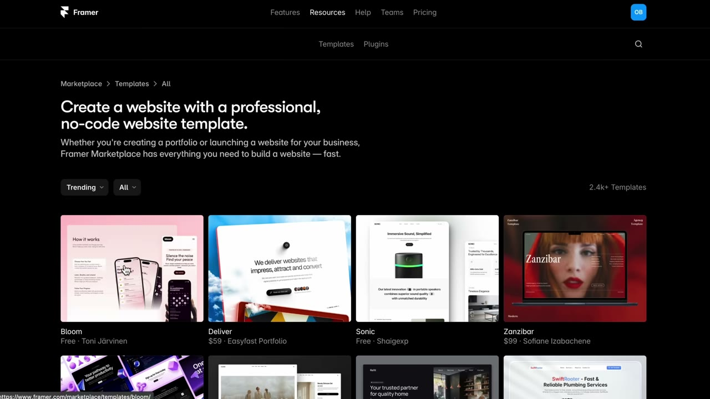
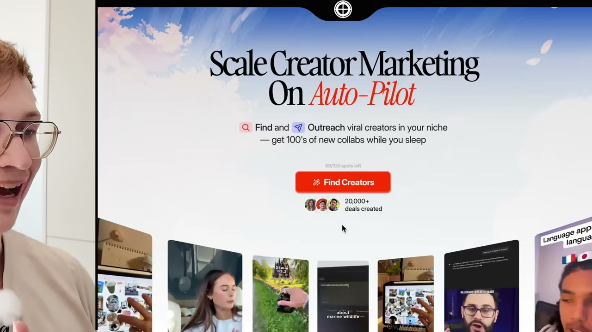
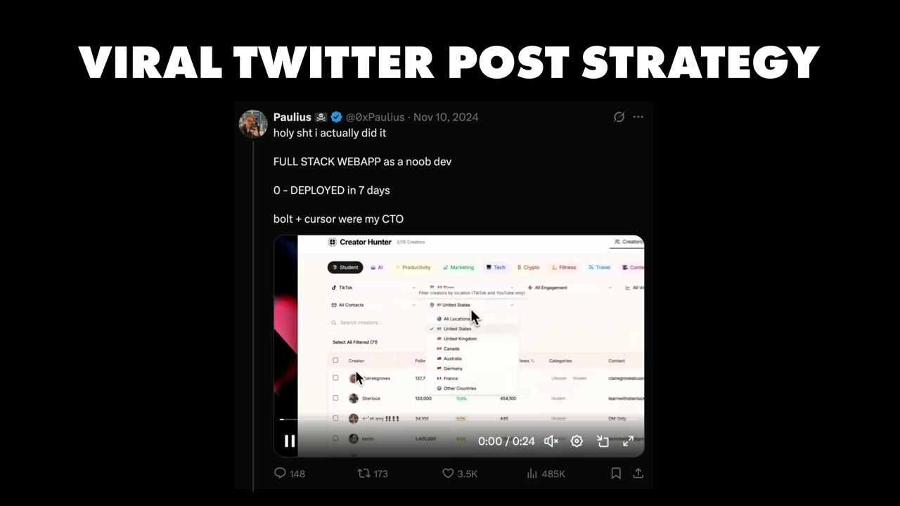
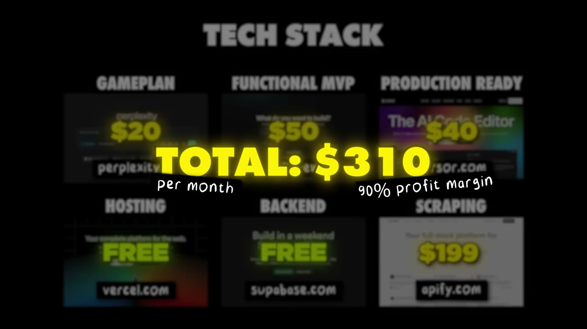

# I Built an App with Cursor, Made $30K, and Quit My Job.

✅ **Đã phân tích sâu** → [`case.md`](case.md)

| | |
|---|---|
| **Video** | <https://www.youtube.com/watch?v=jpSY4MlWX50> |
| **Đăng** | 24/05/2025 |
| **Thời lượng** | 14:01 |
| **Lượt xem** | 725,187 |
| **Lượt thích** | 20,321 |
| **Video ID** | `jpSY4MlWX50` |

## Trong thư mục này

| File | Nội dung |
|---|---|
| [`case.md`](case.md) | **Phân tích đầy đủ** — ý tưởng, validate, GTM, áp dụng ở VN |
| [`meta.json`](meta.json) | Metadata gốc (chapters, heatmap, mô tả) |
| [`screenshots/`](screenshots/) | 10 ảnh 720p |

## Mô tả gốc

This is how Paulius Masalskas built a $30K app using AI.
0:00 - Intro
0:58 - Who is Paulius
1:24 - Paulius' backstory
2:24 - How Paulius found an idea for his app
3:06 - Launch experience
3:43 - How to build MVPs with AI
5:20 - Figure out what your customers want
7:19 - How to design with AI
7:55 - What to focus on in a landing page
8:29 - How to design UI/UX using AI
9:14 - Marketing strategy
10:06 - Building in public
10:55 - Tech stack and costs
11:25 - Biggest lessons learned
11:55 - Day in the life
12:27 - Advice to entrepreneurs
13:10 - Final word
This video is an educational case study 

## Số liệu bắt được từ transcript

> Các đoạn founder nhắc tới con số, kèm timestamp để tua thẳng tới đó trong video.

_(không bắt được con số nào)_

## Chương

- `00:00` Intro
- `00:58` Who is Paulius
- `01:24` Paulius' backstory
- `02:24` How Paulius found an idea for his app
- `03:06` Launch experience
- `03:43` How to build MVPs with AI
- `05:20` Figure out what your customers want
- `07:19` How to design with AI
- `07:55` What to focus on in a landing page
- `08:29` How to design UI/UX using AI
- `09:14` Marketing strategy
- `10:06` Building in public
- `10:55` Tech stack and costs
- `11:25` Biggest lessons learned
- `11:55` Day in the life
- `12:27` Advice to entrepreneurs
- `13:10` Final word

## Ảnh

1. `01_01m11s_replay.jpg` — 
2. `02_02m36s_ch-how-paulius-found-an-idea-for-his-app.jpg` — 
3. `03_03m18s_ch-launch-experience.jpg` — 
4. `04_03m55s_ch-how-to-build-mvps-with-ai.jpg` — 
5. `05_05m32s_ch-figure-out-what-your-customers-want.jpg` — 
6. `06_07m31s_ch-how-to-design-with-ai.jpg` — 
7. `07_08m07s_ch-what-to-focus-on-in-a-landing-page.jpg` — 
8. `08_09m26s_ch-marketing-strategy.jpg` — 
9. `09_10m18s_ch-building-in-public.jpg` — 
10. `10_11m17s_replay.jpg` — 

---

← [Quay lại index](../../index.md) · [Toàn bộ video](../README.md)
