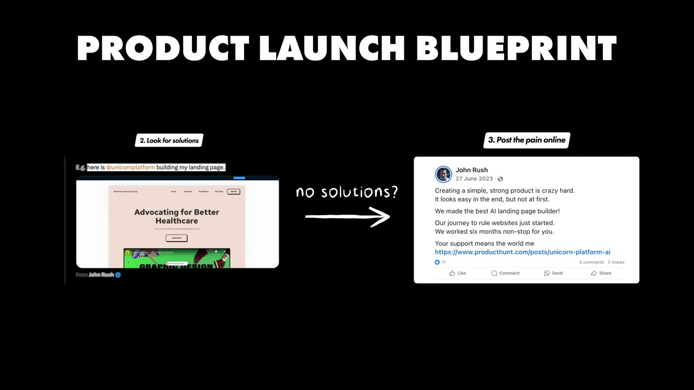
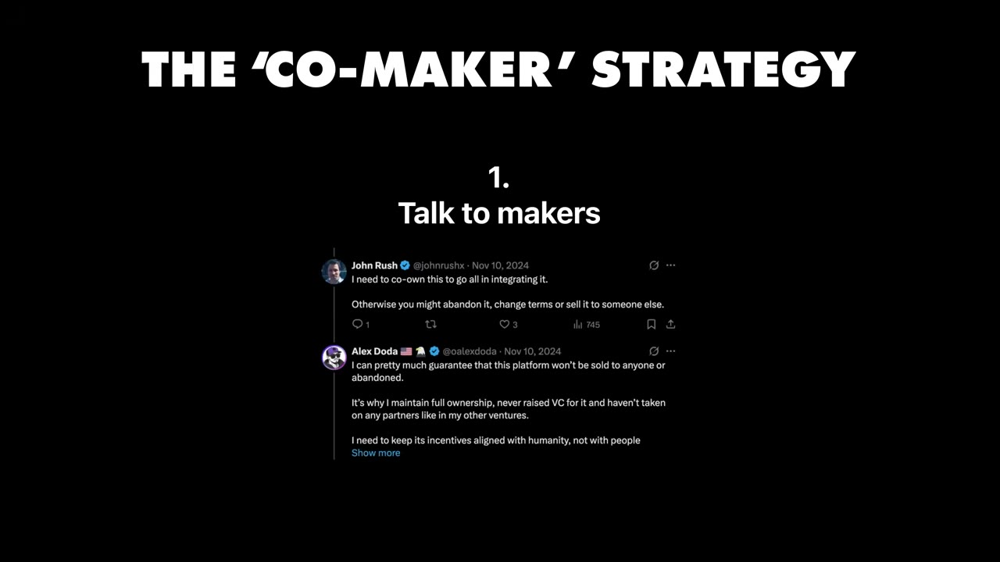
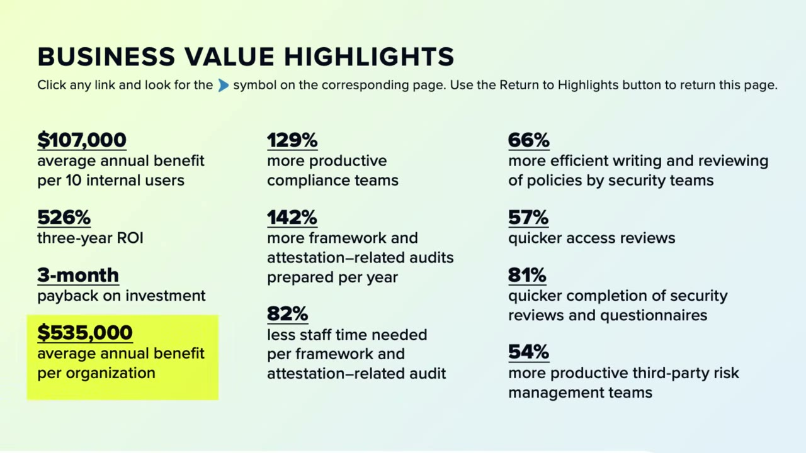
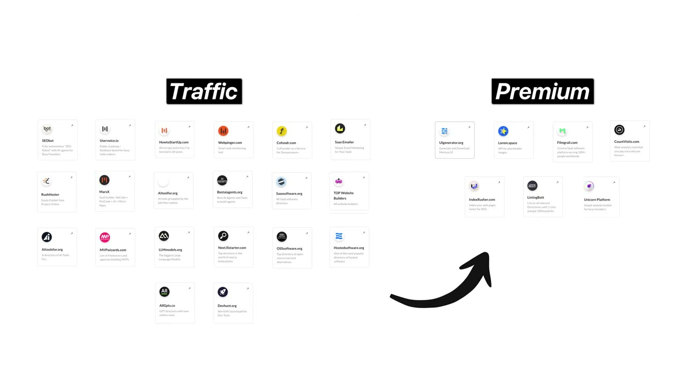

# I Make $250K/Month From 20 Apps

✅ **Đã phân tích sâu** → [`case.md`](case.md)

| | |
|---|---|
| **Video** | <https://www.youtube.com/watch?v=En34iY-rQc0> |
| **Đăng** | 31/05/2025 |
| **Thời lượng** | 18:01 |
| **Lượt xem** | 94,694 |
| **Lượt thích** | 2,580 |
| **Video ID** | `En34iY-rQc0` |

## Trong thư mục này

| File | Nội dung |
|---|---|
| [`case.md`](case.md) | **Phân tích đầy đủ** — ý tưởng, validate, GTM, áp dụng ở VN |
| [`meta.json`](meta.json) | Metadata gốc (chapters, heatmap, mô tả) |
| [`screenshots/`](screenshots/) | 10 ảnh 720p |

## Mô tả gốc

This is how John Rush runs 20+ different businesses, making $3M per year combined.
0:00 - Intro
0:58 - Who is John Rush
1:43 - Backstory
2:59 - Main projects
3:34 - Full ideation blueprint
5:17 - The 'Co-maker' strategy
6:22 - Start securing $100k/year B2B deals
7:56 - Marketing
9:34 - The 'Cross-promo' strategy
10:23 - How John uses AI
11:53 - Tech Stack and profit margins
13:33 - VC VS Bootstrapping
14:19 - Day in the life
15:06 - Biggest lesson learned
15:58 - Advice to entrepreneurs
17:07 - Final word
This video is an educational case study of one founder’s experience. It is not financial 

## Số liệu bắt được từ transcript

> Các đoạn founder nhắc tới con số, kèm timestamp để tua thẳng tới đó trong video.

_(không bắt được con số nào)_

## Chương

- `00:00` Intro
- `00:58` Who is John Rush
- `01:43` Backstory
- `02:59` Main projects
- `03:34` Full ideation blueprint
- `05:17` The 'Co-maker' strategy
- `06:22` Start securing $100k/year B2B deals
- `07:56` Marketing
- `09:34` The 'Cross-promo' strategy
- `10:23` How John uses AI
- `11:53` Tech Stack and profit margins
- `13:33` VC VS Bootstrapping
- `14:19` Day in the life
- `15:06` Biggest lesson learned
- `15:58` Advice to entrepreneurs
- `17:07` Final word

## Ảnh

1. `01_01m10s_ch-who-is-john-rush.jpg` — 
2. `02_01m55s_ch-backstory.jpg` — 
3. `03_03m18s_replay.jpg` — 
4. `04_04m01s_replay.jpg` — 
5. `05_05m29s_ch-the-co-maker-strategy.jpg` — 
6. `06_06m34s_ch-start-securing-100k-year-b2b-deals.jpg` — 
7. `07_07m10s_usd-535-000.jpg` — 
8. `08_08m08s_ch-marketing.jpg` — 
9. `09_09m46s_ch-the-cross-promo-strategy.jpg` — 
10. `10_10m35s_ch-how-john-uses-ai.jpg` — 

---

← [Quay lại index](../../index.md) · [Toàn bộ video](../README.md)
