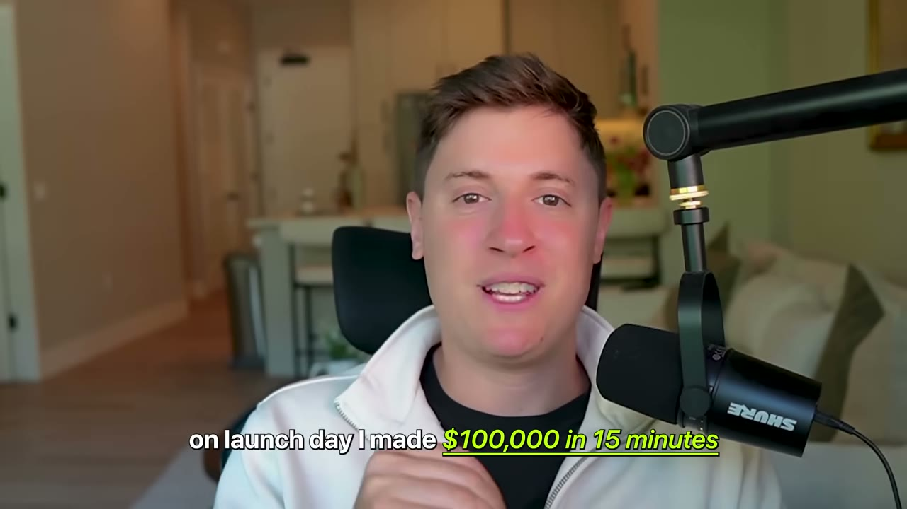
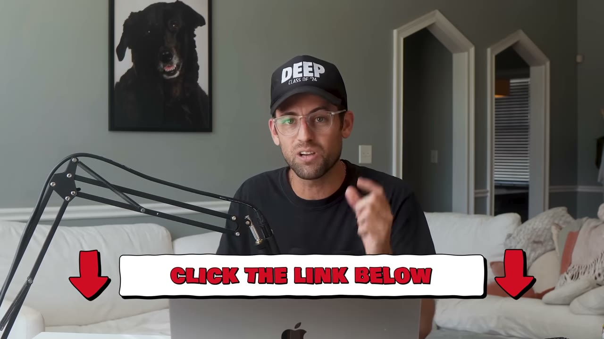
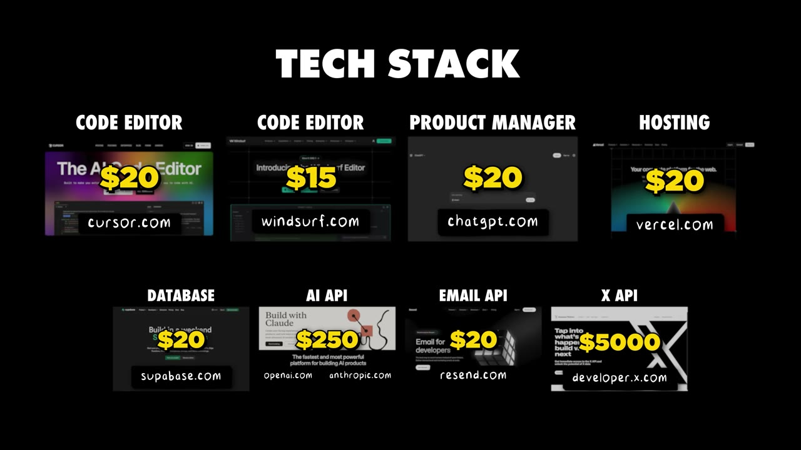
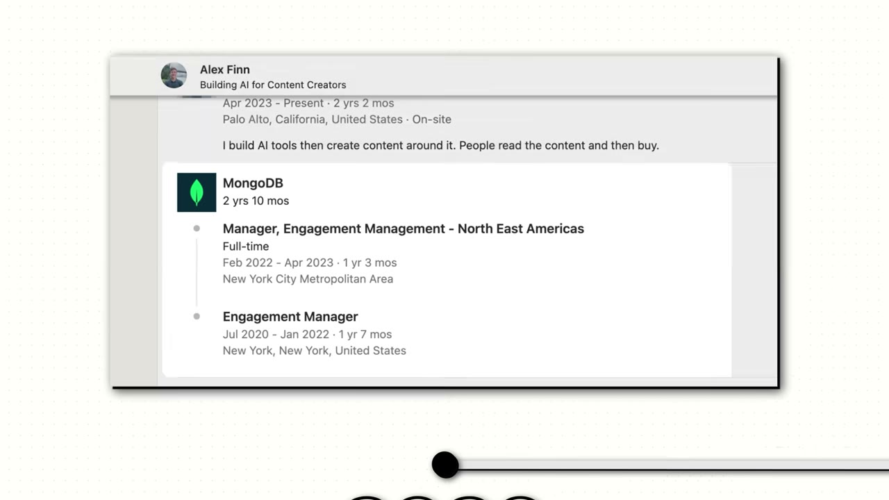
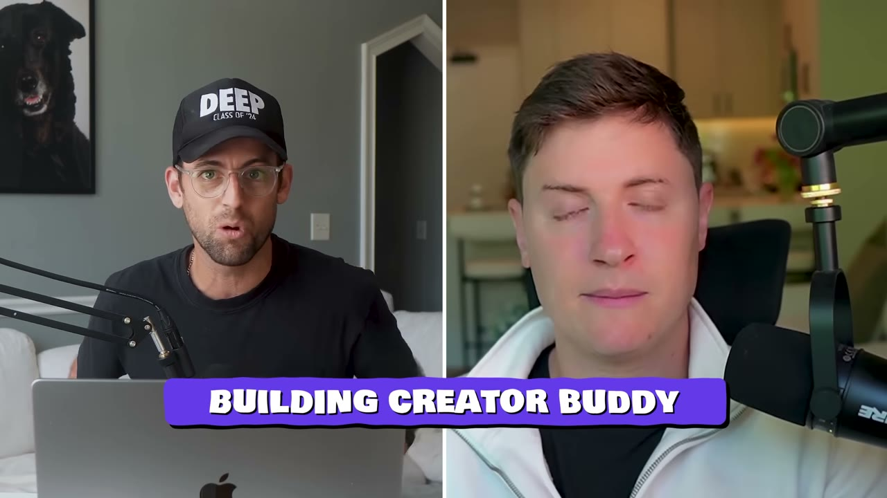
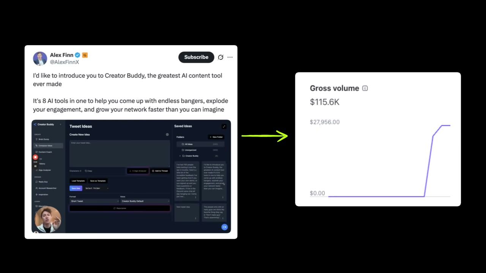
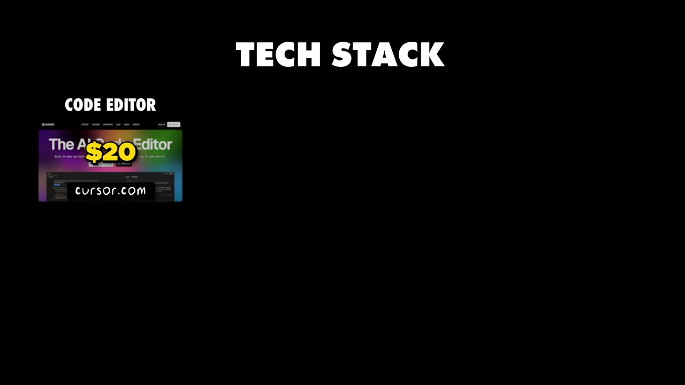

# CreatorBuddy — $25K/tháng, và cái bẫy nằm ngay trong tiêu đề video

> **Tóm tắt 30 giây:** Alex Finn build CreatorBuddy hoàn toàn bằng Cursor, không viết một dòng code. Launch ngày 24/01/2025: **100K ARR sau 15 phút, 300K ARR sau 2 tuần, gần 500 subscriber trả tiền, $25K/tháng thật**. Nhưng hai điều video không nói to: (1) **$100K đó là ARR chứ không phải tiền vào tài khoản** — tiêu đề *made $100K on launch day* là cách nói phóng đại; (2) cú launch chạy được vì anh đã có **hàng trăm nghìn follower trên X** từ một thread về thuật toán X mã nguồn mở được **Elon Musk retweet** năm 2023. Con số đắt nhất lại là chi phí: anh trả **$5.000/tháng cho X API** — và biến chính khoản chi đó thành hào bảo vệ vì *không mấy ai chịu chi ngần ấy cho dữ liệu này*.

## 1. Con số

| Chỉ số | Giá trị |
|---|---|
| Doanh thu thật | **~$25.000/tháng** |
| ARR tương ứng | ~$300.000 |
| Subscriber trả tiền | gần 500 |
| ARPU ngụ ý | ~$50/tháng |
| Tổng chi phí | ~$5.300/tháng |
| — trong đó X API | **$5.000/tháng (94% chi phí)** |
| — Vercel | $20/tháng |
| — Supabase | $20/tháng |
| — AI API + linh tinh | ~$250/tháng |
| Biên lợi nhuận | ~80% |
| Điểm hoà vốn ngụ ý | ~106 subscriber |
| Beta tester | 150 người, gặp 1-1 từng người |
| Quy mô đội | 1 |

## 2. Đọc lại tiêu đề — sự khác nhau giữa ARR và tiền mặt ⭐⭐⭐

Đây là điều quan trọng nhất cần hiểu trước khi rút bài học từ case này.

Video nói ba con số ở ba chỗ, và chúng **không cùng một đơn vị**:

| Nơi nói | Câu nói | Nghĩa thật |
|---|---|---|
| Intro của Pat | *"making $300,000"* | $300K **ARR** = $25K/tháng |
| Tiêu đề video | *"Made $100K on Launch Day"* | $100K **ARR** = ~$8,3K/tháng run-rate |
| Alex, phút 1:19 | *"within 15 minutes, I got it to **$100,000 ARR**, and within 2 weeks, I got it to **$300,000 ARR**"* | Đây là câu chính xác |
| Alex, phút 8:00 | *"a successful launch day where I'm **making 200K on day one**"* | Cũng là ARR, nói tắt |
| Alex, phút 11:05 | *"on **$25,000 a month** of revenue"* | Tiền mặt thật, dùng để tính biên |

**Con số duy nhất là tiền thật: $25.000/tháng.** Mọi con số sáu chữ số đều là run-rate năm.

**Vì sao điều này quan trọng:** ARR ở ngày launch được tính bằng cách nhân số subscription vừa bán ra cho 12 tháng — **trước khi bất kỳ ai kịp churn**. Với sản phẩm creator tool, churn tháng đầu thường rất nặng. Con số ARR ngày launch là con số lạc quan nhất mà một sản phẩm SaaS bao giờ cũng có. Sự thật là 5 tháng sau launch, anh ở $25K/tháng — tức **$300K ARR vẫn giữ được**, đó mới là thành tích đáng nể thật sự. Nhưng đừng để tiêu đề khiến bạn nghĩ có $100.000 tiền mặt chảy vào ví trong 15 phút.

Một mâu thuẫn nhỏ nữa: Pat nói trong intro *"built and launched his app in just 3 months"*, còn Alex nói *"after about seven or eight months of building"* (8/2024 → 1/2025). **Tôi lấy lời của founder**, không lấy lời dẫn.

## 3. Chi phí $5.000/tháng cho X API — biến chi phí thành hào ⭐⭐⭐

Đây là insight tinh tế nhất trong video và Alex nói lướt qua:

> *"I pay **$5,000 a month for the X API**, **which not many people are willing to spend that much for that data**."*

Đọc kỹ mệnh đề thứ hai. Anh không than phiền — anh đang mô tả **rào cản gia nhập của chính mình**.

**Cơ chế:** trong thế giới mà AI coding khiến ai cũng clone được sản phẩm của bạn trong một buổi tối, thứ không clone được không phải code mà là **những chi phí cố định người khác không dám gánh**. Một người vừa vibe-code xong bản sao CreatorBuddy sẽ phải trả $5.000/tháng cho X API **trước khi có khách hàng đầu tiên**. Tức là họ phải chấp nhận âm $60.000/năm để thử một ý tưởng. Rất ít ai làm.

Đây chính là bản chất của câu Alex nói ở cuối video, và hai câu này nên đọc cùng nhau:

> *"Now that anyone can build any software they want, **knowledge and product is no longer the moat. The moat is your distribution.**"*

Thực ra case này có **hai** hào, không phải một: **distribution** (audience) và **data access** (X API $5K/tháng). Cái thứ hai anh không tự nhận là hào nhưng nó là hào rõ rệt hơn.

**Mặt trái — và đây là cảnh báo nghiêm túc:** $5.300/tháng là **chi phí cố định**, không phải biến đổi. Nó không giảm khi bạn có ít khách. Nghĩa là:

- Điểm hoà vốn ≈ **106 subscriber ở $50/tháng**
- Với 50 khách, bạn **lỗ ~$2.800/tháng**
- Với 10 khách, bạn lỗ ~$4.800/tháng

Alex vượt qua điểm này **trong 15 phút** vì anh có audience. Người không có audience sẽ đốt tiền hàng tháng trong lúc chờ khách. **Mô hình này không phải mô hình bootstrap an toàn — nó là mô hình chỉ chạy được nếu bạn chắc chắn có phân phối trước.**

## 4. Framework dùng Cursor — chia nhỏ tới mức vi mô ⭐⭐⭐

Đây là phần kỹ thuật đáng giá nhất, và nó vẫn đúng năm 2026 dù công cụ đã đổi.

> *"The separating factor from people who use Cursor well and don't use Cursor well is **the way you communicate what you want the AI to do**. [...] **the smaller you can break down your problems, your challenges, your requests, the better your results will be.**"*

Ví dụ cụ thể anh đưa — tính năng "AI brain dump":

| Cách sai | Cách của Alex |
|---|---|
| *"Build me an AI brain dump feature"* | 1. *"Can you build an input where a user can enter in an essay or a brain dump?"* |
| | 2. *"Build a button that will eventually repurpose the content"* |
| | 3. *"Now command the AI model to take that essay and turn it into a tweet"* |

> *"And while it seems like that would take much longer, **you'll actually get done a lot more and a lot faster because you're not going to run into bugs that way**."*

**Cơ chế — vì sao chia nhỏ lại NHANH hơn:** chi phí sửa lỗi trong code do AI sinh ra không tuyến tính mà **theo cấp số nhân với kích thước diff**. Một prompt lớn tạo ra 400 dòng code chạm 8 file; khi có bug, bạn không biết bug nằm ở đâu và AI cũng không biết — nó bắt đầu đoán, sửa chỗ này hỏng chỗ kia. Một prompt nhỏ tạo ra 20 dòng chạm 1 file; bug lộ ra ngay và sửa mất 30 giây. **Bạn không tiết kiệm thời gian bằng prompt to, bạn chỉ dồn thời gian sang khâu debug.**

### Hack đáng dùng ngay

> *"A little hack there — if you actually have ChatGPT up on the side, you can say **here's a feature I want to build, can you break it down into micro steps**, and then just take that output and put it into Cursor."*

Tức là dùng **một LLM làm project manager cho LLM kia**. Anh nói rõ mình dùng **ChatGPT o3 làm product manager**. Năm 2026 bạn có thể làm điều tương tự bằng chế độ plan của Claude Code, hoặc bằng một file `PLAN.md` do model mạnh viết ra rồi cho agent thực thi từng mục.

### ⚠️ Cảnh báo về phần công cụ — đây là phần hỏng nhanh nhất của video

> *"I started off on Cursor. It felt like in October of last year, **Cursor, it just felt like the IQ went down**. And so I discovered a tool called **Windsurf**. I've been on Windsurf ever since."*

Đây là nhận xét tháng 6/2025 về một thị trường thay đổi từng quý (Windsurf sau đó đã trải qua biến động lớn về sở hữu). **Đừng chọn công cụ theo video này.** Thứ giữ nguyên giá trị là **framework chia nhỏ**, không phải tên phần mềm. Nhận xét *"IQ went down"* cũng phản ánh một hiện tượng thật của ngành: chất lượng model đằng sau các IDE dao động theo từng bản cập nhật, và founder không kiểm soát được điều đó — **đó là một dạng rủi ro nền tảng ít ai tính tới**.

## 5. Cỗ máy launch $100K ARR — dựng trong 12 ngày, chuẩn bị trong 3 năm ⭐⭐⭐

Trình tự chính xác, đáng chép lại vì nó là một playbook hoàn chỉnh:

1. **8/2024** — phát hiện Cursor, có prototype chạy được **ngay ngày đầu**.
2. Ngay lập tức đem lên cộng đồng X của mình: *"Hey, this is what I built. What do you think? What can I add that makes this more helpful?"*
3. **6-7 tháng lặp** feedback → cải thiện → feedback → cải thiện. Toàn bộ diễn ra công khai.
4. **12/2024** — mở beta: *"anyone subscribed to me on X can beta test CreatorBuddy"*. Được **150 beta tester**.
5. **Gặp 1-1 từng người trong 150 người đó** để hướng dẫn cách dùng. Đây là bước tốn sức nhất và cũng là bước tạo ra nhiều cải thiện nhất: *"once I had it in people's hands, **that's when I made the most improvements**, because I started seeing what people actually were using, what they were clicking on, where they were having challenges, where the bottlenecks were."*
6. Beta chạy **tới đúng ngày trước launch**.
7. **12/01/2025** — công bố sẽ launch ngày **24/01**. Tức **12 ngày báo trước**.
8. Ngày launch: lên X Spaces, nói về CreatorBuddy **cả ngày**.
9. Kết quả: *"I had **hundreds of people ready to buy minute one of launch**."*

**Cơ chế của cú launch — vì sao 12 ngày báo trước lại quan trọng:** khoảng thời gian giữa lúc công bố và lúc mở bán là chỗ **nhu cầu tích tụ thay vì rò rỉ**. Nếu bạn mở bán ngay khi ai đó biết đến sản phẩm, bạn chỉ bắt được số người tình cờ online lúc đó. Nếu bạn hẹn ngày, bạn gom toàn bộ nhu cầu của 12 ngày vào một điểm — và chính sự tập trung đó tạo ra hiệu ứng xã hội (mọi người thấy nhiều người khác cùng mua) làm tăng tiếp tỉ lệ chuyển đổi. Đây là cùng cơ chế mà các cú launch lifetime deal dùng, ví dụ [Floga](../2026-03-29_my-app-made-120k-in-24-hours/case.md).

**Và một chi tiết trung thực đáng quý:**

> *"We hit launch. I go for a 45-minute walk. I come back to **10 trillion DMs and messages** — hey, this is broken, this doesn't work, can you fix this? And I'd like to tell you that a successful launch day where I'm making 200K on day one was all roses and sunshine. But I think that's kind of what comes with the territory of launching on your own."*

## 6. Mâu thuẫn cốt lõi của video — và nó nằm ngay trong lời Alex ⭐⭐⭐

Pat hỏi thẳng câu mà ai xem cũng nghĩ: *"I can already read the YouTube comments — this guy was just able to do it because of his audience."*

Alex trả lời:

> *"Yeah, of course. **Of course that's why I was able to make so much money is because I have an audience.** But at the same time, I have an audience 'cause I spent 3 years creating content. [...] **It took me 5 minutes a day to tweet.** Do that and then you can have an audience too and you can make money."*

**Nhưng ở phút 2:07–2:59 của cùng video, anh kể một câu chuyện hoàn toàn khác:**

> *"In **March 2023, Elon Musk open sources the X algorithm code**. I immediately open up the GitHub. I go through all the code and I decide to write a thread on Twitter about the open source algorithm. [...] And that thread goes super viral. **Elon retweets it. Mark Cuban engages with it.** I get hundreds of thousands of followers. I decided like **I have a once-in-a-lifetime opportunity here**."*

Chính anh dùng chữ **once-in-a-lifetime**.

**Hai lời kể này không thể cùng đúng theo cách anh trình bày.** Hãy tách ra cho rõ:

| Thành phần | Có lặp lại được không |
|---|---|
| Tweet đều 3 năm, 5 phút/ngày | ✅ Có — ai cũng làm được |
| Có **background kỹ thuật đủ sâu để đọc source code thuật toán X** (anh từng dẫn dắt đội technical consultant tại **MongoDB**) | ⚠️ Một số người |
| Đọc và phân tích code **trong vòng vài giờ** sau khi nó public — tức có mặt đúng lúc, đúng chỗ | ⚠️ Hiếm |
| **Elon Musk retweet** | ❌ Không kiểm soát được |
| Nhờ đó có hàng trăm nghìn follower | ❌ Hệ quả của cái trên |

Phần lặp lại được là **điều kiện cần**, không phải điều kiện đủ. Ba năm tweet đưa anh vào vị trí sẵn sàng khi sự kiện xảy ra — nhưng sự kiện đó là xổ số. Cách đọc đúng: **tweet 3 năm không đảm bảo bạn có audience; nó đảm bảo bạn CÓ MẶT nếu cơ hội đến.** Đó là một lời hứa yếu hơn nhiều so với những gì video ngụ ý.

### Mâu thuẫn với các founder khác trong kho

| Quan điểm | Ai nói | Đúng trong điều kiện nào |
|---|---|---|
| **Distribution là hào duy nhất** — phải xây audience | Alex Finn (case này) | Sản phẩm bán cho **chính cộng đồng bạn thuộc về**, và bạn có thời gian 2-3 năm để xây trước |
| **Xây audience là lãng phí thời gian** — chỉ cần bám ý định tìm kiếm | [Ben, FollowBuddy](../2026-03-19_i-make-17k-month-with-one-strategy/case.md) | Sản phẩm giải vấn đề người ta **chủ động đi tìm**, có từ khoá rõ ràng |
| Build in public trên X sau **2,5 năm thất bại liên tiếp** | [Rob Hallam, SuperX](../2025-12-28_how-i-used-twitter-to-hit-10k-month/case.md) | Bạn kể **thất bại** chứ không quảng cáo sản phẩm — con đường vào audience mà không cần Elon retweet |
| Đến từ marketplace, không cần audience | [Sync2Sheets](../2025-06-11_how-i-built-it-9k-month-micro-saas/case.md), [Data Fetcher](../2025-08-13_how-i-built-it-23k-month-micro-saas/case.md) | Sản phẩm nằm trong hệ sinh thái của một nền tảng lớn |

**Cách phân định:** câu hỏi không phải "audience có quan trọng không" mà là **"khách hàng của tôi có tụ tập ở một chỗ tôi có thể xuất hiện đều đặn không?"** Creator trên X thì có — nên Alex đúng. Người dùng Notion cần export dữ liệu thì không tụ tập ở đâu cả, họ chỉ gõ Google khi cần — nên Leandro đúng. **Chọn kênh theo hành vi của khách, không theo case study bạn thấy gần nhất.**

Đáng chú ý: [Rob Hallam của SuperX](../2025-12-28_how-i-used-twitter-to-hit-10k-month/case.md) làm **cùng loại sản phẩm** (công cụ cho creator trên X) nhưng đi từ con số 0 audience và mất 2,5 năm với 5 sản phẩm thất bại. Đọc hai case cạnh nhau cho bạn thấy toàn bộ dải phân phối kết quả của cùng một ngách.

## 7. Nguồn gốc ý tưởng — scratch your own itch, nhưng có điều kiện ⭐⭐

> *"I was putting my tweets in **spreadsheets** every night and reviewing my tweets so I can figure out what's working, what isn't. I'm like, okay, I'm going to build software that makes that process easier. [...] And odds are, if you have that challenge, someone probably has it as well. **The worst case scenario if you build products that solve your own challenges is that you just make your life easier.**"*

Câu cuối là lập luận rủi ro thấp cổ điển, và nó đúng — nhưng chỉ đúng **vì Alex đang ở giữa thị trường mục tiêu**. Anh là creator xây audience trên X, và anh bán cho creator xây audience trên X. Vấn đề của anh **có bảo chứng thống kê** rằng hàng nghìn người khác cũng có.

Cùng logic "biến spreadsheet của mình thành SaaS" xuất hiện ở [Profit AI](../2026-06-24_i-turned-this-spreadsheet-into-a-30k-month-micro-saa/case.md) — dấu hiệu này đủ mạnh để coi là một **mẫu nhận diện ý tưởng**: nếu bạn đang duy trì thủ công một spreadsheet mỗi ngày, đó là một sản phẩm đang chờ.

**Khi nào lập luận này SAI:** khi vấn đề của bạn là vấn đề riêng của hoàn cảnh bạn. Không có "worst case là tự làm đời mình dễ hơn" nếu bạn đã đốt 6 tháng và $30.000 chi phí cơ hội.

## 8. Tech stack và cấu trúc chi phí

| Hạng mục | Công cụ | Chi phí |
|---|---|---|
| AI coding | Cursor → **Windsurf** (đổi 10/2024) | |
| Product manager | ChatGPT **o3** | |
| Framework | **Next.js** | |
| Hosting | **Vercel** | $20/tháng |
| Database | **Supabase** — *"extremely easy to use"* | $20/tháng |
| Email | **Resend** | |
| AI API | Claude, ChatGPT và vài cái khác | ~$250/tháng (gộp cả trên) |
| **Dữ liệu** | **X API** | **$5.000/tháng** |
| **Tổng** | | **~$5.300/tháng** |

Đây là stack **cực kỳ rẻ ở phần hạ tầng** ($40/tháng cho Vercel + Supabase phục vụ 500 khách trả tiền) và **cực kỳ đắt ở phần dữ liệu**. Cấu trúc đó nói lên bản chất sản phẩm: giá trị không nằm ở phần mềm, nằm ở **quyền truy cập dữ liệu**.

## 9. Hai bài học Alex tự rút ra

**1. Chế độ "figure it out"**

> *"The moment I get a challenge, my mindset now needs to be, for the first time ever, **just figure it out**. Instead of that gut instinct — oh, I'm going to hire a landing page consultant, a thumbnail consultant, whatever — I'm just going to go to AI and figure it out. And if you change your mindset to figure-it-out mode, **you can have a one-person business with absolutely no help whatsoever**."*

**2. Distribution là hào**

> *"Someone goes out and builds CreatorBuddy 2.0, the exact same app in 5 seconds, but **they have 10 followers** — I'm going to outsell them in circles. They're not even going to know about the other person's app. So I always make sure no matter what I'm doing, **I'm always putting my community first** so that I can maintain that distribution."*

**Lời khuyên cuối:**

> *"The number one challenge I see is they're not taking the action. They're doing a lot of overthinking. [...] If you don't know what to build, **just build something**. If you don't know what to tweet about, just tweet anything. One of two things will happen: you'll either figure out what works or what doesn't work. [...] Even if you have a 9-to-5, just find 5 to 10 minutes a night to build something or create something."*

## 10. Cảnh báo thiên kiến nguồn ⚠️⚠️

Video này có mật độ quảng cáo cao bất thường — **hai lần chèn quảng cáo trong 14 phút**, và một trong hai là quảng cáo cho chính sản phẩm của kênh:

1. **Phút 5:29–6:06 — Cursor Crash Course.** Pat "từ tương lai" chèn vào, nói rằng sau buổi phỏng vấn anh đã **liên hệ với Alex nhờ làm một khoá học** về đúng framework vừa nói, và khoá đó là **một phần của Starter Story Build**. Tức là: nhân vật trong video vừa là case study, vừa là người bán khoá học cho kênh. Nội dung phỏng vấn không phải bị bịa, nhưng **việc chọn nhân vật này và cách dựng video có động cơ thương mại rõ ràng**.
2. **Phút 8:13–9:16 — quảng cáo trả tiền của Brex** (ngân hàng cho startup). Toàn bộ đoạn *"slow payments, low limits, and no flexibility might be the thing that actually breaks your business"* là script quảng cáo, không liên quan gì tới CreatorBuddy.

**Ba dấu hiệu thổi phồng cần ghi nhận:**
- Tiêu đề *"Made $100K on Launch Day"* mô tả ARR như thể là tiền mặt.
- Intro của Pat nói *"3 months"* trong khi founder nói *"seven or eight months"*.
- Thông điệp *"anyone can have an audience, I promise you"* được đặt ngay sau câu chuyện Elon Musk retweet — hai điều này ở cạnh nhau tạo ra ảo giác nhân quả.

Điểm cộng cho sự trung thực của Alex: anh **không giấu** vai trò của audience (*"of course that's why I was able to make so much money"*), không giấu ngày launch hỗn loạn, và công khai đầy đủ cấu trúc chi phí kể cả khoản X API $5.000 khiến mô hình của anh trông kém hấp dẫn hơn. Đó là mức minh bạch trên trung bình của kênh này.

## 11. Áp dụng cho tôi (indie hacker VN)

### Sao chép được gì — cụ thể

1. **Framework chia nhỏ prompt là thứ dùng được ngay và miễn phí.** Trước mỗi tính năng, bắt model mạnh viết ra danh sách micro-step, rồi cho agent thực thi từng bước một, commit sau mỗi bước. Đây là kỹ năng, không phải công cụ — nó không hết hạn.
2. **Beta 1-1 với 100-150 người là bước đáng sao chép nhất và ít người làm.** Alex nói thẳng đây là nơi anh cải thiện nhiều nhất. Bạn không cần audience trăm nghìn người để làm điều này — bạn cần 150 người, và bạn có thể lấy họ từ Reddit, Discord, Facebook group, hay cold DM.
3. **Hẹn ngày launch trước 10-14 ngày.** Cơ chế gom nhu cầu này hoạt động ở mọi quy mô audience, kể cả 500 follower. Nó chỉ đòi hỏi kỷ luật, không đòi hỏi vốn.
4. **Xây audience bằng cách kể thất bại, không phải chờ viral.** Đây là biến thể khả thi hơn, xem [Rob Hallam](../2025-12-28_how-i-used-twitter-to-hit-10k-month/case.md).

### Rào cản thật — case này khó sao chép hơn vẻ ngoài rất nhiều

- **Chi phí cố định $5.300/tháng là rào cản chí mạng với người Việt.** Đó là ~135 triệu VND/tháng, phải trả **trước khi có khách hàng đầu tiên**. Với ARPU $50, bạn cần 106 khách chỉ để hoà. Đây không phải rủi ro Alex phải chịu vì anh biết chắc mình bán được ngay. Nếu bạn định làm sản phẩm dựa trên API trả phí đắt, **hãy bán trước, thu tiền trước, rồi mới ký hợp đồng API**.
- **Rủi ro nền tảng ở mức cực đoan.** Toàn bộ sản phẩm phụ thuộc vào X API — do một chủ sở hữu duy nhất định giá, có tiền lệ tăng giá đột ngột và thay đổi điều khoản. X có thể nâng giá gấp đôi hoặc cắt tier bất kỳ lúc nào. Đây là cùng loại rủi ro đã đánh sập nhiều công cụ Twitter giai đoạn 2023.
- **Rào cản tiếng Anh ở mức cao nhất trong các mô hình.** Xây audience trên X đòi hỏi viết tiếng Anh **có giọng điệu, có quan điểm, có duyên** — khác hẳn với viết bài SEO. Đây là kỹ năng ngôn ngữ bậc cao, không phải kỹ năng ngữ pháp. Với hầu hết người Việt, đây là rào cản 2-3 năm chứ không phải 3 tháng.
- **Thời gian tích luỹ audience là 3 năm, và không có gì đảm bảo.** Alex tweet từ 12/2021, launch 1/2025. Nếu bạn tính bắt đầu hôm nay, hãy giả định mốc thời gian đó — và giả định không có Elon nào retweet bạn.
- **Thu tiền quốc tế:** Alex không nói dùng gì, nhưng với người Việt vẫn là bài toán Paddle / Lemon Squeezy / Polar vì Stripe không hỗ trợ VN. Xem thêm [Sync2Sheets](../2025-06-11_how-i-built-it-9k-month-micro-saas/case.md).

### Khi nào KHÔNG dùng mô hình này

- **Khi bạn chưa có phân phối và chi phí cố định cao.** Đây là kết hợp chết người. Mô hình audience-first chỉ an toàn khi chi phí vận hành gần bằng 0 — lúc đó bạn có thể chờ. Với $5.300/tháng, bạn không có quyền chờ.
- **Khi khách hàng của bạn không tụ tập ở một nền tảng nào.** Nếu ICP của bạn là kế toán ở doanh nghiệp SME, không có "cộng đồng kế toán trên X" để bạn xuất hiện. Lúc đó SEO, marketplace hay cold outreach mới là kênh đúng — xem [Sync2Sheets](../2025-06-11_how-i-built-it-9k-month-micro-saas/case.md) hoặc [Gojiberry AI](../2026-01-25_how-i-used-reddit-to-build-a-34k-month-saas/case.md).
- **Khi bạn định copy toàn bộ chiến lược thay vì phần cơ học của nó.** Phần lặp lại được của case này là: chia nhỏ prompt, beta 1-1, hẹn ngày launch. Phần không lặp lại được là: Elon retweet. Đừng lập kế hoạch kinh doanh dựa trên phần thứ hai.
- **Khi bạn xây công cụ cho một nền tảng mà bạn không kiểm soát dữ liệu.** Câu hỏi kiểm tra: nếu nền tảng đó tăng giá API gấp 3 vào tháng sau, bạn còn business không? Nếu câu trả lời là không, bạn đang thuê chứ không đang sở hữu.

## Nguồn

- Video: <https://www.youtube.com/watch?v=4hMg_CZauJs> (14:08, đăng 07/06/2025, 205.531 view)
- Founder trên X: [@AlexFinnX](https://x.com/AlexFinnX)
- [Transcript đầy đủ](transcript.md) · [Ảnh chụp](screenshots/)
