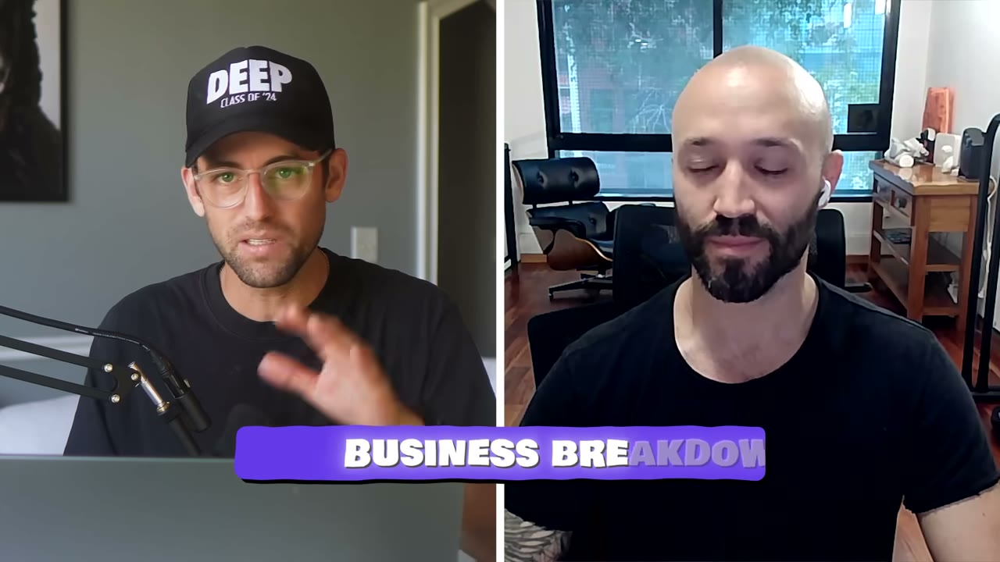
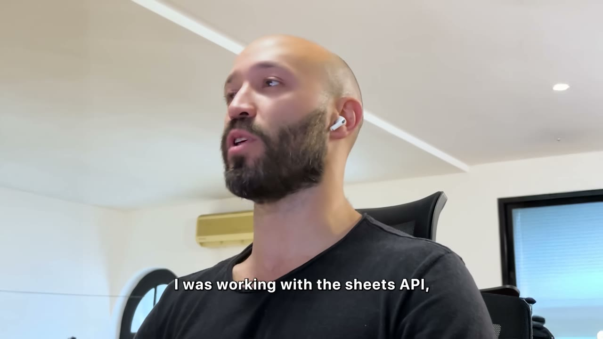
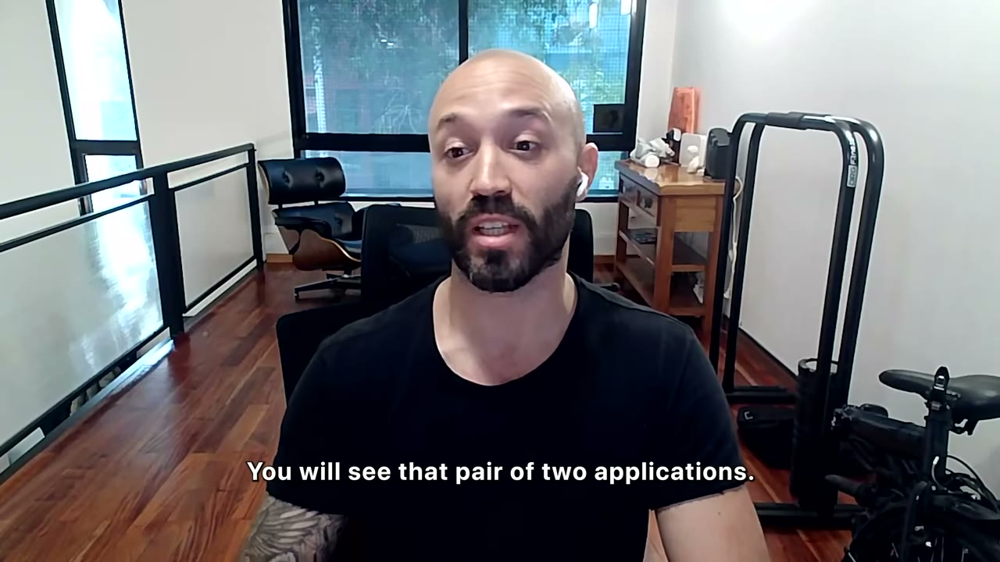
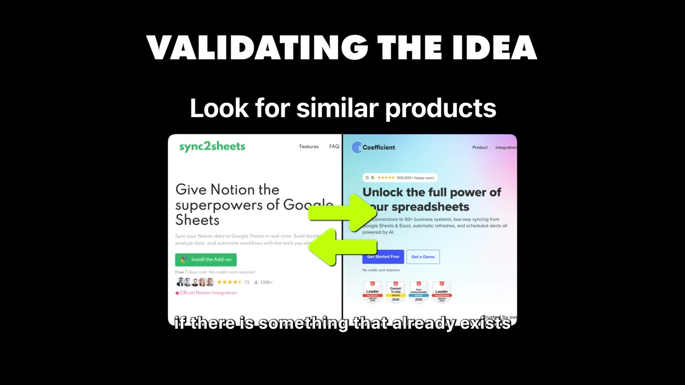
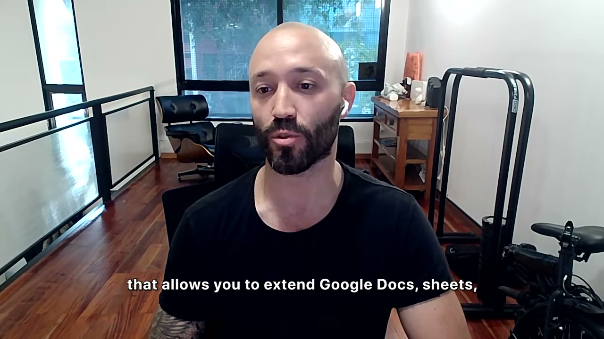
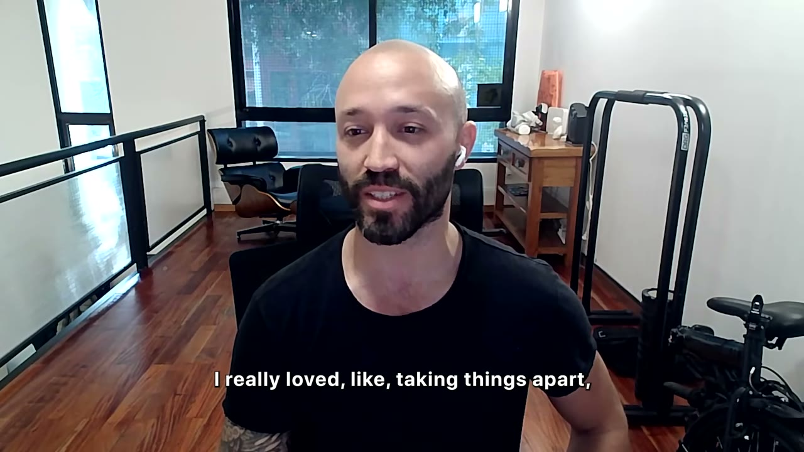
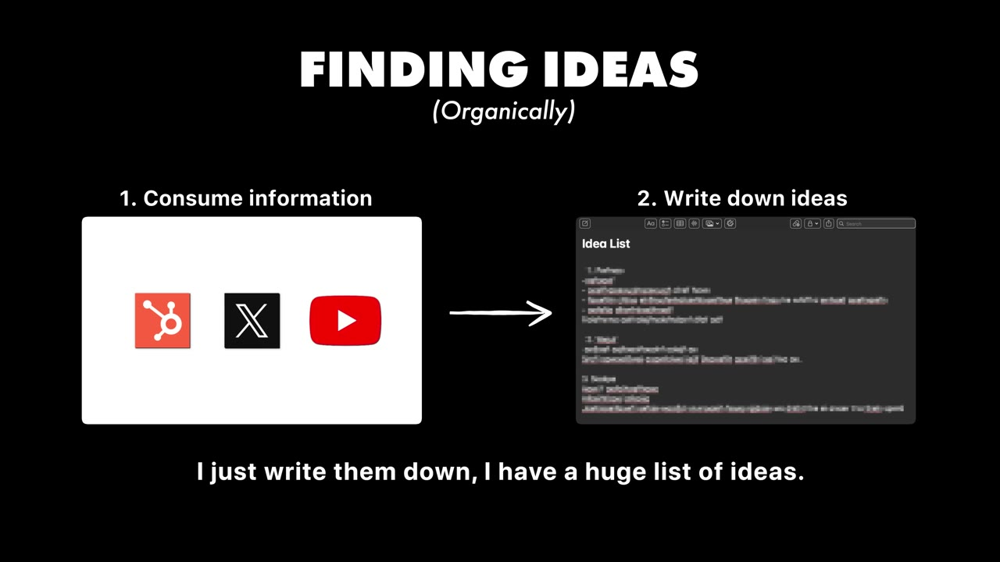
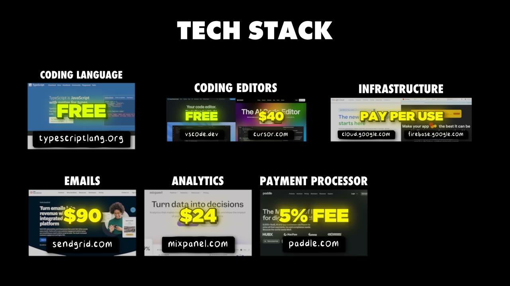
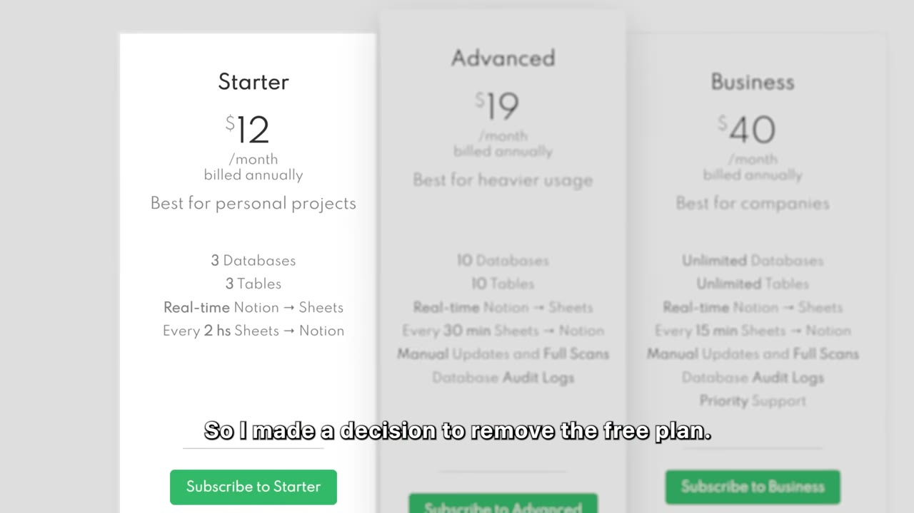

# Sync2Sheets — $9K/tháng từ một add-on làm đúng một việc

> **Tóm tắt 30 giây:** Leandro build một add-on nằm ở sidebar Google Sheets, chức năng duy nhất là đồng bộ database Notion sang Sheets. Anh viết nó trong **2 tuần, năm 2021, không có AI** — chỉ Stack Overflow và Google. Bốn năm sau: **70.000 người dùng, 450 khách trả tiền, 9K USD/tháng, biên 90%**. Nhưng con số đắt nhất là cái anh vô tình để lộ: lifetime revenue chỉ ~120K USD sau 4 năm, trong khi run-rate hiện tại đã là 108K/năm — nghĩa là **3 năm đầu anh gần như không kiếm được gì**. Và cú nhảy lớn nhất không đến từ marketing mà từ việc **xoá gói free**: 5K lên 8K trong vài tháng.

## 1. Con số

| Chỉ số | Giá trị |
|---|---|
| Doanh thu | ~$9.000/tháng |
| Người dùng | hơn 70.000 |
| Khách trả tiền | hơn 450 |
| Traffic | ~5.000 visitor/tháng |
| Lifetime revenue | ~$120.000 trong 4 năm |
| Biên lợi nhuận | 90% |
| ARPU ngụ ý | ~$20/khách/tháng |
| Tỉ lệ free → paid | ~0,64% |
| Thời gian build MVP | 2 tuần (2021, không AI) |
| Quy mô đội | 1 người |

**Lưu ý về số liệu:** Leandro không đưa ảnh dashboard nào trong video. Tất cả con số đều là anh tự nói. Kênh Starter Story không xác minh độc lập. Các con số này nhất quán với nhau nên tôi giữ nguyên, nhưng hãy đọc chúng như lời khai, không phải bằng chứng.

## 2. Đường cong 4 năm — con số founder không nhấn mạnh nhưng bạn phải thấy ⭐⭐⭐

Đây là phần giá trị nhất của case, và nó nằm ở phép trừ chứ không nằm ở lời kể.

Leandro nói hai con số cách nhau vài giây:

> *"lifetime revenue probably around 120k for the last four years. I could say that **the last year or two years is where we made most of the money**."*

Ghép với 9K/tháng hiện tại:

- 9.000 × 12 = **108.000 USD/năm** ở run-rate hiện tại
- Lifetime 4 năm = **120.000 USD**
- ⇒ Ba năm đầu (2021–2023) cộng lại chỉ ra khoảng **12.000–30.000 USD**, tức trung bình **dưới 500 USD/tháng**

**Cơ chế đằng sau:** đây là đường cong điển hình của sản phẩm sống nhờ marketplace + SEO. Cả hai kênh đều là **tài sản tích luỹ**, không phải vòi nước bật là chảy:
- Thứ hạng trên Google Workspace Marketplace tăng theo số lượt cài và số review — mà số lượt cài lại phụ thuộc thứ hạng. Vòng lặp này quay rất chậm ở đầu.
- Bài blog SEO cần 6–18 tháng mới lên hạng, và giá trị của chúng cộng dồn chứ không thay thế nhau.
- Bản thân Notion cũng lớn lên trong 4 năm đó. Anh cưỡi con sóng của một nền tảng đang phình ra.

**Bài học cho bạn:** nếu bạn định làm mô hình này, hãy **lập kế hoạch tài chính cho 24–36 tháng gần như không có doanh thu**, không phải 6 tháng. Leandro sống được nhờ **tiền tiết kiệm sau 8 năm freelance** — anh nói thẳng điều đó. Đây là điều kiện tiên quyết mà video không nhấn mạnh nhưng nó là cả câu chuyện.

So sánh trong kho: [Data Fetcher](../2025-08-13_how-i-built-it-23k-month-micro-saas/case.md) (add-on Airtable, $23K/tháng) đi cùng một con đường và cũng mất nhiều năm. Ngược lại [Pep AI](../2026-05-24_i-built-a-30k-month-in-35-days/case.md) hay [Once](../2026-05-10_i-built-a-20k-month-app-in-83-days/case.md) đạt kết quả trong dưới 90 ngày — nhưng bằng kênh push (outreach, ads, viral), không phải kênh pull (marketplace, SEO). **Chọn kênh là chọn luôn đường cong dòng tiền của bạn.**

## 3. Nguồn gốc ý tưởng — đứng ở khe hở khi một nền tảng vừa mở API ⭐⭐⭐

Trình tự chính xác:

1. Anh đang làm một tích hợp giữa Google Sheets và một dịch vụ khác → **tích luỹ kiến thức sâu về Sheets API**.
2. Đúng lúc đó **Notion phát hành API chính thức** (2021).
3. Anh nhận ra: *"There was a gap between what users needed and what's available in Notion."*
4. Anh lên Reddit, vào subreddit của Notion, **search các từ khoá**: `sheets`, `google sheets`, `excel`, `csv`.
5. Thấy rất nhiều người đang vật lộn export dữ liệu từ Notion sang Sheets để xử lý.
6. Đủ tự tin → build MVP 2 tuần.

**Cơ chế:** khe hở này tồn tại vì **API mới luôn thô**. Khi một nền tảng lớn mở API, nó chỉ cung cấp nguyên liệu, không cung cấp món ăn. Khoảng cách giữa "API cho phép làm" và "người dùng cuối làm được" chính là chỗ micro-SaaS sống. Cửa sổ này rộng nhất trong **6–18 tháng đầu** sau khi API ra mắt, rồi hẹp dần khi nền tảng tự làm hoặc đối thủ tràn vào.

**Cách áp dụng năm 2026:** theo dõi changelog API của các nền tảng đang lớn (Notion, Airtable, Linear, Attio, Cal.com, ClickUp, Slack, monday.com...). Mỗi lần có API mới hoặc endpoint mới → chạy ngay bước 4 của Leandro: vào subreddit/forum của nền tảng đó, search từ khoá của công cụ mà người ta muốn nối vào.

## 4. Cách tìm cơ hội kế tiếp — đọc bảng xếp hạng Zapier ⭐⭐⭐

Đây là chiến thuật cụ thể nhất và hành động được ngay trong video. Câu hỏi của Pat: nếu bắt đầu lại hôm nay, anh sẽ đi đâu tìm cơ hội?

> *"I believe **Zapier is a good place** to go and find those kind of opportunities. So if you go to Zapier and you check for example the most common **Zaps**, you will see that pair of two applications for example are **QuickBooks and Sheets**. [...] And doing that in Zapier is kind of messy. You need to create different Zaps for updates, for creates, deletes, and everything. So **if you're able to build that in just one piece of software that does everything, you're going to be solving a huge pain point**."*

**Vì sao chiến thuật này hiệu quả — cơ chế 3 lớp:**

1. **Zapier đã làm sẵn khâu validation cho bạn.** Danh sách Zap phổ biến nhất là bằng chứng nhu cầu đã được trả tiền, không phải phỏng đoán. Không có bước nào rẻ hơn thế.
2. **Zapier cố tình dở ở tình huống nhiều chiều.** Kiến trúc của Zapier là trigger → action, một chiều, một sự kiện. Đồng bộ hai chiều thật sự (create + update + delete + xoá dòng + đổi cột) phải dựng 4-6 Zap riêng, dễ vỡ, khó debug. Đây là **giới hạn kiến trúc**, không phải bug — nên nó không tự biến mất.
3. **Khách của Zapier đã quen trả tiền** cho việc kết nối phần mềm. Bạn không phải giáo dục thị trường về việc "tại sao phải trả tiền cho thứ này".

**Khi nào chiến thuật này hết hiệu quả:** khi một trong hai nền tảng tự làm tích hợp gốc. Đó là rủi ro thường trực — và Notion hoàn toàn có thể ra tính năng export sang Sheets bất cứ lúc nào.

Nguồn ý tưởng thứ hai anh nêu: **Upwork** — xem người ta đang thuê build cái gì, rồi biến yêu cầu lặp lại thành sản phẩm đóng gói. Đây gần với cách [Lancer](../2026-03-08_i-built-a-10k-month-saas-using-other-peoples-custome/case.md) khai thác khách hàng của người khác.

## 5. Cách validate — 4 bước, không có bước nào tốn tiền ⭐⭐

1. **Có gì tương tự chưa?** Nếu có, đó là tín hiệu tốt chứ không phải xấu.
2. **Đọc bảng giá của đối thủ** để định vị: đây là giải pháp enterprise, SMB hay cá nhân? Bảng giá cho bạn biết ngay quy mô ví tiền của thị trường.
3. **Tìm góc khác biệt.** Câu quan trọng nhất:
   > *"If I can't find that angle, I maybe look for something else, because **if you're not able to differentiate yourself, it's going to be hard to enter into the market**."*
4. **Tìm 5 người dùng đầu tiên sẵn sàng thử** qua Reddit, X, Facebook group, LinkedIn group — và cho họ dùng **trong lúc bạn còn đang build**.

Bước 4 là bước hay bị bỏ. Leandro nhấn mạnh giá trị của nó không phải là "có user sớm" mà là **insight liên tục trong lúc còn sửa được kiến trúc**: *"the insights and all the validation that you get that you're building exactly what they need."*

## 6. Xoá gói free — quyết định đắt nhất trong 4 năm ⭐⭐⭐

Đây là điểm bất ngờ nhất của case.

> *"At the beginning, we had a free plan. And I realized that a lot of users were just using the free plan and that was enough for them. They didn't need to pay. So I made a decision to **remove the free plan**. It was risky. There was a lot of people angry about that. But basically in that moment **we went from 5K to 8K in few months**."*

Tức là **+60% doanh thu** từ một quyết định giá, không phải từ marketing.

**Cơ chế — vì sao free plan giết chết loại sản phẩm này:** Sync2Sheets làm đúng một việc. Với sản phẩm đơn năng, gói free **không phải là bậc thang dẫn lên gói trả tiền — nó là điểm đến cuối cùng**. Nếu bạn cho đủ dùng ở mức free, người dùng không bao giờ có lý do lên gói, vì họ đã đạt được toàn bộ giá trị họ cần.

Free plan chỉ hoạt động khi có **trục để nới**: số lượng (số record, số seat, dung lượng), tần suất, hoặc collaboration. Nếu sản phẩm của bạn không có trục nào như thế → dùng **free trial có hạn ngày**, đừng dùng free plan vĩnh viễn.

Điều này ăn khớp thẳng với lời khuyên cuối video của anh:

> *"What happened to me with some other products is that you build it for free first, you have a lot of usage, and **as soon as you start charging, then they don't use the application anymore**. So that's the moment when you realize that there was not enough value for them. **Charging from the beginning, I think, is super important. Do not waste time building something that no one is going to be willing to pay for.**"*

Anh cũng nói thêm về sức mạnh của thay đổi nhỏ: *"Moving a button, changing a text or just moving things around in the UI can have such a profound impact."*

## 7. Cách phân phối — và sự thật phũ phàng về Product Hunt / Hacker News ⭐⭐

Thứ tự các kênh theo hiệu quả thực tế mà anh mô tả:

| Kênh | Kết quả thật |
|---|---|
| **Google Workspace Marketplace** | Nguồn install đầu tiên và quan trọng nhất. Ai tìm thứ liên quan Notion trong marketplace là gặp anh. |
| **SEO blog** | *"that's right now one of our main traffic channels"* — kênh chính hiện tại |
| **Reddit + F5Bot** | Bền bỉ, chất lượng cao (chi tiết ở dưới) |
| **Spam group Notion + DM cá nhân** | Có user đầu tiên. Anh dùng đúng chữ *"spam a lot of famous groups"* |
| **Chat widget trên landing page** | Không phải kênh traffic, nhưng là kênh **insight** |
| **Product Hunt** (launch sau 1,5 năm) | *"a really nice source of traffic, **not paying customers**"* |
| **Hacker News** (lên trang chủ) | *"the spike you get in traffic is amazing. But **the same, it doesn't translate into paying customers**. It's just visibility, backlinks that improve domain rating, but that's it."* |

**Đây là cảnh báo quý nhất trong video** và nó đi ngược lại rất nhiều nội dung indie hacker: **Product Hunt và Hacker News không phải kênh doanh thu cho sản phẩm B2B ngách.** Chúng là kênh **backlink và domain rating** — tức là chúng nuôi SEO chứ không nuôi MRR trực tiếp.

Đối chiếu trong kho: [ChartDB](../2026-02-25_i-built-a-niche-app-to-9k-mrr/case.md) cũng ~$9K MRR nhưng đến chủ yếu từ Hacker News và GitHub — khác biệt là ChartDB bán cho **developer**, tức đúng khán giả của HN. **Điều kiện phân định:** HN/PH chuyển đổi ra tiền khi khách hàng mục tiêu của bạn CHÍNH LÀ người đọc HN/PH. Người dùng Notion cần export sang Sheets thì không.

### F5Bot — công cụ miễn phí đáng cài ngay

> *"I have a service called **F5Bot** that is free that lets you track different keywords on Reddit. So I set up some keyword tracking related to CSV, sheets, in that subreddit, and every time I get an email with a notification that a new post or comment was added, I just go there and reply."*

Quy tắc anh nêu: *"you need to try to be not spammy and really give value to the users, and if your product can be a solution for their problems, then you recommend your product, **you say you are the founder**."*

Câu "you say you are the founder" là chìa khoá — nó biến quảng cáo thành minh bạch, và Reddit tha thứ cho sự minh bạch. Xem thêm [Gojiberry AI](../2026-01-25_how-i-used-reddit-to-build-a-34k-month-saas/case.md) và [Savewise](../2025-08-09_how-i-used-reddit-to-build-a-25k-month-business/case.md) cho hai biến thể sâu hơn của chiến thuật Reddit.

## 8. Cách xây MVP — và triết lý "làm đúng một việc"

Thứ tự tính năng của anh, rất đáng chép lại:

1. **Chuyển được dữ liệu từ A sang B. Hết.** Không format, không gì cả. *"I just wanted the data to be there in Sheets."*
2. Rồi mới nghĩ tới trải nghiệm: người dùng muốn dữ liệu **trông giống như trong Notion** → thêm conditional formatting, data validation cho select/dropdown.
3. Rồi các chi tiết nhỏ khiến sync không phá vỡ công việc của người ta: cho phép **di chuyển cột, ẩn cột** mà sync vẫn chạy.

> *"I focus on those little details that make the difference."*

**Cơ chế:** bước 1 chứng minh sản phẩm khả thi về kỹ thuật. Bước 2-3 mới là thứ khiến người ta **trả tiền** — vì chúng loại bỏ công việc thủ công lặp lại sau mỗi lần sync. Đây là lý do đối thủ copy được tính năng lõi vẫn thua: giá trị nằm ở lớp thứ ba.

## 9. Tech stack — và bài học Paddle cực kỳ quan trọng cho người Việt ⭐⭐⭐

| Hạng mục | Công cụ | Ghi chú |
|---|---|---|
| Nền tảng add-on | **Google Apps Script** | Ngôn ngữ của Google để mở rộng Docs/Sheets/Slides |
| Ngôn ngữ | TypeScript | |
| Editor | VS Code, gần đây thêm Cursor | Sản phẩm gốc build **không có AI** |
| Hạ tầng | Google Cloud + Firebase | Khoản chi lớn nhất — sync real-time tốn compute |
| Email | SendGrid | ASR đọc là *S grid* |
| Analytics | **Mixpanel** | ASR đọc là *Mixpan*. Anh chọn vì thấy được **từng user đang làm gì** |
| Thanh toán | **Paddle** | ASR rõ. Không dùng Stripe |
| Chat hỗ trợ | Tidio | ASR đọc là *TIO* — nhiều khả năng là Tidio, tôi không chắc 100% |
| Theo dõi Reddit | F5Bot | Miễn phí |

> *"I use **Paddle** as my payment processor instead of Stripe because **Stripe is not available in Argentina**."*

**Đây là câu quan trọng nhất trong toàn bộ video đối với indie hacker Việt Nam.** Stripe cũng không hỗ trợ Việt Nam. Leandro chứng minh bạn có thể xây một business $9K/tháng, thu tiền toàn cầu, từ một nước Stripe không phục vụ — bằng **Paddle**, một merchant of record tự lo VAT/sales tax toàn cầu và trả tiền về tài khoản của bạn. Argentina còn có kiểm soát ngoại hối gắt hơn Việt Nam. Nếu anh làm được, bạn làm được.

Biên 90%, chi phí chính là cloud infrastructure vì *"you are syncing between two services and you are doing that all the time in real time. So there's a lot of compute going on."*

## 10. Chân dung founder và nhịp làm việc

- Học **kỹ sư điện tử**, đại học khiến anh *"literally hate electronics"* → tự học JavaScript mất khoảng 1 năm, chọn JS vì *"you can build mobile apps, web apps and everything"*.
- **Freelance 8 năm**, chán vì: *"You have an entrepreneur spirit. You want to make the decisions and sometimes you're not in charge."*
- Bỏ hết trong COVID: *"I quit everything. No more clients, no more anything."* — có tiết kiệm, có kỹ năng code, có kinh nghiệm.
- Nhịp làm việc: có con 2 tuổi, dậy 7:00–7:30, đưa con đi mẫu giáo rồi mới làm. Kiểu **spike–chill**: gom nhiều task lại làm một đợt lớn rồi nghỉ.
- Bộ lọc công việc: *"If I see that a task or something is not going to move the needle, **I just don't do it** and focus my time in something else."*

Về nguồn ý tưởng cá nhân, anh không đi săn ý tưởng: đọc blog, X, YouTube, ghi mọi ý tưởng vào một danh sách dài. Bộ lọc của anh: *"it's funny when **the same idea pops up different times**. Those are the kind of ideas that you work on."* — tức là dùng **tần suất tái xuất hiện** làm tín hiệu, một cách rẻ để lọc nhiễu khỏi tín hiệu.

## 11. Cảnh báo thiên kiến nguồn ⚠️

Video này có **hai lớp quảng cáo** cần bóc tách:

1. **Đoạn 7:32–9:01 là quảng cáo trả tiền của monday.com.** Toàn bộ phần *"the best marketplace to build for"* — với các con số 245.000 khách hàng, 200+ ngành, 90% khách enterprise dùng app marketplace, *"the marketplace isn't saturated yet"* — **không phải lời của Leandro**, mà là script quảng cáo do Pat Walls đọc. Leandro chưa từng build cho monday.com. Đừng nhầm con số quảng cáo với kinh nghiệm thực chiến. Cách đọc lành mạnh: luận điểm "marketplace là kênh phân phối tốt cho solo dev" **được chứng minh bởi chính case Sync2Sheets** (Google Workspace Marketplace) và [Data Fetcher](../2025-08-13_how-i-built-it-23k-month-micro-saas/case.md) (Airtable), không phải bởi đoạn quảng cáo.
2. **Starter Story Build** (khoá học AI App Accelerator) được nhắc ở đầu và cuối, kèm hứa hẹn *"in 2 weeks you'll come up with an idea, build it and launch it"*. Lưu ý sự lệch pha: Sync2Sheets mất **4 năm** để tới $9K/tháng, và MVP 2 tuần chỉ là điểm bắt đầu. Kênh đã được HubSpot mua lại và chỉ phỏng vấn người thành công — bạn không bao giờ thấy 100 người khác cũng làm add-on Notion và không kiếm được gì.

Ngoài hai điểm trên, phần phỏng vấn Leandro khá trung thực: anh chủ động nói ra rằng Product Hunt và Hacker News **không ra khách trả tiền**, và không giấu việc phải xoá free plan mới tăng được doanh thu. Đó là dấu hiệu tốt.

## 12. Áp dụng cho tôi (indie hacker VN)

### Sao chép được gì — cụ thể, làm được tuần này

1. **Chọn một nền tảng đang phình ra và một API vừa mở.** Hôm nay không còn Notion API 2021, nhưng luôn có cái tương đương. Danh sách để bắt đầu: Google Workspace Marketplace, Airtable, ClickUp, Linear, Attio, Cal.com, Slack, Shopify, monday.com. Tiêu chí: nền tảng đủ lớn để có subreddit riêng, đủ trẻ để marketplace chưa bão hoà.
2. **Đọc bảng "most popular Zaps" trên Zapier.** Với mỗi cặp app phổ biến, hỏi: người ta có phải dựng 4+ Zap để làm một việc không? Nếu có, đó là ứng viên.
3. **Search subreddit của nền tảng đó** bằng tên các công cụ khác (`excel`, `sheets`, `csv`, `notion`, `airtable`...). Đếm số bài than phiền trong 6 tháng gần nhất. Dưới 20 bài thì bỏ.
4. **Cài F5Bot ngay hôm nay** (miễn phí), theo dõi 5-10 từ khoá. Kể cả chưa có sản phẩm — bạn đang xây bản đồ nhu cầu.
5. **Thu tiền từ ngày đầu.** Không free plan vĩnh viễn cho sản phẩm đơn năng. Dùng free trial 7-14 ngày.
6. **Mở tài khoản Paddle** (hoặc Lemon Squeezy / Polar — cùng mô hình merchant of record). Đây là con đường hợp pháp để một người ở VN thu tiền thẻ toàn cầu mà không cần Stripe.

### Rào cản thật — không tô hồng

- **Dòng tiền âm 24–36 tháng.** Đây là rào cản lớn nhất và video không nói ra. Leandro có tiết kiệm từ 8 năm freelance. Nếu bạn không có 2 năm chi phí sống dự phòng, **đừng bỏ việc** để làm mô hình này — làm buổi tối, chấp nhận chậm hơn.
- **Rủi ro nền tảng ở mức tối đa.** Toàn bộ business nằm trong nhà người khác. Notion có thể ra tính năng export gốc, Google có thể đổi chính sách Apps Script, phí commission marketplace có thể tăng. Coi doanh thu là **tiền thuê**, không phải tài sản.
- **Rào cản tiếng Anh là thật ở đây, nhưng ở mức viết chứ không phải nói.** Kênh chính là SEO blog và trả lời Reddit — bạn cần viết tiếng Anh tự nhiên, đúng ngữ cảnh cộng đồng. Reddit phát hiện văn AI rất nhanh và trừng phạt nặng. Đây là chi phí thật, hãy tính vào.
- **Không có thị trường VN cho mô hình này.** Người dùng Notion + Google Sheets chịu trả $20/tháng gần như toàn bộ ở Mỹ/EU. Bạn phải nhắm quốc tế từ ngày đầu — điều đó cũng nghĩa là hỗ trợ khách theo múi giờ của họ.
- **Chi phí compute là chi phí biến đổi thật.** Sync real-time không như một trang tĩnh. Leandro nói cloud là khoản chi lớn nhất của anh dù biên vẫn 90%. Hãy thiết kế giới hạn tần suất sync **vào bảng giá ngay từ đầu**, đừng để khách nặng ăn hết biên.
- **450 khách trả tiền là con số nhỏ — và đó vừa là ưu vừa là nhược.** Ưu: bạn quản lý được một mình. Nhược: mất 20 khách lớn là mất 5% doanh thu, không có luật số lớn che chắn.

### Khi nào KHÔNG dùng mô hình này

- **Khi bạn cần tiền trong 12 tháng.** Marketplace + SEO là kênh pull, đường cong hình chữ J. Nếu bạn cần dòng tiền sớm, hãy nhìn sang mô hình kênh push: [Once](../2026-05-10_i-built-a-20k-month-app-in-83-days/case.md) (outreach thủ công) hoặc [SuperGrow](../2025-09-10_how-i-made-65k-in-3-days/case.md).
- **Khi bạn muốn quy mô lớn.** Trần của một add-on đơn năng thấp — Leandro 4 năm mới tới $9K/tháng và Pat chúc anh *"grow to 100K MRR"* như một điều xa vời. Nếu bạn muốn $100K/tháng, mô hình đúng là **danh mục nhiều sản phẩm bán cho cùng một khách**, như [Barn 2 Plugins](../2026-02-08_i-make-150k-month-from-20-tiny-apps/case.md).
- **Khi vấn đề bạn giải nằm trong lộ trình hiển nhiên của nền tảng.** Nếu tính năng của bạn là thứ nền tảng chắc chắn sẽ tự làm trong 12 tháng, bạn đang làm QA miễn phí cho họ.
- **Khi sản phẩm của bạn cần phải có gói free để lan truyền.** Bài học xoá free plan của Leandro chỉ đúng với sản phẩm đơn năng, không có hiệu ứng mạng. Với sản phẩm cộng tác hoặc có viral loop, xoá free plan sẽ giết luôn kênh tăng trưởng.

## Nguồn

- Video: <https://www.youtube.com/watch?v=npcL7oRZQlI> (15:36, đăng 11/06/2025, 173.445 view)
- Founder trên X: [@LeanZubrezki](https://x.com/LeanZubrezki)
- [Transcript đầy đủ](transcript.md) · [Ảnh chụp](screenshots/)
