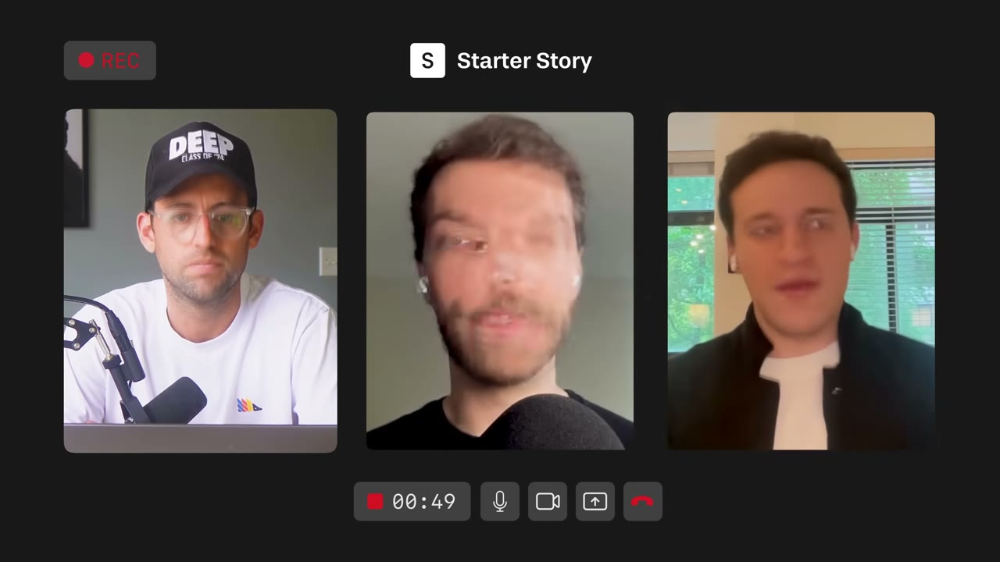
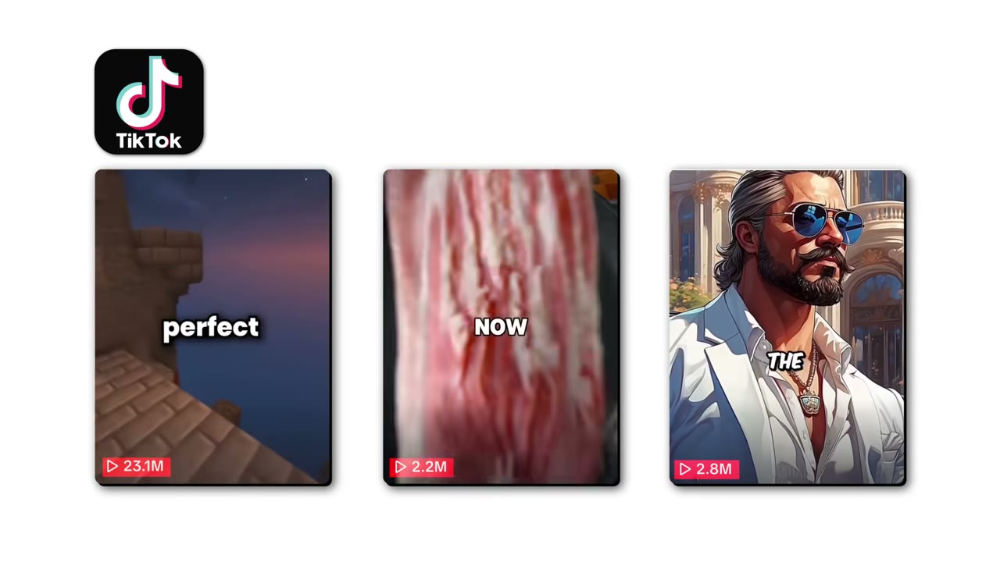
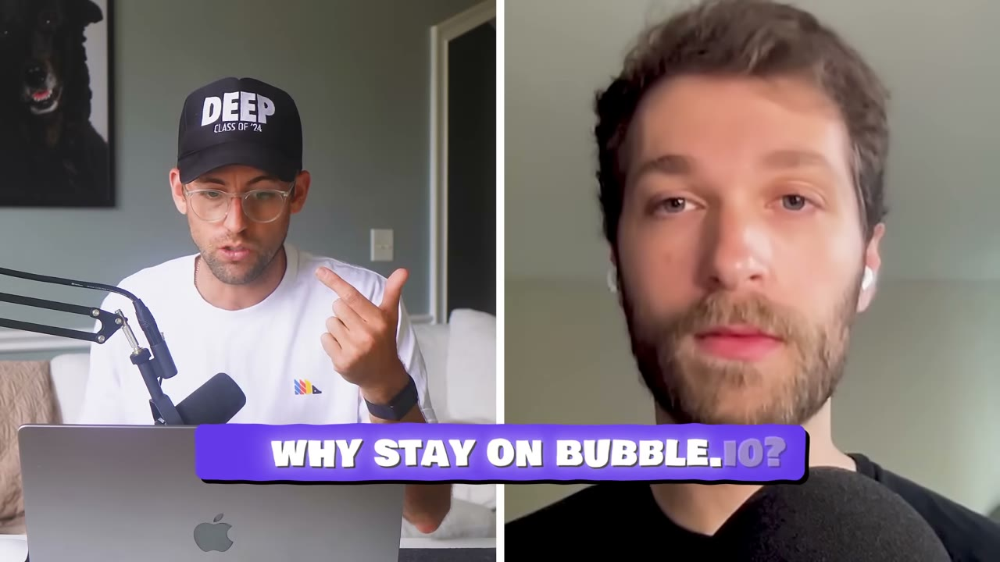
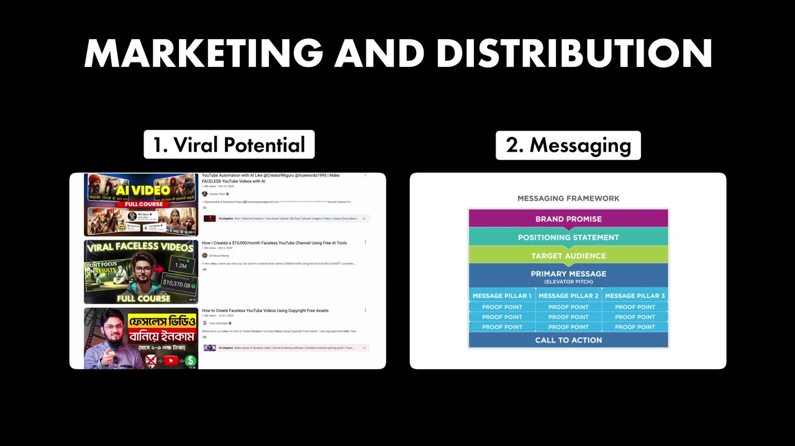

# Faceless.video — 1 triệu USD ARR trên no-code, đọc kèm một cảnh báo lớn

> **Tóm tắt 30 giây.** Jacob Seeger thất bại **6 ý tưởng SaaS** liên tiếp. Ý tưởng thứ bảy — một công cụ tự động sản xuất và đăng video cho các kênh mạng xã hội ẩn danh — đạt **hơn 1 triệu USD ARR trong 10 tháng**, và anh xây nó **100% bằng Bubble**, không viết code. Ở mức 1 triệu ARR nó **vẫn đang chạy trên Bubble**. Quảng cáo đầu tiên của họ là một **chuỗi bài Twitter tốn khoảng 200 USD** và viral ngay. Cảnh báo quan trọng nhất, đặt ngay ở đây: **Bubble là nhà tài trợ trả tiền cho chính video này**, và toàn bộ luận điểm của video phục vụ cho thông điệp của họ.

## ⚠️ Đọc cảnh báo này trước

Đây là case có **xung đột lợi ích nghiêm trọng nhất** trong toàn bộ kho case này. Ba sự thật cần đặt cạnh nhau:

1. **Bubble là nhà tài trợ của video.** Link trong phần mô tả là link theo dõi có gắn tên nhân vật.
2. **Luận điểm trung tâm của video là "no-code scale được tới 1 triệu USD"** — chính xác là thông điệp bán hàng của Bubble.
3. **Đoạn quảng cáo Bubble AI dài hơn một phút** được cài ngay sau đoạn Jacob giải thích vì sao anh ở lại Bubble, khiến hai thứ nghe như một mạch lập luận liền.

Điều này **không có nghĩa câu chuyện là giả**. Nó có nghĩa là bạn nên **giảm trọng số cho mọi phát biểu ủng hộ no-code trong video này** và tăng trọng số cho các chi tiết không phục vụ nhà tài trợ — mà những chi tiết đó, may thay, lại là phần hay nhất.

## 1. Con số

| Chỉ số | Giá trị |
|---|---|
| ARR | hơn 1.000.000 USD |
| Thời gian đạt | 10 tháng |
| Người đăng ký | hơn 1.100.000 |
| **Khách trả tiền** | **không được nêu** |
| Ý tưởng thất bại trước đó | 6 |
| Video sản xuất | hàng nghìn mỗi ngày |
| Nền tảng | Bubble, không viết code |

**Lỗ hổng dữ liệu lớn nhất: video không nêu số khách trả tiền, không nêu biên lợi nhuận, không nêu chi phí.** Với một sản phẩm sản xuất **hàng nghìn video mỗi ngày** — tức là chi phí tính toán, chi phí API tạo giọng nói, chi phí lưu trữ đều rất thật — việc bỏ trống toàn bộ phần chi phí là một khoảng trống lớn. So sánh: [Letterly công bố 250K doanh thu nhưng chi phí ăn hết 235K](../2025-11-24_how-he-makes-250k-per-month-from-a-simple-app-letter/case.md). Không có số chi phí thì **không thể biết 1 triệu ARR này còn lại bao nhiêu**.

Ngoài ra: 1,1 triệu người đăng ký. Nếu tỷ lệ chuyển đổi ở mức 1% thì khoảng 11.000 khách trả tiền — hợp lý với 1 triệu ARR (~90 USD/năm/khách). Nhưng đây là suy đoán của tôi, không phải số liệu.

## 2. Cách tìm ra ý tưởng: để thuật toán dẫn đường ⭐⭐⭐⭐⭐

Đây là phần giá trị nhất video và nó **không phục vụ nhà tài trợ**, nên tôi tin nó nhất.

Alex kể trình tự:

1. Thuật toán TikTok liên tục đẩy cho anh các video "faceless" đang viral
2. Anh nghĩ: mình cũng dựng được, chúng trông đủ đơn giản. Mục tiêu ban đầu chỉ là **tự mình viral**
3. Anh bắt tay làm — và **phát hiện vấn đề thật không nằm ở chỗ anh tưởng**

Vấn đề thật: **sự đều đặn**. Nghĩ ý tưởng mới và dựng video **mỗi ngày** là việc rất khó duy trì. Kỹ năng dựng video không phải rào cản; **nhịp lặp lại hằng ngày mới là rào cản.**

4. Anh nhận ra công nghệ đã đủ để tự động hoá đúng phần đó
5. Anh gọi Jacob, và **Jacob là người đề xuất biến nó thành SaaS thay vì công cụ nội bộ** để hai người tự chạy kênh

Alex chốt bằng câu đáng ghim: *"I'm really glad that I let the algorithm guide me."* Chúng ta đều lướt qua các xu hướng trên TikTok và Reels; nếu dừng lại **phân tích cái gì đang diễn ra**, trong đó có rất nhiều ý tưởng kinh doanh.

**Cơ chế chuyển giao được — và đây là bài học tôi rút ra, không phải video nói:**

> Đừng xây công cụ giúp người ta **làm được** việc gì đó. Hãy xây công cụ giúp người ta **duy trì** việc đó.
>
> Alex biết dựng video. Anh vẫn bỏ cuộc. Khoảng cách giữa "tôi làm được" và "tôi làm được mỗi ngày trong 6 tháng" chính là nơi tiền nằm.

Cùng cấu trúc với [Cursor Directory](../2025-11-16_my-website-makes-35k-month-built-in-3-hours/case.md): directory không chết vì khó xây, nó chết vì nội dung mốc — vấn đề là **duy trì**, không phải **tạo ra**.

Và cũng lưu ý: bước 3 của Alex là **tự mình làm thử trước**. Đó là thứ cho anh thông tin mà người ngoài không có được. Rẻ hơn mọi khảo sát.

## 3. Vì sao ở lại Bubble ⭐⭐⭐ (đọc với cảnh báo ở trên)

Lập luận của Jacob:

- *"If it ain't broke, don't fix it."* Họ chưa gặp vấn đề nào đủ lớn để đòi hỏi chuyển đổi
- Anh **có gặp một vấn đề về khả năng mở rộng một lần**, và đội hỗ trợ Bubble sửa được — điều đó cho anh sự yên tâm để ở lại
- Bubble lo hộ những thứ anh sẽ không biết bắt đầu từ đâu nếu tự làm: bảo mật, khả năng mở rộng, quy tắc quyền riêng tư, quản lý backend
- Anh nói một điều đáng nghĩ: giờ anh **đã biết code**, và anh thấy Bubble **vẫn là lập trình thật**, chỉ ở dạng trực quan và thân thiện hơn
- Kết luận của anh: *"all the bells and whistles that developers get through custom code is not necessary for building a successful business. All you need is a great idea, a functioning product, and a great go to market strategy."*

**Đánh giá của tôi:** phần "vẫn là lập trình, chỉ khác cách trình bày" là quan sát trung thực và hữu ích — nó bác bỏ ảo tưởng rằng no-code miễn cho bạn khỏi việc tư duy như lập trình viên. Phần "1 triệu ARR vẫn chạy trên Bubble" là dữ kiện có thật và đáng ghi nhận.

Nhưng hãy nhớ: **chúng ta không nghe về những người phải rời Bubble.** Pat còn nêu thẳng trong câu hỏi rằng anh gặp rất nhiều người phải chuyển đi khi mọi thứ phức tạp lên. Câu trả lời của Jacob không phản bác điều đó — nó chỉ nói trường hợp của anh chưa xảy ra.

**Cơ hội no-code mà Jacob gợi ý:** trước hết là **marketplace**, vì đó là dạng dễ quản lý cả frontend lẫn backend bằng no-code nhất. Anh cũng nói thẳng: **no-code không có nghĩa là dễ** — vẫn phải sáng tạo và tháo vát. Nó chỉ hạ rào cản đủ để bạn **bắt đầu**, và bắt đầu mới là chướng ngại lớn nhất.

## 4. Marketing: viral không phải may, nhưng cũng không mua được ⭐⭐⭐⭐

Họ nói rõ họ **không phát minh gì mới**: SEO, quảng cáo, influencer, nội dung organic — tất cả những thứ thông thường. Điểm khác biệt nằm ở **thông điệp**, và Alex quy nó về **kể chuyện** (anh xuất thân làm phim).

Ba chi tiết cụ thể đáng lấy:

**1. Quảng cáo đầu tiên là một chuỗi bài Twitter tốn khoảng 200 USD → hàng trăm nghìn view, viral gần như tức thì.** Đây là con số đáng nhớ cạnh [BulkMockup: video 370 view tạo ra 45 USD MRR lặp lại](../2026-02-11_how-i-built-a-12k-month-micro-saas/case.md) — hai đầu đối lập của cùng một sự thật là **chi phí không quyết định kết quả**.

**2. Influencer tự quảng bá mà không ai liên hệ.** Đây là chi tiết tinh tế nhất: những influencer **nhìn thấy quảng cáo của họ** rồi tự đi quảng bá Faceless.video vì tin khán giả của mình sẽ thích. Nghĩa là **tiền quảng cáo không chỉ mua khách hàng — nó còn tuyển được người quảng bá không công.** Đây là hiệu ứng bậc hai mà hầu hết người chạy ads không tính đến khi đo ROAS.

**3. Truyền miệng nằm trong top 5 nguồn attribution** — trong ô "bạn biết chúng tôi từ đâu", người ta gõ chữ *"friend"*.

**Luận điểm gây tranh cãi cần ghi rõ:** Alex nói với B2C thì *"your CAC, customer acquisition costs, it's pretty low. And so, to spend a lot on ads or other methods of promotion is not really viable."* **Câu này tự mâu thuẫn về mặt logic** — CAC thấp thì càng nên chi nhiều cho ads, không phải ngược lại. Ý anh muốn nói gần như chắc chắn là **giá trị vòng đời mỗi khách B2C thấp**, nên không có chỗ cho CAC cao. Tôi ghi lại nguyên trạng và nêu rõ vì đây là loại câu dễ bị trích dẫn sai.

Điều họ kết luận thì đúng và nhất quán với kho case: **bạn đặt nền bằng marketing truyền thống (ads, influencer), nhưng viral chỉ xảy ra khi bản thân sản phẩm tự nói lên được giá trị của nó.**

## 5. Ba lời khuyên cuối — cái đầu tiên là kỹ thuật, hai cái sau là chiến lược ⭐⭐⭐⭐

**1. Từ ngày số 0, hãy tối ưu cho kịch bản tốt nhất.** Câu hỏi kiểm tra rất cụ thể: **nếu hôm nay có 100.000 người đăng ký, app của bạn chịu được không? Hay bạn sẽ phải nghĩ lại mô hình giá và trả nợ kỹ thuật đúng lúc đó?**

Đây là lời khuyên đi ngược "cứ làm bẩn rồi sửa sau", và trong bối cảnh của họ thì hợp lý: sản phẩm B2C viral thì cú tăng đến bất ngờ, và bạn không có thời gian sửa khi nó đến.

**2. Đừng dính quá chặt vào một ý tưởng.** Jacob nói nếu không đi qua 6 ý tưởng trước đó, có lẽ anh vẫn đang cố cứu ý tưởng đầu tiên — thứ có thể **không bao giờ chạy được**. *"Failing fast is a win-win."*

**3. Ở lại bootstrapped, vì nó ép bạn xây tinh gọn và tập trung vào giá trị thật.** Nếu ý tưởng có giá trị với người khác, bạn sẽ mở rộng được lành mạnh; nếu không, bạn chuyển hướng nhanh. **Bạn có lựa chọn** — đó là thứ vốn đầu tư lấy đi.

Và một lời khuyên về học: **đừng xem tutorial chung chung.** Chọn một dự án bạn thật sự hào hứng rồi học đúng những gì cần để làm nó thành hiện thực — bạn học nhanh gấp mười lần.

**Điểm cuối đáng chú ý nhất:** cả hai đều nhấn mạnh rằng **kỹ năng cũ tưởng không liên quan lại là lợi thế**. Alex làm phim → kể chuyện → marketing mạnh. Jacob làm nhạc và tự học marketing cho nhạc của mình (đưa nhạc lên gần một triệu lượt nghe với ngân sách rất nhỏ) → hiểu quảng cáo và khán giả. Không ai trong hai người xuất thân kỹ thuật, và họ coi đó là lợi thế chứ không phải thiếu sót.

## 6. Chi tiết ít ai để ý: vì sao Jacob rời agency ⭐⭐⭐

Jacob từng có Domino, một agency marketing âm nhạc. Anh nói lý do bỏ rất gọn: **thu nhập tỷ lệ thuận trực tiếp với thời gian của anh**, và anh muốn giúp nhiều người hơn mà không phải hy sinh thêm thời gian.

Sau khi có SaaS, anh mô tả sự khác biệt: *"it just allows you to make more money while getting your time back."* Nhưng anh cũng thành thật ngay sau đó — **điều đó không có nghĩa là rảnh tay khi bạn còn thức**. Một ngày của anh vẫn là tối ưu chi phí, cải thiện sản phẩm, làm tính năng mới, và **vẫn xử lý báo lỗi**.

Đây là phần cân bằng hiếm thấy giữa một video đầy con số lớn.

## 7. Cảnh báo thiên kiến nguồn (đầy đủ)

- **Bubble là nhà tài trợ.** Xem cảnh báo ở đầu bài. Đây là mức xung đột lợi ích cao nhất trong kho.
- **Không có ảnh dashboard, không có số khách trả tiền, không có chi phí, không có biên.** Với một sản phẩm sản xuất hàng nghìn video mỗi ngày, việc thiếu số chi phí là thiếu sót nghiêm trọng.
- **Bán khoá Starter Story Build** ở cuối.
- **Tiêu đề nhấn "100% no-code"** nhưng Jacob nói anh **là self-taught developer** và **giờ đã biết code**. Câu chuyện "người không biết code" không hoàn toàn chính xác.
- **10 tháng lên 1 triệu ARR là con số ngoại lệ**, được kể như thể là kết quả của phương pháp. Sáu lần thất bại trước đó cho thấy phương pháp không đảm bảo kết quả.
- **Rủi ro chính sách nền tảng không được nhắc một lần nào.** Sản phẩm này sản xuất hàng nghìn video AI mỗi ngày đăng lên YouTube và TikTok. Cả hai nền tảng đã và đang siết nội dung sản xuất hàng loạt, lặp lại, thiếu tính nguyên bản. Toàn bộ mô hình kinh doanh của khách hàng họ phụ thuộc vào việc các nền tảng đó tiếp tục dung thứ. Đây là rủi ro tồn vong và video im lặng hoàn toàn về nó.

## 8. Áp dụng cho tôi (indie hacker VN)

**Sao chép được ngay:**

1. **Bài tập "phân tích thay vì lướt qua".** Mỗi khi thấy một định dạng nội dung liên tục xuất hiện trên feed, dừng lại hỏi: ai đang làm cái này, họ phải làm gì mỗi ngày, và phần nào của quy trình đó là đau đớn nhất?
2. **Tự làm thử trước khi xây công cụ.** Alex tìm ra vấn đề thật (sự đều đặn) chỉ vì anh tự dựng video vài tuần. Không khảo sát nào cho bạn thông tin đó.
3. **Chuyển từ "giúp làm được" sang "giúp duy trì".** Đây là bộ lọc ý tưởng dùng được ngay và rất khác với các bộ lọc khác trong kho.
4. **Câu hỏi 100.000 người đăng ký** áp dụng cho cả mô hình giá, không chỉ hạ tầng.
5. **Dùng no-code để bắt đầu.** Điểm này đúng bất chấp việc Bubble tài trợ: rào cản lớn nhất là bắt đầu, và Bubble hay công cụ tương tự hạ được nó.

**Rào cản thật:**

- **Rủi ro chính sách nền tảng là rủi ro lớn nhất và video không nói.** Nếu YouTube hay TikTok siết mạnh nội dung AI hàng loạt, giá trị sản phẩm này sụp đổ theo. Ai định copy mô hình này ở Việt Nam nên coi đây là rủi ro số một, không phải rủi ro kỹ thuật.
- **Chi phí biên rất thật.** Hàng nghìn video mỗi ngày nghĩa là chi phí tính toán, giọng nói, lưu trữ tăng tuyến tính theo người dùng. Đây **không phải** SaaS biên 90%. Video giấu điều này.
- **Khách hàng là người nói tiếng Anh trên các nền tảng phương Tây.** Marketing bằng kể chuyện tiếng Anh là kênh chính.
- **Cú viral 200 USD không lặp lại theo yêu cầu.** Họ có 6 lần thất bại trước đó.

**Khi KHÔNG nên làm mô hình này:**

- **Khi bạn không chịu được rủi ro một chính sách nền tảng xoá sổ doanh nghiệp qua đêm.** Đây là dạng rủi ro nền tảng nghiêm trọng hơn cả [Data Fetcher phụ thuộc Airtable](../2025-08-13_how-i-built-it-23k-month-micro-saas/case.md), vì ở đây nền tảng có **động cơ chủ động** chống lại sản phẩm của bạn.
- **Khi bạn cần biết trước unit economics.** Case này không cho bạn dữ liệu để tính.
- **Khi bạn định dùng nó làm bằng chứng rằng "no-code luôn scale được".** Một mẫu, do nhà tài trợ chọn, kể trong video do chính họ trả tiền.

## Nguồn

- Video: [I Built a $1M SaaS 100% with No Code (Bubble)](https://www.youtube.com/watch?v=x9TUDb4sLE0) — Starter Story, 14/06/2025, 130.533 view
- [Transcript đầy đủ](transcript.md) · [Ảnh chụp màn hình](screenshots/)
