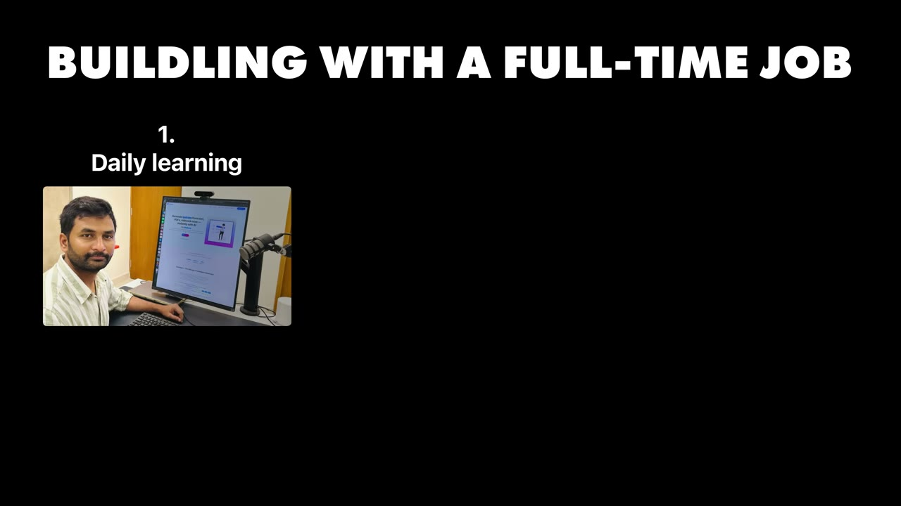
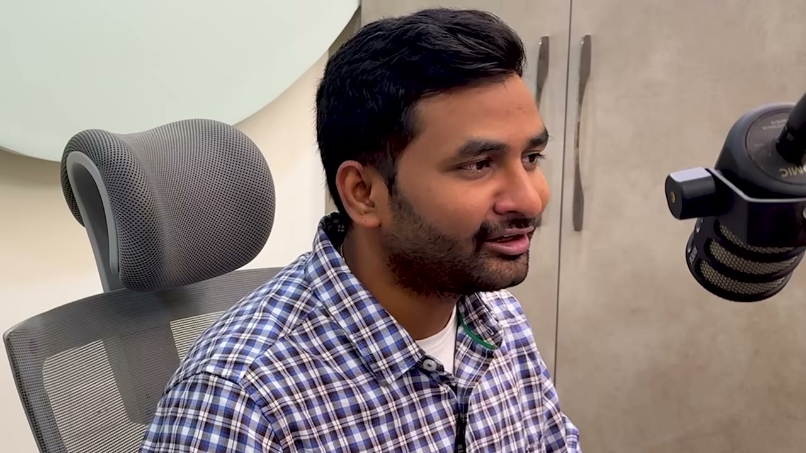
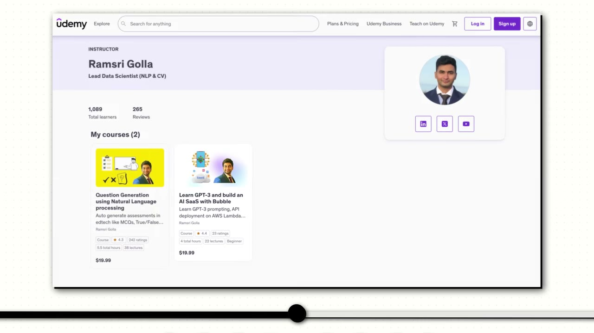
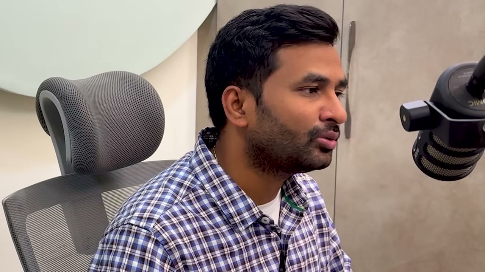
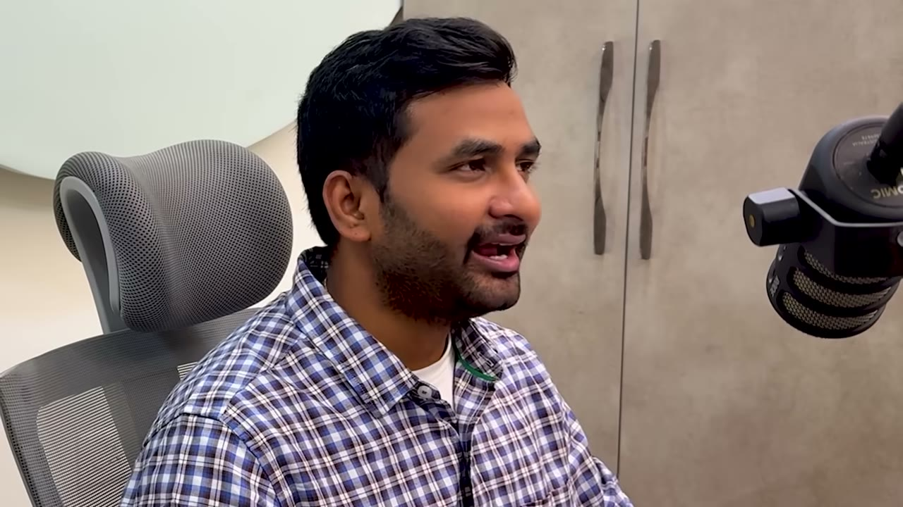

# I Make $100K/Year From 2 AI Side Projects

✅ **Đã phân tích sâu** → [`case.md`](case.md)

| | |
|---|---|
| **Video** | <https://www.youtube.com/watch?v=CoqAxV6b6j4> |
| **Đăng** | 18/06/2025 |
| **Thời lượng** | 13:13 |
| **Lượt xem** | 160,417 |
| **Lượt thích** | 3,760 |
| **Video ID** | `CoqAxV6b6j4` |

## Trong thư mục này

| File | Nội dung |
|---|---|
| [`case.md`](case.md) | **Phân tích đầy đủ** — ý tưởng, validate, GTM, áp dụng ở VN |
| [`meta.json`](meta.json) | Metadata gốc (chapters, heatmap, mô tả) |
| [`screenshots/`](screenshots/) | 10 ảnh 720p |

## Mô tả gốc

This is how Ramsri built 2 apps to $100K/year combined alongside his full-time job.
0:00 - Intro
0:50 - Who is Ramsri
1:12 - Businesses breakdown
1:48 - Building alongside a 9-5
2:47 - Why Ramsri hasn’t quit the 9-5
3:22 - Ramsri’s backstory
5:10 - Find out what people search for
6:27 - How to find ideas
7:31 - Growth & marketing
9:00 - Tech stack
9:37 - Costs & margins
10:01 - Day in the life
11:04 - Advice to entrepreneurs
12:30 - Final word
This video is an educational case study of one founder’s experience. It is not financial advice and does not guarantee any income or results. Every busi

## Số liệu bắt được từ transcript

> Các đoạn founder nhắc tới con số, kèm timestamp để tua thẳng tới đó trong video.

_(không bắt được con số nào)_

## Chương

- `00:00` Intro
- `00:50` Who is Ramsri
- `01:12` Businesses breakdown
- `01:48` Building alongside a 9-5
- `02:47` Why Ramsri hasn’t quit the 9-5
- `03:22` Ramsri’s backstory
- `05:10` Find out what people search for
- `06:27` How to find ideas
- `07:31` Growth & marketing
- `09:00` Tech stack
- `09:37` Costs & margins
- `10:01` Day in the life
- `11:04` Advice to entrepreneurs
- `12:30` Final word

## Ảnh

1. `01_01m24s_usd-8-500.jpg` — 
2. `02_02m00s_ch-building-alongside-a-9-5.jpg` — 
3. `03_02m59s_ch-why-ramsri-hasn-t-quit-the-9-5.jpg` — 
4. `04_03m34s_ch-ramsri-s-backstory.jpg` — 
5. `05_04m17s_usd-10-000.jpg` — 
6. `06_05m22s_ch-find-out-what-people-search-for.jpg` — 
7. `07_06m39s_ch-how-to-find-ideas.jpg` — 
8. `08_07m43s_ch-growth-marketing.jpg` — 
9. `09_09m27s_replay.jpg` — 
10. `10_10m13s_ch-day-in-the-life.jpg` — 

---

← [Quay lại index](../../index.md) · [Toàn bộ video](../README.md)
