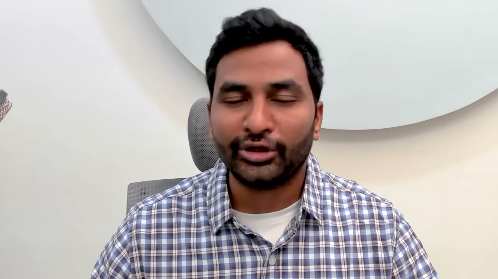
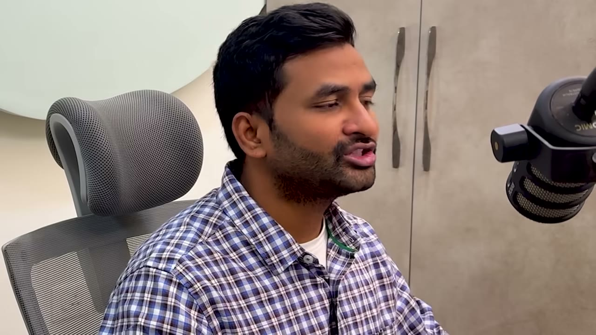
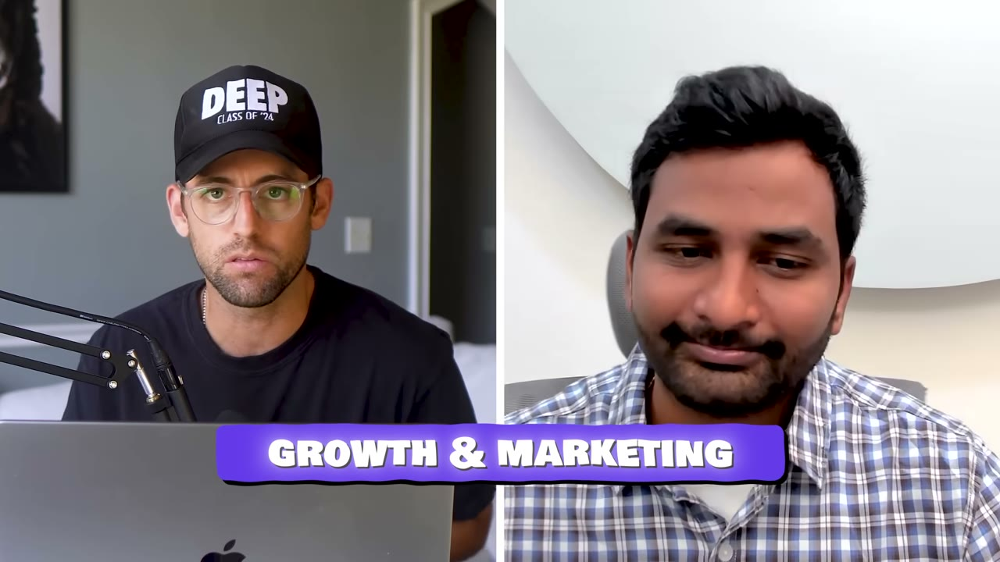
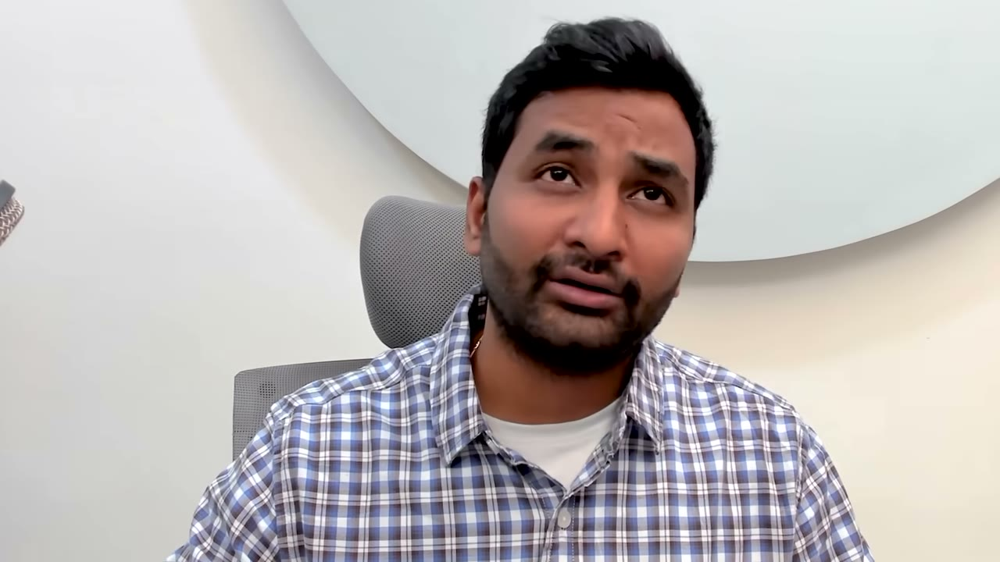

# Ramsri — 100K USD/năm từ hai app AI, và lời từ chối giấc mơ mà kênh này bán

> **Tóm tắt 30 giây.** Ramsri ở Ấn Độ có hai app AI kiếm **8.500 USD/tháng** với **1–2 giờ làm mỗi tuần**, chủ yếu vào chiều thứ Bảy. Anh có **1,5 triệu người dùng** trên một app và chi **0 đồng cho marketing**. Điểm gây chú ý nhất: anh **không định nghỉ việc**, và lý do không phải là sợ hãi — anh có con nhỏ và bố mẹ đã nghỉ hưu, và anh không muốn người thân sống trong một cuộc đời luôn bận rộn và không sẵn sàng. Nhưng con số đáng học nhất lại là con số anh không nhấn mạnh: **1,5 triệu người dùng chỉ tạo ra 400 khách trả tiền.**

## 1. Con số

| Chỉ số | SuperMeme.ai | Questgen |
|---|---|---|
| Doanh thu tích luỹ | ~130.000 USD | ~100.000 USD |
| Người dùng | **hơn 1.500.000** | hơn 150.000 |
| Khách trả tiền | **400** | ~180–200 |
| **Tỷ lệ chuyển đổi** | **0,027%** | **~0,12%** |
| Đội ngũ | 3 người | một mình |

**Cộng lại: 8.500 USD/tháng, biên 70–75%, chi phí lớn nhất là API của OpenAI và Anthropic.**

## 2. Phép tính mà video không làm — và nó lật ngược bài học ⭐⭐⭐⭐⭐

Video trình bày "1,5 triệu người dùng" như một thành tích. Hãy chia ra:

**1.500.000 người dùng → 400 khách trả tiền = 1 người trả tiền trên mỗi 3.750 người dùng.**

Questgen với 150.000 người dùng lại có ~190 khách trả tiền — **tỷ lệ chuyển đổi cao gấp 4–5 lần** dù người dùng ít hơn 10 lần. Và doanh thu tích luỹ của hai app gần bằng nhau (130K vs 100K).

**Điều này nói lên cái gì:** SuperMeme là công cụ tạo meme — người ta dùng một lần cho vui rồi đi. Questgen tạo quiz cho **công ty công nghệ và nhà xuất bản**, tức người dùng nó để **làm việc**. Cùng một founder, cùng một loại công nghệ, nhưng khách của Questgen tiêu tiền để **hoàn thành công việc**, còn khách của SuperMeme tiêu thời gian để **giải trí**.

Đây chính là bộ lọc mà [Will Cannon rút ra từ chênh lệch 8.000 lần giữa UpLead và Signaturely](../2025-10-01_my-two-apps-made-30m/case.md): câu hỏi không phải "thị trường có to không" mà **"khách của tôi dùng thứ này để kiếm tiền hay để giết thời gian"**.

Và nó bổ sung bằng chứng thứ tư cho quy luật xuyên suốt kho case này — **người dùng miễn phí không phải là tài sản**:

| Case | Sự chú ý | Tiền |
|---|---|---|
| [PuffCount](../2025-09-20_the-1m-mobile-app-playbook/case.md) | 11,6 triệu view | gần 0 lượt cài |
| [GlowUp](../2025-12-17_my-mobile-app-made-800k-in-365-days/case.md) | 48 triệu view | 12.500 USD |
| [BulkMockup](../2026-02-11_how-i-built-a-12k-month-micro-saas/case.md) | 12.000 view | 213 USD tổng |
| **SuperMeme** | **1,5 triệu người dùng** | **400 khách** |

## 3. Khung tìm ý tưởng AI — và chữ quan trọng nhất trong đó ⭐⭐⭐⭐⭐

Khung của anh, gói trong một câu: **tìm những công việc thủ công mà người ta ĐANG TRẢ TIỀN, và có thể được cải thiện đáng kể hoặc thay thế bởi AI tạo sinh hiện có hoặc SẮP CÓ.**

Ba mệnh đề, mỗi mệnh đề đều gánh trọng lượng:

**"Đang trả tiền"** — không phải "gặp khó khăn", không phải "muốn có". Đã có dòng tiền chảy qua công việc đó. Đây là cùng bộ lọc với [Thomas Sanlis: không có đối thủ nghĩa là không có thị trường](../2025-08-23_how-i-finally-built-a-10k-month-saas-30-failures/case.md).

**"Công việc thủ công"** — công việc lặp lại, tốn công, có đầu vào và đầu ra rõ ràng. Đó là loại việc AI làm tốt.

**"Hoặc SẮP CÓ"** — đây là chữ đắt nhất, và là chỗ anh thắng. Anh kể rõ: năm 2020 anh và đồng đội nhận ra các công ty công nghệ lớn và nhà xuất bản tạo rất nhiều quiz. **Nhưng AI khi đó chưa làm được việc tạo quiz tự động từ văn bản.** Họ vẫn bắt đầu, vì họ **dự báo được** rằng năng lực này sẽ đến trong vài năm tới.

Anh nói thành một nguyên tắc hành động: **luôn theo dõi sát AI đang đi về đâu, để nhận diện các use case kinh doanh mà công nghệ mới sắp mở khoá** — những thứ trước đây bất khả thi, quá phức tạp, hoặc quá đắt.

**Vì sao điều này đáng giá:** nếu bạn chỉ xây thứ AI **đã** làm được hôm nay, bạn cạnh tranh với tất cả mọi người, vì rào cản duy nhất là biết gọi API. Nếu bạn xây cho thứ AI **sắp** làm được, bạn có 12–24 tháng đi trước để dựng phân phối, thương hiệu và dữ liệu. Ramsri bắt đầu Questgen từ 2020 và tới giờ vẫn thu tiền.

Đối chiếu với [Dustin Stout của Magai — phân biệt khoảng trống tính năng và khoảng trống cấu trúc](../2025-10-11_i-built-a-100k-month-ai-app/case.md): cùng một nỗi lo, hai cách phòng thủ khác nhau.

## 4. "Xây phân phối trước khi xây sản phẩm" ⭐⭐⭐⭐⭐

Đây là câu trả lời của anh cho câu hỏi tăng trưởng, và anh làm đúng nghĩa đen:

- **Trước khi xây Questgen**, anh đã viết rất nhiều blog về việc tạo quiz và làm video YouTube về chủ đề đó
- Anh **xuất hiện mỗi ngày trên LinkedIn**, viết về thứ mình đang làm
- Anh thừa nhận sự thật ít ai nói: *"Sometimes I used to get 10 likes, sometimes 100 likes, 400 likes."* Thuật toán đổi liên tục, **chỉ có sự đều đặn là quan trọng**
- Cả hai sản phẩm đều được **build in public từ trước khi có bất kỳ dấu hiệu viral nào**

**Ba thứ dòng chảy nội dung đó mang lại, theo đúng thứ tự anh kể:**

1. **Người dùng đầu tiên** — toàn bộ, không tốn một đồng marketing
2. **Đồng sáng lập** — *"That's how I found even co-founders for my app. They saw my posts and we just got together."* Anh không đi tìm co-founder; co-founder tìm thấy anh vì anh để lại dấu vết công khai
3. **Đội quân ủng hộ khi ra mắt Product Hunt** — nhóm người dùng đầu tiên từ mạng xã hội đã đẩy SuperMeme lên **số 1 trong ngày ra mắt**

Điểm 2 là thứ tôi cho rằng đáng chú ý nhất và ít ai nhắc: **build in public là một kênh tuyển dụng, không chỉ là kênh marketing.** Với người làm một mình ở Việt Nam, đây có thể là con đường thực tế nhất để tìm người cùng làm — rẻ hơn nhiều so với đi networking.

Anh cũng có một lịch sử làm nền: 2018–2020 anh viết về các thí nghiệm AI của mình trên LinkedIn và Twitter, và **việc thức dậy mỗi ngày để viết trở thành vùng an toàn của anh**. Rồi 2021–2022 anh ra một khoá Udemy thu ~10.000 USD — anh gọi đó là bước ngoặt của hành trình "khởi nghiệp nấu chậm".

## 5. Lý do không nghỉ việc — phản đề của cả kênh này ⭐⭐⭐⭐⭐

Anh nêu lý do rất cụ thể:

- **Không muốn nhận vốn đầu tư mạo hiểm**
- **Không muốn gánh trách nhiệm tuyển và duy trì một đội ngũ chỉ để tăng trưởng**
- **Anh có con nhỏ và bố mẹ đã nghỉ hưu**
- Nguyên văn: *"I don't want people around me to go through the same roller coaster ride of emotions and being always busy and unavailable lifestyle."*

Đây là một trong rất ít lần trong toàn bộ kho case có người **định nghĩa thành công theo mức độ sẵn sàng cho gia đình**, thay vì theo MRR. Và nó đến từ người **đã** có 100K ARR — tức là anh có quyền chọn, và anh chọn không.

Đáng đặt cạnh [Thomas Sanlis](../2025-08-23_how-i-finally-built-a-10k-month-saas-30-failures/case.md) — người cũng nói mình không thể làm 10 tiếng một ngày và cần đạp xe, gặp bạn bè mỗi ngày. Hai founder, hai châu lục, cùng một kết luận.

**Một ngày của anh** (anh kể chi tiết, và nó rất bình thường): dậy 7h30, cho con đi học, 9h30 rảnh, đi bộ trên máy chạy và đọc tin AI, 12h30 đón con và ăn cơm nhà, **14h–17h30 làm công việc chính**, ăn tối với gia đình, thỉnh thoảng làm thêm một giờ buổi tối, ngủ trước 12h. **App SaaS thì để tới chiều thứ Bảy** — hai tiếng cho cập nhật tính năng hoặc dọn dẹp.

## 6. Cấu trúc đội và bài học từ hai lần làm khác nhau ⭐⭐⭐⭐

Anh làm Questgen một mình trước, thấy được **nỗi đau của việc phát triển một startup một mình**, nên với SuperMeme anh **đổi cách**: tìm một full-stack developer và một marketer. Anh nhận vai trò *"the AI guy"*.

Kết quả rất đáng suy nghĩ:

| | Questgen (một mình) | SuperMeme (3 người) |
|---|---|---|
| Người dùng | 150.000 | 1.500.000 (gấp 10) |
| Khách trả tiền | ~190 | 400 (gấp 2) |
| Doanh thu tích luỹ | ~100.000 USD | ~130.000 USD (gấp 1,3) |

**Đội gấp ba lần, người dùng gấp mười lần, doanh thu chỉ hơn 1,3 lần.** Video không đối chiếu điều này. Nó gợi ý rằng có marketer trong đội giúp bạn đạt quy mô chú ý, nhưng nếu **sản phẩm không phục vụ một công việc người ta trả tiền**, quy mô đó không chuyển thành tiền.

## 7. Con đường học của anh — cho người không phải dev

Anh nói rõ điều mà nhiều video giấu: SaaS **không chỉ là phần kỹ thuật**. Nó gồm thanh toán, xác thực, cơ sở dữ liệu, marketing, SEO. Anh mất **vài năm** để thạo tất cả, bằng cách dành **1–2 giờ học và làm mỗi ngày**.

Trình tự của anh:
1. 2015–2018: học mọi khoá kỹ thuật trên Coursera, Udacity trong làn sóng machine learning
2. 2018–2020: thử nghiệm khởi nghiệp, viết về mọi thí nghiệm trên LinkedIn và Twitter
3. 2021–2022: ra khoá Udemy, thu ~10.000 USD
4. 2022–2023: học công cụ no-code, làm bản Questgen đầu tiên — **giao diện chỉ có hai ô văn bản, trái và phải**
5. Gặp giới hạn của no-code → **dành 6 tháng học full-stack** và viết lại Questgen bằng công nghệ hiện đại

Lời khuyên cuối của anh gói lại thành một câu rất dùng được: **hãy giải quyết vấn đề bằng cách nối và ghép các công cụ đã có sẵn, thay vì bỏ ra hàng tháng làm R&D.** Cụ thể: vibe-code bằng Lovable hoặc Bolt.new; nếu chỉ cần chuỗi tự động thì dùng Make, n8n hay Zapier. Hễ có ý tưởng, dựng ngay một nguyên mẫu tối thiểu.

## 8. Cảnh báo thiên kiến nguồn

- **Nhà tài trợ Semrush chiếm khoảng 1 phút** (5:14–6:15) với link theo dõi riêng, được cài ngay trước đoạn nói về tìm ý tưởng — dễ gây cảm giác Semrush là một phần phương pháp của anh. Anh **không hề nhắc tới Semrush** trong phần kể chuyện của mình.
- **Không có ảnh chụp dashboard nào.** Mọi con số là lời tự khai.
- **Con số "1 đến 2 giờ mỗi tuần" chỉ đúng cho hiện tại**, sau khi anh đã bỏ 1–2 giờ **mỗi ngày trong nhiều năm** để học. Tiêu đề và phần mở đầu nhấn mạnh "1–2 giờ/tuần"; đó là trạng thái cuối, không phải con đường.
- **Bán khoá Starter Story Build** ở cuối với lời hứa 12 ngày từ ý tưởng tới app chạy thật — trong khi chính nhân vật gọi hành trình của mình là "slow-cooked" kéo dài từ 2015.
- **Anh có nền tảng machine learning sâu** từ giai đoạn 2015–2018. Khi anh nói "tôi là AI guy", đó là chuyên môn thật, không phải kỹ năng gọi API.

## 9. Áp dụng cho tôi (indie hacker VN)

Đây là case **dễ chuyển giao nhất** trong kho tính tới thời điểm này, vì hoàn cảnh của Ramsri gần với phần lớn người đọc: ở châu Á, có việc làm toàn thời gian, có gia đình, không có audience phương Tây khi bắt đầu.

**Sao chép được ngay:**

1. **Chạy khung "công việc thủ công người ta đang trả tiền + AI sắp làm được".** Liệt kê những việc lặp đi lặp lại mà các công ty ở Việt Nam đang thuê người làm. Hỏi: AI có làm được trong 12–18 tháng tới không? Nếu có, bắt đầu bây giờ.
2. **Viết công khai trước khi có sản phẩm.** Không phải để marketing — để tìm người dùng đầu tiên **và** người cùng làm. Đây là cách rẻ nhất để một người ở Việt Nam gặp được cộng sự.
3. **Ưu tiên sản phẩm cho người dùng để LÀM VIỆC.** Bài học từ chênh lệch 5 lần giữa Questgen và SuperMeme.
4. **Lịch làm việc thật của anh**: 1–2 giờ học mỗi ngày trong giai đoạn xây, 2 giờ chiều thứ Bảy khi đã chạy. Đây là mô hình bền vững cho người có việc chính.
5. **Đừng chờ hết vốn mới xây.** Anh giữ nguyên nguồn thu nhập chính suốt quá trình.

**Rào cản thật:**

- **Chi phí API là chi phí biến đổi thật.** Biên 70–75% của anh thấp hơn nhiều so với SaaS thuần (85–99%), và nó **giảm khi bạn tăng trưởng** nếu người dùng miễn phí ngốn token. 1,5 triệu người dùng để có 400 khách trả tiền nghĩa là bạn đang trả tiền OpenAI cho rất nhiều người sẽ không bao giờ trả lại.
- **Nền tảng machine learning của anh là thật và mất 3 năm.** "AI guy" trong đội không phải vai trò ai cũng đảm nhiệm được.
- **Rủi ro phụ thuộc mô hình.** Anh xây trên OpenAI và Anthropic. Đây là điều [Mike Hill cảnh báo tuyệt đối](../2025-11-02_i-built-3-saas-apps-to-200k-mrr-heres-my-exact-playb/case.md) và [Andy Cloke né tránh vì mật độ cạnh tranh](../2025-08-13_how-i-built-it-23k-month-micro-saas/case.md).
- **Thanh toán quốc tế**: cần Stripe hoặc merchant of record.

**Khi KHÔNG nên đi con đường này:**

- **Khi bạn cần thu nhập thay thế lương trong 12 tháng.** 8.500 USD/tháng của anh là kết quả của gần 10 năm tích luỹ, và anh vẫn đang đi làm.
- **Khi sản phẩm của bạn chỉ có thể miễn phí để lan toả.** Với AI, mỗi người dùng miễn phí có chi phí thật — đây là chỗ mô hình freemium nguy hiểm hơn hẳn SaaS thường.
- **Khi bạn không chịu được nhịp chậm.** Chính anh gọi đó là "slow-cooked". Nếu bạn cần cảm giác tiến bộ nhanh, mô hình này sẽ khiến bạn bỏ cuộc.

## Nguồn

- Video: [I Make $100K/Year From 2 AI Side Projects](https://www.youtube.com/watch?v=CoqAxV6b6j4) — Starter Story, 18/06/2025, 160.417 view
- [Transcript đầy đủ](transcript.md) · [Ảnh chụp màn hình](screenshots/)
