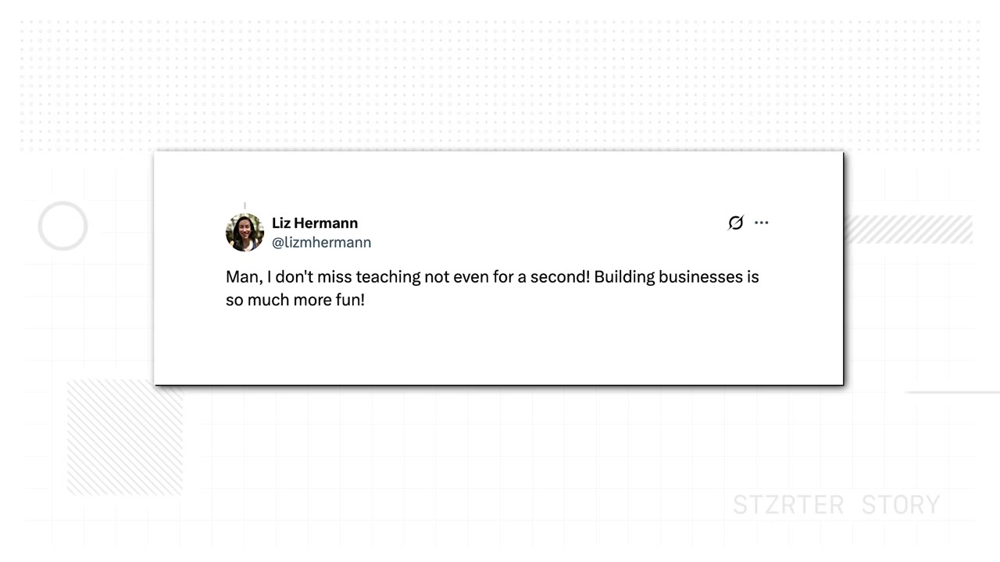
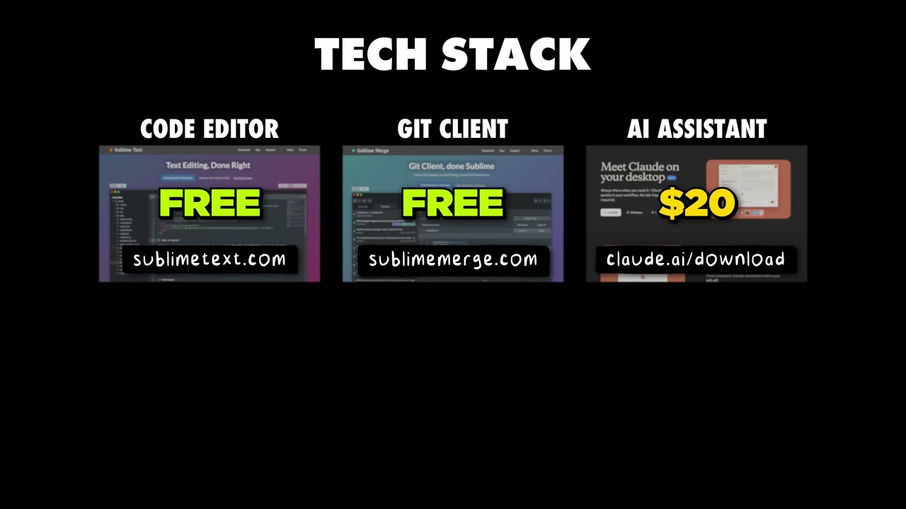

# This App Makes $25,000/Month

✅ **Đã phân tích sâu** → [`case.md`](case.md)

| | |
|---|---|
| **Video** | <https://www.youtube.com/watch?v=HBCwzfFbopE> |
| **Đăng** | 25/06/2025 |
| **Thời lượng** | 14:48 |
| **Lượt xem** | 567,632 |
| **Lượt thích** | 15,327 |
| **Video ID** | `HBCwzfFbopE` |

## Trong thư mục này

| File | Nội dung |
|---|---|
| [`case.md`](case.md) | **Phân tích đầy đủ** — ý tưởng, validate, GTM, áp dụng ở VN |
| [`meta.json`](meta.json) | Metadata gốc (chapters, heatmap, mô tả) |
| [`screenshots/`](screenshots/) | 10 ảnh 720p |

## Mô tả gốc

This is how Lukas Hermann built a simple app to $25,000/month.
0:00 - Intro
0:45 - Who is Lukas?
1:19 - Validating idea on Reddit
2:12 - Building MVP
3:08 - Running the business with his wife
4:06 - Lukas’ background
5:15 - Build on a marketplace
6:40 - Growing the app
8:03 - Word of mouth growth
9:09 - Tech stack
9:51 - Costs to run the business
10:18 - How Stagetimer works
11:00 - Why would people pay for this?
11:35 - How he found this idea
12:19 - Lessons learned
12:55 - “Just get started”
13:43 - Final word

## Số liệu bắt được từ transcript

> Các đoạn founder nhắc tới con số, kèm timestamp để tua thẳng tới đó trong video.

_(không bắt được con số nào)_

## Chương

- `00:00` Intro
- `00:45` Who is Lukas?
- `01:19` Validating idea on Reddit
- `02:12` Building MVP
- `03:08` Running the business with his wife
- `04:06` Lukas’ background
- `05:15` Build on a marketplace
- `06:40` Growing the app
- `08:03` Word of mouth growth
- `09:09` Tech stack
- `09:51` Costs to run the business
- `10:18` How Stagetimer works
- `11:00` Why would people pay for this?
- `11:35` How he found this idea
- `12:19` Lessons learned
- `12:55` “Just get started”
- `13:43` Final word

## Ảnh

1. `01_01m10s_metric.jpg` — 
2. `02_02m24s_ch-building-mvp.jpg` — 
3. `03_03m20s_ch-running-the-business-with-his-wife.jpg` — 
4. `04_04m18s_ch-lukas-background.jpg` — 
5. `05_05m17s_usd-25-000.jpg` — 
6. `06_06m43s_replay.jpg` — 
7. `07_08m15s_ch-word-of-mouth-growth.jpg` — 
8. `08_09m23s_replay.jpg` — 
9. `09_10m14s_usd-1-400.jpg` — 
10. `10_11m00s_usd-25-000.jpg` — 

---

← [Quay lại index](../../index.md) · [Toàn bộ video](../README.md)
