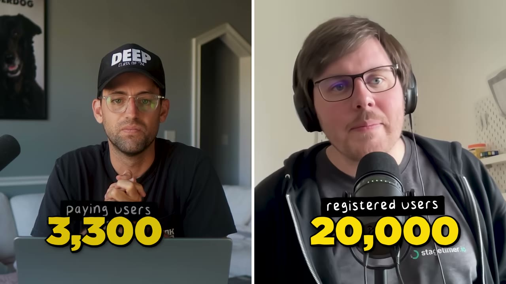
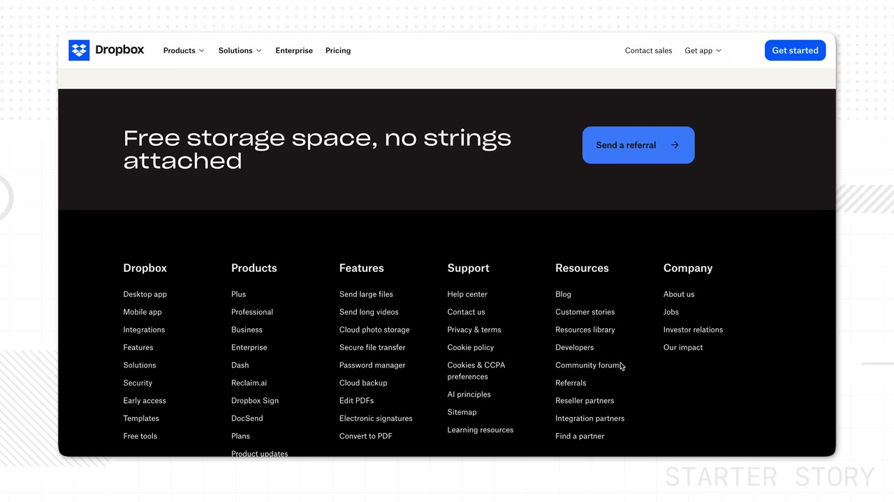
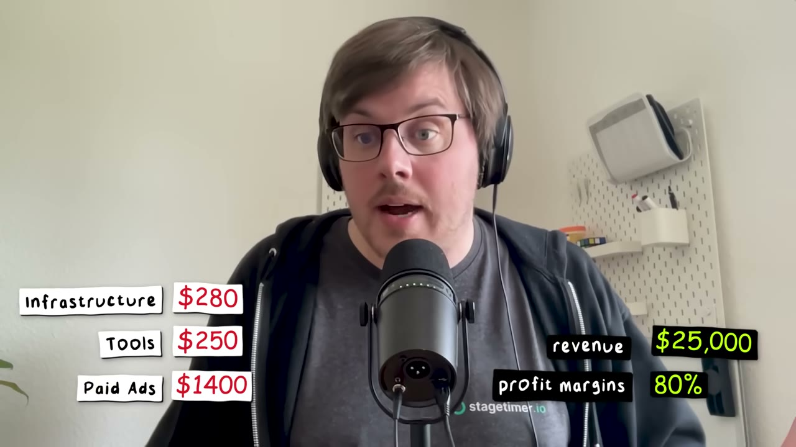

# Stagetimer — $25K/tháng từ một cái đồng hồ đếm ngược

> **Tóm tắt 30 giây:** Lukas Hermann vào studio của bạn và thấy anh này phải **đứng dậy, đi sang phòng khác, bấm một nút, rồi đi về** chỉ để bắt đầu một cái đồng hồ đếm ngược trên phần mềm Flash cũ. Anh viết MVP trong **3 ngày** bằng đúng những công nghệ anh đã biết, đăng **một bài Reddit duy nhất** vào một subreddit siêu nhỏ (58 upvote) để hỏi feedback — website lúc đó **chưa có giá**. Rồi mất **224 ngày** mới có đồng đô đầu tiên. Năm năm sau: **$25.000/tháng**, chi phí vận hành $1.930/tháng, biên 80-90%, đội ngũ gồm anh và vợ. Sản phẩm vẫn chỉ là một cái đồng hồ đếm ngược.

## 1. Con số

| Chỉ số | Giá trị |
|---|---|
| Doanh thu | **$25.000/tháng** |
| Người dùng | 20.000 |
| Đã hoặc đang trả tiền | **4.400** |
| Khách truy cập duy nhất | 86.000/tháng |
| Nguồn traffic | ~50% Google, ~1/3 truyền miệng |
| Hạ tầng + server | $280/tháng |
| Công cụ và dịch vụ | $250/tháng |
| **Quảng cáo trả phí** | **$1.400/tháng** |
| Tổng chi phí | **$1.930/tháng** |
| Biên lợi nhuận (founder nói) | 80-90% |
| Đội ngũ | 2 (founder + vợ) |

### Mốc thời gian — đây mới là con số quan trọng nhất

| Thời điểm | Sự kiện |
|---|---|
| 2007 | Việc lập trình đầu tiên, còn đi học, đạp xe đến chỗ làm viết trang HTML |
| 2017 | Bắt đầu học đại học + freelance song song |
| 2020 | Tốt nghiệp, vào một startup |
| **11/2020** | **Commit đầu tiên của Stagetimer** (đúng lúc COVID) — MVP mất **3 ngày** |
| vài ngày sau | **Bài Reddit duy nhất** để xác thực, 58 upvote |
| **~06/2021** | **Đồng đô đầu tiên — 224 ngày sau commit đầu** |
| 2022 | Nghỉ việc khi Stagetimer đủ **$3.000/tháng** để sống |
| **09/2023** | Chạm mốc **$10.000/tháng** |
| 06/2025 | **$25.000/tháng** |

⭐ **Đây là con số quý nhất trong cả case: 224 ngày để có 1 đô, ~2 năm để có $3K/tháng, gần 3 năm để có $10K/tháng, gần 5 năm để có $25K/tháng.** Nó là liều thuốc giải cho toàn bộ những case "0 lên 30K trong 35 ngày" trong kho này. Lukas làm việc này bằng **1 tiếng mỗi buổi tối** trong khi vẫn đi làm.

### Chỗ số liệu cần đọc kỹ

- **Biên lợi nhuận.** $1.930 / $25.000 = 7,7% chi phí, tức biên **92%** theo phép tính thẳng. Anh nói 80-90% — tức là **thận trọng hơn** con số của chính mình. Chênh lệch nhiều khả năng là phí Stripe/thanh toán (~3-5%) và thuế Đức. Đây là kiểu sai lệch **theo hướng khiêm tốn**, đáng tin hơn nhiều so với các case nói biên cao hơn thực tế. Lưu ý: con số này **chưa trừ lương hai vợ chồng** — đó là lợi nhuận trước khi trả cho chính mình.
- **4.400 là số người "đã hoặc đang trả tiền tại một thời điểm bất kỳ"** — không phải số subscriber đang hoạt động. Anh nói rõ chữ *"are paying or have paid at any point in time"*. Đừng chia $25.000 cho 4.400 để suy ARPU; con số khách đang trả tiền không được nêu.
- Anh dùng chữ **revenue per month**, không phải MRR. Với sản phẩm bán cho sự kiện, nhiều khả năng có lượng đáng kể **mua theo lần/theo tháng lẻ** cho một sự kiện cụ thể — nghĩa là doanh thu này có tính chu kỳ theo mùa sự kiện, kém ổn định hơn MRR thuần.

### Lỗi phụ đề tự động

`Lucas Herman` → **Lukas Hermann** (theo mô tả video); `stage timer` → **Stagetimer**; `supply text / supply merge` → **Sublime Text / Sublime Merge**; `cloud` → **Claude**; `Versell` → **Vercel**; `premium model` → **freemium model**; `product le growth` → **product-led growth**; `soleopreneur/solarpreneur` → **solopreneur**.

## 2. Nguồn gốc ý tưởng — và framework tìm ý tưởng tốt nhất trong kho ⭐⭐⭐

> *"Nó hơi tình cờ. Tôi ở trong studio của bạn tôi và anh ấy dùng một **app Flash rất cũ trên một cái laptop cũ**, còn anh điều khiển mọi thứ từ cái bàn xịn của mình. Rồi để khởi động một cái đồng hồ đếm ngược, anh phải **đứng dậy, đi sang phòng bên, bấm nút, rồi đi ngược lại**. Và cái đầu web developer của tôi lập tức nói: chắc chắn phải có cách tốt hơn."*

Rồi anh biến quan sát đó thành một quy tắc lặp được:

> ⭐ ***"Nếu bạn đến bất kỳ doanh nghiệp nào khác và chỉ cần quan sát người ta làm việc, bạn sẽ thấy họ lãng phí hàng giờ và làm mọi thứ theo những cách vụng về nhất mà lẽ ra bạn đã tự động hoá từ lâu. Đó chính là những ý tưởng đơn giản mà bạn có thể biến thành rất nhiều tiền."***

Và bài học anh rút ra sau 5 năm:

> *"Có nhiều cơ hội hơn ta tưởng. Có **quá nhiều giải pháp vẫn còn giao diện từ năm 1999**, xấu kinh khủng khi dùng. Người ta than phiền về chúng suốt — **nhất là khi bạn bước ra ngoài cái bong bóng developer**. Tôi tin có rất nhiều **ngách triệu đô** với những app nhỏ mà bạn có thể xây. **Cái khó duy nhất là tìm ra chúng.** Một khi đã tìm ra thì đó là một cơ hội tuyệt vời đang mở ra trước mặt."*

**Cơ chế — vì sao cách tìm ý tưởng này hơn hẳn "brainstorm trước màn hình":**

1. Bạn không cạnh tranh với các indie hacker khác, vì họ đều đang tìm ý tưởng **trong bong bóng developer** (công cụ cho developer, công cụ marketing, AI wrapper) — nơi đông nghẹt.
2. Vấn đề bạn thấy tận mắt thì **chắc chắn có thật**, không cần khảo sát.
3. Người đang lãng phí thời gian **đã tự chấp nhận** cách làm vụng về đó — nghĩa là chưa ai bán cho họ giải pháp, tức là chưa có đối thủ.
4. Ngách nhỏ đến mức *"phần lớn các công ty lớn sẽ chẳng buồn động vào"* — như chính anh nói — **nhưng với một solopreneur thì hoàn hảo**.

**Việc cần làm cụ thể:** dành một buổi ở nơi làm việc của bạn bè làm nghề khác bạn (studio, phòng khám, xưởng in, kho hàng, quán ăn, phòng kế toán) và **chỉ ngồi nhìn**. Ghi lại mỗi lần ai đó đứng dậy đi làm một việc lẽ ra một cú click là xong.

## 3. Xác thực ý tưởng — một bài Reddit, 58 upvote ⭐⭐⭐

> *"Tôi làm trên Reddit. Lý do là **tôi đang xây thứ cho những người tôi không biết**. Tôi xây cho người trong ngành video production. Họ ở đâu? Họ tụ tập chỗ nào? Tôi đi tìm một subreddit. **Tôi mất khá lâu mới tìm được một cái. Chúng khá ẩn, chúng rất nhỏ, rất ngách.**"*

Cách anh viết bài:

> *"Tôi đặt một cái link vào đây và nói: **này, thử đi. Cho tôi feedback. Bạn nghĩ sao? Cái này có ích cho bạn không?** Và bạn thấy đấy, người ta viết hẳn danh sách bảo tôi: không, làm cái này, làm cái kia. **Tôi đã đợi một app như thế này từ lâu.**"*

Và đây là chi tiết tinh vi nhất:

> ⭐ ***"Và vì trên website KHÔNG CÓ GIÁ nào gắn vào, nên nó cũng không mang cảm giác 'thằng này chỉ muốn moi tiền mình'. Cái đó hiệu quả cực kỳ tốt."***

Cộng thêm kỷ luật:

> *"Và điều còn lại là **tôi không spam nó. Một bài cho một subreddit.** Thế thôi."*

**Cơ chế:** trên Reddit, thứ bị trừng phạt không phải là link — mà là **ý định bán**. Một trang chưa có giá phát ra tín hiệu "tôi đang hỏi", không phải "tôi đang bán". Nó chuyển bạn từ vai người rao vặt sang vai người xin lời khuyên, và cộng đồng ngách phản ứng hoàn toàn khác với hai vai đó. Bạn nhận lại: xác nhận vấn đề có thật, **danh sách tính năng ưu tiên do chính khách viết**, và những người dùng đầu tiên — trong một bài.

### ⚠️ Mâu thuẫn với case Reddit cùng lô: khi nào theo ai

| Trường phái | Ai | Cách làm | Đúng khi nào |
|---|---|---|---|
| **Một bài, một subreddit, không giá, chỉ hỏi** | **Lukas (case này)** | Xác thực. Không bán gì cả | Ngách siêu hẹp chỉ có 1-2 subreddit nhỏ; bạn chưa có gì để bán |
| **Volume — nhân bản một bài lên 10+ subreddit, có link sản phẩm giữa bài** | Diego Roshardt — AppAlchemy (video 09/07/2025 cùng kênh) | Phân phối. 2-3 bài/tuần | Ngách rộng, có nhiều subreddit lớn; ARPU thấp nên cần hàng nghìn khách |
| **Kể chuyện, không gắn link sản phẩm** | [Romàn Czerny — Gojiberry AI](../2026-01-25_how-i-used-reddit-to-build-a-34k-month-saas/case.md) | Uy tín dài hạn | Bán giá cao ($99+), cần danh tiếng |
| **Beta miễn phí rồi mới thu tiền** | [Tom — Packager](../2026-03-15_i-make-60k-month-from-the-most-boring-saas-on-the-in/case.md) | Gom người dùng chuyên nghiệp | B2B ngách chán, tệp tập trung ở 1-2 subreddit |

**Phân định theo độ rộng của ngách:** Lukas nói *"tôi mất khá lâu mới tìm được MỘT subreddit"*. Khi ngách của bạn chỉ có một cộng đồng và cộng đồng đó nhỏ, **trò volume của Diego là tự sát** — mod sẽ nhớ mặt bạn từ bài thứ hai, và bạn vừa đốt kênh duy nhất của mình. Ngược lại, nếu ngách bạn có 30 subreddit thì đăng đúng một bài rồi thôi là bỏ phí. **Đếm số subreddit trước khi chọn playbook.**

## 4. MVP 3 ngày — quy tắc "chỉ dùng thứ mình đã biết" ⭐⭐⭐

MVP đầu tiên có **đúng một tính năng**: bấm nút ở đây, đồng hồ chạy ở kia.

> *"Tôi dùng tất cả những công nghệ tôi đã biết. Tôi dùng **JavaScript, Vue.js, Node.js**. Lúc đó **Vercel còn mới và tôi không biết nó nên tôi không dùng**. Nếu tôi đã dùng những công nghệ mới chưa biết, tôi sẽ phải **học chúng, hiểu chúng, rồi phát hiện ra chúng có những giới hạn mà trước đó tôi không biết**."*

> ⭐ ***"Và như thế thì tốt, vì tôi ship được MVP trong 3 ngày, rồi xây thêm lên nó từ từ và thoải mái trong 1 TIẾNG tôi có mỗi buổi tối — thay vì phải xây trong 3 tháng chỉ để có một thứ dùng được."***

**Cơ chế:** với người làm side project, tài nguyên khan hiếm nhất không phải tiền — mà là **số block thời gian liên tục**. Một tiếng buổi tối không đủ để debug một framework lạ. Công nghệ mới không chỉ tốn thời gian học, nó tốn thời gian **phát hiện ra giới hạn của nó khi đã đi được nửa đường** — và đó là loại chi phí giết chết side project.

**So sánh thú vị với Diego (AppAlchemy, cùng lô):** Diego cũng cố tình dùng thư viện cũ, nhưng vì lý do ngược lại — *"AI luôn giỏi hơn nhiều với những thư viện được dùng phổ biến nhất"*. Hai founder, hai thời đại, cùng một kết luận: **chọn stack nhàm chán**. Lukas vì bộ não anh đã có sẵn nó; Diego vì bộ não AI đã có sẵn nó. Đây là một trong những lời khuyên hiếm hoi mà mọi founder trong kho này đều đồng ý.

## 5. Cỗ máy tăng trưởng — hai nửa ⭐⭐⭐

### Nửa 1 — SEO đáy phễu: "ăn ké" thứ người ta đã làm sẵn trong ngách

> *"Chúng tôi có một công cụ ngách, rất ngách — **ngách nhỏ đến mức phần lớn công ty lớn sẽ chẳng buồn động vào. Nhưng với chúng tôi, là solopreneur, thì hoàn hảo.** Và tôi quyết định sẽ xem có thể **lấy những thứ người ta ĐANG LÀM SẴN trong ngách của mình rồi ghép công cụ mình vào** không."*

Ví dụ cụ thể anh đưa ra:

> *"Nếu bạn tìm **countdown timer stream deck companion**, chúng tôi đã tạo một **trang tài liệu** chỉ rất chính xác cách dùng công cụ của chúng tôi cùng với tích hợp cho thiết bị phần cứng đó. Chúng tôi cũng làm một **video và đăng lên YouTube**."*

Và đây là phần quan trọng nhất, cũng là điều đi ngược trực giác:

> ⭐ ***"Khi bạn tìm video đó trên YouTube, nó KHÔNG có nhiều view. Nhưng mẹo là: những người CÓ tìm cái này, những người CÓ đi tìm nó trên YouTube — họ muốn câu hỏi của họ được trả lời. Họ có một vấn đề cụ thể và họ muốn một giải pháp cho nó. Nên họ tìm thấy bạn, và họ CÓ KHẢ NĂNG MUA CAO HƠN RẤT NHIỀU."***

Cách anh tìm ra những từ khoá này:

> *"Cách chúng tôi tìm những từ khoá này là **đăng tài liệu, đăng bài viết, rồi nhìn xem người ta THẬT SỰ click vào cái gì, và nhân đôi vào đó**."*

**Cơ chế — vì sao chiến thuật "tích hợp" mạnh với micro-SaaS:**

1. Từ khoá dạng `<sản phẩm của tôi> + <công cụ họ đã dùng>` có lượng tìm cực thấp (10-100/tháng) nên **không ai làm SEO cho nó** — bạn lên hạng 1 gần như tự động.
2. Người gõ truy vấn đó **đã sở hữu thiết bị/phần mềm kia**, đã ở trong ngành, và đang giữa lúc setup. Ý định mua gần như 100%.
3. Mỗi tích hợp là một **trang mới, một video mới, một từ khoá mới** — bạn nhân bản nội dung mà không cần ý tưởng mới. Danh sách công việc tự sinh ra: liệt kê mọi phần cứng/phần mềm mà khách bạn đang dùng.
4. Chiến thuật này **chồng dồn**. Không như bài Reddit chết sau 48 giờ, trang tài liệu còn kéo traffic 5 năm sau.

Đây gần như là cùng một cỗ máy mà [Late dùng để lên $40K/tháng chỉ bằng Google](../2026-03-04_zero-to-40k-month-with-one-marketing-channel-no-soci/case.md), và cùng logic "ý định cao hơn lượt xem" mà [FollowBuddy dùng trên YouTube Search](../2026-03-19_i-make-17k-month-with-one-strategy/case.md).

### Nửa 2 — Truyền miệng được thiết kế, không phải may mắn ⭐⭐⭐

Một phần ba traffic đến từ truyền miệng. Anh nói rõ đó là **kết quả của thiết kế**.

> *"Ngay từ đầu tôi đã muốn giống **Dropbox**. Bạn biết Dropbox chứ — bạn tạo tài khoản rồi nó nói: à, muốn thêm 5GB không? Chia sẻ link cho một người bạn, cho họ đăng ký. Và tôi nghĩ: làm sao tích hợp cái này vào app của mình? Nó gọi là **product-led growth**."*

**Cơ chế 1 — logo có tên miền nằm trong đó:**

> *"Tôi đảm bảo là **mỗi một link người ta chia sẻ đều có logo của tôi trên đó**. Và logo không chỉ là một cái hình — **nó có tên stagetimer.io ngay TRONG logo. Nó được viết ra chữ luôn.** Và đó là cái tên đủ dễ nhớ để người ta thường chỉ cần nhìn thấy là được — họ còn kể lại với chúng tôi: à tôi thấy nó ở một sự kiện và sau đó tôi tự dùng nó."*

Đây là chi tiết nhỏ nhất và đáng chép nhất trong cả video. **Sản phẩm của anh được chiếu lên màn hình lớn trước mặt hàng trăm người tại mỗi sự kiện.** Bằng cách nhét tên miền vào chính logo, anh biến mỗi lần sử dụng thành một biển quảng cáo có thể gõ lại được. Chi phí: 0 đồng. Điều kiện để chạy: **sản phẩm phải hiển thị cho người khác thấy** — đó là lý do nó ăn với công cụ sự kiện, và không ăn với công cụ chạy ngầm.

**Cơ chế 2 — freemium bắt đúng người mang sản phẩm đi khắp nơi:**

> *"Cách còn lại là chúng tôi làm mô hình **freemium**. Bằng cách đó chúng tôi bắt được rất nhiều **freelancer** làm trong ngành này, và **họ mang nó theo tới các sự kiện họ được mời**. Rồi ai đó nói: à, chúng ta cần một cái đồng hồ. Họ bảo: để tôi mở Stagetimer. Họ mở lên, nó chạy tốt, mọi người rất hào hứng — **cuối cùng họ muốn dùng cho sự kiện tiếp theo, đụng phải một giới hạn nào đó, và nói: thôi đáng tiền, mua đi.** Chuyện đó xảy ra rất thường xuyên."*

**Cơ chế:** freelancer là **vector lây lan lý tưởng** vì họ đổi khách hàng liên tục. Một freelancer dùng miễn phí sẽ mang sản phẩm của bạn vào 20 công ty khác nhau trong một năm. Bạn không mất tiền cho họ — bạn mua kênh phân phối bằng bản miễn phí. Bài học chung: **khi thiết kế gói free, đừng hỏi "ai sẽ trả tiền", hãy hỏi "ai sẽ MANG sản phẩm này đi nhiều nơi nhất"** và cho nhóm đó dùng miễn phí thoải mái nhất.

## 6. Sản phẩm — vì sao ai đó trả tiền cho một cái đồng hồ ⭐⭐

Pat hỏi thẳng câu mà ai xem cũng nghĩ: *"tôi dùng đồng hồ trên iPhone được mà, sao cái này làm ra $25.000/tháng?"*

Cách sản phẩm hoạt động:

- Một màn hình đặt trước mặt người nói trên sân khấu, hiện thời gian còn lại.
- Người điều khiển có **giao diện điều khiển trên máy tính của mình**, bấm start/stop từ xa.
- Có thể **gửi tin nhắn lên màn hình đó**: ví dụ *"cầm micro gần lại"*.

> *"Dễ hơn nhiều so với giơ một tờ giấy lên."*

Câu trả lời của Lukas:

> *"Khi tôi xây nó, tôi nghĩ **không đời nào cái này kiếm được nhiều tiền**. Rồi người ta bắt đầu trả tiền, và chúng tôi bắt đầu hiểu ra rằng trong **sự kiện thật, sản xuất video thật, người ta cần thứ này SUỐT**. Chúng tôi có các đài **truyền hình phát sóng bầu cử** cần bấm giờ cho từng người phát biểu. Chúng tôi có cả **đua ngựa** mua nó. Hoá ra gần như ai cũng cần một cái đồng hồ. Và đồng hồ iPhone không dùng được, vì nó chỉ nằm trên cái màn hình bé tí của bạn — còn bạn cần thứ mà **một người bấm start và năm người khác nhìn thấy được**."*

⭐ **Đây là toàn bộ định nghĩa sản phẩm gói trong một câu: "một người bấm, năm người thấy".** Cái iPhone làm được việc; nó không làm được việc **đồng bộ cho nhiều người ở nhiều chỗ**. Sự khác biệt giữa "một công cụ" và "một sản phẩm đáng trả tiền" thường nằm đúng ở chỗ đó — **chuyển từ một người dùng sang nhiều người dùng cùng lúc**.

**Bài học chuyển giao được:** nhìn quanh những việc mà một app điện thoại miễn phí "về lý thuyết là làm được", nhưng thất bại ngay khi có **hai người trở lên cần cùng nhìn/cùng điều khiển**. Đó là danh sách ý tưởng.

## 7. Doanh nghiệp gia đình — phân vai rất rõ ⭐⭐

> *"Sau khi kiếm được đồng đầu tiên và có khách hàng đầu tiên, tôi nghĩ: còn cả marketing phải làm, và giờ phải trả lời cả email chăm sóc khách hàng nữa. Vợ tôi lúc đó đang ở giai đoạn không muốn làm công việc cũ nữa — cô ấy dạy học. Tôi nói: **sao em không tham gia cùng anh? Sao em không học marketing và tiếp quản những phần này?**"*

Phân vai hiện tại:

| Người | Việc |
|---|---|
| **Vợ** | Google Ads, toàn bộ sales email, toàn bộ email support |
| **Lukas** | Sản phẩm, tài chính, development, hướng đi chung (việc CEO) |

Và chi tiết đáng chú ý nhất: **chính vợ anh là người bảo anh nghỉ việc.**

> *"Đến năm 2022 vợ tôi động viên: sao anh không nghỉ việc đi — vì Stagetimer lúc đó đã kiếm đủ để sống qua ngày, **3.000 một tháng**. Nên tôi nghỉ. **Nhờ cô ấy. Chắc tôi đã ở lại công việc đó lâu hơn nhiều nếu không có vợ tôi.**"*

> *"Và đôi khi chúng tôi đi bộ qua đường và bàn xem làm sao để tăng trưởng Stagetimer, đôi khi chỉ nhìn một doanh nghiệp bất kỳ: em sẽ làm gì để tăng trưởng cái tiệm giày kia? Chúng tôi cùng nghĩ theo ngôn ngữ kinh doanh, và nó rất vui, tạo ra rất nhiều cuộc trò chuyện tuyệt vời."*

**Điểm cần cân nhắc thẳng thắn:** đây là một lợi thế cấu trúc rất lớn mà video không gọi tên — **anh có một nhân sự toàn thời gian làm marketing và support mà không phải trả lương thị trường**, và một người đồng chịu rủi ro tài chính. Nếu bạn không có cấu hình đó, đừng so sánh tốc độ của mình với anh. Ngược lại, nếu bạn có, hãy để ý rằng cái làm nó chạy được là **phân vai rõ ràng, không giẫm chân** — chứ không phải "cùng làm mọi thứ".

## 8. Tech stack — ngược đời một cách có chủ ý

| Hạng mục | Công cụ | Ghi chú |
|---|---|---|
| Ngôn ngữ/Framework | **JavaScript, Vue.js, Node.js** | Chọn vì đã biết sẵn, không phải vì tốt nhất |
| Editor + Git | **Sublime Text, Sublime Merge** | Công cụ cũ, anh gọi thẳng là *these are old tools* |
| AI | **Claude** — copy/paste thủ công | **Không** dùng Cursor, **không** dùng Copilot |
| CRM | **Airtable** | *"như một bảng Excel lớn chứa toàn bộ khách hàng, nhưng chạy được automation lên trên nó"* |
| Email | **Postmark** | *"nền tảng gửi email nhưng thật sự làm cho solopreneur"* |
| Quảng cáo | **Google Ads** | $1.400/tháng, vợ anh chạy |

Quan điểm về AI IDE — hiếm và đáng suy nghĩ:

> *"Thực tế với tôi thì **copy/paste vào Claude, sinh code ở đó rồi paste ngược lại còn NHANH HƠN** so với các IDE tích hợp như Cursor hay Copilot."*

**Đây là một mâu thuẫn trực tiếp với phần lớn kho này** — hầu hết case gần đây (Claude Code, Cursor, Codex) đều xem AI IDE là mặc định. Điều kiện khiến Lukas đúng: anh là developer kỳ cựu (từ 2007), làm việc trên một **codebase nhỏ mà anh thuộc lòng**, và không cần AI khám phá ngữ cảnh. AI IDE thắng khi bạn không biết codebase hoặc không biết code; copy/paste thắng khi bạn biết chính xác cần sửa gì và không muốn AI tự ý đụng vào file khác. **Nếu bạn không phải dev, đừng theo Lukas ở điểm này.**

## 9. Chi phí và biên lợi nhuận

> *"SaaS thì **rất, rất rẻ để vận hành**. Chúng tôi tốn **$280/tháng** cho server và hạ tầng. Rồi tốn **$250** cho công cụ và dịch vụ — tất cả những thứ tôi vừa nói, Airtable, Postmark, tất cả gộp lại. Và chúng tôi tiêu **$1.400 cho quảng cáo trả phí**. Nên biên lợi nhuận là 80%, hoặc cao hơn — khoảng giữa 80 và 90%."*

**Điểm đáng chú ý về cơ cấu chi phí:** **72% chi phí của doanh nghiệp này là quảng cáo.** Hạ tầng + công cụ chỉ $530/tháng cho 86.000 khách/tháng. So sánh với AppAlchemy (cùng lô) nơi **83% chi phí là AI API** — đây là khác biệt cấu trúc lớn giữa SaaS truyền thống và AI wrapper: chi phí của Lukas gần như **cố định** (thêm 10.000 khách không làm tăng đáng kể), còn chi phí của một AI wrapper **tăng tuyến tính theo lượng dùng**. Nếu bạn muốn một doanh nghiệp ngủ ngon, mô hình của Lukas an toàn hơn nhiều.

## 10. Lời khuyên cuối — và một rào cản tâm lý rất "châu Âu"

> *"Tôi sẽ quay lại và nói với chính mình: Lukas, mày là người Đức. **Mày sợ quy định. Mày sợ cơ quan thuế đến bảo mày làm sai hết rồi và giờ mày phải đi tù.** Nhưng tao sẽ nói với nó: **không phải như vậy. Cứ bắt đầu đi.** Vẫn có một con đường ngay cả ở đất nước này để xây một doanh nghiệp đơn giản, mở rộng nó, và hiểu cách nó vận hành. **Ai cũng chỉ đang xoay xở đâu đó thôi, và mày cũng làm được.**"*

**Vì sao đoạn này đáng cho người Việt đọc:** nỗi sợ "thủ tục pháp lý/thuế" là rào cản tâm lý phổ biến ở VN không kém gì ở Đức, và nó thường **chặn người ta ở bước 0** — trước cả khi có đồng doanh thu nào. Lukas đã mất 224 ngày để có đồng đầu tiên; trong suốt thời gian đó không có gì để mà lo về thuế cả. **Thứ tự đúng là: làm sản phẩm → có khách → rồi mới xử lý giấy tờ**, không phải ngược lại.

## 11. Cảnh báo thiên kiến nguồn

- **Chương "Build on a marketplace" (5:15-6:40) KHÔNG phải nội dung của Lukas.** Toàn bộ hơn một phút đó là **quảng cáo cho monday.com app marketplace**, được chèn vào giữa câu chuyện và đặt tên chương như thể là một phần bài học. Lukas **không** xây trên marketplace nào cả — Stagetimer là web app độc lập. Đừng rút bài học "xây trên marketplace" từ case này.
- **Không có ảnh dashboard Stripe.** Màn hình chỉ số là do kênh dựng, không phải ảnh chụp hệ thống thanh toán.
- **Đoạn chốt bán Starter Story Build ở cuối** (*"trong 12 ngày bạn sẽ tìm được ý tưởng và build nó bằng AI"*) đặt cạnh một câu chuyện mà founder mất **224 ngày để có 1 đô** và **5 năm để lên $25K/tháng** — đây là mâu thuẫn nội tại rõ nhất trong toàn bộ video. Câu chuyện thật của Lukas là **phản đề** của lời chào bán ở cuối video.
- **Kênh chỉ phỏng vấn người thành công.** Với mỗi Lukas kiên trì 224 ngày không doanh thu, có rất nhiều người bỏ ở ngày thứ 60 — và họ không được lên sóng.
- **Điểm cộng về độ tin cậy:** đây là case có số liệu **nhất quán và tự kiểm tra được nhất** trong ba case cùng lô. Founder nêu chi phí chi tiết, nêu biên **thấp hơn** phép tính của chính mình, nêu cả những khoảng thời gian dài không có tiến triển. Đó là dấu hiệu của người kể thật.

## 12. Áp dụng cho tôi (indie hacker VN)

### Sao chép được gì — đây là case dễ áp dụng nhất trong lô này

1. **Framework tìm ý tưởng bằng cách QUAN SÁT** (mục 2). Chọn một người bạn làm nghề khác bạn, xin ngồi nhìn họ làm việc nửa ngày. Ghi mọi lần họ đứng dậy làm việc thủ công. Đây là bài tập tốn 0 đồng và cho ra ý tưởng **không ai khác đang cạnh tranh**.
2. **Xác thực bằng một bài Reddit không có giá trên website** (mục 3). Nhớ đúng công thức: xin feedback, không bán, một bài một subreddit.
3. **Quy tắc stack nhàm chán** (mục 4). Dùng đúng thứ bạn đã biết. Mục tiêu là MVP trong ngày, không phải trong tháng.
4. **Nhét tên miền vào TRONG logo** (mục 5). Nếu sản phẩm của bạn hiển thị cho người khác thấy, đây là chiến thuật tăng trưởng rẻ nhất tồn tại.
5. **Chiến lược nội dung tích hợp** (mục 5). Liệt kê mọi phần cứng/phần mềm mà khách bạn đang dùng → mỗi cái là một trang tài liệu + một video YouTube nhắm từ khoá `<sản phẩm tôi> + <công cụ họ>`. Traffic thấp, ý định mua cực cao, và **không ai cạnh tranh**.
6. **Đăng nội dung rồi ĐO xem người ta click gì, rồi nhân đôi vào đó** — thay vì nghiên cứu từ khoá trước.
7. **Thiết kế gói free quanh câu hỏi "ai sẽ mang sản phẩm này đi nhiều nơi nhất"**, thường là freelancer.

### Rào cản thật — không tô hồng

- **224 ngày không có một đồng.** Đây là rào cản lớn nhất và nó là rào cản **tâm lý**, không phải kỹ thuật. Bạn phải có nguồn thu nhập khác trong ít nhất một năm. Lukas vẫn đi làm và chỉ dùng **1 tiếng mỗi tối** — đó là cấu hình để sống sót qua giai đoạn này, và bạn nên chép đúng cấu hình đó thay vì bỏ việc.
- **Anh có một co-founder không lương làm marketing/support toàn thời gian.** Nếu bạn một mình, hãy tự trừ đi khoảng 40% năng lực của case này khi ước tính tốc độ.
- **Ngách này nằm ngoài bong bóng developer — đó là điểm mạnh, nhưng cũng nghĩa là bạn phải hiểu ngành đó.** Lukas ngồi trong studio của bạn mình. Bạn không tìm được ngách này bằng cách Google. Bạn phải **quen ai đó làm nghề khác**.
- **Google Ads $1.400/tháng cần thẻ quốc tế và cần biết chạy.** Với ngách hẹp, chi phí click rẻ, nhưng đây vẫn là kỹ năng phải học.
- **Rào cản tiếng Anh ở mức trung bình** — thấp hơn build in public trên X (không cần cá tính, không cần lên hình), nhưng cao hơn 0: bạn cần viết được **trang tài liệu kỹ thuật rõ ràng** và **trả lời email support** cho khách doanh nghiệp phương Tây. Đây là loại tiếng Anh có thể học và có thể dùng AI hỗ trợ, khác với loại cần cho viral content.
- **Doanh thu theo mùa sự kiện.** Sản phẩm bán cho ngành sự kiện — mùa hè và cuối năm cao, đầu năm thấp. Kế hoạch dòng tiền phải tính điều đó. (Video không nêu, đây là suy luận từ bản chất ngách.)
- **Thị trường VN quá nhỏ cho mô hình này.** Ngách sản xuất sự kiện ở VN không đủ 4.400 khách trả tiền. **Bắt buộc bán quốc tế ngay từ ngày đầu.**

### Khi nào KHÔNG dùng mô hình này

- **Khi bạn cần doanh thu trong 6 tháng.** Đây là mô hình 3-5 năm. Nếu bạn cần tiền sớm, xem các case có phân phối vay mượn sẵn — như [LaunchFast đổi 50% cổ phần lấy tệp khách của một công ty coaching và có $10K MRR trong 30 ngày](../2026-01-04_how-i-built-my-first-saas-without-an-audience-25k-mo/case.md).
- **Khi sản phẩm của bạn chạy ngầm, không ai nhìn thấy.** Toàn bộ nửa "truyền miệng" (1/3 traffic) phụ thuộc vào việc sản phẩm **được chiếu lên cho nhiều người xem**. Một công cụ backend không có cơ chế đó — bạn phải mua traffic hoặc làm SEO gấp đôi.
- **Khi ngách của bạn đủ lớn để công ty lớn quan tâm.** Lợi thế phòng thủ của Lukas là *"nhỏ đến mức các công ty lớn chẳng buồn động vào"*. Nếu ngách bạn đủ hấp dẫn để một startup gọi vốn nhảy vào, mô hình 1-tiếng-mỗi-tối sẽ không chống đỡ được.
- **Khi bạn không chấp nhận được trần doanh thu.** $25K/tháng sau 5 năm là kết quả tuyệt vời cho hai người ở Đức, nhưng đây không phải mô hình đi lên $1M/tháng. Nếu tham vọng bạn ở tầm đó, xem [Hero Analytics — SaaS bán cho AGENCY thay vì cho từng brand, $1M ARR sau 19 tháng](../2026-06-10_i-built-a-1m-saas-in-a-hidden-niche/case.md) để thấy cách một ngách hẹp vẫn có thể lớn khi mỗi khách mang theo 30 khách con.

## Nguồn

- Video: <https://www.youtube.com/watch?v=HBCwzfFbopE> (14:48, đăng 25/06/2025, 567.632 view)
- Founder trên X: `@_lhermann`
- [Transcript đầy đủ](transcript.md) · [Ảnh chụp](screenshots/)
