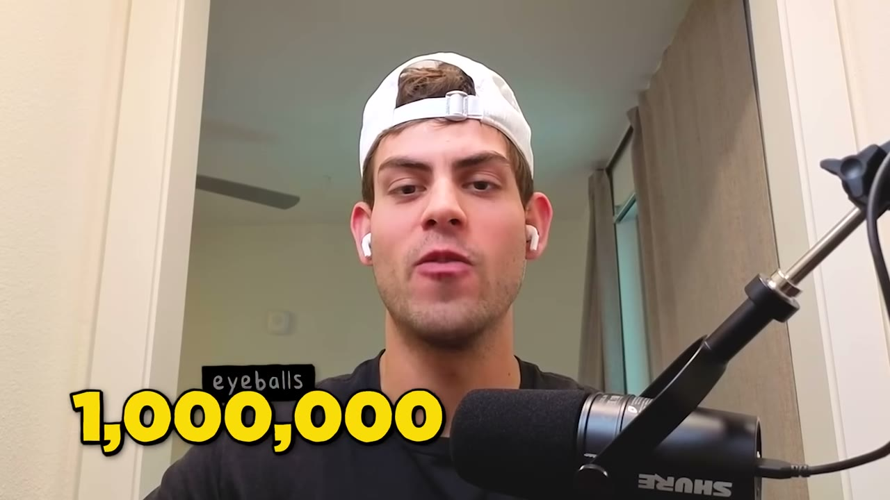
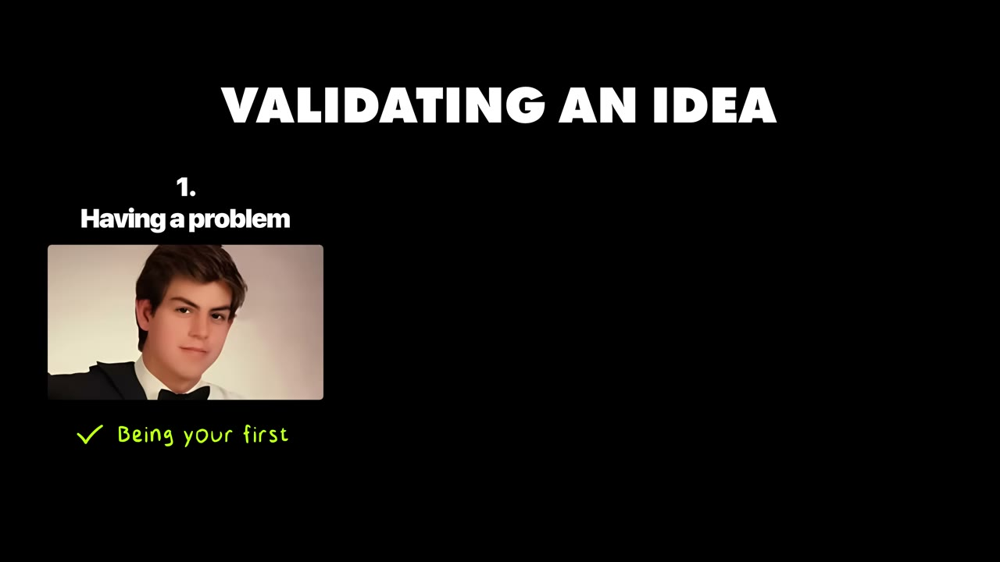
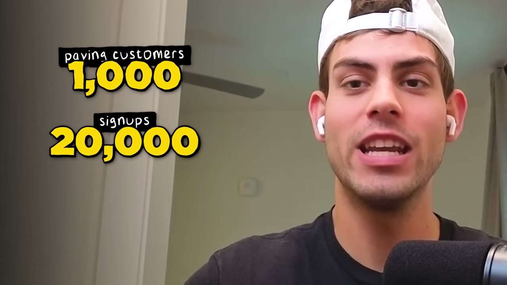
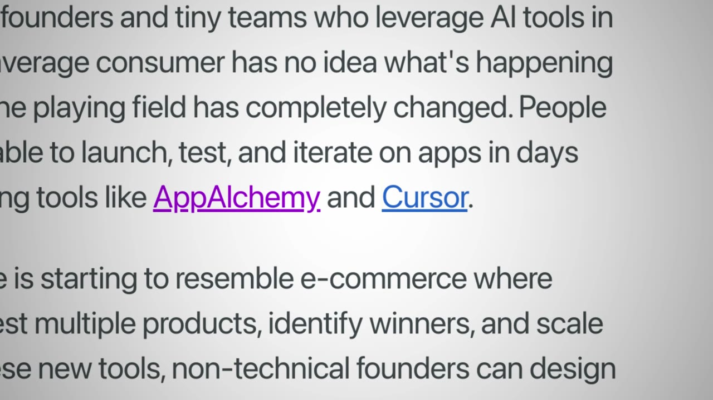
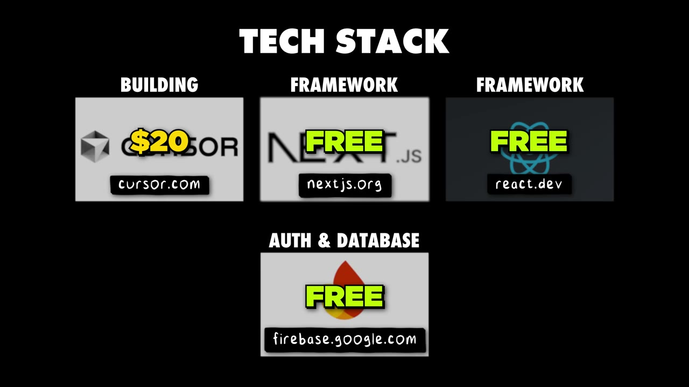

# How I Used Reddit to Hit $17K MRR (With ZERO Audience)

✅ **Đã phân tích sâu** → [`case.md`](case.md)

| | |
|---|---|
| **Video** | <https://www.youtube.com/watch?v=BaWUPamqWlA> |
| **Đăng** | 09/07/2025 |
| **Thời lượng** | 13:16 |
| **Lượt xem** | 277,469 |
| **Lượt thích** | 9,544 |
| **Video ID** | `BaWUPamqWlA` |

## Trong thư mục này

| File | Nội dung |
|---|---|
| [`case.md`](case.md) | **Phân tích đầy đủ** — ý tưởng, validate, GTM, áp dụng ở VN |
| [`meta.json`](meta.json) | Metadata gốc (chapters, heatmap, mô tả) |
| [`screenshots/`](screenshots/) | 8 ảnh 720p |

## Mô tả gốc

This is how Diego Roshardt built an AI app to $17K MRR with zero audience.
0:00 - Intro
0:54 - Who is Diego
1:12 - AppAlchemy breakdown
1:30 - Diego's ideation strategy
1:55 - How to validate an idea
2:23 - How to build fast with AI
2:50 - Build a professional website with one prompt
4:07 - Numbers behind AppAlchemy
4:26 - $17K MRR with no audience
5:26 - Reddit Marketing Playbook
10:12 - Tech Stack
10:33 - Costs & margins
10:54 - The biggest lessons learned
11:53 - "Start now"
12:26 - The final word
This video is an educational case study of one founder’s experience. It is not financial advic

## Số liệu bắt được từ transcript

> Các đoạn founder nhắc tới con số, kèm timestamp để tua thẳng tới đó trong video.

_(không bắt được con số nào)_

## Chương

- `00:00` Intro
- `00:54` Who is Diego
- `01:12` AppAlchemy breakdown
- `01:30` Diego's ideation strategy
- `01:55` How to validate an idea
- `02:23` How to build fast with AI
- `02:50` Build a professional website with one prompt
- `04:07` Numbers behind AppAlchemy
- `04:26` 17K MRR with no audience
- `05:26` Reddit Marketing Playbook
- `10:12` Tech Stack
- `10:33` Costs & margins
- `10:54` The biggest lessons learned
- `11:53` Start now
- `12:26` The final word

## Ảnh

1. `01_01m08s_usd-0.jpg` — 
2. `02_02m07s_ch-how-to-validate-an-idea.jpg` — 
3. `03_03m02s_ch-build-a-professional-website-with-one-prom.jpg` — 
4. `04_04m19s_ch-numbers-behind-appalchemy.jpg` — 
5. `05_05m38s_ch-reddit-marketing-playbook.jpg` — 
6. `06_08m25s_replay.jpg` — 
7. `07_10m32s_replay.jpg` — 
8. `08_12m05s_ch-start-now.jpg` — 

---

← [Quay lại index](../../index.md) · [Toàn bộ video](../README.md)
