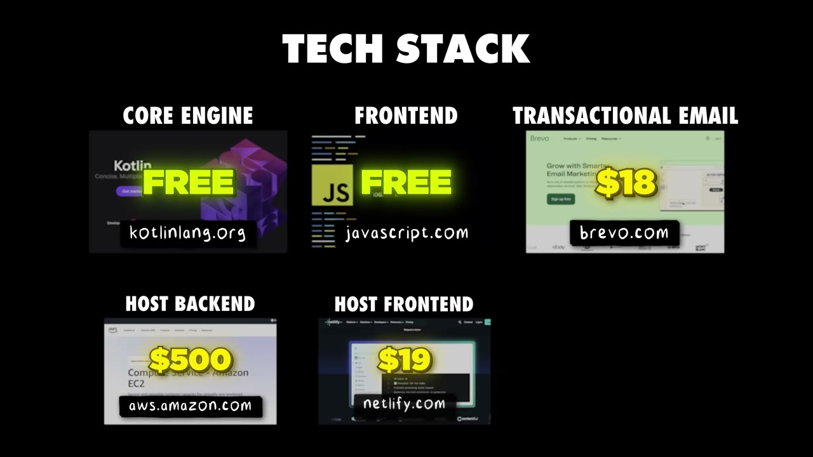
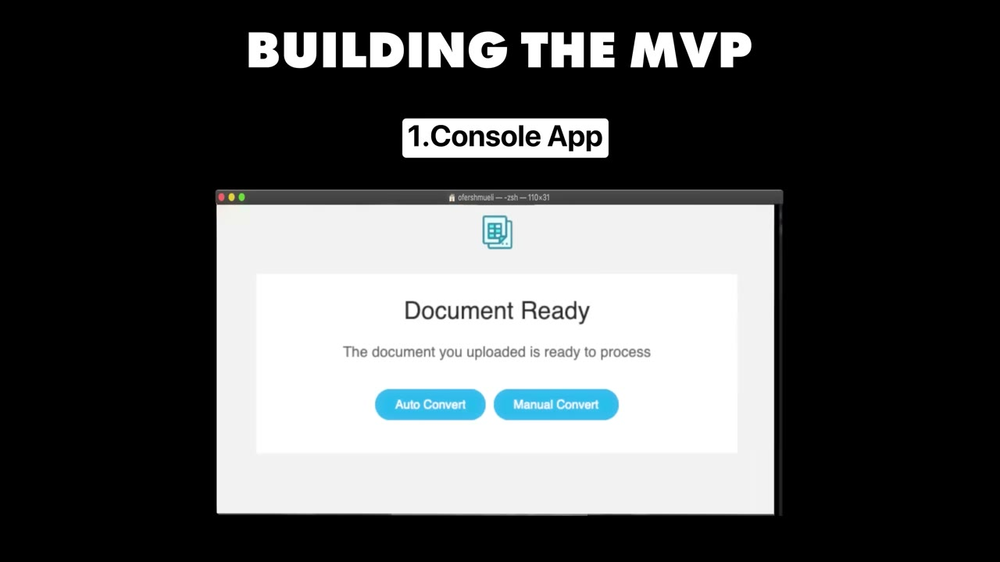
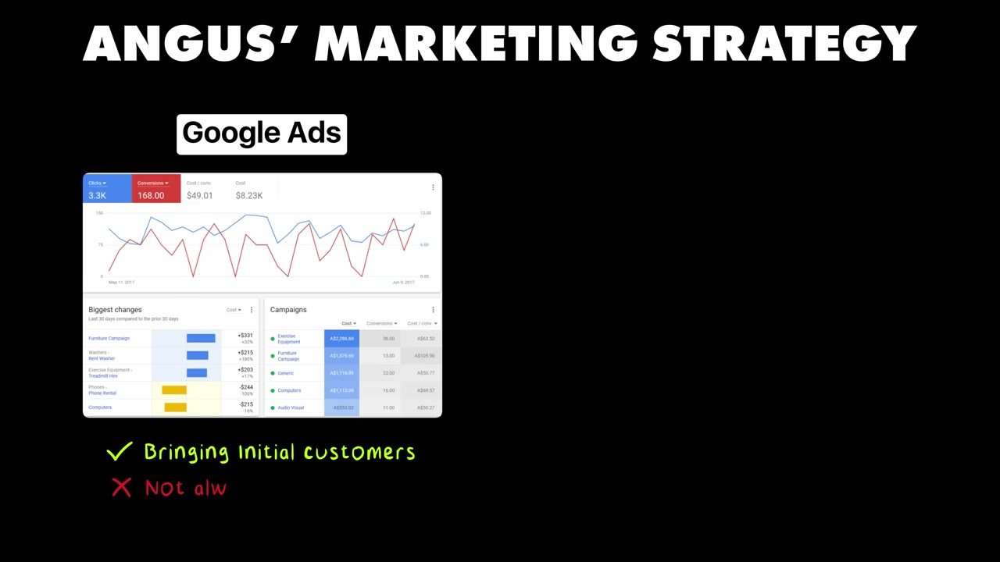
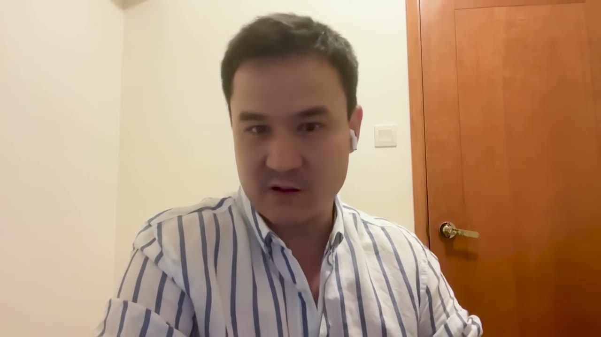
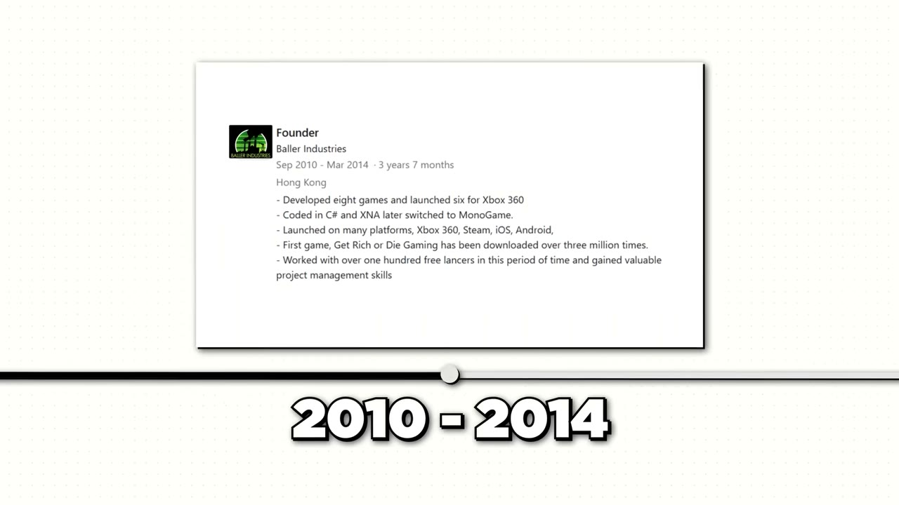

# Bank Statement Converter — $40K/tháng, lợi nhuận $39K, một người làm

> **Tóm tắt 30 giây:** Angus Cheng ở Hong Kong muốn biết mình còn sống được bao lâu với số tiền trong ngân hàng, nhưng ngân hàng chỉ đưa **sao kê PDF**. Anh viết code trích dữ liệu ra Excel, thấy việc đó khó bất thường, kết luận *"chắc đây là vấn đề thật"*. MVP một tuần, mua Google Ads, người ta upload ngay. Rồi anh phát hiện điều ngược đời: **Google Ads chưa bao giờ có lãi** — chi $1.000 thu về $300. Sau 6 tháng anh **cắt sạch quảng cáo và định bỏ luôn dự án** — nhưng lượng đăng ký organic vẫn tiếp tục đến. Bốn năm sau: **$40.000/tháng, trong đó $39.000 là lợi nhuận**, không nhân viên, không mạng xã hội.

## ⚠️ Cảnh báo trước khi đọc

- **Không có ảnh dashboard doanh thu.** Toàn bộ con số là founder tự khai, dù dòng thời gian 4 năm (6K → 14K → 27K → 40K) nhất quán và có vẻ đáng tin.
- **Mâu thuẫn số liệu trong chính video:** ở phút 5:10, người dẫn nói *"how Angus built this **$30,000** per month business"* trong khi mọi chỗ khác đều là $40.000. Nhiều khả năng đây là lỗi khi ghép đoạn quảng cáo Brex vào (đoạn đọc quảng cáo có thể được thu ở thời điểm khác). **Tôi dùng $40.000.**
- **Video có 2 đoạn quảng cáo:** Brex (ngân hàng cho startup) và Starter Story Build (khoá học của kênh). Đoạn Brex chiếm gần 1 phút trong video 10 phút.
- **Lỗi ASR:** `Angus Chang` = **Angus Cheng** (theo meta.json); `Cotlin` = **Kotlin**; `Nex.js` = **Next.js**; `Netifi`/`Netlefi` = **Netlify**; `Brevo` (đúng); `soloreneur`/`solarreneur` = **solopreneur**; `MR` = **MRR**; `Paying customers about a,000` = **khoảng 1.000 khách**; `EPS machine company` có thể là **EFTPOS** (máy thanh toán thẻ) — không chắc.
- **Thiên kiến sống sót rõ ràng:** đây là case có kết luận *"hãy bỏ qua mạng xã hội"* — lời khuyên chỉ đúng vì sản phẩm của anh có nhu cầu tìm kiếm sẵn. Xem mục 8.

## 1. Con số

| Chỉ số | Giá trị |
|---|---|
| MRR hiện tại | **$40.000/tháng** |
| Lợi nhuận | **~$39.000 trên $40.000** — *"a lot of profit"* |
| Tổng người dùng | **75.000** |
| Khách trả tiền | **~1.000** |
| Traffic | **~40.000 lượt/tháng** |
| ARPU ước tính | **~$40/khách/tháng** |
| Team | **1** |
| Vốn gọi | **$0** |

### Dòng thời gian tăng trưởng

| Năm | MRR | Tăng so với năm trước |
|---|---|---|
| 2021 | launch | — |
| 2022 | $6.000 | — |
| 2023 | $14.000 | +133% |
| 2024 | $27.000 | +93% |
| 2025 (lúc quay) | $40.000 | +48% |

**Ba phép tính đáng để bạn dừng lại:**

1. **1.000 khách trên 40.000 lượt truy cập/tháng.** Nếu phần lớn khách trả tiền còn hoạt động và traffic ổn định, tỉ lệ chuyển đổi visitor sang khách trả tiền là **cực cao so với chuẩn SaaS**. Nguyên nhân: **ý định mua gần như tuyệt đối**. Không ai gõ "chuyển sao kê PDF sang Excel" để giải trí.
2. **ARPU ~$40/tháng cho một công cụ chuyển file** là con số bất thường cao. Nó gợi ý khách chính **không phải cá nhân mà là kế toán/bookkeeper xử lý hàng loạt** — người sẵn sàng trả để tiết kiệm hàng giờ nhập liệu. Angus không nói rõ điều này trong video; đây là suy luận của tôi từ tỉ lệ số, hãy kiểm chứng lại trước khi dựa vào.
3. **75.000 người dùng nhưng chỉ 1.000 trả tiền.** Phần lớn là người dùng free dùng một lần — hoàn toàn hợp lý với mô hình freemium công cụ tiện ích.

## 2. Nguồn gốc ý tưởng — bài toán cá nhân, không phải nghiên cứu thị trường ⭐⭐

> *"Tôi vừa nghỉ việc và tôi biết mình sẽ xây một sản phẩm gì đó. Thực ra tôi đã định xây một cái khác. Nhưng bên lề, tôi nghĩ: **tôi có X tiền trong ngân hàng, tôi muốn biết mình còn sống theo cách này được bao lâu nữa.** Để làm thế tôi cần dữ liệu ngân hàng nhiều năm, tôi muốn tất cả nằm gọn trong một file Excel để tính ra mỗi tháng tôi tiêu bao nhiêu. Và việc đó **khó hơn tôi tưởng rất nhiều**, vì ngân hàng của tôi chỉ cung cấp sao kê dạng PDF. Nên tôi viết code để lôi dữ liệu giao dịch ra khỏi sao kê, và **việc đó cũng cực kỳ khó**. Vậy nên tôi kết luận: **đây chắc chắn là một vấn đề thật.**"*

**Cơ chế cần rút ra — đây là phần đáng giá nhất của case:** tín hiệu validate của Angus **không phải** là "tôi có vấn đề này". Tín hiệu là **"tôi là developer và tôi vẫn thấy việc này khó"**.

Đó là một bộ lọc rất mạnh và ít người dùng. Nếu bạn — một người biết code — mất nhiều ngày để tự giải một việc, thì với người **không** biết code, việc đó là **bất khả thi**. Khoảng cách giữa hai điều đó chính là chỗ để đặt giá.

**Bài kiểm tra bạn dùng được ngay:** hãy liệt kê những việc **bạn đã từng phải tự viết script để làm** trong 12 tháng qua. Mỗi cái đó là một ứng viên sản phẩm — và bạn đã có sẵn MVP dưới dạng script.

Sản phẩm này lại còn đến từ **việc phụ**, không phải sản phẩm anh dự định làm. Đây là điểm rất hay lặp lại trong kho: sản phẩm thắng thường là **thứ bạn xây để phục vụ chính mình trong lúc làm việc khác**.

## 3. Cách validate — chỉ một tuần, và Google Ads dùng như thuốc thử ⭐⭐⭐

> *"Tôi thích làm MVP nhanh nhất có thể, đưa lên production, rồi đưa nó tới trước mặt người dùng thật. Tôi và một người bạn làm khoảng **một tuần**. Chúng tôi mua một domain, launch nó, rồi **mua Google Ads** để có người click vào domain. Và **ngay lập tức người ta bắt đầu upload sao kê ngân hàng** — điều đó validate vấn đề."*

Đây là mô hình validate **rẻ nhất và đúng nhất** trong toàn bộ lô ba video này:

1. Build phiên bản nhỏ nhất chạy được — **1 tuần, 2 người**.
2. **Mua traffic** để có người dùng thật ngay trong tuần thứ hai.
3. Đo **hành vi thật** (có ai upload file không), không hỏi ý kiến.

Triết lý anh nói thẳng:

> *"Bạn có thể cố validate trước khi launch, nhưng **nếu MVP chỉ mất một hai tuần thì đằng nào cũng không rủi ro mấy. Vậy thì cứ build luôn đi.**"*

Và:

> *"**Đừng cho bạn bè và gia đình xem — họ sẽ chỉ nói dối bạn, và họ cũng chẳng mua sản phẩm của bạn đâu.**"*

**Ranh giới rõ ràng cho quyết định build-hay-validate-trước:** Angus đặt mốc ở **1-2 tuần**. Dưới mốc đó, chi phí để đi hỏi lớn hơn chi phí để build. Trên mốc đó, hãy validate trước. Đây khớp với ranh giới đã được ghi ở case [Once](../2026-05-10_i-built-a-20k-month-app-in-83-days/case.md) và [Marc Lou](../2026-04-26_how-i-work-77k-month-solopreneur/case.md) trong kho — **con số một tuần là con số nhất quán giữa nhiều founder độc lập**, nên nó đáng tin.

## 4. Chỗ quan trọng nhất: mọi kênh marketing đều THẤT BẠI ⭐⭐⭐

Đây là phần trung thực hiếm thấy trên kênh này. Angus liệt kê bốn kênh, ba cái thất bại:

| Kênh | Kết quả |
|---|---|
| **Google Search Ads** | *"Tốt để có người dùng ban đầu, nhưng **tôi chưa bao giờ chạy được một chiến dịch có lãi**. Tôi chi khoảng **$1.000 và mang về khoảng $300 doanh thu**. Tôi dành rất nhiều thời gian tối ưu, cố làm nó có lãi, nhưng chưa bao giờ được."* |
| **Blogging + build in public** | *"Cái đó thu hút khá nhiều sự chú ý. Tuy nhiên **tôi không nghĩ mình có nhiều người dùng từ đó**, vì người dùng của tôi có vẻ **không dùng Twitter và không đọc blog của tôi**."* |
| **Cold email** | *"**Ba tháng làm việc đó, tôi được đúng MỘT đơn hàng** — và tôi làm phiền rất nhiều người. Tôi nhận lại rất nhiều tin nhắn giận dữ."* |
| **Organic (không chủ đích)** | ✅ **Kênh duy nhất chạy được** |

Và đây là khoảnh khắc bước ngoặt:

> *"Sau khoảng **6 tháng chạy Google Search Ads, tôi quyết định thôi không làm nữa. Tôi thậm chí có thể sẽ không làm cái app này nữa.** Tôi cắt ads và tôi nghĩ chắc mình quay lại đi làm. Và điều thú vị là: **tôi ngừng trả tiền cho ads, nên tôi biết chắc mọi người click vào website đều là organic. Và tôi nhận thấy tôi vẫn có người dùng mới. Tôi có khoảng 2-3 lượt đăng ký mới mỗi ngày.** Từ đó trở đi, tôi tập trung vào cải thiện sản phẩm. Khi khách phàn nàn cái gì, tôi sửa cái đó. Tôi về cơ bản chỉ tập trung làm những gì khách hàng muốn."*

### Cơ chế — vì sao đoạn này quan trọng hơn nó có vẻ

Việc **cắt ads** đóng vai trò của một **thí nghiệm đối chứng** mà hầu hết founder không bao giờ chạy. Khi bạn đang chạy ads, bạn **không thể phân biệt** đâu là nhu cầu thật, đâu là nhu cầu bạn đang bơm tiền tạo ra. Angus vô tình có được câu trả lời sạch: **2-3 lượt đăng ký/ngày, hoàn toàn miễn phí.**

Con số 2-3/ngày nghe **nhỏ đến mức nản** — nhưng đó chính là điểm: **2-3/ngày × 365 ngày × 4 năm = nền tảng của $40K/tháng.** Tăng trưởng của case này không đến từ một cú hích nào; nó đến từ **một dòng chảy nhỏ không bao giờ tắt, cộng dồn trong 4 năm**.

**Việc bạn nên làm sau khi đọc mục này:** nếu bạn đang chạy ads, hãy **tắt trong 2 tuần** và xem còn lại gì. Con số còn lại đó mới là business thật của bạn. Nếu nó bằng 0, bạn đang thuê traffic chứ không đang xây tài sản.

## 5. Tech stack — và lợi nhuận 97,5%

| Hạng mục | Công cụ |
|---|---|
| Engine lõi | **Kotlin** (ngôn ngữ JVM) |
| Frontend | **Next.js** |
| Host frontend | **Netlify** |
| Host backend | **AWS EC2** |
| Email giao dịch | **Brevo** |
| Thanh toán | **Stripe** |

> *"Và thế thôi. Rất nhiều lợi nhuận. Kiểu như **39 trên 40 nghìn đô là lợi nhuận**."*

**Vì sao biên lợi nhuận cao khủng khiếp như vậy** — ba lý do cộng lại:

1. **Không chi quảng cáo.** Đây là lý do lớn nhất. So sánh trực tiếp với [Samuel Rondot](../2025-07-26_i-cloned-3-apps-and-now-make-35k-month/case.md) — cùng mức doanh thu, nhưng anh chi $9.000/tháng hạ tầng và **chưa tính chi phí quảng cáo**.
2. **Không nhân viên.** Angus tự làm dev, support, sales, marketing.
3. **Xử lý PDF là bài toán tính toán thuần**, không cần LLM đắt tiền, không cần lưu trữ lâu dài, không cần chạy instance liên tục cho từng khách. Đây là điểm kỹ thuật quan trọng: **case này có biên lợi nhuận cao vì bản chất kỹ thuật của nó rẻ**, không phải vì founder giỏi tiết kiệm hơn người khác.

Cách anh xây ban đầu cũng đáng chú ý: **phiên bản đầu là một console application viết bằng Kotlin chạy trên máy anh**, chỉ hoạt động với ngân hàng của chính anh. Rồi anh **tổng quát hoá dần** để chạy với các ngân hàng khác, thử với ngân hàng của bạn bè, rồi mới nhờ một người bạn làm UI bằng Next.js.

> *"Rõ ràng là tôi không biết nó có chạy với mọi sao kê ngân hàng hay không."*

→ **Không hoàn hảo cũng bán được.** Anh launch với sản phẩm chỉ đúng cho một tập ngân hàng anh biết.

## 6. Sự thật về đời solopreneur — phần trung thực nhất video ⭐⭐

Đây là đoạn hiếm thấy trên kênh này, nên tôi trích dài:

> *"Khi tôi mới bắt đầu, đó là một thay đổi lớn. Hầu hết bạn bè tôi, hầu hết những người tôi đi chơi cùng, là người ở chỗ làm. Bạn đi uống với họ. Rồi tôi chuyển sang làm cho chính mình, về cơ bản ở nhà cả ngày, không giao tiếp xã hội. **Nó là thay đổi khá lớn khi bạn đi từ chỗ kiếm khoảng $10.000/tháng xuống còn $200/tháng và bạn về cơ bản chẳng chơi với ai. Nên làm solopreneur có thể khá trầm cảm.**"*

> *"Người ta thường không thực sự hiểu bạn đang làm gì, nhất là khi bạn **đang thất bại trong việc kiếm tiền**. Tôi nhớ trong hai năm đầu người ta không hiểu tại sao tôi làm việc này, và họ nghe con số doanh thu rồi bảo tôi: **'Cái này là business dở tệ, mày không nên theo đuổi nó.'** Rồi nhiều năm sau khi nó kiếm nhiều tiền hơn, **chính những người đó nói: 'Ồ, business tuyệt vời đấy.'**"*

**Con số đắt nhất video, và nó không phải con số doanh thu:** $10.000/tháng lương → **$200/tháng**. Đó là cái giá thật. Ai nói với bạn rằng bootstrapping không đau là đang bán cho bạn thứ gì đó.

Mặt tích cực anh nêu:

- **Tự quyết lịch của mình.** *"Nhiều hôm tôi dậy và đi leo núi thay vì đi làm."*
- **Không có sếp, không có nhà đầu tư, không áp lực thời gian.** *"Là solopreneur bạn có thể đi chậm hơn một chút — tuỳ vào bạn tiết kiệm được bao nhiêu tiền."*
- **Được đi vào thị trường nhỏ hơn nhiều.** *"Một quỹ VC sẽ không muốn đầu tư vào Bank Statement Converter. Nó không kiếm đủ tiền, thị trường không đủ lớn. **Nhưng với một người thì đủ, đúng không? Và bạn có thể hoàn toàn hạnh phúc với mức doanh thu đó.**"*

Câu cuối là **định nghĩa của micro-SaaS** — thị trường quá nhỏ để đáng cạnh tranh, nhưng đủ lớn để nuôi một người rất tốt. Đây là loại thị trường mà indie hacker Việt Nam có lợi thế cấu trúc: **chi phí sống thấp hơn Mỹ nhiều lần, nên ngưỡng "đủ" của bạn thấp hơn**.

## 7. Bài học làm anh bất ngờ — độ trễ của công sức ⭐⭐

> *"Hai năm đầu tôi làm việc cực kỳ chăm chỉ mà về cơ bản không kiếm được tiền. Tôi bỏ rất nhiều giờ phát triển app. **Email khách hàng đến lúc 3 giờ sáng, tôi xử lý ngay lập tức.** Lúc đó mỗi khách hàng thêm vào đều tạo tác động lớn lên MRR. Và điều tôi nhận ra là: **hai năm làm việc vất vả đầu tiên đó, bạn không được trả bao nhiêu cả — nhưng bạn nhận tiền cho công sức đó vào khoảng năm thứ tư trở đi.**"*

**Cơ chế:** trong SaaS subscription, công sức năm 1 không sinh doanh thu năm 1 — nó sinh **base khách hàng** mà doanh thu năm 4 đứng trên. Nhìn lại dòng thời gian: 2022 là $6K, 2025 là $40K. Nếu anh bỏ cuộc năm 2022 — như anh **suýt làm** ở tháng thứ 6 — thì $34K kia không bao giờ tồn tại.

Điều này cũng lý giải tại sao lời khuyên cuối cùng của anh lại là về **tiền tiết kiệm**, chứ không về marketing.

## 8. Lời khuyên cuối — và chỗ tôi không đồng ý ⭐⭐⭐

> *"SaaS là một mô hình kinh doanh tuyệt vời. **Hãy chắc là bạn tiết kiệm đủ tiền để sống sót qua NHIỀU NĂM không thu nhập.** Nếu bạn chỉ đủ tiền cho vài tháng runway, **bạn có lẽ sẽ không trụ nổi**. Tôi mất **hai ba năm** trước khi có thể trả tiền thuê nhà bằng doanh thu."*

> *"**Bỏ qua mạng xã hội.** Rất nhiều người nghĩ họ cần xây một lượng follow trên mạng xã hội trước khi xây business. Tôi nghĩ đó là **lãng phí thời gian**. Xây follow trên mạng xã hội là việc rất vất vả. Và kể cả khi bạn có nó, business của bạn vẫn có thể không tốt. Nên hãy tập trung vào business. Tập trung vào sản phẩm. Kiếm người dùng thật. Cải thiện sản phẩm. Và **sẽ dễ kiếm thêm người dùng nếu sản phẩm của bạn giải đúng vấn đề của họ**. **Đừng làm trang Facebook, Instagram, Twitter cho business của bạn** — tôi thấy rất nhiều người làm thế và tôi nghĩ đó cũng là lãng phí thời gian."*

### Chỗ lời khuyên này ĐÚNG và chỗ nó SAI

Angus đang khái quát hoá từ **một loại sản phẩm rất đặc biệt**: một tiện ích mà người ta **chủ động gõ vào Google để tìm**. Với loại sản phẩm đó, anh hoàn toàn đúng — audience là thứ thừa thãi, và bằng chứng là chính anh thừa nhận blogging và build-in-public **không mang lại người dùng** vì *"người dùng của tôi không dùng Twitter"*.

Nhưng chính lời anh nói cũng chứa lời phản bác: **"người dùng của tôi không dùng Twitter"** là một mệnh đề về **ICP của anh**, không phải một quy luật phổ quát. Đổi ICP thì kết luận đổi.

Đối chiếu thẳng với hai case cùng lô, đăng cùng tuần:

| Quan điểm | Ai nói | Đúng khi nào |
|---|---|---|
| **Bỏ qua mạng xã hội. Đừng xây audience. Đừng làm trang Facebook/Twitter cho business** | Angus (case này) | Khách của bạn **gõ một truy vấn cụ thể vào Google rồi mua ngay**. Không cần tin bạn là ai |
| **Xây audience TRƯỚC sản phẩm, chờ một năm mới thu tiền** | [Ben Bozzay — Tech Lockdown](../2025-07-24_my-side-project-makes-15k-month-quit-my-9-5/case.md) | Vấn đề khách **ngại nói ra**, và họ phải **giao lòng tin** cho bạn trước khi trả tiền |
| **Luôn bắt đầu bằng chạy ads, đó là việc đầu tiên tôi làm** | [Samuel Rondot](../2025-07-26_i-cloned-3-apps-and-now-make-35k-month/case.md) | Sản phẩm có **LTV đủ cao** để CAC quảng cáo có lãi |
| **Ads không bao giờ có lãi, cắt sạch mới sống** | Angus (case này) | Sản phẩm **giá trị đơn hàng nhỏ, dùng ngắn hạn**, cạnh tranh trong đấu giá với cả giải pháp miễn phí |

**Bài kiểm tra một câu để biết bạn thuộc phe nào:** *Có tồn tại một câu người ta gõ vào Google, mà nếu tôi xuất hiện ở đó thì họ mua ngay không?*

- **Có** → bạn ở phe Angus. Bỏ mạng xã hội, đổ hết vào sản phẩm và SEO đáy phễu. Xem thêm [Late](../2026-03-04_zero-to-40k-month-with-one-marketing-channel-no-soci/case.md) — cùng logic, một kênh Google duy nhất.
- **Không** → bạn ở phe Ben. Bạn phải tạo ra nhu cầu, và điều đó cần nội dung, cần audience, cần thời gian.

**Còn về mâu thuẫn ads (Angus vs Samuel):** hai người đều dùng ads để **validate** và đều thành công ở bước đó. Họ chỉ khác ở câu hỏi ads có **scale** được không, và câu trả lời do **LTV** quyết định. Angus bán một tiện ích người ta dùng vài lần rồi thôi; Samuel bán subscription giữ chân nhiều tháng. **Trước khi bật ads, hãy biết khách của bạn trả tiền được bao nhiêu tháng liên tiếp.** Nếu chưa biết, đó chính là thứ $500 tiền ads đầu tiên nên đi mua — không phải doanh thu.

## 9. Nền tảng của founder — cần đọc để hiệu chỉnh kỳ vọng

Anh không phải người mới:

| Giai đoạn | Việc |
|---|---|
| 2010-2014 | Dev cho một công ty máy thanh toán (ASR đọc là *EPS machine company*, có thể là EFTPOS) |
| ...cùng thời | Tự làm indie game cho Xbox Live Indie Games, và một app "bạn gái ảo" tên **Girlfriend Plus** cho Android/iOS |
| 2017-2019 | Ngân hàng đầu tư ở Hong Kong |
| 2020 | Công ty crypto, xây sàn giao dịch |
| 2021 | Launch Bank Statement Converter |

→ **Hơn 10 năm kinh nghiệm dev, gồm cả fintech và ngân hàng, cộng với kinh nghiệm tự ship sản phẩm indie từ trước.** Bối cảnh này giải thích vì sao anh build được engine xử lý sao kê trong một tuần, và vì sao anh **có tiền tiết kiệm để sống 2-3 năm không lương** (lương ngân hàng đầu tư ở HK). Con số $10.000/tháng anh nhắc tới chính là mức lương anh bỏ lại.

**Khi so mình với case này, đừng so ở điểm xuất phát $0.** Điểm xuất phát thật của anh là: **kỹ năng cao + tiết kiệm nhiều năm + đã từng ship sản phẩm**.

Anh cũng nói một điều rất hay về sự chuyển đổi tư duy:

> *"Khi làm cho công ty, bạn tốn nhiều thời gian kiểu như chơi đùa, refactor code, thử các database bạn thấy hay ho. Nhưng khi làm cho chính mình, bạn nhanh chóng nhận ra **những thứ đó không kiếm ra tiền và có khả năng là lãng phí thời gian**. Bạn đi từ một developer quan tâm viết code đẹp sang một developer quan tâm tới **tính năng có tính kinh doanh**."*

## 10. Áp dụng cho tôi (indie hacker VN)

### Sao chép được gì

- **Bộ lọc ý tưởng mạnh nhất trong lô này:** *việc gì mà chính tôi — người biết code — vẫn phải vật lộn để tự làm?* Liệt kê mọi script bạn từng viết cho bản thân trong 12 tháng qua. Mỗi cái là một ứng viên sản phẩm **đã có sẵn MVP**.
- **Quy tắc 1 tuần:** nếu MVP dưới 1-2 tuần, đừng đi hỏi ai cả, cứ build và mua $200-300 Google Ads để lấy hành vi thật. Rẻ hơn và đúng hơn mọi cuộc phỏng vấn khách hàng.
- **Thí nghiệm cắt ads.** Nếu bạn đang chạy quảng cáo, hãy tắt 2 tuần. Phần còn lại là business thật của bạn.
- **Ngách "chán và nhỏ" là lợi thế, không phải nhược điểm.** VC không thèm, đối thủ lớn không thèm. Và ngưỡng "đủ sống" của bạn ở VN thấp hơn Angus rất nhiều — **$3.000-5.000/tháng ở VN là mức mà ở Hong Kong anh còn phải cắn răng chịu đựng**.
- **Ý tưởng phái sinh dùng được ngay:** đây là loại sản phẩm **xử lý một định dạng tài liệu địa phương**. Sao kê ngân hàng Việt Nam, hoá đơn VAT điện tử, bảng lương, sổ phụ, tờ khai thuế — mỗi định dạng là một sản phẩm riêng, và **các công cụ quốc tế đều không xử lý được định dạng Việt Nam**. Đây là hào bảo vệ tự nhiên mà người nước ngoài không có.
- **Tech stack cực rẻ.** Không cần LLM, không cần GPU. Xử lý PDF là bài toán tính toán thuần — đây là lý do biên 97,5% khả thi.

### Rào cản thật

- **Cần tiền sống nhiều NĂM, không phải nhiều tháng.** Đây là lời khuyên số một của chính founder. Anh mất 2-3 năm mới trả nổi tiền thuê nhà. Nếu bạn có 6 tháng runway, mô hình này **không dành cho bạn** — hãy làm side project theo kiểu [Ben Bozzay](../2025-07-24_my-side-project-makes-15k-month-quit-my-9-5/case.md) trong khi vẫn đi làm.
- **Trầm cảm và cô lập xã hội là rủi ro thật**, được chính founder nói ra: từ $10.000/tháng xuống $200/tháng, ở nhà cả ngày, bạn bè không hiểu bạn đang làm gì. Ở VN, áp lực gia đình về chuyện "công việc ổn định" còn nặng hơn. **Hãy lên kế hoạch cho phần này như lên kế hoạch cho runway tài chính.**
- **Dữ liệu tài chính = trách nhiệm pháp lý cao.** Bạn đang xử lý sao kê ngân hàng của người khác. Khách B2B (kế toán, công ty) sẽ hỏi về bảo mật, lưu trữ, GDPR. Nếu nhắm khách Mỹ/EU, bạn sẽ sớm gặp yêu cầu **SOC 2 (~$500/tháng cho tooling, chưa kể phí audit)** — chi phí này không có trong video vì Angus phục vụ chủ yếu khách nhỏ.
- **Phụ thuộc hoàn toàn vào Google organic.** Đây là rủi ro nền tảng bị che giấu bởi thành công: một lần cập nhật thuật toán, hoặc AI Overviews của Google trả lời thẳng câu hỏi mà không cần click, là traffic bốc hơi. Case này ra đời trước làn sóng AI search — **giả định "organic sẽ tiếp tục chảy" đang yếu đi từng tháng**.
- **Cạnh tranh AI đang tăng.** Trích xuất dữ liệu từ PDF vốn là bài toán khó (đó là moat của anh), nhưng LLM đa phương thức đang làm nó rẻ đi nhanh chóng. Moat kỹ thuật của case này **mỏng dần theo thời gian**.
- **Thanh toán quốc tế.** Stripe chưa hỗ trợ trực tiếp Việt Nam — bạn cần phương án pháp nhân nước ngoài hoặc Merchant of Record (Paddle, Lemon Squeezy), kèm chi phí và thủ tục.

### Khi nào KHÔNG dùng mô hình này

- **Khi bạn cần dòng tiền trong 12 tháng.** Đường đi ở đây là $0 → $6K sau 1 năm → $40K sau 4 năm. Nếu bạn cần tiền sớm, xem các case paid-ads hoặc mobile app.
- **Khi sản phẩm của bạn cần khách phải tin bạn trước khi mua.** Bỏ qua mạng xã hội sẽ giết bạn — xem [Tech Lockdown](../2025-07-24_my-side-project-makes-15k-month-quit-my-9-5/case.md).
- **Khi không tồn tại một truy vấn tìm kiếm dẫn thẳng tới sản phẩm của bạn.** Toàn bộ case này đứng trên một giả định duy nhất: có người đang gõ đúng câu đó vào Google mỗi ngày. Nếu không có, bạn không có kênh nào cả — và Angus đã chứng minh ads, blog, cold email đều không cứu được bạn.
- **Khi bạn không chịu nổi 2 năm làm việc mà gần như không có phản hồi tích cực nào.**

## Nguồn

- Video: <https://www.youtube.com/watch?v=EF3uyvHHBfM> (10:52, đăng 20/07/2025, 1.046.569 view)
- [Transcript đầy đủ](transcript.md) · [Ảnh chụp](screenshots/)
- Founder trên X: @BallerIndustry
