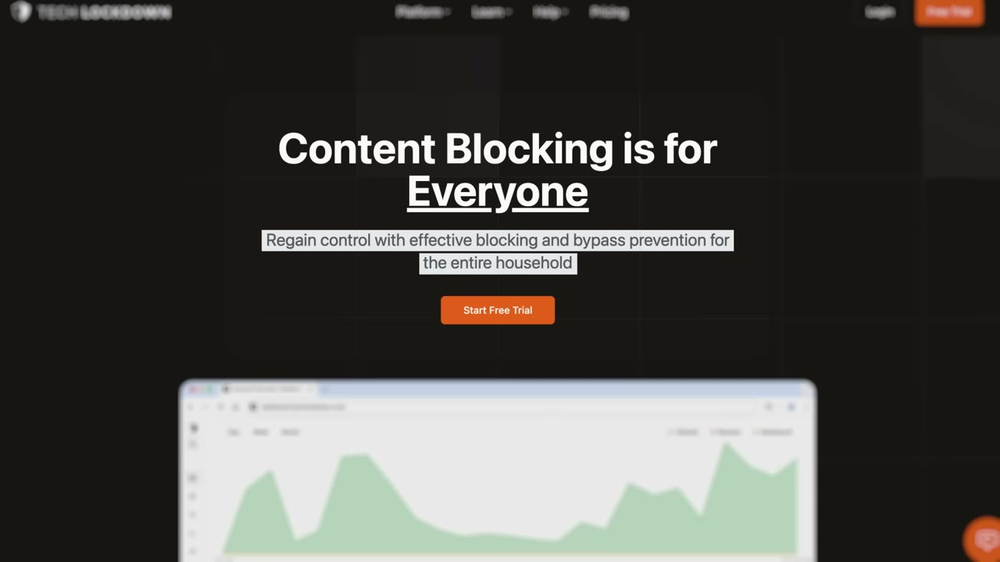
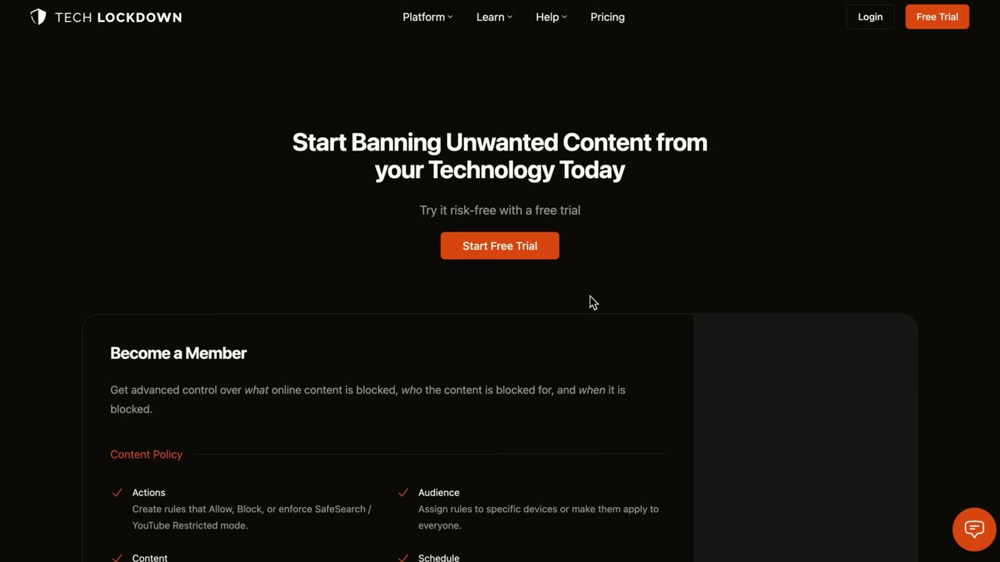
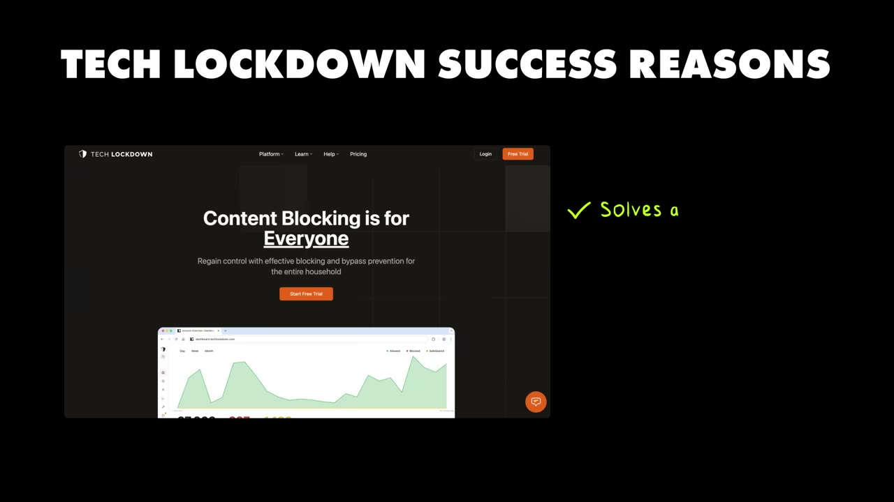
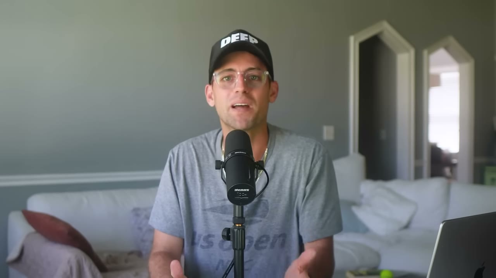
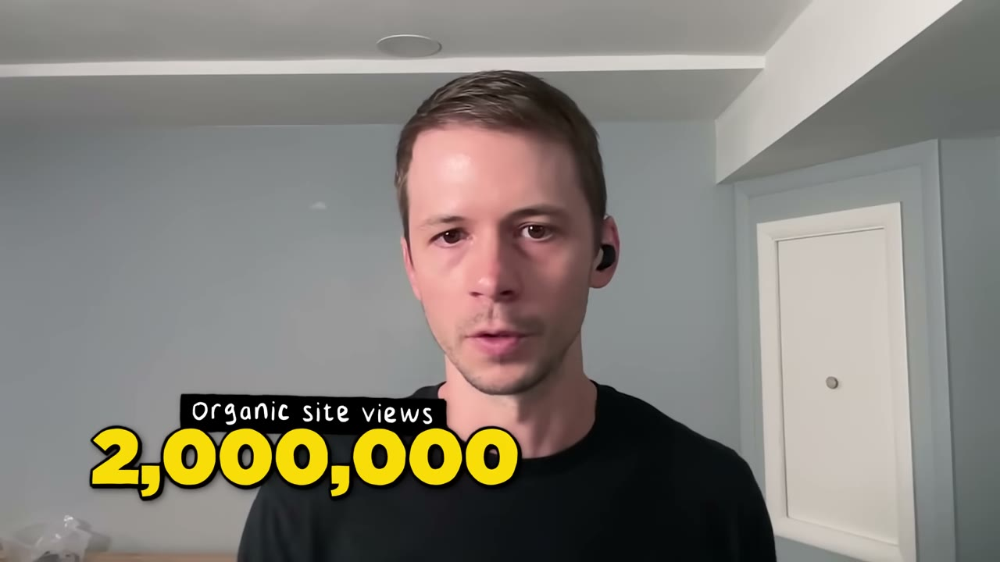
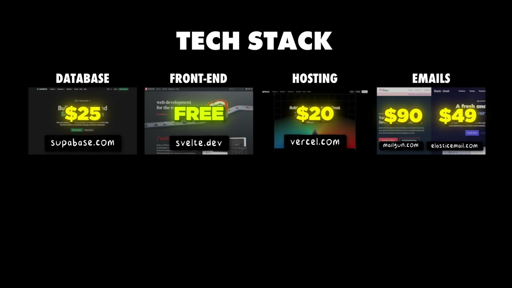

# My Side Project Makes $15K/Month (Quit My 9-5)

✅ **Đã phân tích sâu** → [`case.md`](case.md)

| | |
|---|---|
| **Video** | <https://www.youtube.com/watch?v=ZGwQoRw7mh8> |
| **Đăng** | 24/07/2025 |
| **Thời lượng** | 14:55 |
| **Lượt xem** | 103,722 |
| **Lượt thích** | 2,321 |
| **Video ID** | `ZGwQoRw7mh8` |

## Trong thư mục này

| File | Nội dung |
|---|---|
| [`case.md`](case.md) | **Phân tích đầy đủ** — ý tưởng, validate, GTM, áp dụng ở VN |
| [`meta.json`](meta.json) | Metadata gốc (chapters, heatmap, mô tả) |
| [`screenshots/`](screenshots/) | 10 ảnh 720p |

## Mô tả gốc

This is how Ben Bozzay built his side project to $15K per month and was able to never work FT again.
0:00 - Intro
0:51 - Who is Ben Bozzay
1:25 - Tech Lockdown breakdown
1:44 - Who Tech Lockdown is for
2:20 - Ben's experience with side projects
3:17 - Idea for Tech Lockdown
4:02 - Getting fired
4:46 - Why Tech Lockdown succeeded
5:29 - How to build alongside a full-time job
6:27 - How to start a side project
7:12 - Start YOUR side project using AI
8:03 - Ben's playbook for finding ideas
9:15 - Numbers behind Tech Lockdown
9:39 - Growth & marketing
11:02 - Content creation strategy
11:36 - Tech

## Số liệu bắt được từ transcript

> Các đoạn founder nhắc tới con số, kèm timestamp để tua thẳng tới đó trong video.

_(không bắt được con số nào)_

## Chương

- `00:00` Intro
- `00:51` Who is Ben Bozzay
- `01:25` Tech Lockdown breakdown
- `01:44` Who Tech Lockdown is for
- `02:20` Ben's experience with side projects
- `03:17` Idea for Tech Lockdown
- `04:02` Getting fired
- `04:46` Why Tech Lockdown succeeded
- `05:29` How to build alongside a full-time job
- `06:27` How to start a side project
- `07:12` Start YOUR side project using AI
- `08:03` Ben's playbook for finding ideas
- `09:15` Numbers behind Tech Lockdown
- `09:39` Growth & marketing
- `11:02` Content creation strategy
- `11:36` Tech stack
- `12:47` Make your side project scalable
- `13:20` Don't overcomplicate things
- `14:02` The final word

## Ảnh

1. `01_01m06s_replay.jpg` — 
2. `02_02m00s_usd-15-m.jpg` — 
3. `03_03m29s_ch-idea-for-tech-lockdown.jpg` — 
4. `04_04m18s_usd-3-000.jpg` — 
5. `05_04m58s_ch-why-tech-lockdown-succeeded.jpg` — 
6. `06_05m41s_ch-how-to-build-alongside-a-full-time-job.jpg` — 
7. `07_06m39s_ch-how-to-start-a-side-project.jpg` — 
8. `08_07m24s_ch-start-your-side-project-using-ai.jpg` — 
9. `09_09m28s_metric.jpg` — 
10. `10_12m19s_usd-150.jpg` — 

---

← [Quay lại index](../../index.md) · [Toàn bộ video](../README.md)
