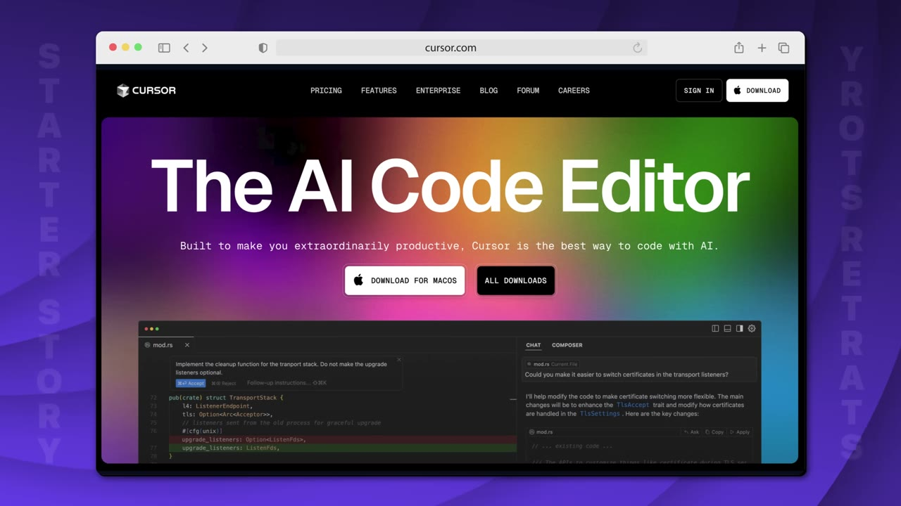
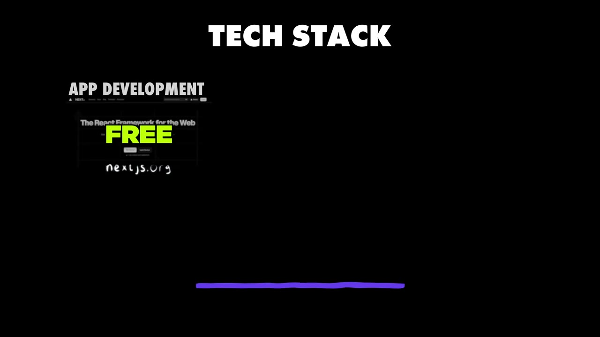

# I cloned 3 apps and now make $35K/month

✅ **Đã phân tích sâu** → [`case.md`](case.md)

| | |
|---|---|
| **Video** | <https://www.youtube.com/watch?v=8BtHk-oNlN0> |
| **Đăng** | 26/07/2025 |
| **Thời lượng** | 13:38 |
| **Lượt xem** | 1,043,597 |
| **Lượt thích** | 31,586 |
| **Video ID** | `8BtHk-oNlN0` |

## Trong thư mục này

| File | Nội dung |
|---|---|
| [`case.md`](case.md) | **Phân tích đầy đủ** — ý tưởng, validate, GTM, áp dụng ở VN |
| [`meta.json`](meta.json) | Metadata gốc (chapters, heatmap, mô tả) |
| [`screenshots/`](screenshots/) | 10 ảnh 720p |

## Mô tả gốc

This is how Samuel Rondot built 3 apps that are making a total $35K per month, by copying already successful projects.
0:00 - Intro
0:53 - Who is Samuel Rondot
1:11 - How Samuel taught himself coding
1:58 - Framework for learning coding
2:43 - Samuel's ideation strategy
3:45 - Validating an idea
5:11 - How Samuel copied his apps
6:26 - Discover real-world design inspiration
7:28 - Samuel's businesses breakdown
8:02 - Marketing strategy
9:49 - Tech stack
10:29 - Costs & margins
11:02 - You don't need to innovate
11:34 - How to start building apps
12:55 - Turn your idea into a real-world app

## Số liệu bắt được từ transcript

> Các đoạn founder nhắc tới con số, kèm timestamp để tua thẳng tới đó trong video.

_(không bắt được con số nào)_

## Chương

- `00:00` Intro
- `00:53` Who is Samuel Rondot
- `01:11` How Samuel taught himself coding
- `01:58` Framework for learning coding
- `02:43` Samuel's ideation strategy
- `03:45` Validating an idea
- `05:11` How Samuel copied his apps
- `06:26` Discover real-world design inspiration
- `07:28` Samuel's businesses breakdown
- `08:02` Marketing strategy
- `09:49` Tech stack
- `10:29` Costs & margins
- `11:02` You don't need to innovate
- `11:34` How to start building apps
- `12:55` Turn your idea into a real-world app

## Ảnh

1. `01_01m08s_usd-35-000.jpg` — 
2. `02_02m10s_ch-framework-for-learning-coding.jpg` — 
3. `03_02m55s_ch-samuel-s-ideation-strategy.jpg` — 
4. `04_03m57s_ch-validating-an-idea.jpg` — 
5. `05_05m23s_ch-how-samuel-copied-his-apps.jpg` — 
6. `06_06m29s_usd-34-000.jpg` — 
7. `07_07m47s_usd-20-000.jpg` — 
8. `08_10m01s_ch-tech-stack.jpg` — 
9. `09_10m42s_usd-4-000.jpg` — 
10. `10_11m46s_ch-how-to-start-building-apps.jpg` — 

---

← [Quay lại index](../../index.md) · [Toàn bộ video](../README.md)
