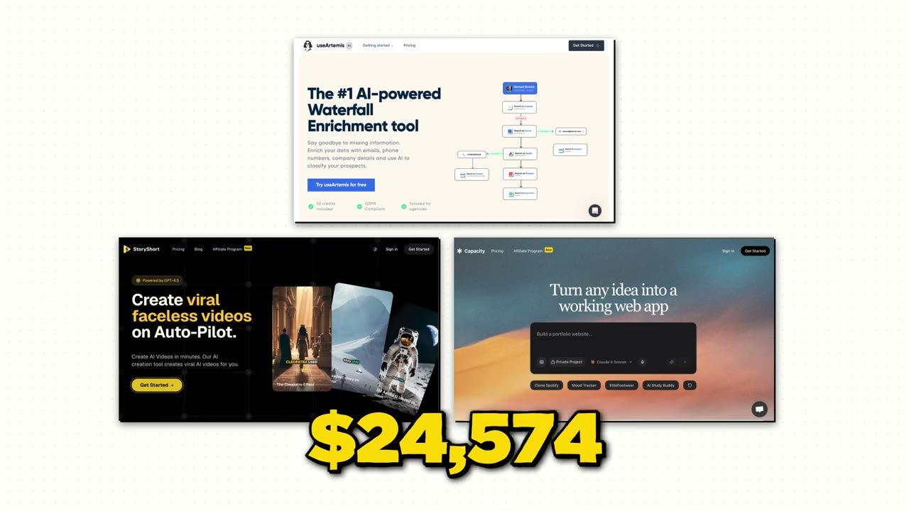
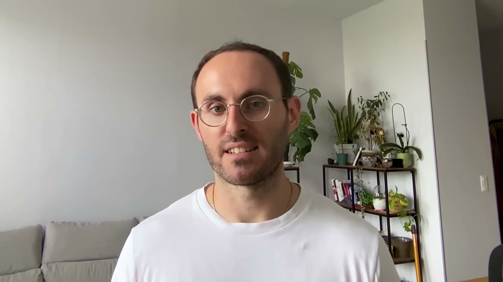
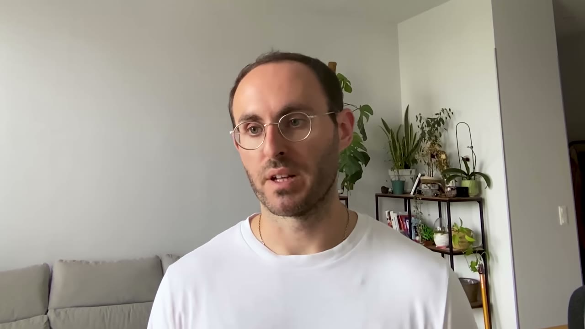
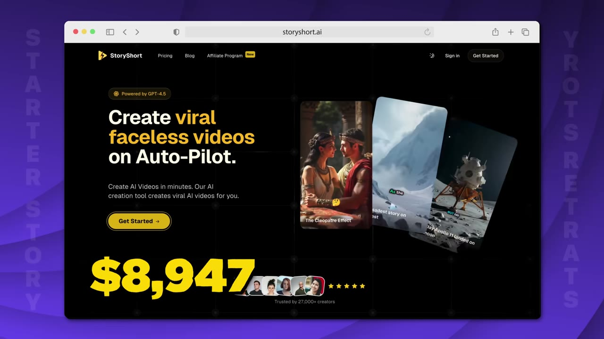
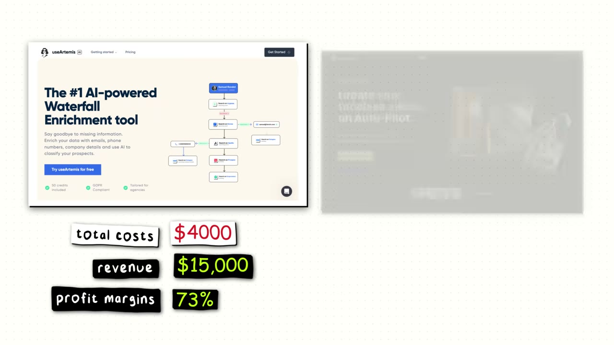
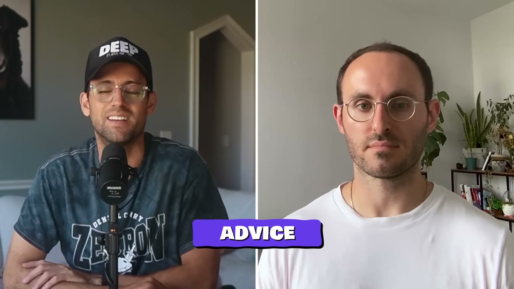

# UseArtemis + StoryShort AI + Capacity.so — $35K/tháng từ chiến lược clone có kỷ luật

> **Tóm tắt 30 giây:** Samuel Rondot từng là **optician** (thợ đo mắt), tự học code bằng một khoá YouTube 15 tiếng, và giờ chạy 3 SaaS thu ~$35K/tháng. Quy tắc của anh: **không bao giờ xây thứ chưa tồn tại và chưa thành công**. Nhưng điều đắt nhất không phải là "clone" — mà là **bộ lọc để chọn clone cái nào**: anh dùng Ahrefs soi nguồn traffic của đối thủ, và chỉ nhảy vào khi traffic đó **mua được bằng tiền**. Sản phẩm $20K/tháng của anh được chọn đúng vì lý do đó: *"toàn bộ traffic đến từ Facebook ads, nghĩa là tôi có thể sao chép nó trong đúng một tuần."*

## ⚠️ Cảnh báo trước khi đọc

- **Không có ảnh dashboard doanh thu.** Toàn bộ con số là founder tự khai. Kho này có nhiều case có ảnh Stripe/RevenueCat thật — case này thì không.
- **Video có 2 đoạn quảng cáo** (Mobin — thư viện thiết kế app, và Starter Story Build — khoá học của chính kênh) chiếm khoảng 1/8 thời lượng. Chốt video là lời mời mua khoá học. Kênh Starter Story đã được HubSpot mua lại và bán khoá học, nên hãy đọc phần "ai cũng làm được" với con mắt hoài nghi.
- **Tên sản phẩm bị ASR đọc sai nặng.** Phụ đề tự động đọc thành `usimus`, `us.com`, `Artimis` cho cùng một sản phẩm — gần như chắc chắn là **UseArtemis**; `storyshow.ai`, `story shorti` = **StoryShort AI**; `href` = **Ahrefs**; `JPT`/`Chad GPT` = **ChatGPT**; `Nexjs` = **Next.js**; `Versel` = **Vercel**; `Cotlin`... (không có ở video này). Meta.json không liệt kê tên sản phẩm nên tôi **không xác nhận được 100%** tên UseArtemis — hãy kiểm tra lại qua X.com/samuelrdt trước khi trích dẫn.
- **Con số mâu thuẫn:** Pat nói "$34,000 per month" ở phút 6:24 trong khi tổng ba sản phẩm founder nêu là $35.900. Tôi dùng $35K.

## 1. Con số

| Chỉ số | Giá trị |
|---|---|
| Tổng doanh thu | ~$35K/tháng (15K + 20K + 0.9K) |
| UseArtemis (LinkedIn scraping) | ~$15.000/tháng, ~10.000 khách |
| StoryShort AI (AI video generator) | ~$20.000/tháng, ~4.000 khách |
| Capacity.so (AI coding tool, mới) | ~$900/tháng, ~50 người dùng |
| Chi phí UseArtemis | ~$4.000/tháng |
| Chi phí StoryShort | ~$5.000/tháng |
| Thời gian build MVP | 2 tuần |
| Số người trong team | 1 |

**ARPU đáng chú ý:** UseArtemis $15K / 10.000 khách = **~$1,5/khách/tháng**. StoryShort $20K / 4.000 khách = **~$5/khách/tháng**. Đây là những con số ARPU **rất thấp** — nghĩa là mô hình này sống bằng **khối lượng**, không phải bằng giá. Hoặc "customers" ở đây là tổng khách từng đăng ký chứ không phải subscription đang hoạt động (founder không nói rõ). Cả hai cách hiểu đều dẫn tới cùng kết luận: **đây là mô hình cần máy bơm traffic chạy liên tục**, không phải mô hình LTV cao.

## 2. Bộ lọc 4 tiêu chí để chọn cái gì đáng clone ⭐⭐

> *"Tôi là người hơi lười và tôi không có năng lượng vô hạn. Nên tôi có một quy tắc cực kỳ quan trọng: **không bao giờ xây thứ chưa tồn tại và chưa thành công, hoặc ít nhất chưa có traction.** Như vậy tôi giảm xác suất thất bại và tăng xác suất thành công."*

Nguồn ý tưởng số 1 của anh: **Twitter/X**, đặc biệt các cộng đồng solopreneur và build-in-public.

Bốn bộ lọc:

1. **Tôi sẽ tự dùng nó.**
2. **Tôi thấy được là nó đang chạy được rồi** (có traction).
3. **Họ KHÔNG đốt hàng nghìn đô marketing** → chứng tỏ có nhu cầu thật, không phải nhu cầu do quảng cáo bơm ra.
4. **Sản phẩm đủ đơn giản để duy trì.**

Tiêu chí 3 là tiêu chí tinh tế nhất và hay bị bỏ qua: nếu đối thủ phải chi cực nhiều mới bán được, bạn clone về cũng sẽ phải chi cực nhiều — và bạn không có tiền như họ.

## 3. Cách anh đọc "có validate hay chưa" — 4 bước cụ thể ⭐⭐⭐

Đây là phần hành động được ngay hôm nay:

**Bước 1 — Tìm traction.** Tín hiệu tốt nhất trên Twitter là khi founder **khoe ảnh MRR hoặc ảnh Stripe**. Nghe cơ bản nhưng đó là bằng chứng cuối cùng rằng có người trả tiền.

**Bước 2 — Soi nguồn traffic bằng Ahrefs.** Câu hỏi: họ lấy khách **chỉ từ ads**, hay còn **rank SEO**?
- **Cả ads lẫn SEO** → tín hiệu rất tốt: nhu cầu mạnh và thường **dễ sao chép** hơn.
- **Chủ yếu SEO** → khó hơn, vì SEO cần thời gian. Vẫn làm được nếu bạn kiên nhẫn.

**Bước 3 — Tự hỏi mình build và duy trì nổi không.** *"Tôi không muốn xây một sản phẩm khiến tôi mất ngủ vì phải bảo trì cái backend phức tạp."*

**Bước 4 — Tự hỏi mình có thích sản phẩm đó không.** *"Không gì tệ hơn làm việc trên một sản phẩm mình không quan tâm."*

## 4. Cơ chế thật sự đằng sau case này ⭐⭐⭐

Đây là câu quan trọng nhất cả video, và nó bị chôn giữa đoạn kể chuyện:

> *"Điều thực sự tốt ở cái này là **toàn bộ traffic đến từ Facebook ads, nghĩa là tôi có thể sao chép nó theo đúng nghĩa đen trong một tuần** — vì với Facebook ads bạn chỉ cần bật lên là có traffic."*

**Cơ chế:** clone sản phẩm là chuyện dễ. Clone **kênh phân phối** mới là chuyện khó. Vậy nên bài toán chọn ý tưởng của Samuel thực chất là bài toán **phân loại kênh của đối thủ**:

| Kênh của đối thủ | Thời gian bạn cần để sao chép | Rào cản |
|---|---|---|
| Facebook / Google Ads | **~1 tuần** | Tiền. Chỉ cần tiền. |
| SEO / content | **12-24 tháng** | Thời gian + domain authority |
| Audience cá nhân, cộng đồng | **Nhiều năm hoặc không bao giờ** | Không mua được |
| Tích hợp / marketplace / partnership | Tuỳ | Quan hệ |

Nói cách khác: **Samuel không clone sản phẩm — anh clone những sản phẩm mà lợi thế duy nhất của đối thủ là ngân sách quảng cáo.** Đó là loại lợi thế mỏng nhất trên đời.

Ngược lại, đây cũng là lời cảnh báo cho chính bạn: nếu doanh nghiệp của bạn chỉ sống nhờ paid ads, **bạn cũng đang mời người khác clone mình trong một tuần**.

## 5. Sai lầm đầu tiên: chính anh cũng từng làm ngược quy tắc

Sản phẩm thật đầu tiên của anh (UseArtemis) được xây **trước khi** anh có chiến lược này — và anh gọi đó là sai lầm:

> *"Tôi xây một công cụ tìm email mà đối thủ là những cái tên lớn như Apollo, Lemlist... và nó cực kỳ khó bảo trì."*

Bài học anh rút ra và áp dụng cho sản phẩm thứ hai: **chọn thứ dễ bảo trì**. Đây là ràng buộc kỹ thuật, không phải ràng buộc thị trường — và nó là ràng buộc mà solo founder hay đánh giá thấp nhất. Một sản phẩm scraping/automation phải chạy hàng loạt instance sẽ ăn cả thời gian lẫn tiền của bạn (xem mục 7: UseArtemis đốt $4K/tháng chi phí hạ tầng).

Trớ trêu: sản phẩm "sai quy tắc" đó vẫn đang thu $15K/tháng. Nên đọc mục này như **chi phí cơ hội**, không phải như thất bại.

## 6. Growth stack — 4 tầng, theo đúng thứ tự ⭐⭐

> *"Tôi luôn bắt đầu bằng chạy ads. Đó luôn là việc đầu tiên tôi làm."*

**Tầng 1 — Ads (Google hoặc Meta, tuỳ sản phẩm).** Mục đích **không phải** là kênh tăng trưởng vĩnh viễn mà là **cách nhanh nhất để test thị trường**. Sản phẩm nào hợp Google, sản phẩm nào hợp Meta — anh thử cả hai.

**Tầng 2 — SEO, ngay khi có traction.** *"Quá nhiều app chỉ dựa vào ads và chưa từng có một khách nào từ Google."* SEO chậm nhưng khi chạy được thì gần như **traffic miễn phí và nó cộng dồn**. Anh dùng [Outrank.so](../2025-12-07_i-built-4-saas-apps-to-100k-mrr-heres-my-exact-playb/case.md) để tự động viết và đăng bài blog (trước đó dùng một công cụ SEO khác, ASR không đọc rõ tên).

**Tầng 3 — Kênh YouTube faceless tự động.** Đây là chỗ StoryShort tự ăn chính nó: anh **xây luôn tính năng này vào sản phẩm**. StoryShort tự đăng video UGC-style hằng ngày về sản phẩm của bạn lên YouTube, TikTok, Instagram. Bạn có thể tạo nhiều kênh cùng nói về sản phẩm mỗi ngày, chạy autopilot.

**Tầng 4 — Affiliate.** Lý do anh nhấn mạnh không chỉ là chi phí cố định trên mỗi khách:

> *"Nó còn tạo virality, vì có rất nhiều người làm video YouTube về StoryShort, viết bài về nó... Người ta dễ chia sẻ sản phẩm của bạn hơn khi họ được ăn hoa hồng."*

## 7. Chi phí và biên lợi nhuận — chỗ cần đọc kỹ

| Sản phẩm | Doanh thu | Chi phí |
|---|---|---|
| UseArtemis | ~$15.000 | ~$4.000/tháng |
| StoryShort | ~$20.000 | ~$5.000/tháng |
| Capacity.so | ~$900 | chưa rõ, anh nói *"sẽ khá đắt"* vì mỗi lần deploy website là phải chạy instance |

Anh giải thích vì sao UseArtemis đắt hơn tương đối: *"vì Artemis bạn phải chạy instance để tự động hoá rất nhiều thứ."*

**Nghi vấn của tôi:** $9.000 chi phí trên $35.900 doanh thu = biên ~75%. Nhưng anh nói rõ ở mục growth rằng **anh luôn bắt đầu bằng ads và dùng affiliate cho cả ba sản phẩm**. Nếu $9.000 kia chỉ là hạ tầng, thì **chi phí quảng cáo và hoa hồng affiliate chưa được tính vào**. Với mô hình ARPU $1,5-$5/tháng và kênh chính là paid ads, chi phí acquisition rất có thể là khoản lớn nhất — và nó vắng mặt trong video. **Đừng lấy con số 75% này làm kế hoạch tài chính.**

Đối chiếu: [Bank Statement Converter](../2025-07-20_i-make-40k-month-with-this-one-website/case.md) công bố $39K lợi nhuận trên $40K doanh thu — vì founder đã **cắt bỏ hoàn toàn quảng cáo**. Hai case này là hai đầu đối lập của cùng một trục.

## 8. Tech stack

| Hạng mục | Công cụ |
|---|---|
| Code | Next.js + Node.js |
| Deploy | Vercel |
| Thanh toán | Stripe |
| Phân tích SEO | Ahrefs |
| Viết bài SEO tự động | Outrank.so |
| Trợ lý code | ChatGPT |

Framework tự học code của anh (dành cho người bắt đầu từ 0):

1. **Chọn một dự án thật** (không phải bài tập).
2. **Hỏi ChatGPT xem cần học gì để build nó.** Ví dụ cụ thể anh đưa: chụp màn hình một trang bạn thích trên Google hoặc Twitter, đưa cho ChatGPT và hỏi *"làm sao build được riêng cái landing page này trước đã?"*
3. **Build từng bước, gặp chỗ bí thì hỏi ChatGPT.** Yêu cầu nó dùng công nghệ hiện đại (Next.js, Node.js).

> *"Nếu bạn chỉ xem một khoá học thì thường không đủ, vì bạn sẽ lạc trong những ngôn ngữ mà có lẽ bạn chẳng bao giờ dùng tới, và bạn không thực sự thấy vì sao mình lại học cái mình đang học."*

Anh nói thẳng: *"Nếu giờ tôi 18 tuổi, tôi không nghĩ mình sẽ học code theo cách truyền thống. Tôi sẽ chỉ dùng AI coding tools. Với AI ngày nay, bạn build được **90%** của hầu hết các app."*

## 9. Mâu thuẫn với các founder khác — và điều kiện phân định ⭐⭐⭐

Case này va thẳng vào hai case cùng lô (đăng cùng tuần) và nhiều case khác trong kho:

| Quan điểm | Ai nói | Đúng khi nào |
|---|---|---|
| **Luôn bắt đầu bằng chạy ads** — cách nhanh nhất validate | Samuel (case này) | Sản phẩm có audience rộng, mua theo cảm hứng, và **bạn có $1-3K để đốt**. Ads ở đây là chi phí NGHIÊN CỨU, không phải kênh tăng trưởng |
| **Ads không bao giờ có lãi** — $1.000 chi ra đổi $300 doanh thu, cắt sạch mới sống | [Angus Cheng — Bank Statement Converter](../2025-07-20_i-make-40k-month-with-this-one-website/case.md) | Sản phẩm là **tiện ích giá thấp**, giá trị đơn hàng nhỏ, và có sẵn giải pháp miễn phí trong đấu giá từ khoá → CAC vượt LTV |
| **Không cần innovate, cứ clone** | Samuel (case này) | Lợi thế duy nhất của đối thủ là ngân sách ads |
| **Phải là thứ bạn thật sự đam mê, sẵn sàng làm không công** | [Ben Bozzay — Tech Lockdown](../2025-07-24_my-side-project-makes-15k-month-quit-my-9-5/case.md) | Bạn làm **side project song song việc full-time** → nhiên liệu duy nhất giữ bạn dậy lúc 5h30 là hứng thú, không phải bảng tính |
| **Bản địa hoá một app đã thắng ở Mỹ về thị trường nội địa** | [CalBuddy](../2026-08-09_i-copied-a-huge-app-now-i-make-80k-month/case.md) | Đây là phiên bản **có hào bảo vệ** của chiến lược clone — ngôn ngữ và văn hoá là rào cản mà bản gốc lười vượt |

**Cách tôi hoà giải Samuel vs Angus (mâu thuẫn về ads):** cả hai đều đúng ở giai đoạn khác nhau. Angus **cũng dùng Google Ads để validate** và nó **có tác dụng** (*"ngay lập tức người ta bắt đầu upload sao kê ngân hàng, điều đó validate vấn đề"*). Cả hai đồng ý: **ads = công cụ validate rẻ và nhanh**. Chỗ họ khác nhau là **ads có scale được thành kênh tăng trưởng hay không** — và câu trả lời phụ thuộc vào một con số duy nhất: **LTV**. Với sản phẩm subscription giữ chân được nhiều tháng (StoryShort), CAC $30 là ổn. Với công cụ chuyển file người ta dùng một lần rồi biến (Bank Statement Converter), CAC $30 là tự sát.

**Câu hỏi bạn phải trả lời trước khi bật ads:** khách của tôi sẽ trả tiền **bao nhiêu tháng liên tiếp**? Nếu bạn chưa biết, đốt $500 để tìm ra là hợp lý; đốt $5.000 thì không.

**Cách tôi hoà giải Samuel vs Ben (clone vs đam mê):** hai người này làm trong hai chế độ hoàn toàn khác. Samuel làm **full-time, danh mục nhiều sản phẩm** — với anh sản phẩm là tài sản có thể thay thế, và "thích sản phẩm" chỉ là bộ lọc thứ tư trong bốn bộ lọc. Ben làm **buổi sáng 5h30 trước khi đi làm** — với anh đam mê không phải là thứ xa xỉ, nó là **nguồn năng lượng duy nhất**. Nếu bạn đang có việc full-time ở VN, **mô hình của Ben mới là mô hình của bạn**, không phải của Samuel.

## 10. Lời khuyên cuối của founder

Nếu quay lại nói chuyện với chính mình hồi còn làm optician:

1. **Dùng AI coding tools** (hồi đó chưa có).
2. **Dành thời gian học Google Ads và Meta Ads** — thậm chí cả X Ads.
3. **Ra mắt sớm nhất có thể.** *"Bỏ qua những phần chán của việc xây SaaS như trang reset mật khẩu, trang settings. Cứ launch sản phẩm tối thiểu và chạy ads để test nhu cầu ngay."*
4. **Có traction rồi mới tập trung SEO.** Anh thêm một lý do ít người nói: *"Kể cả một ngày nào đó bạn muốn bán công cụ, có traffic SEO cũng rất có giá trị."* → SEO là thứ làm **tăng giá bán** khi exit, không chỉ là kênh marketing.
5. **Tự động hoá tối đa** (Outrank cho bài viết, StoryShort cho đăng video).
6. **Có khách đều hằng ngày rồi mới hoàn thiện sản phẩm**, thêm tính năng.

> *"Điều làm tôi bất ngờ là **bạn không cần phải innovate**. Bạn chỉ cần nhìn xem cái gì đang chạy trên X, trong các cộng đồng, trên forum, rồi xây phiên bản thay thế của riêng bạn. Nếu bạn thích sản phẩm đó và thấy nó chạy được, cứ clone ý tưởng, build MVP trong hai tuần và chạy ads ngay. Tôi nghĩ người ta luôn làm phức tạp hoá — nhưng **công cụ đơn giản và chán mới là thứ kiếm được nhiều tiền nhất.**"*

## 11. Áp dụng cho tôi (indie hacker VN)

### Sao chép được gì

- **Bộ lọc Ahrefs là thứ dùng được ngay tuần này.** Lập danh sách 20 sản phẩm nhỏ bạn thấy khoe MRR trên X. Với mỗi cái, cắm domain vào Ahrefs (bản free/trial cũng xem được cơ cấu traffic sơ bộ). Đánh dấu cái nào **traffic chủ yếu là paid** — đó là danh sách săn của bạn. Đây là công việc nghiên cứu 3 tiếng, không tốn code.
- **Quy tắc "đủ đơn giản để duy trì" nên viết ra giấy dán lên màn hình.** Solo founder VN không có đội DevOps. Sản phẩm cần chạy hàng loạt instance (scraping, render video, deploy website) sẽ ăn cả tiền lẫn giấc ngủ của bạn — chính Samuel trả $4-5K/tháng cho chuyện này.
- **Framework tự học code của anh áp dụng thẳng được:** chọn dự án thật → hỏi ChatGPT cần học gì → build từng bước. Anh từ **thợ đo mắt, 0 kinh nghiệm code**, đi lên bằng một khoá YouTube 15 tiếng cộng việc áp dụng ngay từng thứ vừa học.
- **Affiliate là kênh rẻ nhất trong bộ bốn của anh** và ít người Việt dùng. Nó là chi phí biến đổi (chỉ trả khi có khách), khác hẳn ads là chi phí cố định trả trước.

### Rào cản thật

- **Cần vốn quảng cáo bằng USD, trả trước.** Playbook này bắt đầu bằng "chạy ads". Với ARPU $1,5-5/tháng, bạn cần bơm liên tục và **hoà vốn sau nhiều tháng**, không phải sau vài tuần. Ngân sách test tối thiểu thực tế: **$1.000-3.000** mà bạn phải chấp nhận mất trắng. Đây là rào cản lớn nhất của case này với người Việt.
- **Thẻ tín dụng quốc tế và tài khoản quảng cáo.** Meta/Google Ads cho tài khoản Việt Nam hay bị khoá vì lý do vô lý; sản phẩm scraping/AI-video còn dễ bị từ chối chính sách quảng cáo hơn nữa. Hãy tính trước phương án tài khoản dự phòng.
- **Rủi ro nền tảng cao ở cả 3 sản phẩm.** UseArtemis scrape LinkedIn — LinkedIn kiện và chặn scraper là chuyện thường xuyên. StoryShort đăng tự động lên YouTube/TikTok — các nền tảng này đang siết nội dung AI hàng loạt. Đây không phải rủi ro lý thuyết mà là rủi ro **có thể xoá sổ doanh thu trong một tuần**.
- **Bạn phải thi đấu bằng tiếng Anh, ở thị trường Mỹ/EU.** Không có phiên bản tiếng Việt cho ba sản phẩm này — thị trường VN quá nhỏ và ARPU quá thấp cho mô hình khối lượng.
- **Rủi ro pháp lý và đạo đức của việc clone.** Clone ý tưởng thì hợp pháp; clone giao diện, copy văn bản, copy tên thì không. Ranh giới mỏng hơn video này mô tả.

### Khi nào KHÔNG dùng mô hình này

- **Khi bạn còn đang đi làm full-time.** Playbook này giả định bạn có thời gian ban ngày để canh dashboard quảng cáo và xoay vòng sản phẩm nhanh. Nếu bạn build lúc 5h30 sáng, hãy đọc [Tech Lockdown](../2025-07-24_my-side-project-makes-15k-month-quit-my-9-5/case.md) thay vì case này.
- **Khi sản phẩm của bạn là công cụ dùng một lần** (chuyển file, tính toán, tra cứu). LTV quá thấp để ads có lãi — xem [Bank Statement Converter](../2025-07-20_i-make-40k-month-with-this-one-website/case.md) đã mất 6 tháng và một khoản tiền để học bài đó.
- **Khi đối thủ bạn định clone sống nhờ SEO, cộng đồng hoặc thương hiệu cá nhân.** Bạn sẽ clone được sản phẩm nhưng không clone được khách. Đó là trường hợp của [Savvy Nomad](../2026-05-21_i-make-1-7m-year-in-the-most-boring-niche-imaginable/case.md) hay [SiteGPT](../2026-01-07_how-i-grew-my-app-to-13k-month-even-though-i-hate-ma/case.md).
- **Khi bạn không có tiền dự phòng sống được 12 tháng.** Anh nghỉ việc rồi mới làm — video không nói anh sống bằng gì trong giai đoạn đó.

## Nguồn

- Video: <https://www.youtube.com/watch?v=8BtHk-oNlN0> (13:38, đăng 26/07/2025, 1.043.597 view)
- [Transcript đầy đủ](transcript.md) · [Ảnh chụp](screenshots/)
- Founder trên X: @samuelrdt
