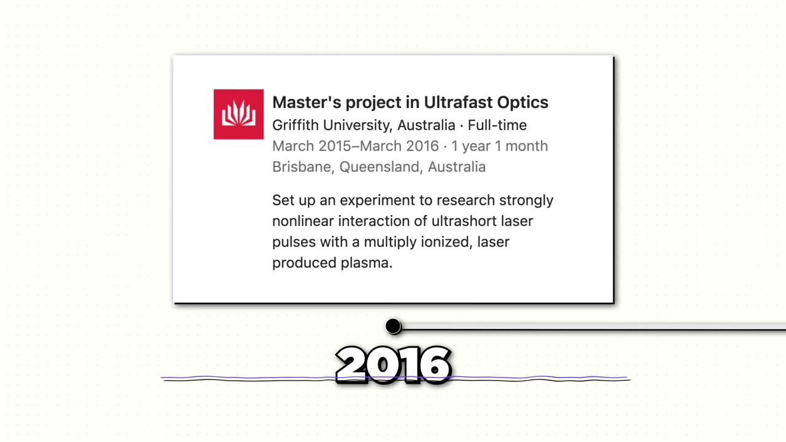
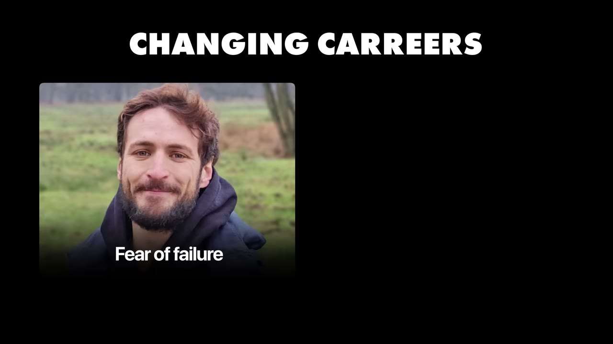
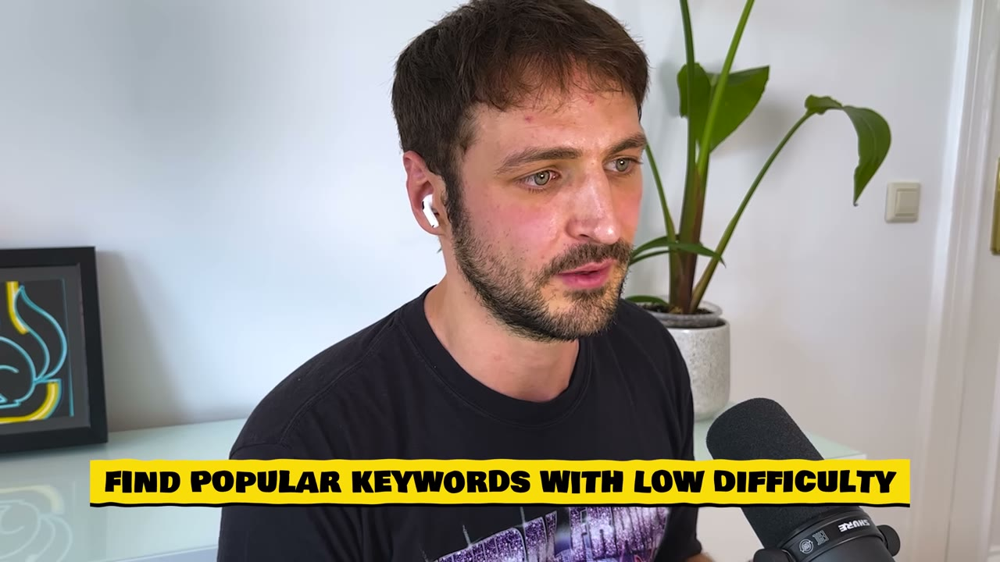
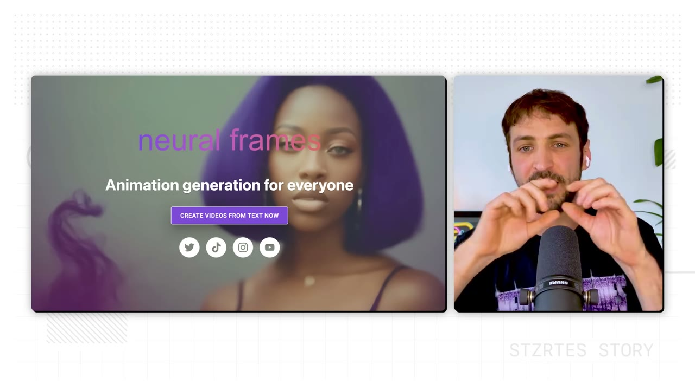
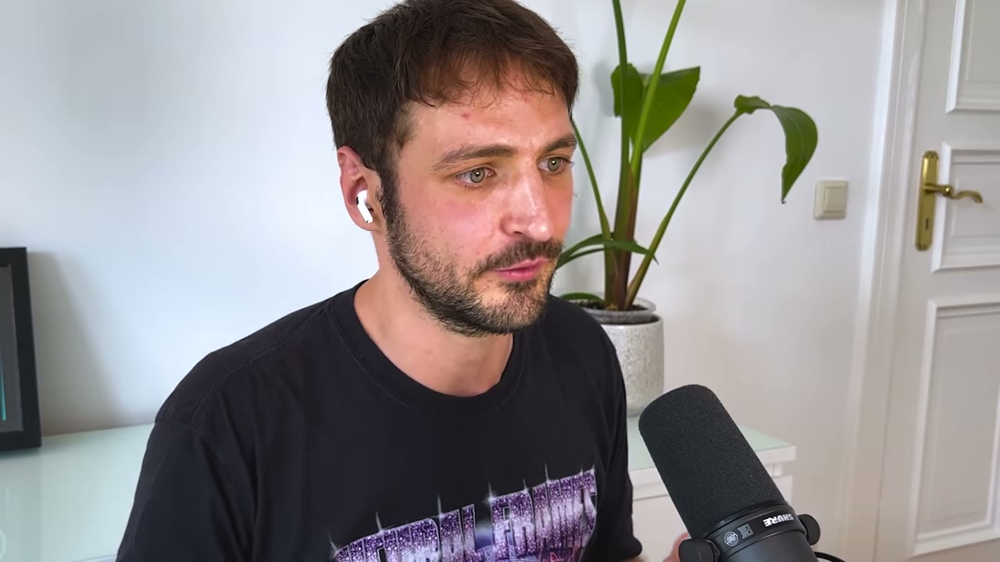
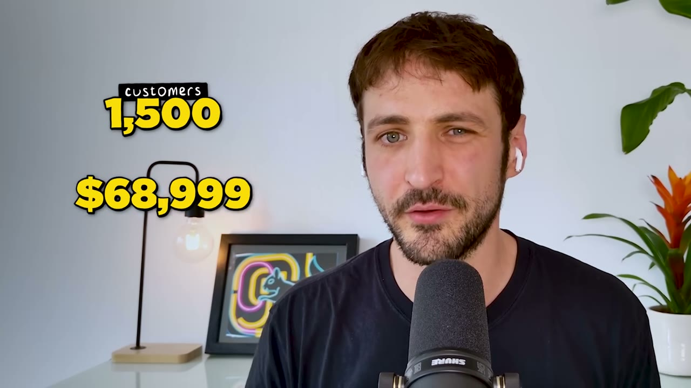
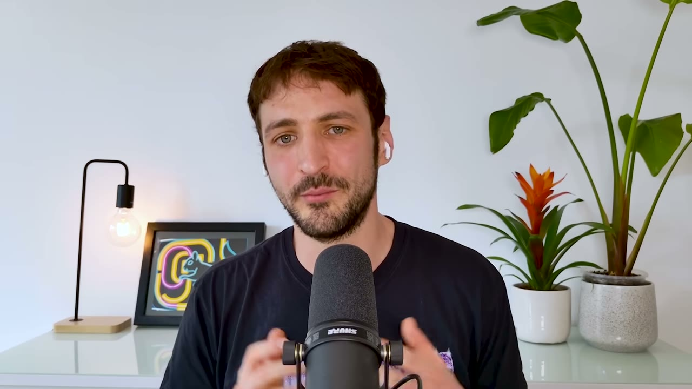

# My AI App Makes $100K/Month

✅ **Đã phân tích sâu** → [`case.md`](case.md)

| | |
|---|---|
| **Video** | <https://www.youtube.com/watch?v=miEUhwSR2-0> |
| **Đăng** | 30/07/2025 |
| **Thời lượng** | 12:30 |
| **Lượt xem** | 78,062 |
| **Lượt thích** | 1,936 |
| **Video ID** | `miEUhwSR2-0` |

## Trong thư mục này

| File | Nội dung |
|---|---|
| [`case.md`](case.md) | **Phân tích đầy đủ** — ý tưởng, validate, GTM, áp dụng ở VN |
| [`meta.json`](meta.json) | Metadata gốc (chapters, heatmap, mô tả) |
| [`screenshots/`](screenshots/) | 10 ảnh 720p |

## Mô tả gốc

This is how Nicolai Klemke dropped his PhD in physics to build in AI, and now makes $100K per month.
0:00 - Intro
0:48 - Who is Nico
1:15 - What does Neural Frames do?
1:48 - From PhD in physics to building in AI
2:30 - Why Nico changed his career
3:02 - Start landing enterprise customers
4:12 - Advice on changing careers
4:57 - Nico's ideation process
5:53 - AI ideas to build NOW
6:28 - Growth hack: niching down
7:18 - From 0 to $100K MRR
8:40 - Numbers behind Neural Frames
9:02 - Tech stack
9:50 - Costs to run
10:29 - Bootstrap over VC
11:11 - Take the leap today
11:45 - Start building with 

## Số liệu bắt được từ transcript

> Các đoạn founder nhắc tới con số, kèm timestamp để tua thẳng tới đó trong video.

_(không bắt được con số nào)_

## Chương

- `00:00` Intro
- `00:48` Who is Nico
- `01:15` What does Neural Frames do?
- `01:48` From PhD in physics to building in AI
- `02:30` Why Nico changed his career
- `03:02` Start landing enterprise customers
- `04:12` Advice on changing careers
- `04:57` Nico's ideation process
- `05:53` AI ideas to build NOW
- `06:28` Growth hack: niching down
- `07:18` From 0 to $100K MRR
- `08:40` Numbers behind Neural Frames
- `09:02` Tech stack
- `09:50` Costs to run
- `10:29` Bootstrap over VC
- `11:11` Take the leap today
- `11:45` Start building with AI

## Ảnh

1. `01_01m07s_usd-100-000.jpg` — 
2. `02_02m00s_ch-from-phd-in-physics-to-building-in-ai.jpg` — 
3. `03_02m42s_ch-why-nico-changed-his-career.jpg` — 
4. `04_04m24s_ch-advice-on-changing-careers.jpg` — 
5. `05_05m41s_replay.jpg` — 
6. `06_06m40s_ch-growth-hack-niching-down.jpg` — 
7. `07_07m15s_usd-100-000.jpg` — 
8. `08_08m50s_usd-100-000.jpg` — 
9. `09_09m54s_usd-100-000.jpg` — 
10. `10_10m41s_ch-bootstrap-over-vc.jpg` — 

---

← [Quay lại index](../../index.md) · [Toàn bộ video](../README.md)
