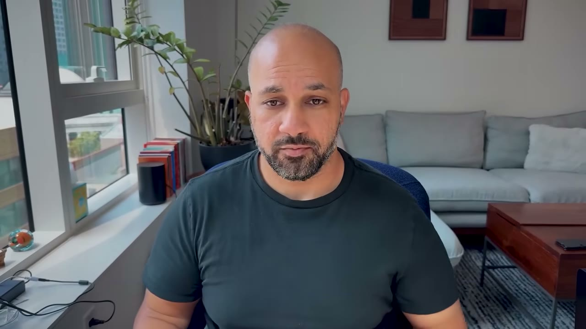
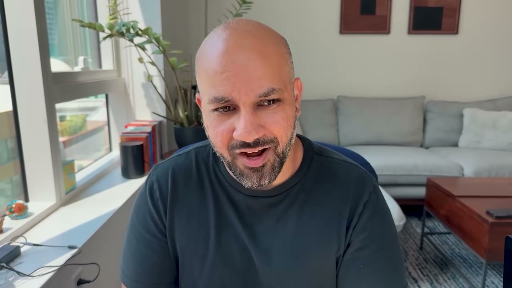
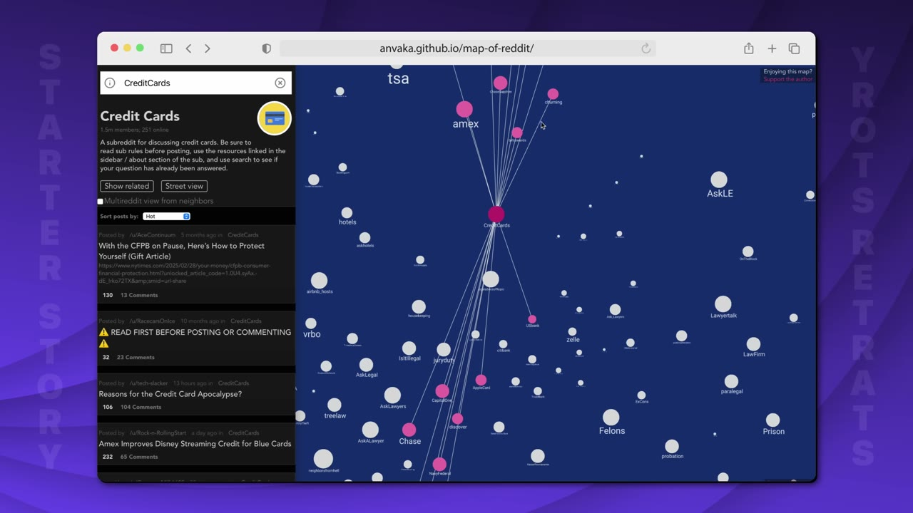
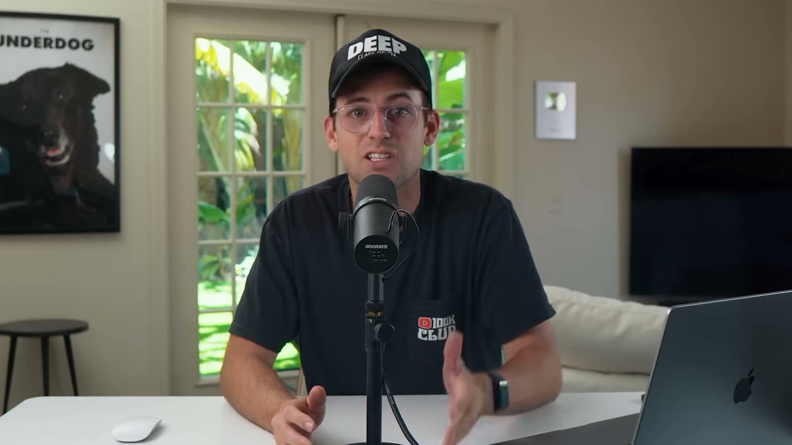
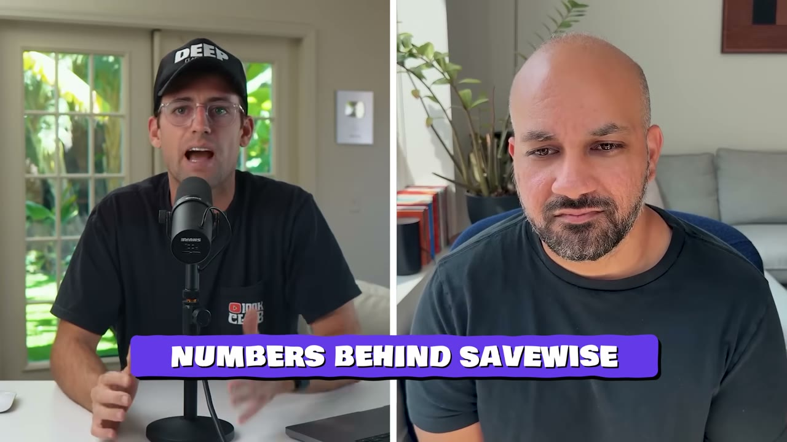
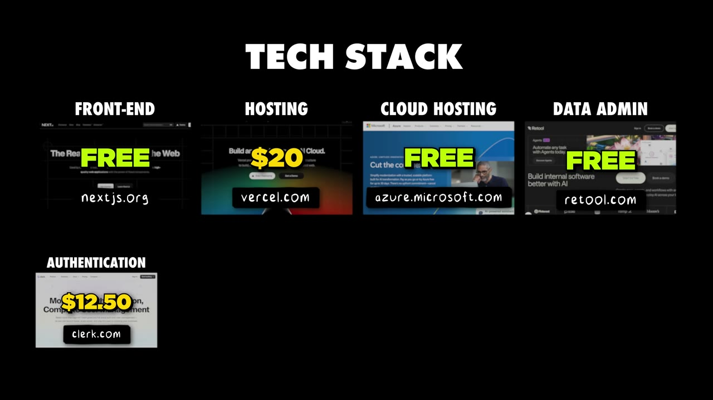

# How I Used Reddit To Build a $25K/Month Business

✅ **Đã phân tích sâu** → [`case.md`](case.md)

| | |
|---|---|
| **Video** | <https://www.youtube.com/watch?v=3X4VneEHvig> |
| **Đăng** | 09/08/2025 |
| **Thời lượng** | 14:35 |
| **Lượt xem** | 160,796 |
| **Lượt thích** | 4,569 |
| **Video ID** | `3X4VneEHvig` |

## Trong thư mục này

| File | Nội dung |
|---|---|
| [`case.md`](case.md) | **Phân tích đầy đủ** — ý tưởng, validate, GTM, áp dụng ở VN |
| [`meta.json`](meta.json) | Metadata gốc (chapters, heatmap, mô tả) |
| [`screenshots/`](screenshots/) | 10 ảnh 720p |

## Mô tả gốc

Meet Avneesh, he grew his app to $25K/month using Reddit & Facebook, without spending any money on ads.
0:00 - Intro
1:03 - Who is Avneesh
1:28 - Idea for Savewise
2:26 - Trying to find customers
3:32 - The 2 platforms that worked
4:07 - 5-Step Marketing Playbook
7:55 - Build YOUR app with AI in 12 days
8:35 - Getting 1500 visitors from one post
9:51 - The post that changed everything
11:10 - Numbers behind Savewise
11:57 - Tech stack
12:53 - Understand your customer
13:50 - The final word
This video is an educational case study of one founder’s experience. It is not financial advice and does 

## Số liệu bắt được từ transcript

> Các đoạn founder nhắc tới con số, kèm timestamp để tua thẳng tới đó trong video.

_(không bắt được con số nào)_

## Chương

- `00:00` Intro
- `01:03` Who is Avneesh
- `01:28` Idea for Savewise
- `02:26` Trying to find customers
- `03:32` The 2 platforms that worked
- `04:07` 5-Step Marketing Playbook
- `07:55` Build YOUR app with AI in 12 days
- `08:35` Getting 1500 visitors from one post
- `09:51` The post that changed everything
- `11:10` Numbers behind Savewise
- `11:57` Tech stack
- `12:53` Understand your customer
- `13:50` The final word

## Ảnh

1. `01_01m23s_usd-25-000.jpg` — 
2. `02_02m38s_ch-trying-to-find-customers.jpg` — 
3. `03_03m44s_ch-the-2-platforms-that-worked.jpg` — 
4. `04_04m19s_ch-5-step-marketing-playbook.jpg` — 
5. `05_05m01s_replay.jpg` — 
6. `06_08m07s_ch-build-your-app-with-ai-in-12-days.jpg` — 
7. `07_08m47s_ch-getting-1500-visitors-from-one-post.jpg` — 
8. `08_10m34s_replay.jpg` — 
9. `09_11m15s_usd-25-000.jpg` — 
10. `10_12m28s_replay.jpg` — 

---

← [Quay lại index](../../index.md) · [Toàn bộ video](../README.md)
