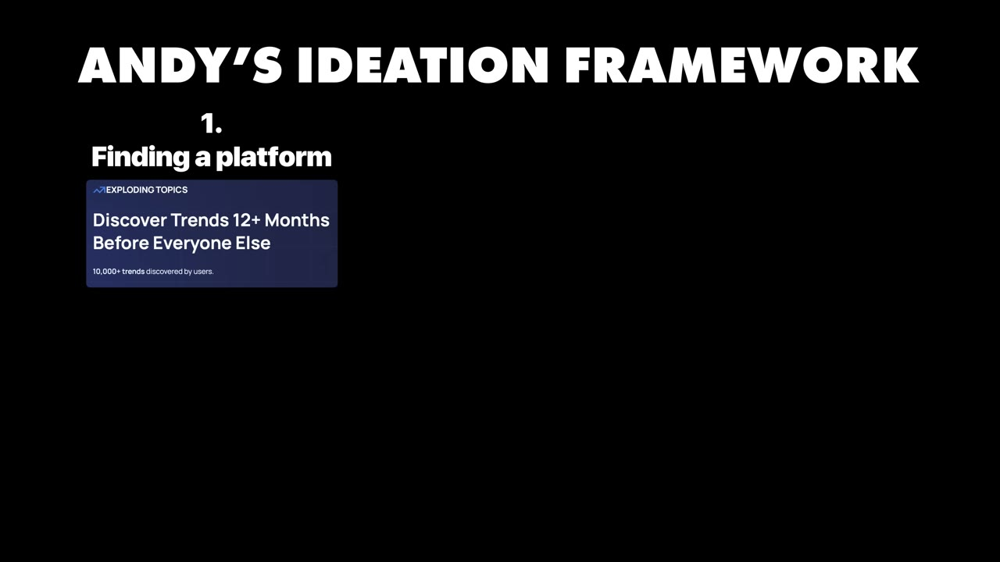
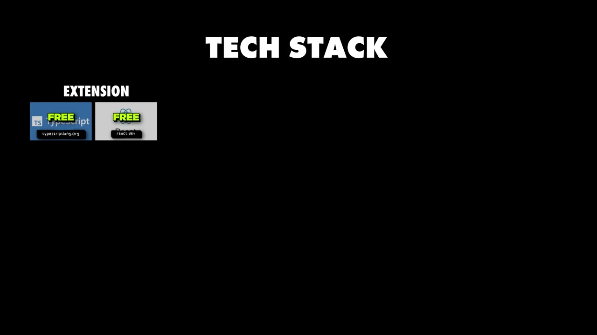

# How I Built It: $23K/month micro-saas

✅ **Đã phân tích sâu** → [`case.md`](case.md)

| | |
|---|---|
| **Video** | <https://www.youtube.com/watch?v=NvtsM8Nk72c> |
| **Đăng** | 13/08/2025 |
| **Thời lượng** | 11:08 |
| **Lượt xem** | 315,009 |
| **Lượt thích** | 7,074 |
| **Video ID** | `NvtsM8Nk72c` |

## Trong thư mục này

| File | Nội dung |
|---|---|
| [`case.md`](case.md) | **Phân tích đầy đủ** — ý tưởng, validate, GTM, áp dụng ở VN |
| [`meta.json`](meta.json) | Metadata gốc (chapters, heatmap, mô tả) |
| [`screenshots/`](screenshots/) | 10 ảnh 720p |

## Mô tả gốc

Meet Andy, who started Data Fetcher as a side hustle, and now it's making $23K/month. In this video, Andy will share exactly how he did this.
0:00 - Intro
0:40 - Who is Andy
0:58 - From an engineer to an entrepreneur
1:44 - Data Fetcher breakdown
2:18 - Ideation & validation
2:56 - Build YOUR micro-saas
3:42 - Pros & cons of building on platforms
4:39 - Andy's ideation framework
6:05 - Great platforms to build on NOW
6:54 - Growing from 0 to $23K/month
7:44 - Tech stack
8:33 - Costs & margins
9:01 - The power of focus
9:47 - How to increase revenue overnight
10:32 - The final word
This video i

## Số liệu bắt được từ transcript

> Các đoạn founder nhắc tới con số, kèm timestamp để tua thẳng tới đó trong video.

_(không bắt được con số nào)_

## Chương

- `00:00` Intro
- `00:40` Who is Andy
- `00:58` From an engineer to an entrepreneur
- `01:44` Data Fetcher breakdown
- `02:18` Ideation & validation
- `02:56` Build YOUR micro-saas
- `03:42` Pros & cons of building on platforms
- `04:39` Andy's ideation framework
- `06:05` Great platforms to build on NOW
- `06:54` Growing from 0 to $23K/month
- `07:44` Tech stack
- `08:33` Costs & margins
- `09:01` The power of focus
- `09:47` How to increase revenue overnight
- `10:32` The final word

## Ảnh

1. `01_00m52s_usd-23-000.jpg` — 
2. `02_01m44s_replay.jpg` — 
3. `03_02m56s_usd-23-000.jpg` — 
4. `04_04m00s_usd-100-m.jpg` — 
5. `05_04m51s_replay.jpg` — 
6. `06_06m17s_ch-great-platforms-to-build-on-now.jpg` — 
7. `07_07m06s_ch-growing-from-0-to-23k-month.jpg` — 
8. `08_07m56s_ch-tech-stack.jpg` — 
9. `09_08m36s_usd-23-000.jpg` — 
10. `10_09m13s_ch-the-power-of-focus.jpg` — 

---

← [Quay lại index](../../index.md) · [Toàn bộ video](../README.md)
