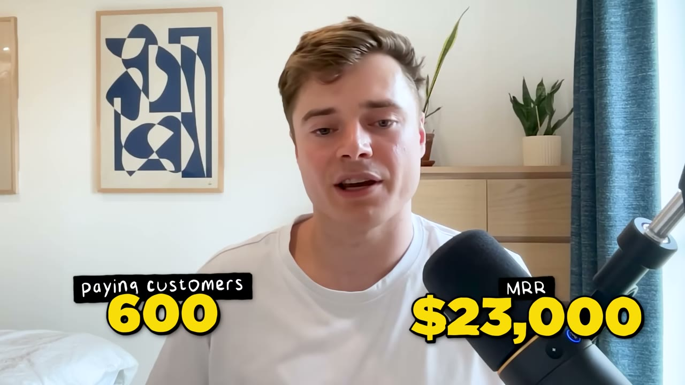
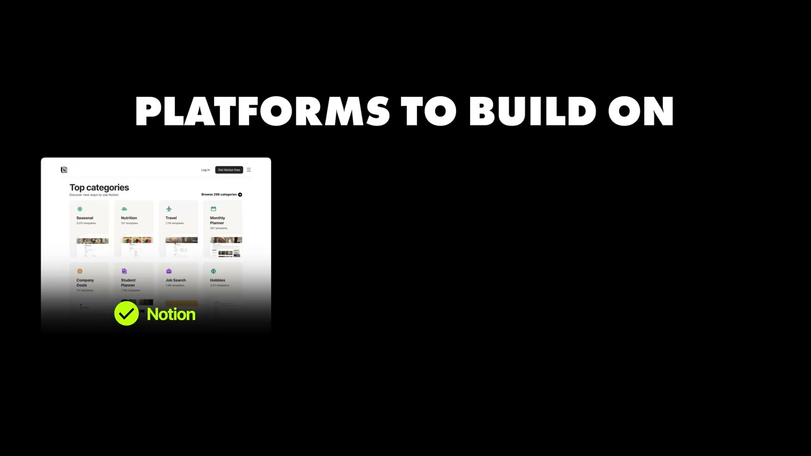
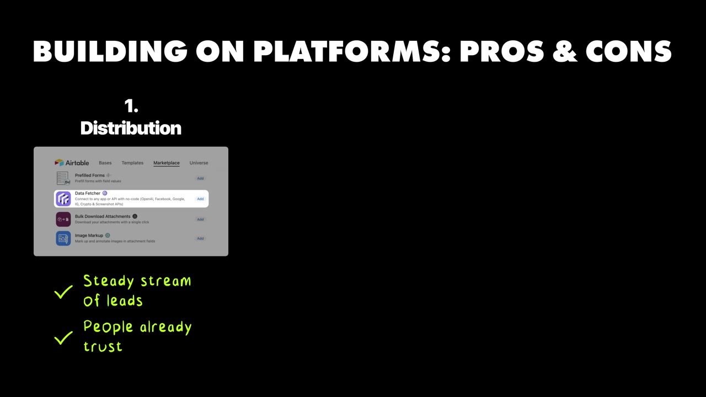

# Data Fetcher — chiến lược nền tảng: chọn cái ao đủ nhỏ để cá mập không bơi vào

> **Tóm tắt 30 giây.** Andy Cloke thấy một add-on cho Google Sheets tên API Connector đang có 100.000 người dùng và sống rất khoẻ. Anh không nghĩ ra ý tưởng mới — anh **bê đúng mô hình đó sang một nền tảng đang tăng trưởng nhanh vừa mở marketplace: Airtable**. Anh validate bằng cách đọc diễn đàn của chính Airtable, có khách trả tiền sau vài ngày, và sau hơn 5 năm đạt **23.000 USD/tháng với 600 khách và biên 85%**, làm một mình. Điểm tinh tế nhất của cả case: anh chọn ngách này **chính vì** nó không đủ lớn để ai đó gọi vốn triệu đô nhảy vào cạnh tranh.

## 1. Con số

| Chỉ số | Giá trị |
|---|---|
| MRR | 23.000 USD |
| Khách trả tiền | 600 (≈38 USD/khách/tháng) |
| Biên lợi nhuận | **85%** |
| Chi phí hosting | **2.500 USD/tháng** — lớn nhất |
| Chi phí công cụ SaaS | ~1.000 USD/tháng |
| Co-working | 150 USD/tháng |
| Nhân sự | 1 |
| Thời gian vận hành | hơn 5 năm |

**Quỹ đạo thật — chậm hơn tiêu đề gợi ý rất nhiều:**

| Mốc | MRR |
|---|---|
| Vài tháng đầu | 1.000 USD |
| Hết năm 1 | 10.000 USD |
| Sau 3 năm | 20.000 USD |
| Hiện tại (5+ năm) | 23.000 USD |

Đây là một trong số ít case trong kho công bố timeline đủ thành thật để thấy **đường tăng trưởng bị làm phẳng sau năm thứ nhất**: 0→10K trong 12 tháng, rồi 10K→20K mất thêm 2 năm. Đối lập hoàn toàn với các case app di động viral kiểu [PuffCount](../2025-09-20_the-1m-mobile-app-playbook/case.md) hay [GlowUp](../2025-12-17_my-mobile-app-made-800k-in-365-days/case.md) — và đó là ưu điểm, không phải nhược điểm: doanh thu này **không phụ thuộc vào việc tháng này có viral hay không**.

## 2. Khung 6 bước tìm ý tưởng trên nền tảng đang lên ⭐⭐⭐⭐⭐

Đây là phần dùng được ngay và là lý do video này đáng lưu.

**Bước 1 — Tìm nền tảng đang tăng trưởng.** Anh dùng **Exploding Topics**. Điều kiện ngầm: nền tảng phải đang lên *và* vừa mở marketplace. Airtable khi đó đúng cả hai.

**Bước 2 — Tìm điểm đau trên nền tảng đó.** Đọc **diễn đàn chính thức của nền tảng**, Reddit, Twitter. Anh phát hiện nhu cầu về một công cụ *thật sự linh hoạt*. Lưu ý cách làm: không khảo sát, không phỏng vấn — đọc chỗ người ta đã tự nguyện viết ra vấn đề của mình.

**Bước 3 — Mượn một add-on đã được chứng minh ở nền tảng trưởng thành hơn.** Với anh là API Connector trên Google Sheets. Mượn cả UX, rồi làm cho nó **cảm giác native** với nền tảng mới.

**Bước 4 — Kiểm tra khả năng tích hợp.** Có API công khai không? Có marketplace không? Có extension SDK không? Thiếu ba thứ này thì bỏ.

**Bước 5 — Tính nhẩm quy mô cơ hội.** Nền tảng có bao nhiêu người dùng? Vấn đề này phổ biến cỡ nào? Người ta chịu trả bao nhiêu? Mẹo: **lấy luôn bảng giá của sản phẩm tương đương ở nền tảng trưởng thành** làm mốc, giả định giá trên nền tảng mới xấp xỉ.

**Bước 6 — Nền tảng có nghiền nát bạn không?** Đọc roadmap, đọc diễn đàn hỗ trợ, xem họ phát tín hiệu gì về tính năng này. Anh thừa nhận đây là bước khó nhất vì không ai nhìn được tương lai.

**Vì sao khung này mạnh:** bước 3 và bước 5 loại bỏ gần hết rủi ro nhu cầu — bạn đang sao chép một sản phẩm **đã có 100.000 người dùng chứng minh là người ta cần**, và bạn có sẵn mốc giá. Cùng logic với [Will Cannon sao chép kẻ dẫn đầu](../2025-10-01_my-two-apps-made-30m/case.md) và [Stoppr clone Quittr](../2025-10-30_i-vibe-coded-a-12k-month-mobile-app-stoppr-breakdown/case.md): **rủi ro duy nhất còn lại là rủi ro thực thi, không phải rủi ro nhu cầu.**

## 3. Nghịch lý cốt lõi: chọn ngách vì nó QUÁ NHỎ ⭐⭐⭐⭐⭐

Đây là đoạn tôi cho là giá trị nhất video, và nó đi ngược mọi lời khuyên khởi nghiệp thông thường.

Andy nói về hai lợi ích của việc xây trên nền tảng, nhưng lợi ích thứ hai mới là thứ đáng ghi:

1. **Phân phối:** ở trên marketplace, đặc biệt là sớm, nghĩa là có dòng lead chất lượng cao đều đặn — **và họ tin bạn vì bạn đã được chính nền tảng phê duyệt**. Niềm tin này là thứ một website lạ không mua được bằng tiền.
2. **Đủ lớn để đổi đời, nhưng không đủ lớn để ai đó gọi vốn xây công ty 100 triệu đô cạnh tranh.** Nguyên văn: *"it's kind of in this perfect indie hacker opportunity space where it just like sits in that sweet spot."*

Điểm 2 là một **chiến lược phòng thủ**, không phải sự khiêm tốn. Thị trường 23K MRR không hấp dẫn quỹ đầu tư, nên anh không bao giờ phải đối đầu với một đối thủ đốt 5 triệu đô để mua khách. Đây là con hào duy nhất mà một người làm một mình thực sự giữ được.

**Rủi ro nền tảng — anh nói rõ và không né:** công cụ của bạn có thể trở nên vô dụng chỉ sau một đêm. Cách anh quản lý rủi ro rất cụ thể: **Data Fetcher nằm đúng giữa hai thứ Airtable đã có** — scripting (quá kỹ thuật) và no-code imports (quá cứng nhắc). Anh đánh cược rằng Airtable **khó có động cơ xây một thứ nằm chính giữa hai sản phẩm của họ**. Rồi anh nói thêm: *"I think it's safe for now. Touchwood."* — tức là chính anh cũng biết đây là cược, không phải bảo đảm.

**Nguyên tắc rút ra:** khi xây trên nền tảng, đừng hỏi *"tính năng này có hay không"*, hãy hỏi **"nó có nằm ở chỗ mà nền tảng thấy phiền hơn là thấy đáng làm không"**.

## 4. Nền tảng nên xây ngay bây giờ — và nền tảng nên tránh ⭐⭐⭐⭐

**Nên:**
- **Notion** — không mới nhưng vẫn tăng nhanh, và **API còn tương đối mới**. Cơ hội quanh automation, báo cáo, đưa dữ liệu ra vào.
- **Figma** — cơ hội nhỏ quanh việc xuất Figma sang Webflow, Framer, và các CMS/công cụ thiết kế web khác.

**Tránh:**
- **ChatGPT và Claude.** Lý do anh đưa rất thẳng: tăng trưởng thì khổng lồ nhưng *"everyone and their dog is building for ChatGPT and Claude"* — cạnh tranh quá đông. Anh khuyên **dùng những công cụ đó để tăng sức mạnh cho doanh nghiệp của bạn, thay vì xây trên chúng.**

Lời khuyên này đáng đối chiếu với [Mike Hill: "không bao giờ làm business lấy AI làm lõi"](../2025-11-02_i-built-3-saas-apps-to-200k-mrr-heres-my-exact-playb/case.md) — hai người đến từ hai hướng khác nhau nhưng gặp nhau ở cùng một kết luận. Andy lo về **mật độ cạnh tranh**, Mike lo về **rủi ro phụ thuộc API**. Cả hai lý do đều đúng và cộng dồn.

## 5. Cách anh đi từ 0 lên 23K — vòng lặp lặp lại ⭐⭐⭐⭐

Vòng lặp rất đơn giản và anh chạy nó suốt 5 năm:

1. Có khách đầu tiên sau **vài ngày** — chỉ nhờ vào marketplace, không marketing gì
2. Nhận ra **một số use case và một số API lặp đi lặp lại**
3. Viết blog và làm video YouTube **về đúng những tích hợp phổ biến đó** → lên 1K MRR sau vài tháng, 3K sau một năm
4. Nhận ra có thể làm dễ hơn nữa → xây **tích hợp no-code** cho người ít kỹ thuật → **10K MRR**
5. Lặp lại: nói chuyện với khách, lấy phản hồi, xây vào sản phẩm, rồi kể cho người khác nghe qua content

**Chi tiết đáng học nhất ở bước 3:** anh không viết content về "cách dùng Data Fetcher". Anh viết về **từng tích hợp cụ thể mà khách đang tìm** — Facebook Ads vào Airtable, Google Analytics vào Airtable. Mỗi tích hợp là một từ khoá long-tail riêng với người tìm kiếm đã có ý định rõ ràng. Cùng cơ chế với [Momego dùng tiếng lóng từng thành phố](../2025-10-23_how-i-built-a-30k-month-mobile-app/case.md): **nhân bản một trang cho mỗi biến thể của nhu cầu.**

## 6. Chi phí: chỗ case này khác hầu hết SaaS trong kho ⭐⭐⭐⭐

| Khoản | USD/tháng |
|---|---|
| Hosting | **2.500** |
| Công cụ SaaS | ~1.000 |
| Co-working | 150 |
| **Tổng** | **~3.650** |
| **Biên** | **85%** |

Hosting 2.500 USD trên doanh thu 23.000 là **cao bất thường** cho một SaaS 600 khách. Video không giải thích, nhưng lý do nằm ngay trong bản chất sản phẩm: đây là công cụ **chạy job theo lịch** — worker liên tục gọi API bên ngoài và ghi dữ liệu về, cho 600 khách hàng, 24/7. Chi phí tính toán tỷ lệ thuận với số lịch chạy, không phải số người đăng nhập.

Cách anh xử lý cũng đáng chú ý: API và database trên **Heroku** (đắt, tiện), còn **worker chạy job đẩy sang Hetzner** — nhà cung cấp giá rẻ. Đây là phân tách đúng: trả tiền cho sự tiện lợi ở phần cần ổn định, tối ưu giá ở phần ngốn tài nguyên.

**Bài học chuyển giao:** trước khi chọn mô hình giá, hãy hỏi **chi phí biên của tôi tăng theo cái gì**. Với Data Fetcher là số job chạy — nên giá phải gắn với hạn mức request, nếu không một khách nặng có thể ăn hết lợi nhuận của mười khách nhẹ.

## 7. Hai bài học cá nhân — cái thứ hai đắt nhất ⭐⭐⭐⭐⭐

**Bài học 1: hội chứng đồ chơi mới, và cách anh tự chẩn đoán.**

Anh phí khoảng **6 tháng** cho các dự án phụ. Điều đắt giá là anh nhận ra mình đã **tự nói dối về lý do**: mỗi lần anh tự nhủ là vì rủi ro nền tảng, vì thị trường bão hoà, vì lý do chiến lược nào đó. Sự thật: *"it was cuz growth had slowed and I was getting bored and losing motivation."*

Đây là một chẩn đoán rất dùng được. Lần tới khi bạn thấy mình có một lý do chiến lược nghe rất hợp lý để bỏ dự án đang chạy, hãy kiểm tra xem lý do đó có xuất hiện **đúng lúc tăng trưởng chậm lại** hay không.

Cách anh chống lại: anh dùng **Claude như một business coach**, nói thẳng *"be my business coach and make me focus on the thing that's working and talk me out of trying to launch something new."* Anh thừa nhận hơi ngượng nhưng nó hiệu quả — như có một người đồng sáng lập để chịu trách nhiệm trước. Với người làm một mình, đây là mẹo rẻ và dùng được ngay.

**Bài học 2: anh mất gần trọn một năm mà không nói chuyện với người dùng.**

Nguyên văn phần kết: khi cuối cùng anh chịu làm user testing, **trong một buổi chiều** anh tìm ra hàng loạt vấn đề UX, và sửa chúng làm tăng doanh thu, tăng mức sử dụng, tăng gần như mọi thứ **gần như ngay lập tức**. Và anh học được **vì sao khách thích công cụ của mình hơn công cụ khác** — thông tin định vị mà không phân tích nào thay thế được.

Đối chiếu trong kho: [Setter AI](../2025-09-27_how-we-built-a-10k-mo-saas/case.md) làm ngược lại — nói chuyện với khách *trước khi* có sản phẩm và thu 500 USD đặt cọc. Andy mất một năm mới làm điều đó. Cùng một bài học, một người học rẻ, một người học đắt.

## 8. Cảnh báo thiên kiến nguồn

- **Video có hai đoạn bán khoá Starter Story Build**, một đoạn dài chèn ngay giữa (khoảng 2:56–3:40) và một ở cuối. Link trong mô tả có UTM riêng.
- **Thông điệp bán hàng mâu thuẫn với chính nội dung.** Quảng cáo nói "trong vài ngày bạn sẽ có app chạy được nhờ AI", trong khi câu chuyện thật là **5 năm và 3 năm để đi từ 10K lên 20K**. Đây là kiểu ghép nối cần cảnh giác.
- **Không có ảnh chụp dashboard doanh thu nào** trong video. 23K MRR và 85% biên đều là lời tự khai (dù anh có dùng ChartMogul, tức là có nguồn dữ liệu thật).
- **Bối cảnh bị làm mờ:** anh là **React developer freelance ở London** và **đã bán một SaaS trước đó** (directory influencer TikTok, vài nghìn đô MRR) để tự mua cho mình vài tháng rảnh. Tức là anh bước vào Data Fetcher với kỹ năng kỹ thuật đầy đủ, kinh nghiệm ra sản phẩm, và một khoản đệm tài chính. "Solo founder làm side project" là đúng nhưng không đầy đủ.
- **Đây là câu chuyện sống sót về rủi ro nền tảng.** Chúng ta nghe câu chuyện của người mà Airtable chưa nghiền nát. Những người bị nghiền nát không lên kênh này.

## 9. Áp dụng cho tôi (indie hacker VN)

**Sao chép được ngay — đây là một trong những case dễ áp dụng nhất trong kho:**

1. **Chạy nguyên khung 6 bước trong một buổi tối.** Chọn Notion hoặc Figma (chính anh đề xuất), đọc diễn đàn tìm điểm đau, tìm add-on tương đương ở nền tảng trưởng thành hơn, kiểm tra API/SDK, lấy giá của bản gốc làm mốc, đọc roadmap xem có bị nuốt không.
2. **Content marketing theo từng tích hợp cụ thể.** Một trang cho mỗi API bạn hỗ trợ. Người tìm "Facebook Ads to Notion" có ý định mua cao hơn rất nhiều người tìm "công cụ tự động hoá".
3. **Nói chuyện với người dùng trong tháng đầu, không phải năm đầu.** Bài học đắt nhất của Andy là bài học bạn có thể mua miễn phí.
4. **Dùng AI như business coach chống phân tâm.** Rẻ, và anh xác nhận nó có tác dụng thật.
5. **Tách hạ tầng:** phần cần ổn định để ở nhà cung cấp tiện; phần ngốn tài nguyên đẩy sang nhà cung cấp rẻ.

**Rào cản thật:**

- **Rủi ro nền tảng là thật và không kiểm soát được.** Airtable có thể xây tính năng này bất cứ lúc nào. Andy sống sót 5 năm nhờ chọn vị trí khéo, nhưng chính anh gõ vào gỗ cầu may. Đừng xây thứ này thành nguồn thu nhập duy nhất mà không có kế hoạch B.
- **Marketplace là kênh phân phối, nhưng chỉ khi bạn vào SỚM.** Lợi thế của Andy là Airtable *vừa mở* marketplace. Marketplace của Notion và Figma hôm nay đã đông hơn nhiều. Bước 1 của khung — tìm nền tảng đang lên vừa mở marketplace — mới là bước thật sự khó.
- **Khách hàng là người dùng Airtable/Notion ở phương Tây**, thanh toán bằng thẻ quốc tế. Cần Stripe hoặc merchant of record (như [Polar mà Uneed dùng](../2025-08-23_how-i-finally-built-a-10k-month-saas-30-failures/case.md)) — giải được, nhưng phải giải.
- **Cần tiếng Anh viết tốt** vì content marketing là kênh tăng trưởng chính.

**Khi KHÔNG nên dùng mô hình này:**

- **Khi bạn cần tăng trưởng nhanh.** 3 năm để đi từ 10K lên 20K. Đây là mô hình lifestyle business, không phải mô hình đổi đời trong 12 tháng.
- **Khi bạn không chịu được rủi ro bị nền tảng nuốt.** Nếu toàn bộ thu nhập gia đình phụ thuộc vào việc Airtable không xây tính năng đó, bạn đang ngủ trên một quả bom hẹn giờ không biết giờ.
- **Khi chi phí biên của bạn tăng theo mức sử dụng nhưng bạn định giá theo đầu người.** Hosting 2.500 USD của Andy là lời nhắc: mô hình chạy job nền có COGS thật, khác hẳn [Cursor Directory biên 99,8%](../2025-11-16_my-website-makes-35k-month-built-in-3-hours/case.md).

## Nguồn

- Video: [How I Built It: $23K/month micro-saas](https://www.youtube.com/watch?v=NvtsM8Nk72c) — Starter Story, 13/08/2025, 315.009 view
- [Transcript đầy đủ](transcript.md) · [Ảnh chụp màn hình](screenshots/)
