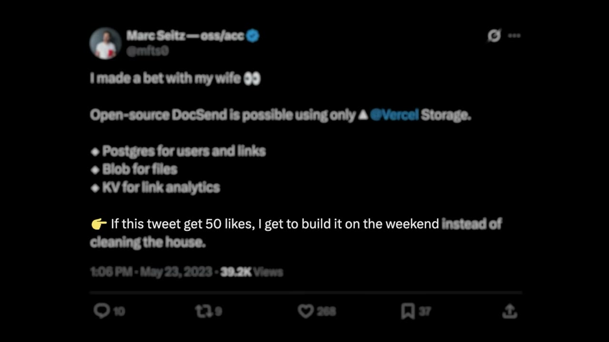
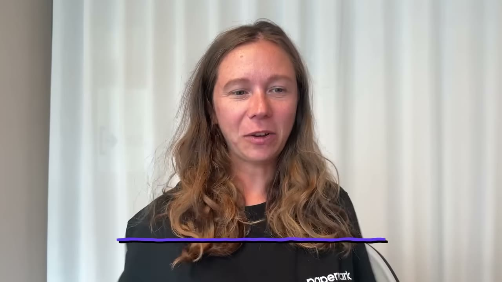
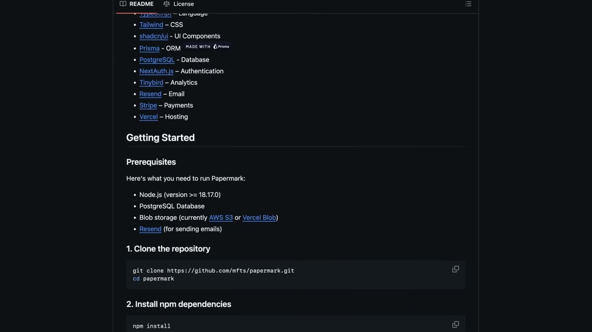

# How We Built It: $900K Open Source SaaS

✅ **Đã phân tích sâu** → [`case.md`](case.md)

| | |
|---|---|
| **Video** | <https://www.youtube.com/watch?v=F8i0kkrQ8_o> |
| **Đăng** | 16/08/2025 |
| **Thời lượng** | 14:37 |
| **Lượt xem** | 187,323 |
| **Lượt thích** | 4,399 |
| **Video ID** | `F8i0kkrQ8_o` |

## Trong thư mục này

| File | Nội dung |
|---|---|
| [`case.md`](case.md) | **Phân tích đầy đủ** — ý tưởng, validate, GTM, áp dụng ở VN |
| [`meta.json`](meta.json) | Metadata gốc (chapters, heatmap, mô tả) |
| [`screenshots/`](screenshots/) | 10 ảnh 720p |

## Mô tả gốc

This is how Iuliia and Marc built a $900K/year SaaS. But their approach was different: make it open-source. Today, we'll dive into why that was the best decision for their business.
0:00 - Intro
0:50 - Who are Marc and Iuliia
1:15 - Idea for Papermark
2:06 - What is Papermark
3:04 - What is open-source
4:18 - How do they make money
5:03 - Benefits of open-source
6:36 - Get compliant fast
7:44 - Opportunities to build now
9:06 - Growth from 0 to $900K
10:05 - Numbers behind Papermark
10:54 - Tech stack
11:46 - Costs & margins
12:13 - How to succeed with open-source
13:54 - The final word
This v

## Số liệu bắt được từ transcript

> Các đoạn founder nhắc tới con số, kèm timestamp để tua thẳng tới đó trong video.

_(không bắt được con số nào)_

## Chương

- `00:00` Intro
- `00:50` Who are Marc and Iuliia
- `01:15` Idea for Papermark
- `02:06` What is Papermark
- `03:04` What is open-source
- `04:18` How do they make money
- `05:03` Benefits of open-source
- `06:36` Get compliant fast
- `07:44` Opportunities to build now
- `09:06` Growth from 0 to $900K
- `10:05` Numbers behind Papermark
- `10:54` Tech stack
- `11:46` Costs & margins
- `12:13` How to succeed with open-source
- `13:54` The final word

## Ảnh

1. `01_01m31s_replay.jpg` — 
2. `02_02m18s_ch-what-is-papermark.jpg` — 
3. `03_03m16s_ch-what-is-open-source.jpg` — 
4. `04_04m30s_ch-how-do-they-make-money.jpg` — 
5. `05_05m15s_ch-benefits-of-open-source.jpg` — 
6. `06_06m48s_ch-get-compliant-fast.jpg` — 
7. `07_07m28s_usd-1-000.jpg` — 
8. `08_09m18s_ch-growth-from-0-to-900k.jpg` — 
9. `09_10m17s_ch-numbers-behind-papermark.jpg` — 
10. `10_11m36s_replay.jpg` — 

---

← [Quay lại index](../../index.md) · [Toàn bộ video](../README.md)
