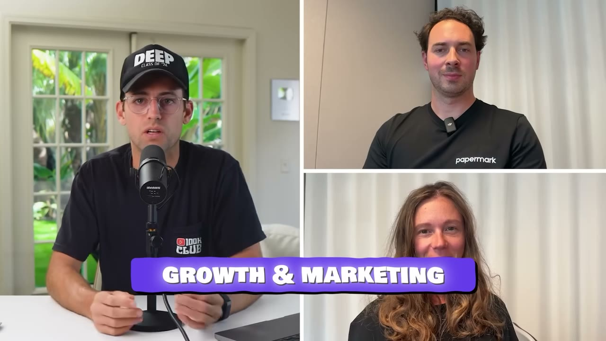
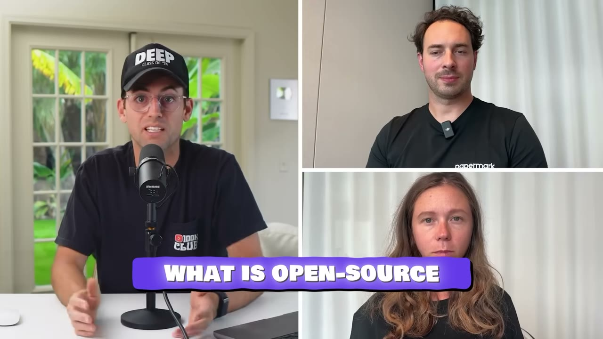
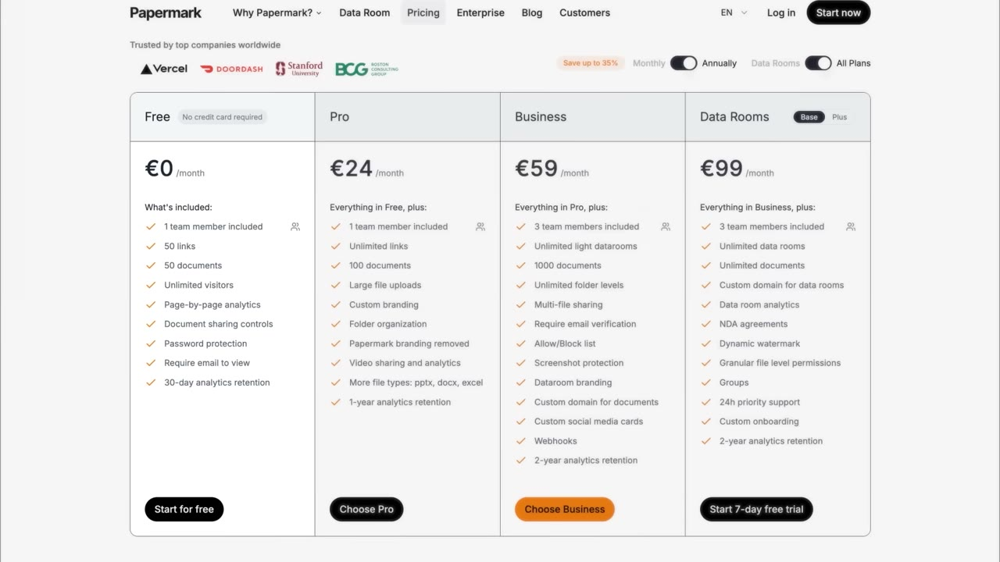
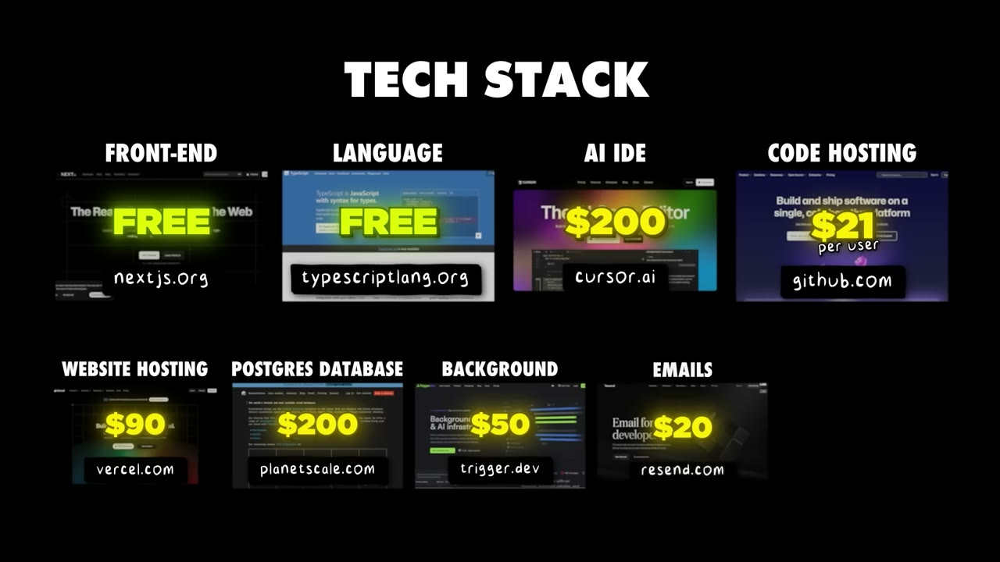

# Papermark — cho không phần lõi, thu tiền phần phiền phức

> **Tóm tắt 30 giây.** Marc đăng một tweet nói sẽ xây bản mã nguồn mở thay thế DocSend. Tweet đó được **40.000 view trong vài giờ**. Anh dựng MVP trong một cuối tuần, đăng tweet ra mắt hôm thứ Hai — **100.000 view** — và ngay sau đó có người hỏi *"chúng tôi trả tiền mua dịch vụ được không?"*. Mười tám tháng sau, hai vợ chồng đạt **75.000 USD MRR**. Mô hình: mã lõi miễn phí, ai tự cài thì không mất tiền; ai không muốn dính tới hạ tầng thì trả tiền cho bản hosted. Nhưng lời khuyên sắc nhất của họ lại đi ngược khẩu hiệu: **mở mã nguồn không tự động thắng — bạn phải bằng tính năng với kẻ dẫn đầu rồi ship nhanh hơn nó.**

## 1. Con số

| Chỉ số | Giá trị |
|---|---|
| MRR | 75.000 USD (≈900.000 USD ARR) |
| Quỹ đạo | 20K MRR hết năm 1 → 75K MRR giữa năm 2 |
| Người dùng | ~30.000, **phần lớn miễn phí** |
| Người đóng góp mã nguồn | 60 |
| GitHub star | 7.000 |
| North star | 800.000 lượt xem tài liệu được chia sẻ |
| Nhân sự lõi | 2 (vợ chồng) |

**Số khách trả tiền bị mất trong âm thanh** (ASR đọc thành "around ,000 customers"). Tôi không đoán. Nhưng có thể suy ra biên độ: 30.000 người dùng và 75.000 USD MRR — nếu giá trung bình 50 USD/tháng thì khoảng 1.500 khách, tức **tỷ lệ chuyển đổi khoảng 5%**. Đây là con số hợp lý cho open-core và cũng là lời cảnh báo: **95% người dùng của bạn sẽ không bao giờ trả tiền, và đó là thiết kế, không phải lỗi.**

## 2. Nguồn gốc: tweet trước, code sau ⭐⭐⭐⭐⭐

Đây là cách validate rẻ nhất trong toàn bộ kho case, cùng hạng với [landing page giả của Setter AI](../2025-09-27_how-we-built-a-10k-mo-saas/case.md).

| Bước | Chi phí | Tín hiệu thu được |
|---|---|---|
| Tweet "tôi sẽ xây bản open source thay thế DocSend" | 0 | 40.000 view trong vài giờ, nhiều người nói muốn thấy nó |
| Dựng MVP dùng được | một cuối tuần | — |
| Tweet ra mắt thứ Hai | 0 | 100.000 view |
| — | — | Khách tự hỏi mua |

Pat Walls nhận xét một câu đáng ghi lại: số founder anh phỏng vấn mà **doanh nghiệp khởi nguồn từ đúng một tweet** cao hơn nhiều so với người ta tưởng.

**Cơ chế thật sự vì sao tweet này ăn:** nó không phải một ý tưởng, nó là một **lời hứa cụ thể chống lại một sản phẩm cụ thể**. "Bản open source thay thế DocSend" trả lời ngay ba câu hỏi trong đầu người đọc: nó làm gì (DocSend), khác gì (mở mã), và tại sao tôi quan tâm (miễn phí, tự kiểm soát). So sánh với thất bại của [Thomas Sanlis](../2025-08-23_how-i-finally-built-a-10k-month-saas-30-failures/case.md) ở lý do số 2 — *headline không hiểu được thì không ai kéo xuống* — đây chính là ví dụ ngược lại.

## 3. Bốn lợi thế của open source — và cái nào là thật ⭐⭐⭐⭐

Marc liệt kê bốn lợi ích. Tôi xếp lại theo mức độ tôi tin:

**1. Khó bị sao chép (rất thật).** Nguyên văn: *"you have nothing to hide behind."* Bạn đã cho không phần lõi rồi thì không ai có động cơ xây lại đúng thứ đó để bán — giá không thể thấp hơn 0. Đây là lập luận phòng thủ tinh tế và đúng.

**2. Rào cản gia nhập bằng 0 (thật, nhưng hai chiều).** Người ta đến xem, đóng góp, tự chạy cho đội nhỏ, rồi một số chuyển sang bản hosted vì không muốn tự quản. Nhưng cũng nghĩa là **95% không bao giờ trả tiền** — xem mục 1.

**3. Tốc độ R&D từ cộng đồng (thật, nhưng có điều kiện).** Đối thủ chỉ có nhân viên; Papermark có 60 người đóng góp. Điều kiện: chỉ hoạt động khi dự án đủ hấp dẫn về mặt kỹ thuật để lập trình viên muốn ghi vào hồ sơ. Marc nói thẳng lý do họ đến: *"maybe they can't find a job but they can do open source projects"* — đóng góp để thăng tiến sự nghiệp. **Bạn đang trả bằng uy tín, không phải bằng tiền.** Cùng cơ chế với [Cursor Directory](../2025-11-16_my-website-makes-35k-month-built-in-3-hours/case.md), nơi cộng đồng merge rules qua PR khiến chi phí nội dung bằng 0.

**4. Niềm tin và bảo mật (thật, và là con hào B2B).** Ngân hàng thẩm định phần mềm không cần xin quyền truy cập mã — họ tự audit. Đây là thứ rút ngắn chu kỳ bán hàng doanh nghiệp một cách rất cụ thể, và nó là lợi ích **không sao chép được** bằng phần mềm đóng.

## 4. Mô hình tiền: bán sự tiện, không bán mã ⭐⭐⭐⭐⭐

Ba tầng rất rõ:

| Tầng | Ai dùng | Trả tiền? |
|---|---|---|
| Tự cài, mã lõi | người rành kỹ thuật, đội nhỏ | Không |
| Bản hosted papermark.com | người không muốn dính hạ tầng | Có, theo tháng |
| Enterprise license, tự cài | công ty cần tính năng nâng cao **và** muốn giữ dữ liệu trong hạ tầng của mình | Có, mua license |

Tầng thứ ba là phần thông minh nhất và ít người copy: **họ bán license cho người vẫn tự host.** Khách hàng doanh nghiệp không được phép đưa tài liệu ra ngoài, nên bản hosted vô dụng với họ — nhưng họ vẫn cần tính năng nâng cao. Nếu chỉ có hai tầng, nhóm khách trả tiền cao nhất bị loại khỏi phễu.

**Nguyên tắc rút ra:** trong open-core, câu hỏi đúng không phải *"tính năng nào nên tính tiền"* mà là **"sự phiền phức nào tôi đang gánh hộ, và ai sẵn sàng trả để khỏi gánh nó"**. Với Papermark, sự phiền phức là vận hành hạ tầng và tuân thủ.

## 5. Cách họ nói về chi phí — và điều nó tiết lộ ⭐⭐⭐⭐

Iuliia chia chi phí thế này: **khoảng 80% là freelancer và lương founder**, 15% thử nghiệm marketing, 5-6% công cụ.

Đây là **tỷ trọng trong tổng chi phí, không phải phần trăm doanh thu** — video không nói tổng chi phí là bao nhiêu, nên **không thể tính được biên lợi nhuận**. Đừng để tiêu đề "900K" làm bạn tưởng đây là case biên cao.

Nhưng cấu trúc chi phí này nói lên điều quan trọng: **open source không miễn phí về nhân lực.** 60 người đóng góp cộng đồng không thay thế được đội làm việc chính — họ vẫn phải trả freelancer. So sánh trong kho:

| Case | Chi phí lớn nhất | Biên |
|---|---|---|
| [Data Fetcher](../2025-08-13_how-i-built-it-23k-month-micro-saas/case.md) | hosting 2.500 USD | 85%, công bố rõ |
| [Cursor Directory](../2025-11-16_my-website-makes-35k-month-built-in-3-hours/case.md) | 525 USD tổng | 99,8% |
| **Papermark** | **người (80%)** | **không công bố** |

## 6. Lời khuyên quan trọng nhất trong video: mở mã không phải là chiến lược ⭐⭐⭐⭐⭐

Marc nói thẳng, và đây là đoạn tôi khuyên đọc kỹ nhất:

- Làm bản open source thay thế một ông lớn **không phải là công thức thắng chắc**
- Bạn phải **đạt ngang tính năng** với công cụ hiện có trên thị trường trước đã
- Rồi phải **ship nhanh hơn họ**
- Mục tiêu là trở thành **kẻ kế nhiệm rõ ràng**, không phải "một lựa chọn khác cũng có mặt trên thị trường"
- Và phải **biến sự hào hứng quanh open source thành đà sản phẩm** — chuyển người hâm mộ thành người dùng thật rồi thành khách trả tiền

Câu cuối là chỗ hầu hết dự án open source chết: 7.000 star không phải doanh thu. Star là sự tán thưởng, không phải cam kết. Đây cũng là lý do họ chọn north star là **800.000 lượt xem tài liệu** — một chỉ số đo hành vi sử dụng thật, không đo sự chú ý. Cùng logic với [Uneed chọn 10.000 click chuyển tiếp](../2025-08-23_how-i-finally-built-a-10k-month-saas-30-failures/case.md).

## 7. Chỗ Marc chỉ ra để đào tiếp ⭐⭐⭐⭐

Anh nêu một luận điểm rất dùng được: **AI khiến việc phục vụ ngách nhỏ trở nên khả thi**, nên hãy tìm phần mềm đã phình to đến mức phức tạp và cắt nó xuống.

Ví dụ cụ thể anh đưa: CRM. Chúng đã lớn đến mức phải "một cỡ vừa tất cả", muốn tuỳ biến phải lên gói đắt nhất. Vậy tại sao không làm **CRM riêng cho bác sĩ thú y**, hoặc **cho người quản lý toà nhà văn phòng**?

Bốn câu hỏi anh đề nghị tự hỏi:
1. Đã có bản open source thay thế chưa?
2. Làm bản open source có hợp lý không?
3. Thị trường có đủ lớn không?
4. Có đủ chỗ cho người chơi mới không?

Cộng một quan sát nền: **thường thì phần mềm không phải là yếu tố khác biệt** — nên việc công khai mã không gây hại gì cho doanh nghiệp của bạn. Nếu mã của bạn *là* lợi thế duy nhất, đừng mở.

## 8. Cảnh báo thiên kiến nguồn

- **Nhà tài trợ Vanta chiếm gần một phút** (khoảng 6:38–7:38), với ưu đãi 1.000 USD và link theo dõi riêng. Nội dung tài trợ về compliance được cài ngay trước đoạn nói về niềm tin và audit — dễ gây cảm giác liên quan hơn thực tế.
- **Không có ảnh chụp dashboard doanh thu nào.** 75K MRR là lời tự khai.
- **Số khách trả tiền bị mất trong bản ghi âm** và không ai nhắc lại — chỉ số quan trọng nhất để tính giá trung bình lại thiếu.
- **Bán khoá Starter Story Build** ở cuối, với thông điệp "ngày nay chỉ cần một ý tưởng đơn giản" — mâu thuẫn trực tiếp với lời khuyên của chính Marc rằng bạn phải đạt ngang tính năng với kẻ dẫn đầu rồi vượt nó.
- **Đây là câu chuyện sống sót.** Có hàng nghìn repo "open source alternative to X" chết với 200 star. Chúng ta không nghe về chúng.

## 9. Áp dụng cho tôi (indie hacker VN)

**Sao chép được ngay:**

1. **Tweet trước khi code.** Một câu duy nhất, có tên đối thủ cụ thể, đăng lên nơi khách hàng mục tiêu ở. Chi phí bằng 0, và tín hiệu thu được rõ ràng hơn mọi khảo sát. Nếu không ai quan tâm, bạn vừa tiết kiệm một cuối tuần.
2. **Câu hỏi "phiền phức nào tôi gánh hộ".** Áp dụng được cho cả sản phẩm đóng: tính tiền cho việc gỡ bỏ sự phiền phức, không tính tiền cho tính năng.
3. **Bài tập cắt nhỏ phần mềm phình to.** Chọn một danh mục phần mềm quen thuộc, tìm nhóm nghề nhỏ, hỏi họ dùng 10% nào của công cụ đó.
4. **Chọn north star đo hành vi, không đo sự chú ý.**

**Rào cản thật:**

- **Cộng đồng đóng góp cần uy tín kỹ thuật quốc tế.** 60 contributor đến vì dự án hấp dẫn và vì Marc có mặt trong hệ sinh thái đó. Một dự án khởi từ Việt Nam không có sẵn dòng chảy này — bạn sẽ tự làm phần lớn công việc trong 12 tháng đầu.
- **Chi phí lớn nhất của họ là người.** Nếu bạn định làm một mình, tốc độ ship của bạn phải cạnh tranh với một đội có 60 người hỗ trợ — đó là điều kiện Marc đặt ra ("out ship them"), và nó khắc nghiệt.
- **Thị trường của Papermark là B2B phương Tây** (startup gọi vốn, quỹ đầu tư). Bán được vào đó cần niềm tin, hợp đồng, và thường cả pháp nhân. Đây là rào cản thật với người bán từ Việt Nam, không phải rào cản kỹ thuật.
- **Tweet 40.000 view không tự nhiên xảy ra.** Marc đã có mặt trong cộng đồng đó từ trước.

**Khi KHÔNG nên mở mã nguồn:**

- **Khi phần mềm chính là lợi thế của bạn.** Marc nói rõ điều kiện: mở mã an toàn *vì* phần mềm thường không phải yếu tố khác biệt. Nếu thuật toán của bạn là con hào, mở mã là tự sát.
- **Khi bạn cần doanh thu sớm.** Open-core cho không phần lõi để đổi lấy phân phối — nó là khoản đầu tư dài hạn. Ngược lại với [Packager](../2026-03-15_i-make-60k-month-from-the-most-boring-saas-on-the-in/case.md) là "thu tiền sớm".
- **Khi khách hàng của bạn không phải lập trình viên.** Toàn bộ động cơ đóng góp là uy tín nghề nghiệp của dev. Sản phẩm cho người không viết code sẽ không có ai contribute — bạn chỉ nhận được nhược điểm (cho không phần lõi) mà không có ưu điểm (R&D cộng đồng).

## Nguồn

- Video: [How We Built It: $900K Open Source SaaS](https://www.youtube.com/watch?v=F8i0kkrQ8_o) — Starter Story, 16/08/2025, 187.323 view
- [Transcript đầy đủ](transcript.md) · [Ảnh chụp màn hình](screenshots/)
