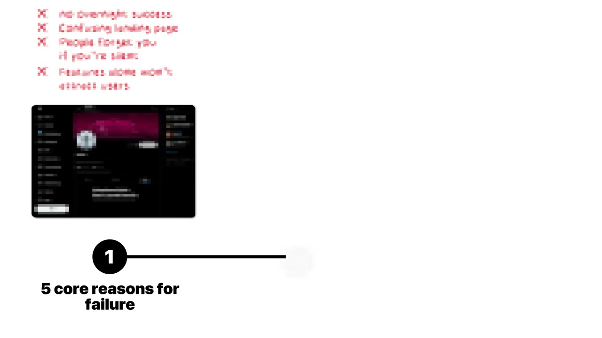
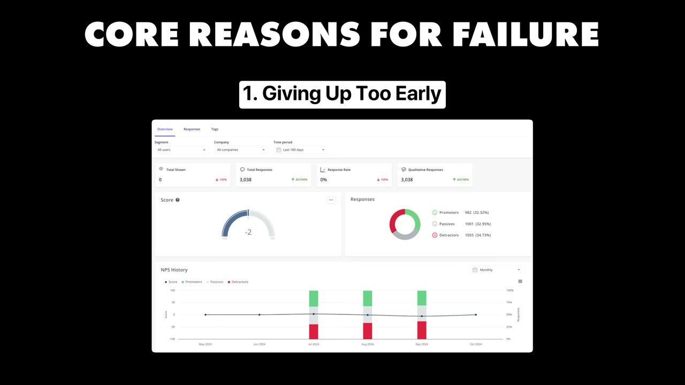
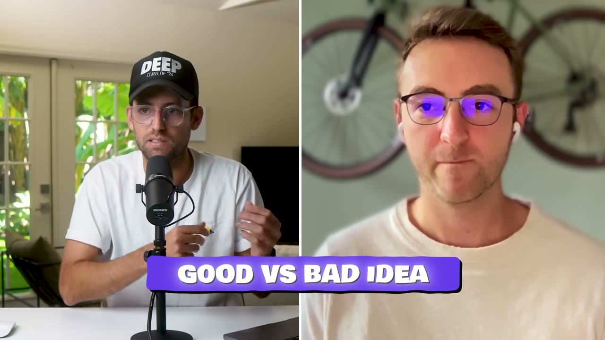
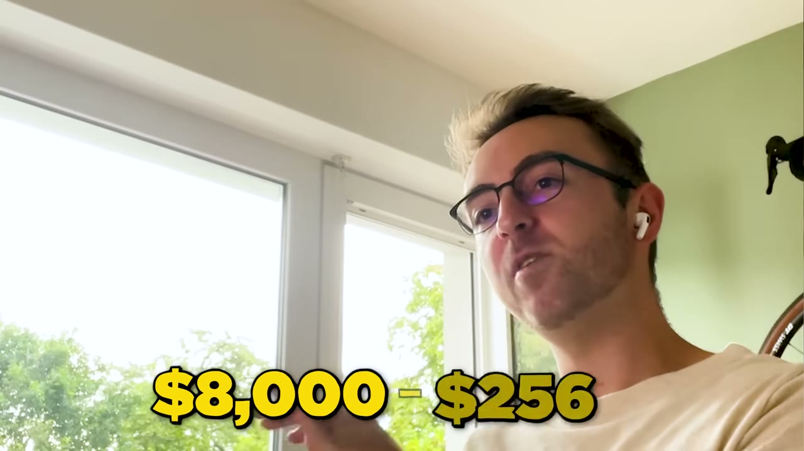
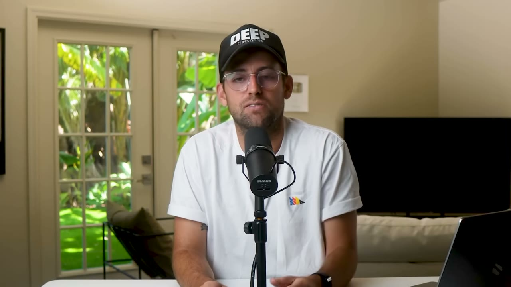

# Uneed — 30 lần thất bại, và bài học đắt nhất không nằm ở lần thành công

> **Tóm tắt 30 giây.** Thomas Sanlis ra mắt hơn 30 dự án trong nhiều năm, gần như tất cả đều chết. GitHub của anh là một nghĩa trang repo bỏ hoang. Dự án thứ 31 — Uneed, một directory công cụ front-end — cũng chỉ chạm **200 USD/tháng** rồi dừng. Anh pivot nó thành **nền tảng launch cạnh tranh với Product Hunt**, doanh thu **sụt mạnh ngay lập tức**, rồi vài tháng sau mới bò lên **8.000–10.000 USD/tháng**. Điều khiến lần này khác không phải là ý tưởng hay hơn, mà là anh pivot **đúng lúc cộng đồng indie hacker đang công khai bất mãn với Product Hunt**. Chính anh nói: pivot sớm hơn một năm thì đã là thảm bại.

## 1. Con số

| Chỉ số | Giá trị |
|---|---|
| Doanh thu | 8.000–10.000 USD/tháng, **rất thất thường** |
| Người dùng | 40.000 |
| Khách trả tiền | 2.000 (mua suất bỏ hàng chờ hoặc quảng cáo) |
| Traffic | 30.000 khách/tháng |
| North star của founder | 10.000 click chuyển sang site sản phẩm/tháng |
| Số dự án thất bại trước đó | hơn 30 |
| Nhân sự | 1 |

Lưu ý ngay: founder nhấn mạnh hai lần rằng doanh thu **"rất bất thường, lên xuống nhiều"** vì nó phụ thuộc vào các ý tưởng marketing và độ viral của anh trên mạng xã hội. Đây không phải MRR ổn định kiểu subscription. Đây là doanh thu giao dịch, phụ thuộc vào sự chú ý — cùng loại rủi ro với [GlowUp](../2025-12-17_my-mobile-app-made-800k-in-365-days/case.md).

## 2. Năm lý do dự án chết — theo người đã chết 30 lần ⭐⭐⭐⭐⭐

Đây là phần giá trị nhất video, vì hiếm ai kể thất bại chi tiết đến vậy.

**1. Bỏ cuộc quá sớm.** Anh thấy người ta ra mắt rồi bỏ sau một hai tuần vì không có đăng ký hay đơn hàng nào. Nguyên văn: *"I don't think a product will ever work overnight."*

**2. Mục đích không rõ ràng.** Hàng trăm landing page đẹp, đầy animation, nhưng đọc headline xong không hiểu sản phẩm làm gì. *"Nobody's going to scroll down if they don't understand your headline."*

**3. Mất đà (loss of momentum) — anh nói đây là thứ giết phần lớn dự án của anh.** Cơ chế: build in public tạo ra một dòng nhắc lặp lại tên bạn và tên sản phẩm trên feed người khác. Ngưng nói về nó vài tuần, bạn phải xây lại đà từ đầu. Đà không phải tài sản tích luỹ vĩnh viễn — nó là thứ **bay hơi**.

**4. "Build it and they will come" là sai.** Anh nói thẳng là anh ghét câu này. Không marketing thì không ai đến, bất kể sản phẩm tốt cỡ nào.

**5. Sai thời điểm.** Dự án không chạy vào tháng Giêng không có nghĩa nó không chạy vào tháng Bảy.

## 3. Hai bộ lọc ý tưởng — cái thứ hai gây tranh cãi nhất ⭐⭐⭐⭐⭐

**Bộ lọc 1: "Ý tưởng tốt là ý tưởng bạn biết cách bán."**

Anh đối chiếu chính hai dự án của mình:

| | Gum Affiliates (chết) | Uneed (sống) |
|---|---|---|
| Hiểu thị trường? | Không rành Gumroad, không rành affiliate | Rành Product Hunt, rành indie hacker, rành nền tảng launch |
| Có kênh phân phối? | Không | Tài khoản Twitter cá nhân |
| Có kế hoạch bán? | *"I didn't have a plan"* | Có |

Ba điều kiện anh nêu: **biết thị trường**, hoặc **có kênh phân phối lớn**, hoặc **có một ý tưởng marketing hay**. Thiếu cả ba thì ý tưởng đó là ý tưởng tồi — bất kể nó nghe hay đến đâu.

**Bộ lọc 2: "Không có đối thủ nghĩa là không có thị trường."**

Nguyên văn: *"You're not Steve Jobs. Creating a new market is nearly impossible."*

Đây là một trong những câu trực diện nhất trong toàn bộ kho case này, và nó **trùng khớp với** [Will Cannon](../2025-10-01_my-two-apps-made-30m/case.md) — người xây cả hai công ty bằng cách sao chép kẻ dẫn đầu rồi đọc review 1-2 sao của họ. Uneed cũng vậy: nó là bản thay thế Product Hunt.

## 4. Cơ chế thật sự khiến Uneed thắng: timing như một tài nguyên ⭐⭐⭐⭐⭐

Đây là chỗ tôi cho rằng video có giá trị nhất, và cũng là chỗ dễ bị đọc lướt nhất.

Uneed dưới dạng directory chỉ đạt 200 USD/tháng. Sau khi pivot, **doanh thu tụt xuống** và anh sợ. Vài tháng sau mới hồi. Vậy cái gì thay đổi?

Anh nói rõ: anh **khai thác một cơn drama**. Cộng đồng indie hacker khi đó đang than trên mạng xã hội rằng Product Hunt chỉ ưu ái sản phẩm lớn và người có audience lớn, còn họ thì không được featured. Nguyên văn: *"That was the right moment to launch a concurrent, an alternative to Product Hunt."* Và: **pivot cùng ý tưởng đó sớm hơn một năm thì "could have been a huge failure."**

**Bài học chuyển giao được:** timing không phải may mắn thụ động, nó là một **tín hiệu quan sát được**. Tín hiệu ở đây rất cụ thể — *một nhóm khách hàng đang công khai phàn nàn về kẻ dẫn đầu, cùng lúc, trên một kênh bạn đang có mặt*. Đó là lúc chi phí thuyết phục người ta đổi nhà cung cấp rẻ nhất. Chờ đợi tín hiệu này khác hoàn toàn với "chờ may".

Nó cũng giải thích tại sao chiến lược của anh — **cứ giữ dự án sống và tiếp tục nói về nó** — có ý nghĩa kinh tế: bạn không thể tạo ra drama trong ngành, nhưng bạn có thể ở sẵn đó với một sản phẩm đang chạy khi drama nổ ra.

## 5. Mô hình kiếm tiền: bán sự chú ý, không bán phần mềm

2.000 khách đã trả tiền để **bỏ qua hàng chờ** hoặc **quảng cáo sản phẩm**. Đây là mô hình quảng cáo/marketplace, giống [Cursor Directory](../2025-11-16_my-website-makes-35k-month-built-in-3-hours/case.md) bán job ads. Điểm chung: sản phẩm miễn phí với một phía (người xem), thu tiền phía kia (người muốn được nhìn thấy).

North star anh chọn rất đáng học: **không phải doanh thu, không phải số user, mà là 10.000 click chuyển tiếp sang site của sản phẩm được đăng**. Vì đó là giá trị anh thực sự giao cho người trả tiền. Chọn đúng chỉ số này là chọn đúng thứ để tối ưu.

## 6. Lời khuyên cuối: chống lại chính kênh này ⭐⭐⭐⭐

Câu trả lời của Thomas ở cuối video đi ngược lại thông điệp ngầm của phần lớn nội dung indie hacking:

- Anh **không thể** làm việc 10 tiếng/ngày và nói thẳng là mình không phải kiểu người đó
- Anh cần đạp xe, gặp bạn bè, ra ngoài **mỗi ngày**
- Nguyên văn: *"you have as much chances of becoming rich in a month as winning the lottery"*
- *"marathon, not a sprint"*

Pat Walls cũng chốt lại: *"Almost nobody I know is an overnight success."* Đây là lời thú nhận đáng giá từ chính người vận hành một kênh chuyên kể chuyện thành công.

## 7. Cảnh báo thiên kiến nguồn

- **Video này tồn tại vì khán giả phàn nàn.** Pat mở đầu bằng đúng câu đó: người xem chê kênh chỉ kể chuyện thành công. Nên video này là một phản hồi có chủ đích — tốt cho chúng ta, nhưng đừng nhầm nó với việc kênh đã đổi hướng.
- **Có nhà tài trợ Mobbin** chèn ~55 giây giữa video, và link trong mô tả là link affiliate của Starter Story.
- **Có bán khoá Starter Story Build** ở cuối, gắn ngay sau câu "gần như không ai thành công sau một đêm" — một cú chuyển rất khéo từ sự thật khiêm tốn sang lời chào hàng.
- **Không có ảnh chụp dashboard doanh thu nào** trong video. Con số 8–10K là lời tự khai.
- **Danh sách 30 dự án thất bại không được kiểm chứng chi tiết** — chỉ lướt qua GitHub. Chúng ta không biết mỗi dự án được đầu tư bao nhiêu công sức thật sự, nên "30 lần thất bại" có thể là 30 lần thử vài ngày chứ không phải 30 lần dốc sức.

## 8. Áp dụng cho tôi (indie hacker VN)

**Sao chép được ngay:**

1. **Bộ lọc ba câu hỏi trước khi code:** Tôi có biết thị trường này không? Tôi có kênh phân phối không? Tôi có một ý tưởng marketing cụ thể chưa? Không có ít nhất một cái — đừng bắt đầu. Đây là bộ lọc rẻ nhất trong toàn bộ kho case.
2. **Săn tín hiệu drama.** Lập một danh sách theo dõi những nền tảng đang có người dùng bất mãn công khai. Khi cơn bất mãn nổ ra, ai đã có sẵn sản phẩm chạy sẽ hưởng gần như toàn bộ.
3. **Chọn north star là giá trị giao cho người trả tiền,** không phải doanh thu. Với Uneed đó là click chuyển tiếp.
4. **Duy trì đà bằng nhịp đăng đều,** vì đà bay hơi chứ không tích luỹ.

**Rào cản thật:**

- **Kênh phân phối của Thomas là tài khoản Twitter tiếng Anh xây nhiều năm.** Đây là thứ không sao chép được trong vài tháng. Cùng vấn đề với [Cursor Directory](../2025-11-16_my-website-makes-35k-month-built-in-3-hours/case.md) — "3 tiếng build" giấu 2 năm build in public.
- **Uneed cạnh tranh trực tiếp với Product Hunt**, một thương hiệu toàn cầu. Muốn thắng phải có uy tín trong cộng đồng indie hacker phương Tây. Người Việt vào ngách này gần như chắc chắn thua ở khâu tin cậy, trừ khi đã có tên tuổi sẵn.
- **Doanh thu phụ thuộc sự chú ý** nghĩa là tháng nào bạn không viral, tháng đó bạn nghèo. Không có hợp đồng, không có khoá chặt khách hàng.

**Khi KHÔNG nên dùng mô hình này:**

- Khi bạn cần thu nhập ổn định để sống. Dao động 8–10K nghe nhẹ, nhưng đó là 25% biên độ, và founder thừa nhận nó phụ thuộc vào việc anh có nghĩ ra ý tưởng marketing hay không.
- Khi bạn chưa có audience. Marketplace là bài toán con gà quả trứng gấp đôi: cần cả người đăng sản phẩm lẫn người xem. Không audience nghĩa là không bên nào chịu đến trước.
- Với người muốn xây tài sản bán được: mô hình phụ thuộc cá nhân founder (Twitter của anh ấy) rất khó bán lại — khác hẳn [SEO asset kiểu DuckMath](../2026-03-01_i-make-15k-month-from-one-website/case.md).

## Nguồn

- Video: [How I Finally Built a $10K/Month SaaS (30 Failures)](https://www.youtube.com/watch?v=rPguT9z6kRQ) — Starter Story, 23/08/2025, 60.756 view
- [Transcript đầy đủ](transcript.md) · [Ảnh chụp màn hình](screenshots/)
