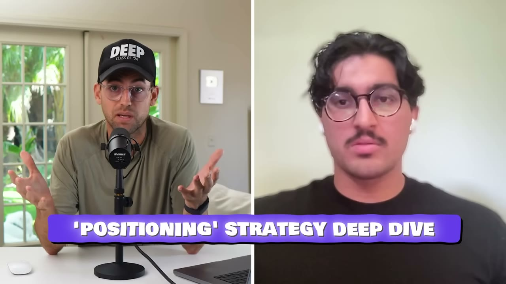
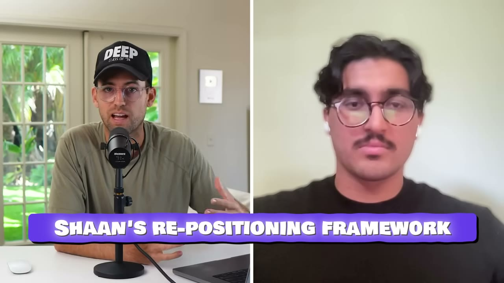

# Alia — $4M ARR sau khi đổi một câu mô tả về chính mình

> **Tóm tắt 30 giây:** Shaan Arora và hai co-founder mất **6 tháng chỉ để đi từ 2 khách lên 20 khách**. Sản phẩm là *"công cụ giáo dục khách hàng kiêm chương trình loyalty"* — và chính Shaan thừa nhận việc anh **không giải thích nổi nó là cái gì** chính là triệu chứng của vấn đề. Rồi một co-founder đọc cuốn **Obviously Awesome** của April Dunford, và họ phát hiện ra: khách hàng tốt nhất của họ không hề nghĩ họ là công cụ giáo dục — **khách nghĩ họ là công cụ pop-up**. Họ đổi toàn bộ ngôn ngữ (không đổi sản phẩm) và đi tới **$4M ARR với ~1.500 thương hiệu**, trong đó có Nike Strength và TOMS. Điều đáng học nhất không phải "hãy repositioning" — mà là **thứ tự 4 bước họ dùng để test lại vị thế mới ở nơi RẺ NHẤT trước**.

## 1. Con số

| Chỉ số | Giá trị |
|---|---|
| ARR | **$4 triệu** (~$333K/tháng) |
| Số thương hiệu đang dùng | ~1.500 |
| Khách hàng lớn | **Nike Strength**, **TOMS** |
| Thời gian từ 2 → 20 khách | **6 tháng** (trước repositioning) |
| Thời gian từ "0" → $4M ARR | ~1 năm (sau repositioning) |
| Quy mô đội | 12 người, 3 co-founder |
| Vốn | bootstrapped |
| Sản phẩm | **chỉ pop-up**, không làm gì khác |

**Đọc kỹ câu này trước khi tin con số:**

> *"Trước cuốn sách, chúng tôi **không có product market fit, không có doanh thu, và không có khách hàng vui vẻ**."*

Nhưng ngay sau đó anh cũng nói: *"Chúng tôi khởi nghiệp. Chúng tôi có **hai khách hàng**."* và *"mất khoảng **6 tháng để đi từ 2 khách lên khoảng 20 khách**."*

Hai mươi khách trả tiền không phải "$0 doanh thu". **"Zero to 4 million ARR" là cách kể chuyện, không phải kế toán.** Con số thật có lẽ là: từ vài nghìn đô MRR lên $333K MRR trong khoảng một năm — vẫn cực ấn tượng, nhưng khác về mặt bài học. Nó có nghĩa là repositioning **nhân lên một cỗ máy đã chạy được**, chứ không phải khởi động một cỗ máy chết.

## 2. Positioning thật sự là gì — và vì sao nó không phải marketing ⭐⭐⭐

Vấn đề gốc, nói bằng chính triệu chứng của nó:

> *"Trước khi là pop-up, nó kiểu như là một chương trình loyalty, một công cụ giáo dục. Và **cái sự khó khăn khi tôi phải mô tả cho bạn nó là gì — đó chính là biểu hiện của vấn đề positioning**."*

Phản ứng của khách hàng tiềm năng lúc đó:

> *"Người ta kiểu 'ê, cái này hay đấy, **nhưng nó nằm ở đâu trong tech stack của tôi? Tôi thay thế cái gì bằng nó? Và các anh là ai?**'"*

**Ba câu hỏi đó là bài test positioning tốt nhất tôi từng thấy trong kho này.** Nếu prospect của bạn hỏi cả ba, bạn không có vấn đề sản phẩm — bạn có vấn đề danh mục.

Sau khi đọc sách:

> *"Chúng tôi hiểu ra rằng **khách hàng nhìn nhận chúng tôi khác với thứ chúng tôi đang bán**. Đó là viên thuốc đắng phải nuốt, nhưng là viên quan trọng."*

Và đây là câu đắt nhất cả video:

> *"**Tôi muốn tin rằng khách hàng tốt nhất của tôi nghĩ về chúng tôi như một công cụ giáo dục khách hàng mới mẻ và sáng tạo. Sự thật phũ phàng là họ không nghĩ vậy. Họ nghĩ về chúng tôi như một công cụ pop-up.**"*

Rồi phép suy luận đưa họ tới quyết định:

> *"Nếu khách hàng tốt nhất của chúng tôi nghĩ chúng tôi là công cụ pop-up **và họ trả tiền cho việc đó**, thì bạn có thể ngoại suy và nói rằng **một đống khách hàng khác cũng nghĩ chúng tôi là công cụ pop-up có thể sẽ trả tiền cho chúng tôi**. Tôi nghĩ chúng ta nên cố trở thành cái thứ đó và xem thị trường phản ứng thế nào."*

**Cơ chế — vì sao positioning tạo ra doanh thu chứ không chỉ tạo ra sự rõ ràng:**

Người mua B2B không mua sản phẩm, họ mua **một ô trong ngân sách và một ô trong tech stack**. Cả hai ô đó đều đã có tên sẵn. Khi bạn tự gọi mình bằng một cái tên không tồn tại trong đầu họ ("công cụ giáo dục khách hàng"), bạn buộc họ phải làm ba việc miễn phí cho bạn: tạo ra một danh mục mới, tự thuyết phục danh mục đó đáng có ngân sách, rồi bảo vệ nó với sếp. Gần như không ai làm.

Khi bạn tự gọi mình bằng cái tên đã có sẵn trong đầu họ ("pop-up"), bạn thừa hưởng **toàn bộ nhu cầu, ngân sách và ngôn ngữ đã tồn tại** của danh mục đó. Bạn chỉ còn phải thắng một câu hỏi duy nhất: *trong danh mục này, tại sao là bạn?*

Đây cũng là lý do bước đầu tiên trên website của họ là câu hỏi *"why?"*:

> *"Chúng tôi giỏi nhất về pop-up. **Vì sao?** Và rồi chúng tôi trả lời câu why đó ngay ở đây."*

## 3. Bốn đòn bẩy — và THỨ TỰ triển khai mới là bài học thật ⭐⭐⭐

Shaan liệt kê 4 thứ họ đổi:

### (1) Copy trên website
- Tagline: **"the next generation of pop-ups"**
- Menu không ghi "product features" mà ghi **"pop-up features"** — *"vì đây chỉ là những tính năng tồn tại bên trong pop-up, đó là tất cả những gì chúng tôi làm."*
- Một khối trả lời trực tiếp câu hỏi *"vì sao chúng tôi giỏi nhất về pop-up"*

### (2) Content
- Bài viết về **đúng cái business bạn vừa định vị lại**
- Anh ghim một post lên profile cá nhân: *"We're at 3.5 million ARR. **Pop-ups. That's all we do. Pop-ups equals Alia. Alia equals pop-ups.**"*
- *"Khi ai đó muốn tra tôi là ai, **đây là thứ đầu tiên họ thấy**. Và liên tưởng đó dính lại trong đầu họ. **Đó là chỗ bạn tạo ra inbound demand và đó là chỗ bạn scale một business.**"*

### (3) Sales call
- *"Tôi vào call và nói 'Chào, tôi là Shaan. **Tôi là CEO. Chúng tôi làm pop-up.**' Đó là cách tôi mở đầu mọi cuộc gọi."*

### (4) Ngôn ngữ nội bộ
- *"Rất, rất quan trọng. **Mọi người trong đội đều phải hiểu rằng: trước đây chúng ta là công ty này, chúng ta vẫn là công ty này, nhưng chúng ta tập trung vào thứ mới này.**"*

**Nhưng phần thực sự đáng tiền là ở chỗ khác.** Khi Pat hỏi *"có sợ không khi quyết định repositioning cả công ty?"*, Shaan trả lời:

> *"**Không phải làm hết một lúc.** Tôi có nhắc 4 thứ — website, content, sales call, ngôn ngữ nội bộ. **Chúng tôi không làm cả 4 cùng lúc.** Nó là: *hãy lên một cuộc gọi bán hàng. Hãy nói về pop-up. Hãy nói chúng ta là công cụ pop-up. Và xem close rate ra sao.* Tôi nhận ra rất nhanh trên các cuộc gọi rằng **chúng ngắn hơn, súc tích hơn, và chốt được thường xuyên hơn**. Okay, sales call ổn. Giờ thử làm content quanh nó. Và content đó làm tốt hơn content trước. Okay, thú vị đấy. **Rồi** chúng tôi đổi website, **rồi** đổi ngôn ngữ nội bộ, và rồi mọi người kiểu 'à, cái này hợp lý'. Giờ thì lật hết mọi thứ."*

**Vẽ ra thành thang chi phí — đây là thứ đáng ghi lại:**

| Bước | Chi phí đảo ngược | Thời gian có tín hiệu | Tín hiệu đo được |
|---|---|---|---|
| 1. Sales call | **gần như bằng 0** | vài ngày | close rate, độ dài call |
| 2. Content | thấp | 2-4 tuần | engagement so với bài cũ |
| 3. Website | trung bình | 1-2 tháng | conversion, inbound |
| 4. Ngôn ngữ nội bộ | **cao — khó rút lại** | vài tháng | sự đồng thuận của đội |

**Cơ chế:** anh test giả thuyết đắt nhất (chúng ta là công ty pop-up) tại điểm rẻ nhất (một câu chào trong cuộc gọi) và với vòng phản hồi nhanh nhất (close rate trong tuần này). Mỗi bước sau chỉ được mở khoá khi bước trước cho tín hiệu dương.

Đây là **cách chống lại rủi ro lớn nhất của repositioning**: bạn đốt hết uy tín nội bộ và bên ngoài cho một vị thế mới rồi phát hiện nó sai. Bằng cách này, nếu sai ở bước 1, chi phí là một tuần và không ai bên ngoài biết.

**Hãy so với cách hầu hết người làm:** thuê designer, làm lại website, đổi logo, viết thông cáo — tức là bắt đầu ở bước 3-4, nơi đắt nhất và chậm nhất có tín hiệu.

## 4. Ngôn ngữ nội bộ — bước bị bỏ qua nhiều nhất, và nó là kênh phân phối ⭐⭐

Hầu hết người đọc sẽ coi bước 4 là chuyện nội bộ nhàm chán. Shaan giải thích vì sao nó không phải:

> *"...để khi họ làm CS, khi họ làm sales, khi ban quản lý ra quyết định, **họ nói cùng một ngôn ngữ mà bạn nói với chính mình**. Có những tweet khác nhau và những kênh Slack nơi người ta hỏi **'công cụ pop-up nào tốt nhất?'**. Và nếu bạn có được liên kết giữa bản thân và **cái thứ cụ thể đó**, thì **mọi câu trả lời sẽ là 'dùng cái này'** — vì họ biết bạn làm đúng cái đó."*

**Cơ chế — và đây là điểm sâu nhất của case:** positioning không phải để khách hiểu bạn. Nó là để **người thứ ba giới thiệu bạn giùm bạn**.

Word-of-mouth chỉ chạy được khi có một **truy vấn** để bạn khớp vào. Khi ai đó gõ vào Slack *"best pop-up tool?"*, bộ nhớ của mọi người sẽ trả về tên nào được gắn chặt nhất với ba chữ "pop-up tool". Nếu bạn tự mô tả là *"nền tảng tương tác khách hàng thế hệ mới"*, bạn không tồn tại trong bất kỳ truy vấn nào — không ai bao giờ hỏi câu đó.

**Công thức rút ra:** viết ra chính xác câu hỏi mà bạn muốn là câu trả lời. Không phải khẩu hiệu — mà là **truy vấn**. *"Best pop-up tool"*. *"Công cụ triển khai phần mềm qua Intune"* ([Packager](../2026-03-15_i-make-60k-month-from-the-most-boring-saas-on-the-in/case.md)). *"App theo dõi peptide"* ([Pep AI](../2026-05-24_i-built-a-30k-month-in-35-days/case.md)). Nếu không viết ra được truy vấn đó bằng dưới 5 từ, bạn chưa có positioning.

## 5. Cách không bỏ cuộc khi bạn có đúng 2 khách hàng ⭐⭐

Câu hỏi rất thật: bạn có 2 khách hàng — một là em họ của co-founder, một là bạn cùng lớp — và bạn nhìn lên mạng thấy người ta có hàng nghìn.

> *"Cách tôi đặt mục tiêu cho bản thân rất đơn giản. **Chúng tôi có hai khách hàng. Mục tiêu duy nhất của tôi là kiếm được người thứ ba.** Có người thứ ba rồi, mục tiêu là người thứ tư, thứ năm, cứ thế. Để khi bạn tới ba khách hàng, bạn kiểu 'wow, tôi có khách mới', chứ không phải **'chết tiệt, công ty kia có 20.000 khách, bao giờ tôi mới tới đó'**. **Việc tới đó ngay không phải việc của bạn.** Việc của bạn là tới khách thứ ba, thứ tư, thứ năm, và **hiểu bằng cách nào bạn tới được năm khách đó**."*

**Cơ chế:** vế cuối mới là vế quan trọng. Đây không phải lời động viên kiểu "chia nhỏ mục tiêu". Đó là một **quy trình học**: mỗi khách hàng mới là một điểm dữ liệu về *cách* bạn có được khách. Với 5 điểm dữ liệu bạn bắt đầu thấy pattern. Bạn không thể học được gì từ mục tiêu "20.000 khách" vì nó không cho bạn hành động nào để lặp lại.

Điều làm anh yên tâm khi ở đáy:

> *"Thứ cho tôi sự an ủi là **những người đó cũng từng ở vị trí của tôi**, và họ cũng từng có hai khách hàng không muốn dùng sản phẩm của họ, rồi cuối cùng họ tìm ra được."*

## 6. Framework 3 bước để tự làm lại

Khi được hỏi đưa framework cho người xem, Shaan nói:

1. **Đọc cuốn sách.** *"Tôi không có liên hệ gì với cuốn sách. Tôi chỉ nghĩ nó là cuốn sách hay. Đọc nó."* — **Obviously Awesome** của April Dunford.
2. **Làm các bài tập positioning trong sách.** *"Trong sách họ bảo hãy tự hỏi những câu hỏi này. Và bạn nên tự hỏi chính mình những câu đó. Nếu bạn có team, có co-founder, hãy làm cùng họ."*
3. **Thử vị thế mới trên sales call và xem phản ứng trực tiếp.** *"Xem chúng có chốt thường xuyên hơn không. Xem họ có hiểu sản phẩm rõ hơn không. Và xem họ có hào hứng hơn không."*

> *"Nếu bạn làm ba việc đó, bạn sẽ có cảm nhận tốt về việc: **okay, vị thế mới này có tốt hơn không?** Kể cả nếu không, bạn có thể quay lại bước hai, nói chuyện với co-founder lần nữa, đi qua các câu hỏi đó lần nữa, và có lẽ nghĩ ra một vị thế mới tốt hơn."*

**Điểm mạnh của framework này:** nó có **vòng lặp thất bại** rõ ràng. Hầu hết lời khuyên positioning không nói bạn phải làm gì khi vị thế mới cũng sai. Ở đây câu trả lời là: quay lại bước 2, không phải bỏ cuộc.

## 7. Nhảy vào một ngành đông đúc và thắng bằng tốc độ ⭐⭐

Đây là chỗ Alia mâu thuẫn thẳng với phần lớn kho này.

| Chiến lược | Ai | Logic |
|---|---|---|
| **Tìm ngách chán, không ai cạnh tranh** | [Packager](../2026-03-15_i-make-60k-month-from-the-most-boring-saas-on-the-in/case.md), [Savvy Nomad](../2026-05-21_i-make-1-7m-year-in-the-most-boring-niche-imaginable/case.md), [Cut Coach](../2026-04-08_my-app-makes-20k-month-how-i-found-a-simple-idea-and/case.md) | Không đối thủ = không phải giải thích vì sao bạn tốt hơn |
| **Nhảy vào danh mục đông nghẹt và làm cái tên được nhớ nhất** | **Alia** (case này) | Danh mục đã có = ngân sách đã có, truy vấn đã có, chỉ cần thắng bộ nhớ |
| **Chọn thị trường đã có PMF rồi lấy review 1-2 sao của kẻ dẫn đầu** | [UpLead + Signaturely](../2025-10-01_my-two-apps-made-30m/case.md) | Lai giữa hai cái trên |

Pop-up cho e-commerce là một trong những danh mục phần mềm đông đúc nhất tồn tại — Klaviyo, Privy, Justuno, OptiMonk, cộng hàng trăm app trên Shopify App Store, cộng chính tính năng pop-up có sẵn trong mọi nền tảng email marketing.

Shaan trả lời câu "vì sao vẫn thắng được":

> *"Từ góc độ founder trẻ, **đồng tiền duy nhất bạn có mà các ông lớn trong ngành không có là TỐC ĐỘ và SỰ CẤP BÁCH**. Các ông lớn không di chuyển nhanh được như bạn. Khi chúng tôi chọn repositioning, chúng tôi bước vào một ngành mà người ta đã ở đó **15-20 năm**, và họ sẽ di chuyển chậm hơn chúng tôi một cách tất yếu vì họ là công ty lớn hơn. **Bạn có lợi thế đó.**"*

Cộng với lời khuyên cuối:

> *"**Làm một thứ, và làm thứ đó một cách phi thường.**"*

**Điều kiện phân định — khi nào chiến lược nào đúng:**

- **Vào danh mục đông đúc thắng khi** (a) danh mục đó là một **feature** chứ không phải một **suite** — pop-up là thứ có thể làm tốt hơn hẳn bằng cách chỉ làm mỗi nó; (b) các đối thủ lớn coi nó là tính năng phụ nên không dồn kỹ sư vào; (c) có ngân sách sẵn và người mua đã biết mình cần nó. Đây chính xác là mô hình *"micro version của SaaS tỷ đô"* — cùng logic với [Shipper](../2026-05-28_i-built-a-micro-version-of-a-1b-saas-now-i-make-50k/case.md) và [Yadaphone](../2025-10-16_i-rebuilt-a-1b-app-and-now-make-14k-month/case.md).
- **Tìm ngách chán thắng khi** bạn không có đội 12 người, không làm sales call được, và cần một thị trường nơi chỉ cần xuất hiện là đã dẫn đầu.

**Với indie hacker VN, vế thứ hai gần như luôn là lựa chọn đúng.** Alia có 12 người và một đội bán hàng nói tiếng Anh gọi điện cho thương hiệu Mỹ. Bài học chuyển giao được từ case này **không phải chiến lược thị trường của họ** — mà là **cơ chế positioning ở mục 2-4**, thứ áp dụng được ở mọi quy mô.

## 8. Những chỗ cần soi kỹ — số liệu và cách kể chuyện

**(a) "Zero to $4M ARR" không đúng nghĩa đen.** Đã phân tích ở mục 1. Họ có ~20 khách trả tiền trước đó. Con số tăng trưởng thật vẫn rất mạnh nhưng bài học khác đi: repositioning là **chất xúc tác cho một cỗ máy đã chạy**, không phải phép hồi sinh.

**(b) "Đọc một cuốn sách và mọi thứ nổ tung."** Pat nói nguyên văn *"you can read one book and it can change your entire business"*. Đây là khung kể chuyện gọn gàng nhưng nó bỏ qua: một đội 12 người, ba co-founder, một sản phẩm đã chạy được vài năm, một quy trình sales call đủ khối lượng để đo close rate trong vài ngày, và khả năng tiếp cận thương hiệu như Nike Strength. **Cuốn sách là bước cuối cùng bị thiếu, không phải toàn bộ cỗ máy.**

**(c) Không có bằng chứng tài chính nào.** Không có ảnh Stripe, không có ChartMogul, không có bảng ARR. Con số duy nhất được cho xem là một tweet ghim của chính founder ghi $3.5M ARR. Đây là mức bằng chứng thấp hơn hẳn nhiều case khác trong kho.

**(d) Cảnh báo thiên kiến nguồn.** Kênh Starter Story nay thuộc HubSpot và bán khoá học Starter Story Build. Video chèn quảng cáo khoá học **hai lần** (phút 6:07 và phút cuối). Đáng chú ý hơn: chương ở phút 6:07 tên là *"Build your own AI app"* — nhưng **Alia không phải AI app**, đó là công cụ pop-up. Chương quảng cáo được gắn vào một câu chuyện không liên quan tới AI. Kênh cũng chỉ phỏng vấn người đã thành công: chúng ta không nghe từ hàng nghìn công ty đã repositioning và vẫn chết.

**(e) Nhưng bằng chứng gián tiếp thì mạnh.** Nike Strength và TOMS là những cái tên có thể kiểm chứng công khai, và ~1.500 thương hiệu là con số cụ thể chứ không tròn trịa đáng ngờ. Không có lý do để nghi ngờ quy mô tổng thể.

## 9. Áp dụng cho tôi (indie hacker VN)

**Sao chép được ngay — và đây là case có tỉ lệ giá trị trên chi phí cao nhất:**

- **Bài test 3 câu hỏi** (mục 2). Trong 5 cuộc trò chuyện tới với khách tiềm năng, đếm xem có bao nhiêu người hỏi: *nó nằm ở đâu trong stack của tôi? tôi thay cái gì bằng nó? các anh là ai?* Nếu cả ba câu xuất hiện đều đặn, bạn có vấn đề positioning, không phải vấn đề sản phẩm. **Chi phí: 0 đồng.**
- **Bài tập truy vấn 5 từ** (mục 4). Viết ra chính xác câu mà bạn muốn là câu trả lời khi ai đó hỏi trong một group Facebook/Slack/Zalo. Không viết được trong 5 từ = chưa có positioning.
- **Hỏi khách hàng tốt nhất họ nghĩ bạn là gì.** Đây là dữ liệu Shaan đã có sẵn nhưng không muốn nghe. Bạn có thể lấy nó trong một buổi chiều bằng 5 tin nhắn. Câu hỏi đúng: *"nếu anh giới thiệu chúng tôi cho một người bạn, anh sẽ mô tả chúng tôi bằng câu gì?"*
- **Thang chi phí 4 bước** (mục 3). Test vị thế mới ở nơi rẻ nhất trước. Với indie hacker không có sales call, thang tương đương là: **DM/email 1-1 → một bài post → landing page → đổi toàn bộ branding**. Nguyên tắc giữ nguyên.
- **Mục tiêu "khách hàng thứ ba"** (mục 5) khi bạn đang ở đáy và mất động lực.
- **Đọc Obviously Awesome.** Sách của April Dunford, có bản ebook, đọc trong 3-4 tiếng. Đây là chi phí thấp nhất trong toàn bộ case.

**Rào cản thật, không tô hồng:**

- **Đây là công ty 12 người bán B2B cho thị trường Mỹ.** Kênh phân phối cốt lõi của họ là **sales call bằng tiếng Anh với thương hiệu e-commerce Mỹ**, cộng một profile X có uy tín trong cộng đồng đó. Đó là hai thứ khó nhất để tái tạo từ VN. Điểm số `replicability_vn: 2` phản ánh chiến lược thị trường, không phải bài học positioning.
- **Danh mục pop-up cụ thể thì đừng đụng vào.** Klaviyo, Justuno, OptiMonk và hàng trăm app Shopify đã ở đó, cộng chính Alia. Bài học chuyển giao được là **phương pháp**, không phải thị trường.
- **Sales call là kênh có trần thời gian.** Nếu bạn làm một mình, mỗi call là 30-45 phút của bạn. Mô hình này chỉ scale khi bạn có đội — hoặc khi positioning tốt tới mức inbound đủ lớn để bạn chọn lọc.
- **"Speed vs incumbents" là lợi thế có hạn sử dụng.** Nó đúng trong 12-24 tháng đầu. Sau đó bạn trở thành incumbent của chính mình, và người tiếp theo sẽ dùng đúng lập luận này để đánh bạn.
- **Rủi ro của việc chỉ làm một thứ.** *"Do only one thing"* là lời khuyên tốt cho tăng trưởng nhưng nó tập trung toàn bộ rủi ro vào một danh mục. Nếu Shopify hoặc Klaviyo quyết định làm pop-up tốt hơn và miễn phí, Alia không có gì khác để bán. Đây là cùng loại rủi ro nền tảng đã xuất hiện ở nhiều case trong kho.

**Khi nào KHÔNG dùng mô hình này:**

- **Khi bạn thật sự chưa có khách hàng nào.** Positioning là bài tập **đọc lại tín hiệu từ khách hàng hiện có**. Shaan có 20 khách để soi. Với 0 khách, bạn không có dữ liệu — bạn cần validate trước, và câu trả lời nằm ở [Rootd](../2025-08-31_this-app-made-over-1m/case.md) (đọc review đối thủ) hoặc [Once](../2026-05-10_i-built-a-20k-month-app-in-83-days/case.md) (outreach thủ công), không phải ở đây.
- **Khi vấn đề thật của bạn là sản phẩm không dùng được.** Repositioning một sản phẩm tệ chỉ làm nhiều người thất vọng nhanh hơn. Dấu hiệu phân biệt: nếu khách **hiểu** bạn là gì nhưng vẫn không mua → vấn đề sản phẩm hoặc giá. Nếu khách **không hiểu** bạn là gì → vấn đề positioning.
- **Khi bạn ở B2C mobile.** Cơ chế "một truy vấn, một cái tên" hoạt động qua Slack, Twitter và word-of-mouth trong ngành B2B. Ở B2C mobile, cơ chế tương đương là ASO và thuật toán TikTok — khác hoàn toàn.
- **Khi bạn đang tạo ra một danh mục mới thật sự.** Có những sản phẩm buộc phải tự tạo danh mục. Nhưng đó là đường đắt và chậm, và bạn phải chọn nó có ý thức — không phải vì bạn không dám gọi mình bằng cái tên tầm thường mà khách đã dùng.

## Nguồn

- Video: <https://www.youtube.com/watch?v=MLAH5OZ5FO8> (11:40, đăng 27/08/2025, 74.885 view)
- [Transcript đầy đủ](transcript.md) · [Ảnh chụp](screenshots/)
- Sách được nhắc tới: **Obviously Awesome** — April Dunford
- Lưu ý ASR: transcript tự động đọc "Shaan" thành "Sean"/"Shawn", và một chỗ đọc "pop-up tools" thành "pop-up books". Tên đúng lấy từ `description` trong meta.json (Shaan Arora, x.com/iamshaanarora).
