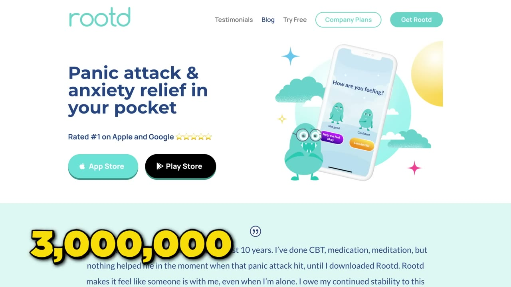
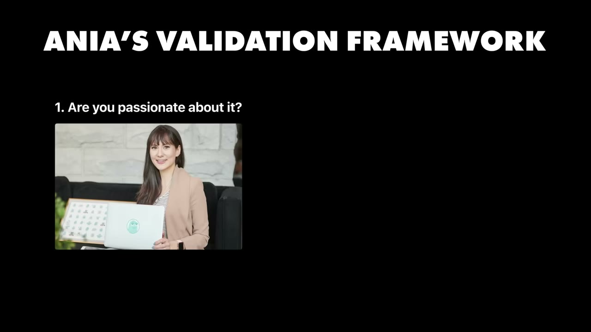
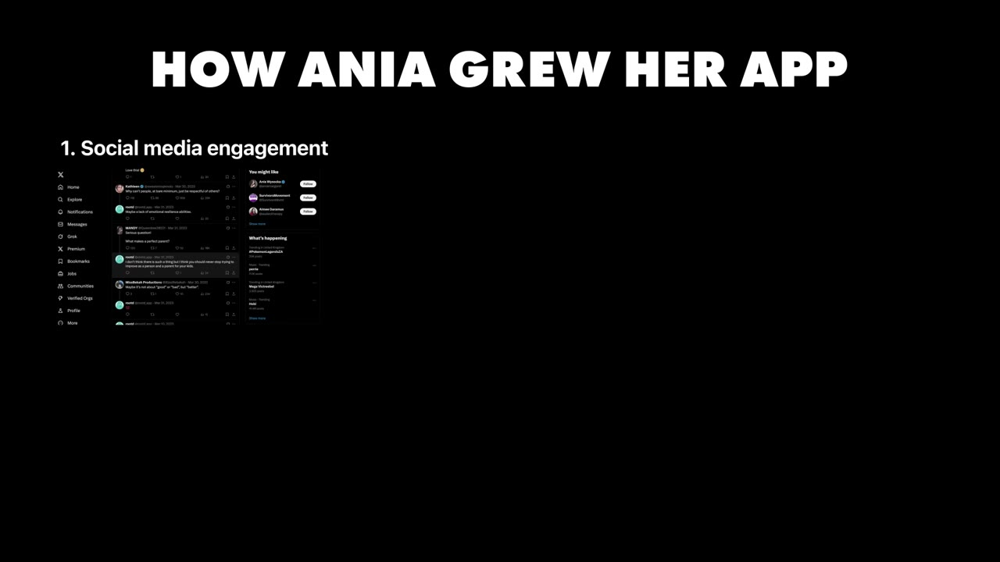
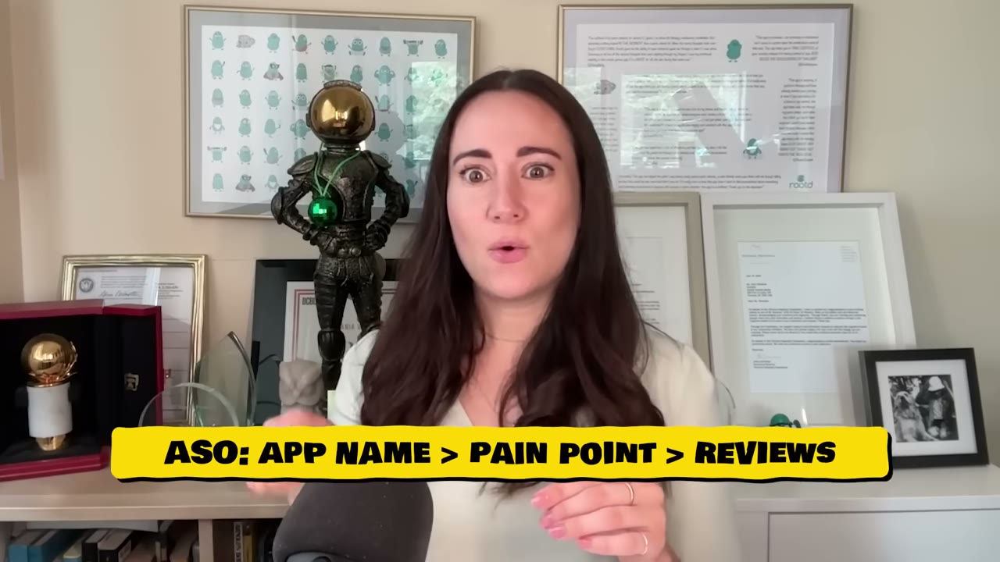

# This app made over $1M

✅ **Đã phân tích sâu** → [`case.md`](case.md)

| | |
|---|---|
| **Video** | <https://www.youtube.com/watch?v=VfNRd5Rk0cM> |
| **Đăng** | 31/08/2025 |
| **Thời lượng** | 15:15 |
| **Lượt xem** | 632,069 |
| **Lượt thích** | 16,065 |
| **Video ID** | `VfNRd5Rk0cM` |

## Trong thư mục này

| File | Nội dung |
|---|---|
| [`case.md`](case.md) | **Phân tích đầy đủ** — ý tưởng, validate, GTM, áp dụng ở VN |
| [`meta.json`](meta.json) | Metadata gốc (chapters, heatmap, mô tả) |
| [`screenshots/`](screenshots/) | 10 ảnh 720p |

## Mô tả gốc

Ania Wysocka experienced a panic attack in university and decided to build a mental health app. Today, Rootd has been downloaded more than 4M times, and has made over $1M!
0:00 - Intro
0:55 - Who is Ania & what she built
1:11 - Idea for Rootd
1:51 - How Ania validated the idea
2:40 - Ania's validation framework
3:16 - Building as a non-technical person
4:11 - Building the full app
5:10 - Growth timeline of Rootd
5:38 - Building alongside a 9-5
6:29 - Build your own app
7:10 - Growth: from 0 to 4M downloads
8:42 - Growth hack: being helpful on social media
9:18 - Ania's successful app playbook

## Số liệu bắt được từ transcript

> Các đoạn founder nhắc tới con số, kèm timestamp để tua thẳng tới đó trong video.

_(không bắt được con số nào)_

## Chương

- `00:00` Intro
- `00:55` Who is Ania & what she built
- `01:11` Idea for Rootd
- `01:51` How Ania validated the idea
- `02:40` Ania's validation framework
- `03:16` Building as a non-technical person
- `04:11` Building the full app
- `05:10` Growth timeline of Rootd
- `05:38` Building alongside a 9-5
- `06:29` Build your own app
- `07:10` Growth: from 0 to 4M downloads
- `08:42` Growth hack: being helpful on social media
- `09:18` Ania's successful app playbook
- `10:32` The most important metric
- `11:28` What is Rootd
- `13:03` Listen to users
- `14:26` The final word

## Ảnh

1. `01_01m07s_ch-who-is-ania-what-she-built.jpg` — 
2. `02_02m03s_ch-how-ania-validated-the-idea.jpg` — 
3. `03_02m52s_ch-ania-s-validation-framework.jpg` — 
4. `04_03m28s_ch-building-as-a-non-technical-person.jpg` — 
5. `05_04m23s_ch-building-the-full-app.jpg` — 
6. `06_05m22s_ch-growth-timeline-of-rootd.jpg` — 
7. `07_06m41s_ch-build-your-own-app.jpg` — 
8. `08_07m23s_replay.jpg` — 
9. `09_08m36s_replay.jpg` — 
10. `10_09m30s_ch-ania-s-successful-app-playbook.jpg` — 

---

← [Quay lại index](../../index.md) · [Toàn bộ video](../README.md)
