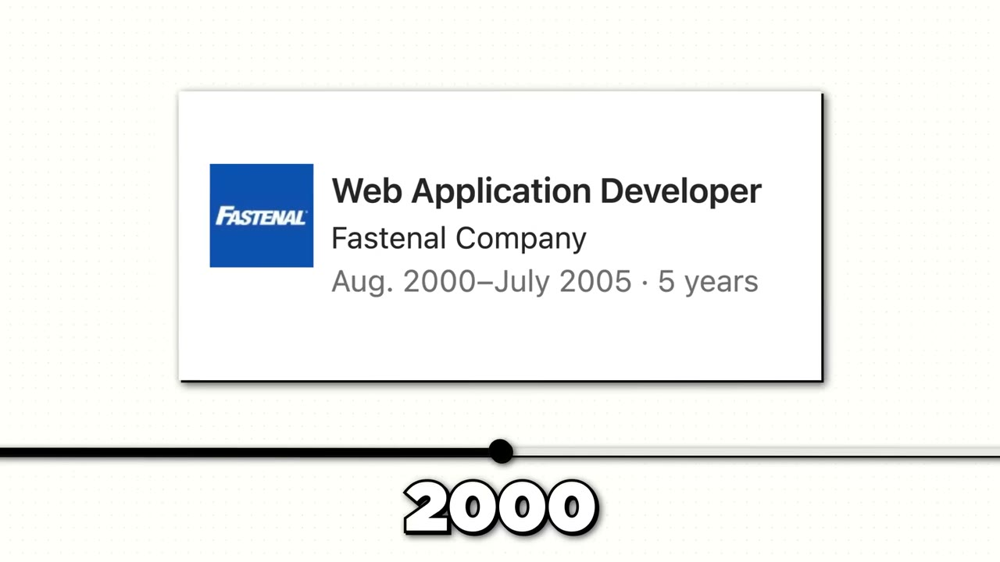

# My app makes $41K/month

✅ **Đã phân tích sâu** → [`case.md`](case.md)

| | |
|---|---|
| **Video** | <https://www.youtube.com/watch?v=a1EXyJlSx9g> |
| **Đăng** | 13/09/2025 |
| **Thời lượng** | 11:47 |
| **Lượt xem** | 139,779 |
| **Lượt thích** | 3,544 |
| **Video ID** | `a1EXyJlSx9g` |

## Trong thư mục này

| File | Nội dung |
|---|---|
| [`case.md`](case.md) | **Phân tích đầy đủ** — ý tưởng, validate, GTM, áp dụng ở VN |
| [`meta.json`](meta.json) | Metadata gốc (chapters, heatmap, mô tả) |
| [`screenshots/`](screenshots/) | 10 ảnh 720p |

## Mô tả gốc

Joe Rozek went out for brunch and got an idea that would become a $40K/month app.
0:00 - Intro
0:55 - Who is Joe
1:08 - Joe's background
1:48 - Idea for Waitly
2:48 - How to get your business foundations right
3:55 - Growth timeline: 0 to $40K MRR
4:29 - Growth strategies
5:19 - What is Waitly
6:11 - Competing with $1B companies
7:11 - How to come up with a successful idea
7:56 - Opportunities to build now
8:51 - Numbers behind Waitly
9:12 - Tech stack
9:30 - Costs & margins
10:28 - Keep going
This video is an educational case study of one founder’s experience. It is not financial advice and d

## Số liệu bắt được từ transcript

> Các đoạn founder nhắc tới con số, kèm timestamp để tua thẳng tới đó trong video.

_(không bắt được con số nào)_

## Chương

- `00:00` Intro
- `00:55` Who is Joe
- `01:08` Joe's background
- `01:48` Idea for Waitly
- `02:48` How to get your business foundations right
- `03:55` Growth timeline: 0 to $40K MRR
- `04:29` Growth strategies
- `05:19` What is Waitly
- `06:11` Competing with $1B companies
- `07:11` How to come up with a successful idea
- `07:56` Opportunities to build now
- `08:51` Numbers behind Waitly
- `09:12` Tech stack
- `09:30` Costs & margins
- `10:28` Keep going

## Ảnh

1. `01_00m37s_usd-40-000.jpg` — 
2. `02_01m20s_ch-joe-s-background.jpg` — 
3. `03_02m00s_ch-idea-for-waitly.jpg` — 
4. `04_02m41s_metric.jpg` — 
5. `05_03m57s_replay.jpg` — 
6. `06_04m48s_usd-130.jpg` — 
7. `07_05m31s_ch-what-is-waitly.jpg` — 
8. `08_06m23s_ch-competing-with-1b-companies.jpg` — 
9. `09_09m41s_usd-700.jpg` — 
10. `10_10m26s_replay.jpg` — 

---

← [Quay lại index](../../index.md) · [Toàn bộ video](../README.md)
