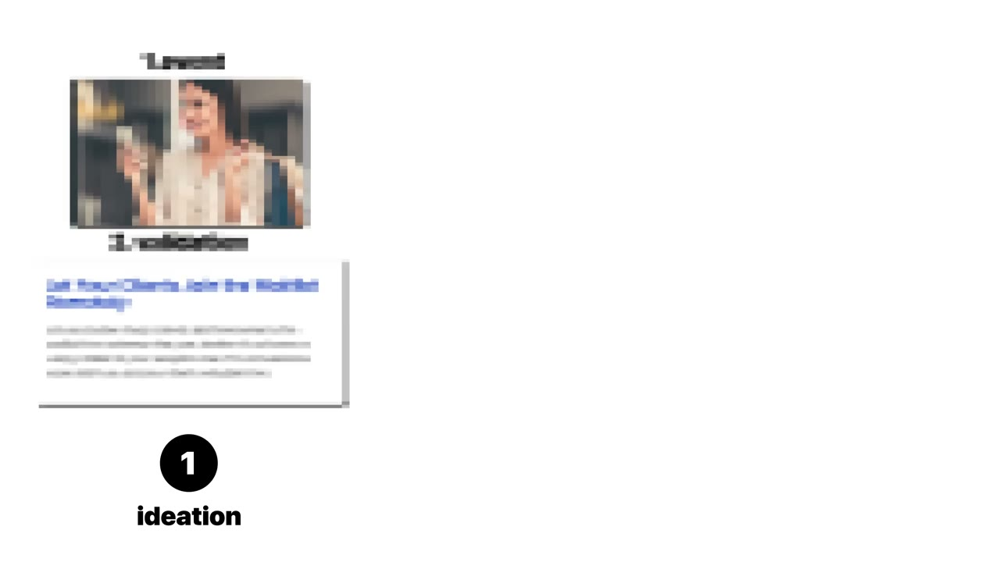
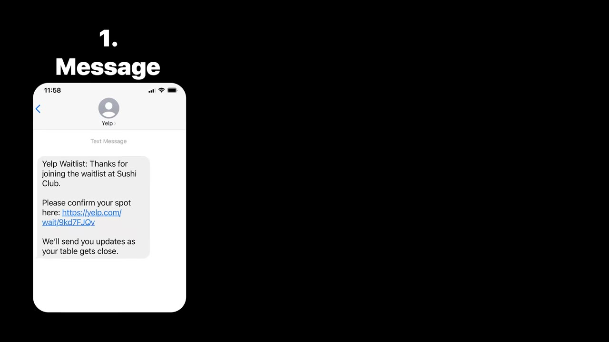
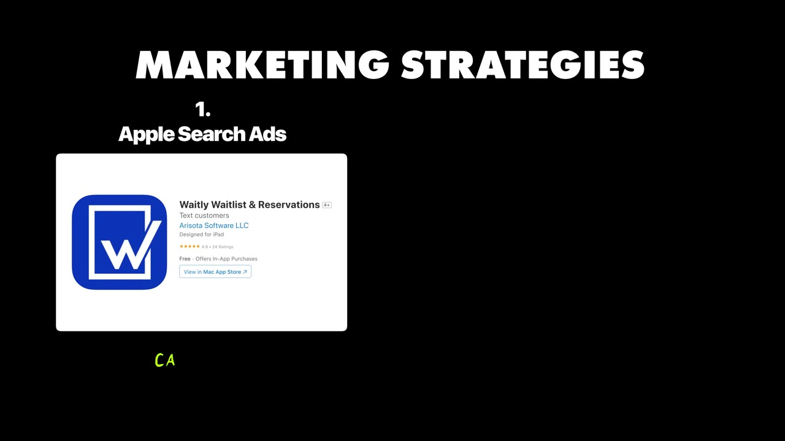
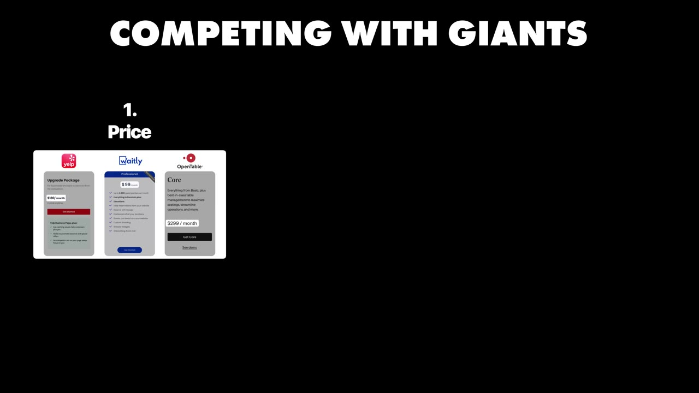
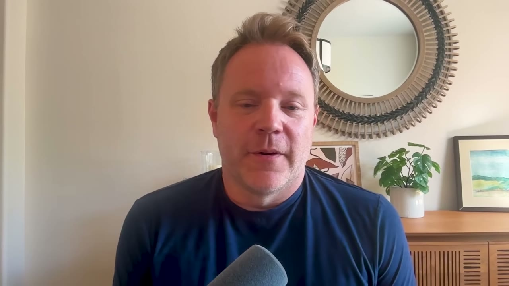
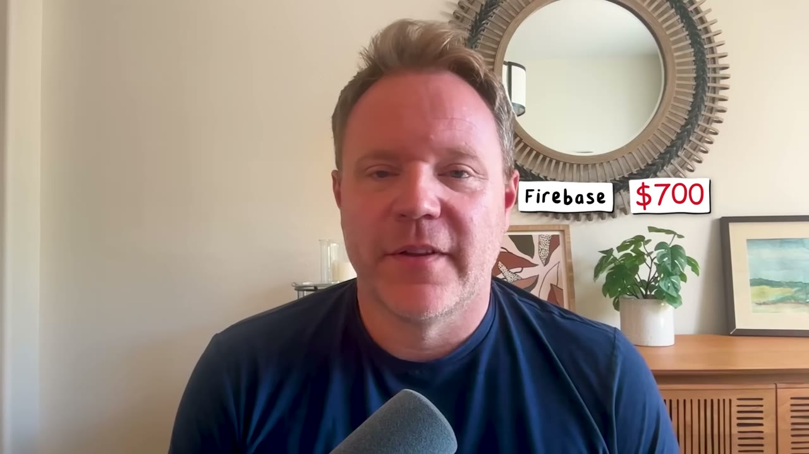

# Waitly — 41K USD/tháng từ một nỗi bực mình 90 giây khi đi ăn sáng

> **Tóm tắt 30 giây:** Năm 2017 Joe Rozek đi ăn brunch, bị đưa vào danh sách chờ, bấm link xem thời gian chờ thì Yelp bắt **tải app và tạo tài khoản**. Đăng ký xong thì bàn đã sẵn sàng. Anh nghĩ: cái link này lẽ ra chỉ nên mở một trang web. Tám năm sau, Waitly thu **hơn 40.000 USD/tháng**, có **700 khách trả tiền**, đã xếp **59 triệu lượt khách** vào danh sách chờ — và vẫn là **một người làm**. Điều đắt nhất trong case này không phải ý tưởng, mà là bộ số kinh tế đơn vị anh công khai: **CAC 130 USD đổi lấy LTV 750-1.000 USD** — nhưng anh chỉ dám chi **500 USD quảng cáo/tháng**. Nghịch lý đó là bài học thật của video.

## 0. Đọc trước khi tin số

- Transcript là phụ đề tự động nên **sai tên riêng liên tục**: `Weightley` / `Whe` = **Waitly**, `Doula` = **doola** (nhà tài trợ), `Freshes` = **Freshdesk**, `Calendarly` = **Calendly**, `MR` = **MRR**, `weight list` = **wait list**. Tên đúng lấy từ `meta.json`.
- **Không có một ảnh dashboard nào** trong toàn bộ video. Mọi con số đều là founder tự đọc ra. Đây là mức bằng chứng thấp hơn các case có ảnh Stripe/RevenueCat trong kho.
- Kênh Starter Story đã được HubSpot mua lại và **bán khoá học Starter Story Build**. Ngay trong video này, nhà tài trợ **doola** chiếm gần một phút, và phần kết bán khoá học với thông điệp *"dùng AI đi từ ý tưởng đến app trong vài ngày"*. Hãy để ý mâu thuẫn: **case đang kể là một hành trình 8 năm** — xem mục 6.

## 1. Con số

| Chỉ số | Giá trị |
|---|---|
| Doanh thu | Hơn 40.000 USD/tháng; năm nay trên đà vượt 500.000 USD |
| Khách trả tiền | 700 (Mỹ + Canada) |
| Doanh nghiệp đã từng dùng thử | Hơn 15.000 |
| Lượt khách đã xếp hàng qua Waitly | Hơn 59 triệu |
| Giá niêm yết | 100 USD/tháng phẳng, mở khoá toàn bộ tính năng |
| CAC | ~130 USD |
| LTV | 750-1.000 USD |
| Chi quảng cáo hiện tại | ~500 USD/tháng |
| Chi phí cố định | ~4.000 USD/tháng (+ 1% RevenueCat, 3% Stripe) |
| Team | 1 người |

**Đường doanh thu 8 năm — founder đọc thẳng từng năm:**

| Năm | Doanh thu năm |
|---|---|
| Năm 1 | 0 USD (chỉ có bản miễn phí) |
| Năm 2 | 14.500 USD |
| Năm 3 | ~116.000 USD |
| Năm 4 | 186.000 USD |
| Năm 5 | 307.000 USD |
| Năm 6 | 354.000 USD |
| Năm 7 | 445.000 USD |
| Năm 8 (đang chạy) | Trên đà vượt 500.000 USD |

**Mâu thuẫn nội bộ cần nói thẳng:** 700 khách × 100 USD/tháng = **70.000 USD/tháng**, nhưng doanh thu thực chỉ ~41.000 USD/tháng. Nghĩa là **doanh thu bình quân mỗi khách chỉ ~59 USD/tháng**, không phải 100. Giải thích hợp lý nhất: 100 USD là **giá bậc cao nhất** ("unlock all the features"), phần lớn khách đang ở bậc rẻ hơn, cộng thêm khách trả theo năm được giảm giá. Khi bạn tự dựng mô hình tài chính cho một sản phẩm tương tự, **đừng lấy giá niêm yết nhân số khách** — hãy dùng ARPU thực.

Tương tự, "15.000 doanh nghiệp đã thử / 700 đang trả tiền" **không phải tỉ lệ chuyển đổi 4,7%**. Đó là **tổng dùng thử tích luỹ 8 năm** so với **ảnh chụp số khách đang trả tiền hôm nay** — đã trừ toàn bộ churn của 8 năm. Hai con số không cùng đơn vị thời gian.

## 2. Nguồn gốc ý tưởng — nỗi bực 90 giây ⭐⭐⭐

Câu chuyện đáng học vì nó **nhỏ tới mức ai cũng từng gặp**:

1. Sáng thứ Bảy 2017, quán đông, Joe bị đưa vào wait list.
2. Nhận SMS có link *"Click here to see your wait time"*.
3. Bấm vào → **Yelp bắt tải app và tạo tài khoản** chỉ để xem còn phải chờ bao lâu.
4. Đăng ký xong thì nhận tin: bàn đã sẵn sàng. **Toàn bộ công sức đó vô nghĩa.**
5. Vợ anh nói: *"Hay là anh làm một app wait list đi."*

> **Cơ chế vì sao khe hở này tồn tại:** Yelp và OpenTable **không kiếm tiền từ việc bạn xem được thời gian chờ**. Họ kiếm tiền từ cover fee trên mỗi lượt đặt bàn và từ việc bành trướng mạng lưới thực khách. Vì vậy mọi điểm chạm đều bị thiết kế để **ép tải app và tạo tài khoản** — đó là tài sản của họ. Trải nghiệm tệ không phải do họ kém, mà **do mô hình kinh doanh của họ bắt buộc phải như thế**. Đó chính là loại khe hở mà công ty lớn không thể tự vá — và là chỗ duy nhất một người làm một mình có cửa thắng.

Đây là bài kiểm tra bạn nên áp vào mọi ý tưởng: *nếu ông lớn sửa lỗi này, họ có mất doanh thu không?* Nếu **có**, khe hở đó bền. Nếu **không**, họ sẽ vá trong một quý và bạn chết.

Timeline build cũng rất thật, không tô hồng:
- **6 tháng**: có prototype chạy được, thêm được người vào danh sách, **chưa nhắn tin được cho ai**.
- **~1,5 năm**: quyết tâm đẩy lên App Store. Tuần đầu: **10 lượt tải**.
- **~2 năm**: mới bật in-app purchase — và đó mới là lúc "doanh nghiệp" bắt đầu.

## 3. Kinh tế đơn vị và nghịch lý 500 USD ⭐⭐⭐

Founder đưa ra bộ số hiếm khi được nói công khai:

| | |
|---|---|
| CAC qua Apple Search Ads | **~130 USD** |
| LTV | **750-1.000 USD** |
| Tỉ lệ LTV/CAC | **5,8x - 7,7x** |

> *"As much money as we can put into those ads, there's definitely ROI there."*

Nhưng ở phần chi phí, anh nói chi Apple Search Ads hiện tại chỉ **~500 USD/tháng**.

**Đây là mâu thuẫn quan trọng nhất của video và không ai trong video nêu ra.** Nếu mỗi 130 USD thật sự đẻ ra 750-1.000 USD, người tỉnh táo sẽ đổ 50.000 USD/tháng vào đó. Anh chỉ đổ 500. Vì sao?

Giải thích khả dĩ nhất — và đây là bài học cho bạn:

> **Trong ngách dọc siêu hẹp, kênh quảng cáo bị chặn bởi LƯỢNG TÌM KIẾM, không phải bởi ngân sách.** Mỗi tháng chỉ có chừng đó chủ nhà hàng ở Mỹ gõ "waitlist app" trên App Store. Bạn mua hết 100% số impression đó rồi thì tiền thừa **không có chỗ tiêu**. Tăng ngân sách chỉ làm CAC leo dốc khi bạn phải đấu giá các từ khoá lệch ý định.

Hệ quả thực tế cho indie hacker:
- Ngách hẹp = CAC rẻ, ROI đẹp, **nhưng trần tăng trưởng thấp và cứng**. Waitly mất 8 năm đi từ 0 lên 500K/năm chính vì lý do này.
- Nếu bạn muốn tăng trưởng dốc, bạn **phải mở kênh thứ hai** (nội dung, outbound, partnership) chứ không thể chỉ bơm tiền.
- Ngược lại: ngách hẹp cho phép **một người** giữ được toàn bộ doanh nghiệp trong 8 năm mà không bị đối thủ vốn mạnh dí. Đây là đánh đổi có ý thức, không phải thất bại.

Phần nurture sau khi có lead cũng rất cơ bản mà hiệu quả — đúng kiểu B2B nhỏ:
- Email hướng dẫn bắt đầu + video quick start.
- **Onboarding qua Zoom**, kể cả đào tạo nhân viên của quán nếu cần.
- **Gần cuối trial thì tung khuyến mãi** để chốt lần mua đầu.

Với LTV 750-1.000 USD, bỏ 30 phút Zoom cho một khách là hoàn toàn có lãi. Đó là lý do chiến thuật "thủ công" này chỉ hợp với sản phẩm có LTV đủ cao — đừng bê sang app B2C 50 USD/năm.

## 4. Cách thắng công ty tỉ đô — ba lớp phòng thủ ⭐⭐⭐

Joe nêu ba điểm, nhưng cơ chế đằng sau mới là thứ đáng chép lại:

**1. Giá — và cấu trúc giá, không chỉ mức giá**

Waitly: **100 USD/tháng phẳng**, mở khoá tất cả.
Yelp/OpenTable: phí cố định hàng trăm USD/tháng **cộng cover fee trên mỗi lượt đặt bàn**.

Cơ chế: cover fee làm chi phí của nhà hàng **tăng theo thành công của chính họ**. Quán càng đông càng trả nhiều. Giá phẳng biến chi phí thành **một dòng cố định dễ duyệt** — thứ mà chủ quán nhỏ cần để ngủ ngon. Bạn không cần rẻ hơn; bạn cần **dễ dự đoán hơn**.

**2. Đơn giản — và đơn giản mở ra ngành khác**

Vì Waitly *chỉ* làm wait list và đặt chỗ, nó không dính vào nghiệp vụ nhà hàng. Kết quả bất ngờ: **thời COVID, hàng loạt chuỗi bán lẻ bị giới hạn số người trong cửa hàng cần cho khách xếp hàng ngoài trời.** Waitly vào **hơn 700 địa điểm** và **10x doanh thu năm đó**.

> **Cơ chế:** tính năng càng ít chuyên biệt cho một ngành thì càng dễ **nhảy ngang sang ngành khác** khi có cú sốc thị trường. Đối thủ tỉ đô của anh gắn chặt vào nghiệp vụ nhà hàng nên không nhảy được.

**Nhưng phải nói thẳng phần may mắn:** cú 10x đó là **COVID** — một sự kiện một lần trong đời, không lặp lại được và không nằm trong tầm kiểm soát của founder. Nhìn lại bảng doanh thu: năm 2 là 14.500 USD, năm 3 vọt lên 116.000 USD. Cú nhảy 8 lần đó trùng khớp với đại dịch. **Nếu bỏ năm COVID ra, đường tăng trưởng của Waitly là một đường dốc rất thoải.** Đừng lập kế hoạch dựa trên việc có một đại dịch.

**3. Chăm sóc khách hàng — bắt máy ngay**

> *"Anytime that someone calls our support line, someone answers immediately. They're always surprised that someone picked up right away."*

Cơ chế: với khách B2B nhỏ, **nhấc máy trong 3 giây là một tính năng mà công ty tỉ đô không thể sao chép** — không phải vì họ không biết làm, mà vì với hàng trăm nghìn khách, chi phí đó phá vỡ mô hình của họ. Đây là lợi thế **cấu trúc** của người nhỏ, không phải là "chăm chỉ hơn".

## 5. Sản phẩm thật sự làm gì ⭐⭐

Đơn giản đến mức gần như thô sơ — và đó là điểm mạnh:

1. Nhân viên nhập: tên khách, số người, thời gian chờ ước tính, số điện thoại, ưu tiên chỗ ngồi (trong nhà/ngoài trời).
2. Sau vài giây, khách nhận **SMS** báo đã vào danh sách chờ.
3. SMS có link, bấm vào **xem ngay thời gian chờ — không phải tải app nào cả**.
4. Khi bàn sẵn sàng, nhân viên bấm "notify" → khách nhận SMS thứ hai.
5. Phục vụ xong thì tick khỏi danh sách.

Toàn bộ giá trị nằm ở **bước 3**: chính xác là nỗi bực mình đã đẻ ra sản phẩm. Sản phẩm này là *một câu than phiền được chuyển thành phần mềm*, không hơn.

## 6. Khung tìm ý tưởng của Joe — và chỗ nó va vào chính video này ⭐⭐

Bốn bước anh đưa ra:

1. **Bạn không cần ý tưởng mới.** Đầy vấn đề đã có lời giải mà bạn có thể cải thiện; trong lúc cải thiện bạn sẽ tìm ra một ngách bên trong ngành đó.
2. **Dùng AI dựng MVP nhanh** — anh nói giờ chỉ mất vài tuần.
3. **Lấy phản hồi từ khách hàng đầu tiên.**
4. **Chuẩn bị tinh thần cho điều bất ngờ**, phải thích nghi.

> **Mâu thuẫn cần chỉ ra:** bước 2 mô tả một thế giới không phải thế giới mà Waitly được xây. Joe mất **6 tháng** để có prototype chưa nhắn tin được, **1,5 năm** để lên store, **2 năm** để thu đồng đầu tiên. Phần kết video thì bán khoá học "đi từ ý tưởng đến app trong vài ngày". **Hai thông điệp này không thể cùng đúng cho cùng một loại sản phẩm.**
>
> Cách hoà giải: AI rút ngắn **thời gian viết code**, nó không rút ngắn **thời gian tìm được 700 doanh nghiệp chịu trả tiền hàng tháng**. Trong 8 năm của Joe, phần code có lẽ chiếm dưới 20% thời gian. Nếu bạn dùng AI để dựng bản Waitly trong 2 tuần, bạn vẫn còn **7 năm 11 tháng rưỡi của bài toán phân phối** phía trước.

Vài ý tưởng anh đang nghịch, nêu ra để tham khảo cách nghĩ (đều là "vấn đề tôi tự gặp"):
- App quản lý giải pickleball (vì bảng tính điểm của giải anh đang chơi đã loạn).
- Chatbot hỗ trợ khách hàng huấn luyện trên sản phẩm/website cụ thể.
- Một mạng xã hội để kết nối lại bạn bè và gia đình — lại là một pha "đấu với người khổng lồ".

## 7. Chi phí thật của một SaaS solo ⭐⭐

| Hạng mục | Chi phí |
|---|---|
| Firebase (hosting, auth, database) | ~700 USD/tháng |
| **SMS gửi cho khách của các quán** | **~2.500 USD/tháng** |
| Apple Search Ads | ~500 USD/tháng |
| RevenueCat (subscription trong app iOS) | 1% doanh thu |
| Stripe (thanh toán từ website) | 3% doanh thu |
| SurveyMonkey | 35 USD/tháng |
| Hive (quản lý dự án) | 25 USD/tháng |
| Freshdesk (ticket hỗ trợ) | 40 USD/tháng |
| **Claude Code** | **200 USD/tháng** |
| ChatGPT (viết nội dung email) | 20 USD/tháng |
| Calendly (đặt lịch demo) | 12 USD/tháng |
| **Tổng cố định** | **~4.032 USD/tháng** (~10% doanh thu) |

Tech stack: **Firebase** làm nền, **Node.js** cho backend, **Swift** cho app iOS, **ReactJS** cho bản web.

**Ba điều rút ra:**
1. **SMS là biến phí lớn nhất và nó tăng theo lượng khách của khách hàng bạn.** 2.500 USD trên 41.000 USD doanh thu = **6%**. Nếu bạn định giá phẳng cho một sản phẩm có biến phí kiểu này, hãy đưa trần số tin nhắn vào từng gói, nếu không một khách chuỗi lớn sẽ ăn hết biên lợi nhuận của bạn.
2. **Một solo founder năm 2025 trả 200 USD/tháng cho Claude Code** — nhiều hơn cả tiền quảng cáo cho hai tuần. Đây là chuẩn chi phí mới cần đưa vào dự toán.
3. **Không có lương nhân sự.** Đó là toàn bộ lý do biên lợi nhuận đẹp. Ngay khi thuê người đầu tiên, mô hình này đổi hoàn toàn.

## 8. Lời khuyên cuối

> *"Keep going. When that self-doubt creeps in, when you're competing with giants, you're not sure if you can actually go forward, just keep going. **Acknowledge that your doubts have no basis in reality because you cannot predict the future.** Launch your product and see what the future holds."*

Câu này nghe sáo, nhưng đặt cạnh bảng doanh thu 8 năm thì nó có trọng lượng khác: **năm 1 anh kiếm 0 đồng, năm 2 kiếm 14.500 USD.** Gần như mọi người bỏ cuộc ở đúng khoảng đó.

## 9. Áp dụng cho tôi (indie hacker VN)

### Sao chép được gì

- **Mẫu ý tưởng có thể dùng ngay tuần này:** đi tìm điểm chạm mà một công ty lớn **cố tình làm khó** vì mô hình doanh thu của họ. Trong nước có đầy: đặt lịch phòng khám, xếp hàng đăng kiểm, salon tóc, spa, quán bún đông giờ trưa, trung tâm tiêm chủng, cửa hàng sửa xe.
- **Thay SMS bằng Zalo ZNS/OA.** Đây là điểm nội địa hoá quan trọng nhất. SMS brandname ở VN đắt (hàng trăm đồng đến gần 1.000đ/tin) trong khi Zalo ZNS rẻ hơn nhiều và tỉ lệ mở cao hơn. Nguyên tắc cốt lõi của Waitly — **khách không phải cài app nào** — thậm chí còn dễ đạt hơn ở VN vì Zalo đã nằm sẵn trên máy mọi người.
- **Kiến trúc rẻ và một người gánh được:** Firebase + Node + React + một app native. Không microservice, không Kubernetes.
- **Onboarding thủ công qua Zoom/Google Meet là vũ khí, không phải điểm yếu**, miễn LTV đủ cao. Hãy tính ngưỡng: nếu LTV dưới ~100 USD thì đừng làm.
- **Bán bằng giá phẳng dễ dự đoán** cho khách hàng nhỏ, thay vì ăn theo doanh thu của họ.

### Rào cản thật

- **ARPU nội địa thấp một bậc.** Waitly thu ~59 USD/khách/tháng. Ở VN, một quán ăn nhỏ chấp nhận trả khoảng 200.000-500.000đ/tháng cho phần mềm vận hành là đã khá. Để ra 10.000 USD/tháng bạn cần **500-1.000 điểm bán**, không phải 170. Đó là bài toán bán hàng, không phải bài toán code.
- **Không có kênh Apple Search Ads tương đương cho từ khoá tiếng Việt.** Lượng tìm kiếm "app quản lý danh sách chờ" trên App Store VN gần như bằng 0. Bán B2B offline ở VN vẫn phải **đi từng quán hoặc qua đại lý POS**, tức là bạn cần chân chạy hoặc hoa hồng cho partner — chi phí và kỹ năng hoàn toàn khác.
- **Cạnh tranh nội địa đã có sẵn hệ POS.** KiotViet, Sapo, iPOS, Misa CukCuk đang ở trong quán rồi. Waitly thắng vì OpenTable *không thể* bỏ cover fee; các nhà POS VN thì **có thể** bổ sung tính năng danh sách chờ bất cứ lúc nào vì nó không đe doạ doanh thu của họ. **Khe hở này ở VN mỏng hơn ở Mỹ** — hãy kiểm tra kỹ trước khi lao vào.
- **Biến phí tin nhắn ăn vào biên.** 6% doanh thu của Waitly là tiền SMS. Nếu bạn bán 300.000đ/tháng mà quán gửi 2.000 tin ZNS, bạn có thể lỗ trên chính khách hàng tốt nhất.
- **Thời gian.** Tám năm. Kể cả cắt ngắn bằng AI, bạn vẫn đang nhìn vào một mô hình **cộng dồn chậm**, không phải mô hình tạo tiền trong 90 ngày như [lifetime deal của SuperGrow](../2025-09-10_how-i-made-65k-in-3-days/case.md) hay [Floga](../2026-03-29_my-app-made-120k-in-24-hours/case.md).
- **Một người trực điện thoại 24/7 là bất khả thi lâu dài.** Lợi thế "bắt máy ngay" của Joe cũng là cái xích trói anh vào doanh nghiệp.

### Khi nào KHÔNG dùng mô hình này

- **Khi bạn cần dòng tiền trong 12 tháng tới.** Vertical SaaS bán cho doanh nghiệp nhỏ offline có chu kỳ tin cậy dài; năm đầu gần như chắc chắn bằng 0.
- **Khi ngách bạn nhắm không có ai đang trả tiền cho phần mềm vận hành.** Joe không phải dạy nhà hàng rằng "wait list cần phần mềm" — Yelp và OpenTable đã dạy hộ anh và đã lấy tiền của họ. Nếu bạn phải **giáo dục thị trường** thì chi phí gấp nhiều lần, giống cảnh báo của [Deven ở SuperGrow](../2025-09-10_how-i-made-65k-in-3-days/case.md): đừng làm trong thị trường chưa được xác thực.
- **Khi bạn không chịu nổi phần vận hành.** Sản phẩm này thắng nhờ hỗ trợ và onboarding, không nhờ công nghệ. Nếu bạn muốn một sản phẩm tự chạy, hãy nhìn mô hình search-intent như [FollowBuddy](../2026-03-19_i-make-17k-month-with-one-strategy/case.md) hay ngách nội dung như [DuckMath](../2026-03-01_i-make-15k-month-from-one-website/case.md).
- **Khi bạn định dựa vào một cú sốc thị trường.** Cú 10x của Waitly đến từ COVID. Đó không phải chiến lược.

### So sánh nhanh với các case khác trong kho

| Case | Điểm chung | Khác biệt then chốt |
|---|---|---|
| [Packager](../2026-03-15_i-make-60k-month-from-the-most-boring-saas-on-the-in/case.md) | B2B ngách chán, đối thủ lớn lười | Packager bán cho doanh nghiệp online, không cần vận hành offline |
| [Shipper](../2026-05-28_i-built-a-micro-version-of-a-1b-saas-now-i-make-50k/case.md) | Làm bản thu nhỏ của sản phẩm tỉ đô | Shipper cưỡi sóng AI và đạt 50K/tháng trong 9 tháng; Waitly mất 8 năm — khác biệt nằm ở **tốc độ của thị trường**, không ở tài năng founder |
| [Savvy Nomad](../2026-05-21_i-make-1-7m-year-in-the-most-boring-niche-imaginable/case.md) | Ngách chán, khách trả đều | Savvy Nomad có SEO kéo khách; Waitly phải mua từng khách bằng Apple Search Ads |
| [Journable](../2026-03-25_i-built-a-100k-month-android-app/case.md) | Tăng trưởng bằng quảng cáo trả tiền | Journable là B2C, có thể bơm ngân sách gần như vô hạn; Waitly bị trần bởi lượng tìm kiếm của ngách |

## Nguồn

- Video: <https://www.youtube.com/watch?v=a1EXyJlSx9g> (11:47, đăng 13/09/2025, 139.779 view)
- [Transcript đầy đủ](transcript.md) · [Ảnh chụp](screenshots/)
