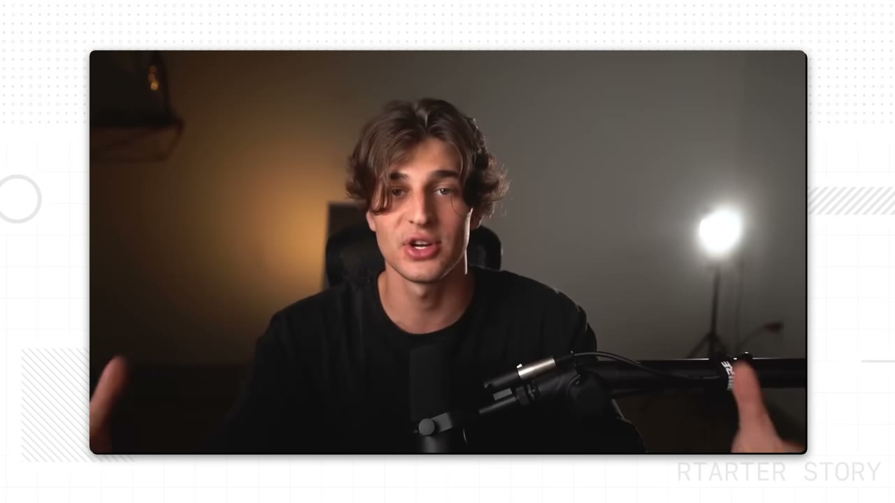
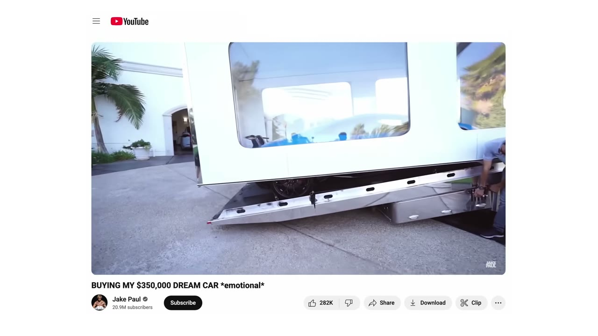
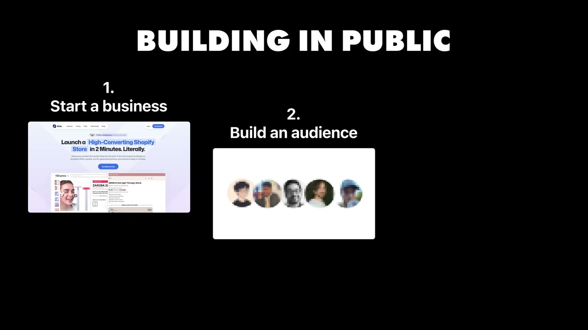
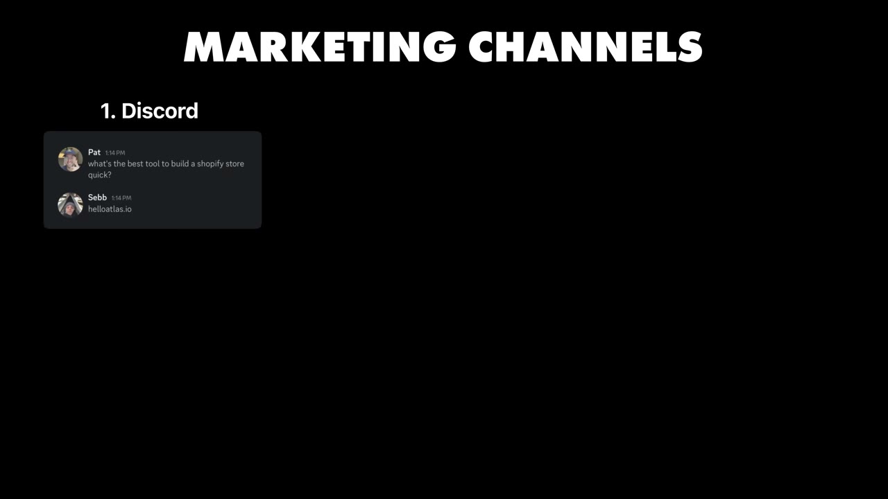

# I Quit YouTube & Built a $1M App (Without My Audience)

✅ **Đã phân tích sâu** → [`case.md`](case.md)

| | |
|---|---|
| **Video** | <https://www.youtube.com/watch?v=laRliIVNZgU> |
| **Đăng** | 17/09/2025 |
| **Thời lượng** | 15:55 |
| **Lượt xem** | 51,759 |
| **Lượt thích** | 1,656 |
| **Video ID** | `laRliIVNZgU` |

## Trong thư mục này

| File | Nội dung |
|---|---|
| [`case.md`](case.md) | **Phân tích đầy đủ** — ý tưởng, validate, GTM, áp dụng ở VN |
| [`meta.json`](meta.json) | Metadata gốc (chapters, heatmap, mô tả) |
| [`screenshots/`](screenshots/) | 10 ảnh 720p |

## Mô tả gốc

Sebastian Ghiorghiu made millions and grew his YouTube channel to 1M subscribers, but then started doubting whether he could build a "real" business, without showing his face on camera. To prove himself, he built an app that now makes $250K/year.
0:00 - Intro
1:17 - Who is Sebastian
1:48 - Building a "real" business
2:36 - Life as an influencer
3:17 - Why Sebastian stopped making videos
4:36 - Why SaaS?
5:56 - Building the business
7:12 - Does audience really matter?
8:22 - "Real" business: pros & cons
9:57 - Sebastian's identity shift
10:31 - Build an audience or a "real" business?
11:28 - Gr

## Số liệu bắt được từ transcript

> Các đoạn founder nhắc tới con số, kèm timestamp để tua thẳng tới đó trong video.

_(không bắt được con số nào)_

## Chương

- `00:00` Intro
- `01:17` Who is Sebastian
- `01:48` Building a "real" business
- `02:36` Life as an influencer
- `03:17` Why Sebastian stopped making videos
- `04:36` Why SaaS?
- `05:56` Building the business
- `07:12` Does audience really matter?
- `08:22` "Real" business: pros & cons
- `09:57` Sebastian's identity shift
- `10:31` Build an audience or a "real" business?
- `11:28` Growth from 0 to $250K/month
- `12:51` Did influencer skills help?
- `13:37` Failure is normal

## Ảnh

1. `01_01m30s_replay.jpg` — 
2. `02_02m48s_ch-life-as-an-influencer.jpg` — 
3. `03_03m29s_ch-why-sebastian-stopped-making-videos.jpg` — 
4. `04_04m48s_ch-why-saas.jpg` — 
5. `05_06m08s_ch-building-the-business.jpg` — 
6. `06_07m24s_ch-does-audience-really-matter.jpg` — 
7. `07_08m34s_ch-real-business-pros-cons.jpg` — 
8. `08_10m09s_ch-sebastian-s-identity-shift.jpg` — 
9. `09_10m54s_replay.jpg` — 
10. `10_11m41s_replay.jpg` — 

---

← [Quay lại index](../../index.md) · [Toàn bộ video](../README.md)
