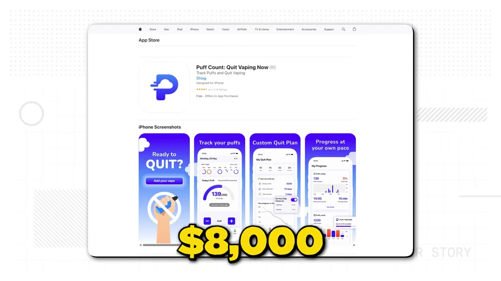
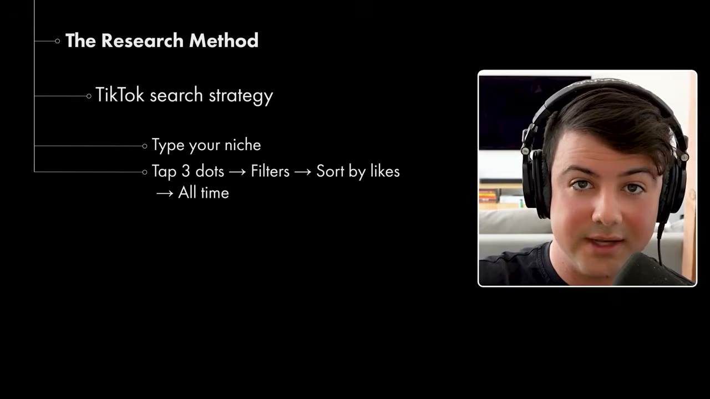
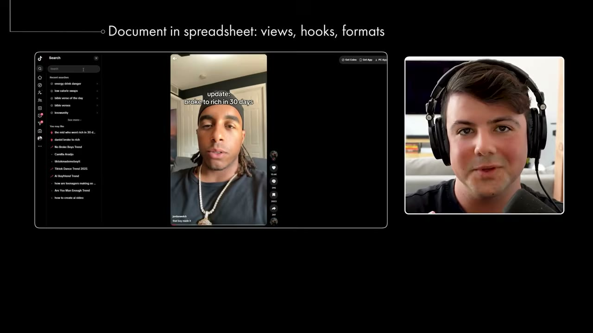
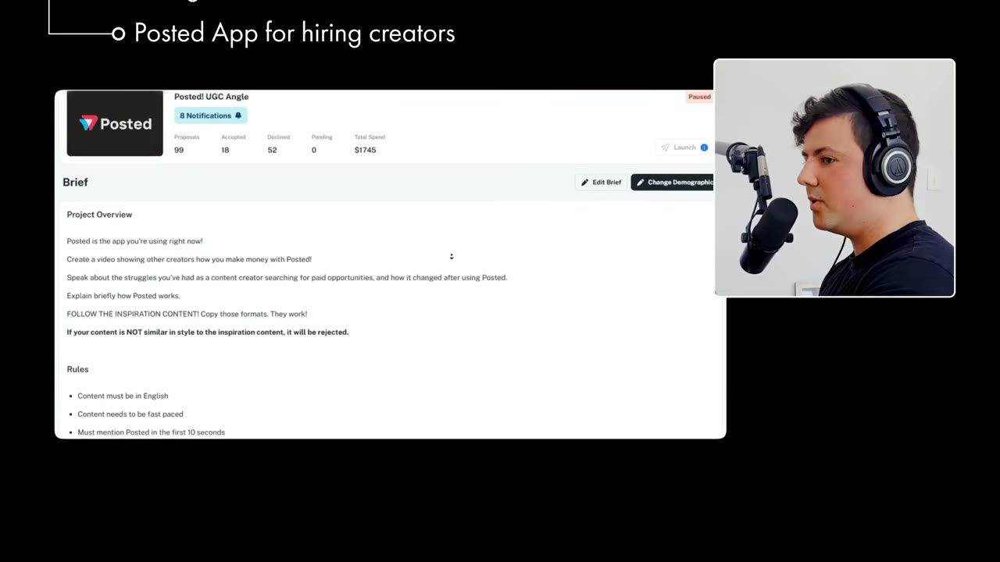
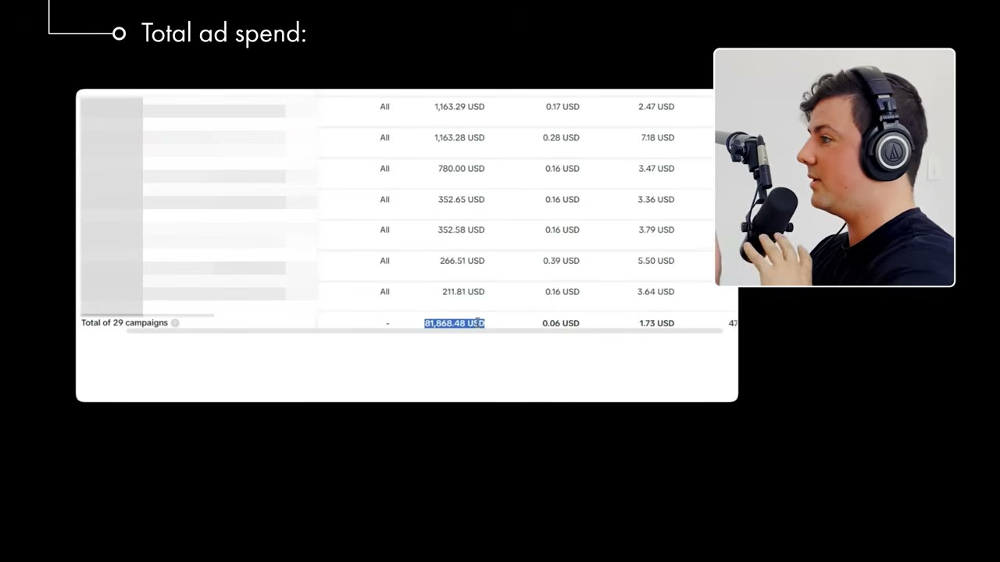
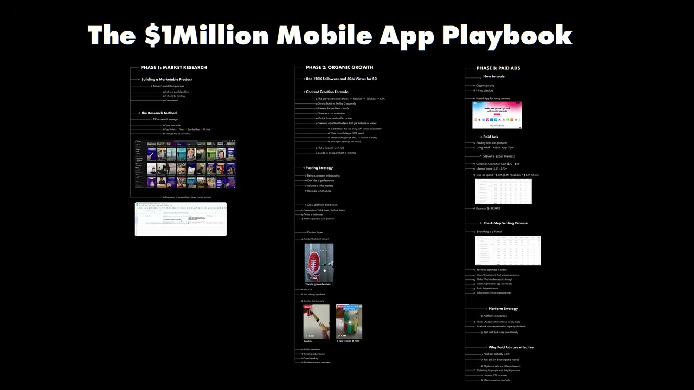

# The $1M Mobile App Playbook

✅ **Đã phân tích sâu** → [`case.md`](case.md)

| | |
|---|---|
| **Video** | <https://www.youtube.com/watch?v=hKqLceTPLWM> |
| **Đăng** | 20/09/2025 |
| **Thời lượng** | 23:55 |
| **Lượt xem** | 127,552 |
| **Lượt thích** | 4,272 |
| **Video ID** | `hKqLceTPLWM` |

## Trong thư mục này

| File | Nội dung |
|---|---|
| [`case.md`](case.md) | **Phân tích đầy đủ** — ý tưởng, validate, GTM, áp dụng ở VN |
| [`meta.json`](meta.json) | Metadata gốc (chapters, heatmap, mô tả) |
| [`screenshots/`](screenshots/) | 10 ảnh 720p |

## Mô tả gốc

This is how you build a marketing-first $1M mobile app.
0:00 - Welcome to $1M Mobile App Playbook
1:13 - What Steven has built
1:43 - The 3-Phase Marketing Playbook
2:48 - Phase 1: Market Research
3:24 - Step 1.1: The Research Method
4:37 - Step 1.2: The $1M Spreadsheet
8:32 - Phase 2: Organic Growth
11:03 - Step 2.1: Posting Schedule
14:15 - Phase 3: Paid Ads
23:15 - The final word
This video is an educational case study of one founder’s experience. It is not financial advice and does not guarantee any income or results. Every business is different and your results may vary.

## Số liệu bắt được từ transcript

> Các đoạn founder nhắc tới con số, kèm timestamp để tua thẳng tới đó trong video.

_(không bắt được con số nào)_

## Chương

- `00:00` Welcome to $1M Mobile App Playbook
- `01:13` What Steven has built
- `01:43` The 3-Phase Marketing Playbook
- `02:48` Phase 1: Market Research
- `03:24` Step 1.1: The Research Method
- `04:37` Step 1.2: The $1M Spreadsheet
- `08:32` Phase 2: Organic Growth
- `11:03` Step 2.1: Posting Schedule
- `14:15` Phase 3: Paid Ads
- `23:15` The final word

## Ảnh

1. `01_00m15s_ch-welcome-to-1m-mobile-app-playbook.jpg` — 
2. `02_01m27s_usd-44-000.jpg` — 
3. `03_03m00s_ch-phase-1-market-research.jpg` — 
4. `04_03m39s_replay.jpg` — 
5. `05_04m49s_ch-step-1-2-the-1m-spreadsheet.jpg` — 
6. `06_08m43s_usd-0.jpg` — 
7. `07_11m15s_ch-step-2-1-posting-schedule.jpg` — 
8. `08_15m08s_replay.jpg` — 
9. `09_17m20s_usd-82-000.jpg` — 
10. `10_22m13s_usd-44-000.jpg` — 

---

← [Quay lại index](../../index.md) · [Toàn bộ video](../README.md)
