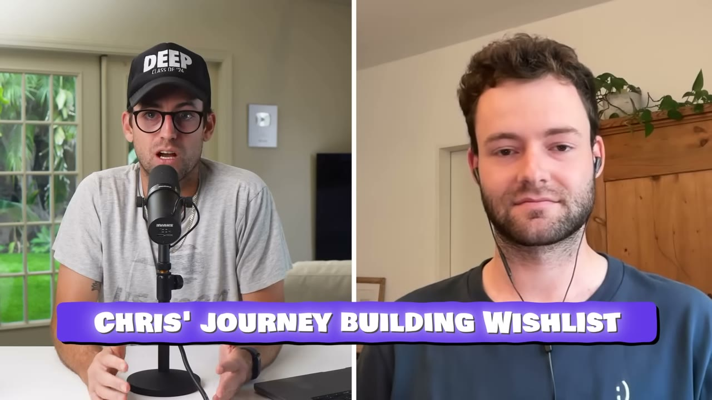
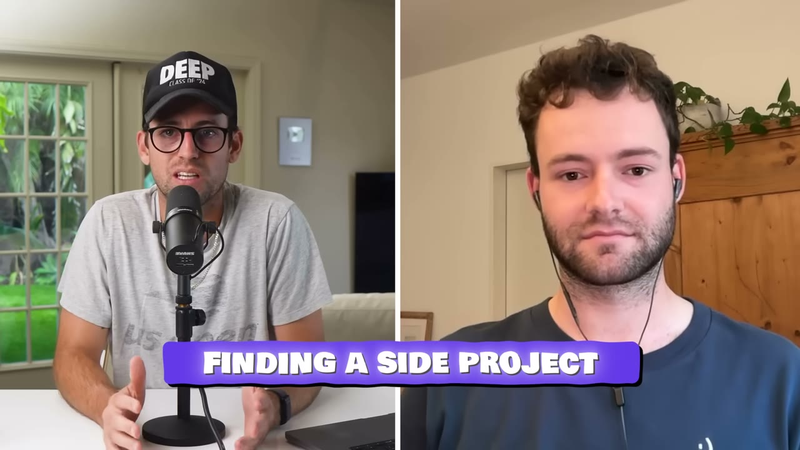
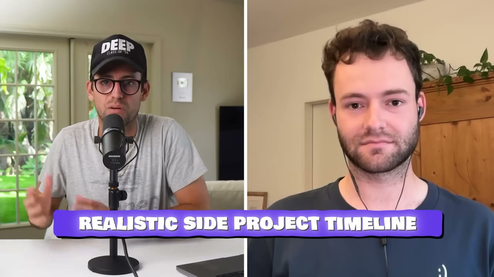

# Wishlists — 6 năm làm ngoài giờ, không marketing, 99% biên

> **Tóm tắt 30 giây:** Chris bị **từ chối** khi xin việc lập trình app cho một hãng xe đạp — nhưng họ khen sự nhiệt tình của anh, và điều đó thành động lực. Anh chọn xây app đầu tiên là **danh sách điều ước** (thay vì to-do list, vì *"đã có 2 triệu app to-do"*), vì chính anh đang dùng Excel để ghi wishlist. Sáu năm sau — **3 năm đại học + 2,5 năm vừa làm full-time** — app có **1,1 triệu người đăng ký** và **$150.000/năm**, và anh nghỉ việc. Anh nói thẳng: *"Ngày nay ai cũng sẽ vibe code nó trong một cuối tuần. Với tôi nó mất 6 năm. Đó là **marathon, không phải một cuối tuần vibe coding**."*

## 1. Con số

| Chỉ số | Giá trị |
|---|---|
| Doanh thu | **$150.000/năm** (~$6K/tháng mùa thấp, **×5 mùa cao**) |
| Người đăng ký | **1,1 triệu** |
| Người dùng hoạt động tháng | 110.000 |
| Khách trả tiền | ~4.000 + người mua hàng qua app |
| **Biên lợi nhuận** | **~99%** — *"tôi gần như không có chi phí ngoài server"* |
| Đội ngũ | **1 người**, không vốn, **không marketing** |

**Hai nguồn doanh thu:**
1. **In-app purchase** — gói premium (ví dụ: ảnh wishlist tuỳ chỉnh)
2. **Affiliate** — *"quan trọng hơn, tôi kiếm tiền qua link affiliate. Nếu tôi thêm một điều ước từ Amazon, tôi có thể tự động import. Khi ai đó mở link này từ trong Wishlists, **tôi được tiền vì tôi đổi nó thành link affiliate của mình**."*

> **Mô hình affiliate này rất đáng chú ý.** Nó biến hành vi tự nhiên của người dùng (chia sẻ danh sách quà → người thân bấm vào mua) thành doanh thu, **không cần thuyết phục ai trả tiền cả**. Với 1,1 triệu người dùng và mùa Giáng sinh, đó là dòng tiền không có chi phí biên.

## 2. Tính mùa vụ — dữ liệu hiếm trong kho ⭐⭐

Doanh thu **mùa cao gấp 5 lần mùa thấp**. Đây là con số ít case nào công bố, và nó có hai hệ quả thực tế:
- **Bạn không thể đọc một tháng và suy ra cả năm.** $6K/tháng vào tháng 9 và $30K/tháng vào tháng 12 là cùng một doanh nghiệp.
- **Dòng tiền phải được quản lý theo năm**, không theo tháng. Nếu bạn nghỉ việc dựa trên tháng cao điểm, bạn sẽ gặp rắc rối vào tháng 2.

Đối chiếu: [Barn 2 Plugins cũng có đỉnh tháng 11 (Black Friday)](../2026-02-08_i-make-150k-month-from-20-tiny-apps/case.md). Nếu bạn chọn ngách gắn với một mùa, hãy biết trước điều này.

## 3. Lịch làm việc thật — 2,5 năm vừa đi làm ⭐⭐⭐

Đây là phần giá trị nhất cho người đang có công việc toàn thời gian:

| Giờ | Việc |
|---|---|
| 8:00 - 9:00 | **Side project — nhưng KHÔNG code.** Trả lời email hỗ trợ, xem analytics |
| 9:00 - 18:00 | Công việc chính |
| 18:00 - 20:00 | Việc cá nhân, thể thao |
| 20:00 - 23:00 (đôi khi muộn hơn) | Side project — phần code |

> *"Cái này hiệu quả đặc biệt tốt **vào những tháng lạnh**, nhưng vào mùa hè tôi không thể tự thúc mình tiếp tục code sau cả ngày code."*

Và một nước đi thông minh:
> *"Đầu năm 2025 tôi **đàm phán để làm 4 ngày một tuần** để có thêm một ngày trọn vẹn cho Wishlists."*

**Bốn bài học anh rút ra về việc làm song song:**

1. **Thành thật với công ty của bạn.** *"Hãy nói thẳng về side project vì nó có lợi cho cả hai. Bạn học được rất nhiều ở chỗ làm... nhưng có side project nghĩa là bạn phải làm mọi thứ, và điều đó cũng cực kỳ có lợi cho công việc của bạn."*
2. **Dùng mọi khoảng thời gian rảnh** — đi xe, đi tàu. **Nhưng phải ưu tiên**: *"Đừng bao giờ quên bạn bè, gia đình, bạn gái. Họ là chìa khoá của mọi thứ."*
3. **Dùng mùa đông cho khôn ngoan.** *"Mùa đông không ai nói 'trời đẹp thế kia sao cậu ngồi trong nhà code'."*
4. **Working holiday** — kết hợp giao tiếp và làm việc. *"Ở gần những người có động lực khác giúp ích rất nhiều, và nó cũng giữ sức khoẻ tinh thần của bạn ở trạng thái tốt."*

> Điểm 4 đáng chú ý vì nó là **liều thuốc cho cùng vấn đề đã hạ gục [Vikash (phẫu thuật cột sống)](../2026-02-11_how-i-built-a-12k-month-micro-saas/case.md) và [Pat Walls (cái lồng)](../2026-02-23_i-sold-my-company/case.md)**. Ba case, cùng một cảnh báo về cái giá cá nhân.

## 4. Thay marketing bằng ĐÁNH GIÁ ⭐⭐⭐

> *"Là developer cũng có nghĩa là tôi **tự nhiên dở marketing**. Nên tôi đơn giản là **không làm marketing theo cách thông thường**. Tôi cũng không có tiền cho nó. Và mục tiêu của tôi cũng không phải kiếm tiền."*

Thay vào đó, anh xây một cỗ máy đánh giá:

**Bước 1 — Xin bạn bè và gia đình đánh giá.**
> *"Ban đầu điều đó rất ngượng, nhưng nó giúp tôi rất nhiều. **Đánh giá cực kỳ quan trọng để một app được xếp hạng cao trên App Store.**"*

**Bước 2 — Hỏi đánh giá ĐÚNG THỜI ĐIỂM.**
> *"Tôi hiện popup đánh giá trong app vào thời điểm phù hợp — **sau khi người dùng vừa hoàn thành được điều gì đó**, ví dụ vừa thêm một điều ước hoặc vừa thực hiện được một điều ước. **Lúc người dùng đang cảm thấy vui.**"*

**Bước 3 — Vòng lặp hỗ trợ → đánh giá.** ⭐⭐⭐
Đây là chiến thuật hay nhất trong case:
> *"Tôi tích hợp một hệ thống hỗ trợ đơn giản từ rất sớm. Tôi lưu lại tất cả email và yêu cầu tính năng của người dùng ngay từ đầu. Và **mỗi lần tôi ship một tính năng hoặc sửa một lỗi cho một người dùng cụ thể, tôi nhắn lại họ**: 'Chào John, tôi vừa sửa vấn đề của bạn' hoặc 'Chào John, tôi vừa làm tính năng bạn yêu cầu — bạn thấy sao? Bạn có thích không?'"*

> *"**Tôi luôn viết câu hỏi trong email hỗ trợ để họ trả lời lại.** Và khi họ trả lời với câu trả lời tích cực — **chỉ khi đó** tôi mới xin họ đánh giá app. Cách đó hiệu quả tới tận hôm nay."*

**Vì sao nó hoạt động:** anh chỉ xin đánh giá từ những người **đã xác nhận bằng lời rằng họ đang hài lòng**. Tỉ lệ đánh giá 5 sao gần như đảm bảo. Đây là cùng nguyên lý với [thư viện 1.500 video hỗ trợ của Vikash](../2026-02-11_how-i-built-a-12k-month-micro-saas/case.md): **hỗ trợ khách hàng không phải chi phí, nó là kênh tăng trưởng**.

## 5. Cách đặt mục tiêu — lý do anh không bỏ cuộc ⭐⭐

> *"**Bắt đầu nhỏ.** Bắt đầu từ một vấn đề thật mà bạn hoặc ai đó gặp phải, vì tôi đảm bảo với bạn: nếu bạn có vấn đề này thì **có ít nhất một người nữa trên trái đất có cùng vấn đề**, và thế là đủ để bắt đầu."*

Và đây là phần quan trọng nhất:
> *"Cực kỳ quan trọng với tôi là **đặt mục tiêu đúng**. **Nếu 6 năm trước tôi đặt mục tiêu là $150K/năm, tôi đã vứt bỏ dự án đó rồi.** Mục tiêu đầu tiên của tôi không phải là triệu đô, mà là **có một người lạ nào đó tải app**."*

> *"Kiếm tiền có thể đến sau. **Người dùng trước, kiếm tiền sau.** Quan trọng nhất là **cứ vui đã**. Nó là side project, nên tệ nhất là nó thất bại — bạn vẫn còn công việc toàn thời gian và ít nhất bạn đã có khoảng thời gian tốt và chắc chắn học được khá nhiều."*

## 6. Dòng thời gian thật — 6 năm ⭐⭐

| Năm | Cột mốc |
|---|---|
| 2019 | Bắt đầu xây (sinh viên) |
| 2020 | Phát hành phiên bản đầu tiên |
| 2021 | **Được nhận việc app developer — chỉ vì đã xây Wishlists** |
| 2023 | Tốt nghiệp tháng 7, có 2 tháng rảnh → ra **Wishlists 2.0**, đạt **100.000 người đăng ký** |
| 2024 | Làm toàn thời gian + side project |
| 2025 (tháng 7) | **Nghỉ việc, toàn thời gian với Wishlists** |

> Chi tiết đáng nhớ: **side project đem lại cho anh công việc**, rồi công việc nuôi anh trong lúc side project lớn lên, rồi side project thay thế công việc. Đây là vòng lặp an toàn nhất trong kho.

## 7. Tech stack

| Hạng mục | Công cụ |
|---|---|
| Cross-platform | **Flutter** |
| IDE | Cursor |
| Backend + analytics | Firebase |
| In-app purchase | RevenueCat |
| Deep link | OneLink |
| Kế toán | Sevdesk |

> *"Tôi nói **99% biên** vì tôi thật sự không có chi phí gì ngoài chi phí server."*

## 8. Lời khuyên cuối

> *"**Đừng phức tạp hoá mọi thứ. Không phải ai cũng phải bay lên sao Hoả.** Bạn không cần xây Facebook tiếp theo. Bạn không cần vốn VC. Tìm một vấn đề bạn tự giải được. Tìm một vấn đề thật mà bạn hoặc ai đó gặp phải, và cứ thử. **Kể cả khi điều đó chỉ có nghĩa là làm một phiên bản đẹp hơn của một app đã tồn tại.**"*

Câu cuối trùng khớp với [Letterly](../2025-11-24_how-he-makes-250k-per-month-from-a-simple-app-letter/case.md): *"tốt hơn là tìm thứ đã đang hoạt động và có thể làm tốt hơn"*. Hai case độc lập, cùng kết luận.

## 9. Áp dụng cho tôi (indie hacker VN)

**Đây là mô hình an toàn nhất trong toàn bộ kho cho người đang đi làm:**

- **Không cần vốn, không cần marketing, không cần tiếng Anh nói.** App wishlist là giao diện đơn giản; hỗ trợ qua email viết. Đây là mô hình có **ít rào cản nhất** với người Việt.
- **99% biên lợi nhuận.** Không có chi phí AI, không có chi phí quảng cáo. Doanh thu gần bằng lợi nhuận — khác hẳn [Letterly đốt $200K/tháng quảng cáo](../2025-11-24_how-he-makes-250k-per-month-from-a-simple-app-letter/case.md).
- **Doanh thu affiliate không cần thuyết phục ai trả tiền** — phù hợp với thị trường mà người dùng ngại trả phí subscription (bao gồm VN).
- **Cách đặt mục tiêu của anh là thứ tôi nên chép lại nguyên văn.** Mục tiêu đầu: một người lạ tải app. Không phải doanh thu. Nếu tôi đặt mục tiêu tiền ngay từ đầu, tôi sẽ bỏ cuộc ở tháng thứ tư — đúng như anh nói.
- **Vòng lặp hỗ trợ → đánh giá** làm được ngay từ người dùng đầu tiên và không tốn gì.

**Rào cản thật:**

- **SÁU NĂM.** Đây là con số phải nhìn thẳng. Anh nói rõ để đối lại với văn hoá "vibe code cuối tuần". Nếu tôi đọc case này và kỳ vọng 6 tháng, tôi đang tự lừa mình.
- **Doanh thu tập trung vào một mùa.** Với ngách quà tặng, tháng 12 quyết định cả năm. Rủi ro cao nếu có sự cố đúng mùa đó.
- **1,1 triệu người đăng ký chỉ tạo ra 4.000 khách trả tiền** (~0,36%). Đây là mô hình cần **quy mô người dùng rất lớn**. Với ngách nhỏ hơn, con số này không đủ.
- **Affiliate Amazon phụ thuộc chính sách Amazon**, vốn đã cắt hoa hồng nhiều lần. Đây là rủi ro nền tảng thật, giống mọi case khác trong kho.
- **Anh ở Đức** — thị trường mà người dùng có thói quen mua hàng online và tỉ lệ chuyển đổi affiliate cao. Với người dùng VN, doanh thu affiliate trên mỗi người dùng sẽ thấp hơn nhiều. **Nhắm thị trường phương Tây nếu muốn con số này.**

**Khi nào KHÔNG dùng mô hình này:** khi bạn cần thu nhập trong 12 tháng. Đây là mô hình **cộng dồn cực chậm nhưng gần như không có rủi ro tài chính**. Nó phù hợp khi bạn có công việc ổn định và muốn xây một tài sản dài hạn — không phù hợp nếu bạn đã nghỉ việc và cần dòng tiền.

## Nguồn

- Video: <https://www.youtube.com/watch?v=w3zxMrwWrt0> (13:33, đăng 24/09/2025, 196.949 view)
- [Transcript đầy đủ](transcript.md) · [Ảnh chụp](screenshots/)
