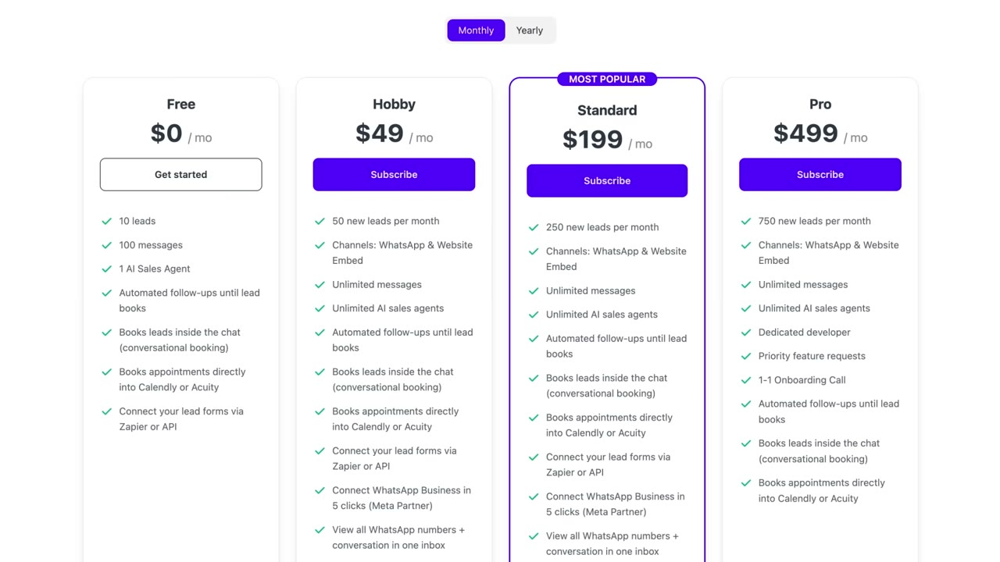
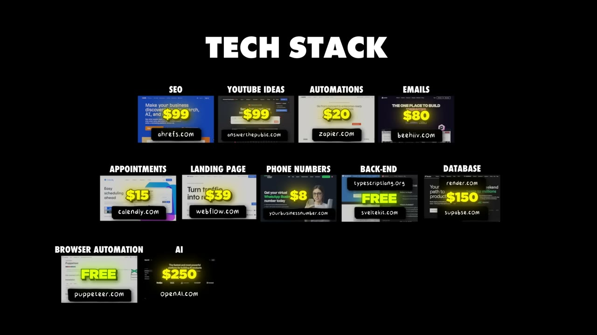

# How We Built a $10K/mo SaaS

✅ **Đã phân tích sâu** → [`case.md`](case.md)

| | |
|---|---|
| **Video** | <https://www.youtube.com/watch?v=3eY71OS4MFw> |
| **Đăng** | 27/09/2025 |
| **Thời lượng** | 13:12 |
| **Lượt xem** | 57,383 |
| **Lượt thích** | 1,557 |
| **Video ID** | `3eY71OS4MFw` |

## Trong thư mục này

| File | Nội dung |
|---|---|
| [`case.md`](case.md) | **Phân tích đầy đủ** — ý tưởng, validate, GTM, áp dụng ở VN |
| [`meta.json`](meta.json) | Metadata gốc (chapters, heatmap, mô tả) |
| [`screenshots/`](screenshots/) | 10 ảnh 720p |

## Mô tả gốc

Josef and Timo met at a coworking space and decided to build an app together. But both were burnt out from spending months building projects that got 0 customers. So this time, they used a different approach, and now their app is at $10K MRR
0:00 - Intro
0:51 - Who are Josef & Timo
1:05 - What is Setter AI
1:38 - How they validated Setter AI
2:28 - Fake landing page that made $500
3:58 - When is an app validated?
4:48 - $10K/month Validation Framework
7:41 - $$$$ opportunities to build NOW
8:37 - SEO growth strategy
9:47 - Numbers behind Setter AI
10:25 - Tech stack
11:26 - Costs & margins
11:

## Số liệu bắt được từ transcript

> Các đoạn founder nhắc tới con số, kèm timestamp để tua thẳng tới đó trong video.

_(không bắt được con số nào)_

## Chương

- `00:00` Intro
- `00:51` Who are Josef & Timo
- `01:05` What is Setter AI
- `01:38` How they validated Setter AI
- `02:28` Fake landing page that made $500
- `03:58` When is an app validated?
- `04:48` 10K/month Validation Framework
- `07:41` opportunities to build NOW
- `08:37` SEO growth strategy
- `09:47` Numbers behind Setter AI
- `10:25` Tech stack
- `11:26` Costs & margins
- `11:49` Charge early on

## Ảnh

1. `01_01m22s_usd-50.jpg` — 
2. `02_02m40s_ch-fake-landing-page-that-made-500.jpg` — 
3. `03_04m12s_usd-500.jpg` — 
4. `04_05m00s_ch-10k-month-validation-framework.jpg` — 
5. `05_06m00s_usd-500.jpg` — 
6. `06_07m53s_ch-opportunities-to-build-now.jpg` — 
7. `07_08m49s_ch-seo-growth-strategy.jpg` — 
8. `08_09m59s_ch-numbers-behind-setter-ai.jpg` — 
9. `09_11m10s_usd-29.jpg` — 
10. `10_12m01s_ch-charge-early-on.jpg` — 

---

← [Quay lại index](../../index.md) · [Toàn bộ video](../README.md)
